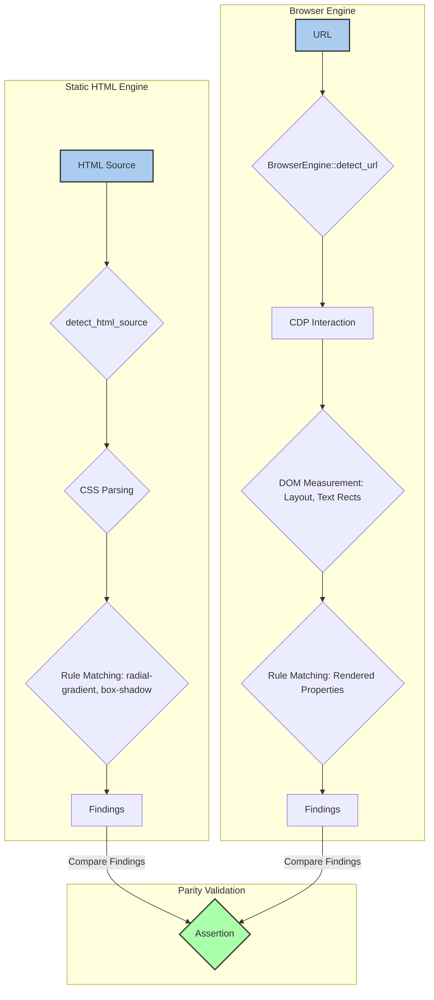

<!-- source: DeepWiki mcp.deepwiki.com · repo pbakaus/impeccable · page 8.2 Detector Fixtures and Parity · fetched 2026-10-30 -->

# Detector Fixtures and Parity

<details>
<summary>Relevant source files</summary>

The following files were used as context for generating this wiki page:

- [crates/browser/tests/line_length_text_count.rs](crates/browser/tests/line_length_text_count.rs)
- [crates/detect/tests/fixtures/broken-image/block-close.svelte](crates/detect/tests/fixtures/broken-image/block-close.svelte)
- [crates/detect/tests/fixtures/broken-image/children-text.tsx](crates/detect/tests/fixtures/broken-image/children-text.tsx)
- [crates/detect/tests/fixtures/broken-image/expressions.astro](crates/detect/tests/fixtures/broken-image/expressions.astro)
- [crates/detect/tests/fixtures/broken-image/unclosed-quote.html](crates/detect/tests/fixtures/broken-image/unclosed-quote.html)
- [crates/html/tests/radial_spotlight.rs](crates/html/tests/radial_spotlight.rs)
- [tests/fixtures/antipatterns/color.html](tests/fixtures/antipatterns/color.html)
- [tests/fixtures/antipatterns/glow.html](tests/fixtures/antipatterns/glow.html)
- [tests/fixtures/antipatterns/legitimate-borders.html](tests/fixtures/antipatterns/legitimate-borders.html)
- [tests/fixtures/antipatterns/line-length-text-count.html](tests/fixtures/antipatterns/line-length-text-count.html)
- [tests/fixtures/antipatterns/linked-stylesheet.html](tests/fixtures/antipatterns/linked-stylesheet.html)
- [tests/fixtures/antipatterns/radial-spotlight-glow.html](tests/fixtures/antipatterns/radial-spotlight-glow.html)
- [tests/fixtures/antipatterns/should-flag.html](tests/fixtures/antipatterns/should-flag.html)
- [tests/fixtures/antipatterns/should-pass.html](tests/fixtures/antipatterns/should-pass.html)
- [tests/fixtures/antipatterns/typography-should-flag.html](tests/fixtures/antipatterns/typography-should-flag.html)
- [tests/fixtures/antipatterns/typography-should-pass.html](tests/fixtures/antipatterns/typography-should-pass.html)
- [tests/oracle/golden/detect-fixture-json-line-length-text-count-html.json](tests/oracle/golden/detect-fixture-json-line-length-text-count-html.json)
- [tests/oracle/golden/detect-fixture-json-radial-spotlight-glow-html.json](tests/oracle/golden/detect-fixture-json-radial-spotlight-glow-html.json)
- [tests/oracle/golden/detect-fixture-text-line-length-text-count-html.json](tests/oracle/golden/detect-fixture-text-line-length-text-count-html.json)

</details>


This page details the testing strategy for the Impeccable detector, focusing on the use of HTML fixtures to validate anti-pattern detection across different engine types: static, browser, and snapshot. It covers the `should-flag` and `should-pass` corpus, specific fixtures for consent/overlay/validity, and the mechanisms ensuring parity between detection engines.

## Anti-Pattern Fixture Corpus

The core of detector testing relies on a corpus of HTML fixtures located in `tests/fixtures/antipatterns/`. These fixtures are meticulously crafted to represent both valid design patterns (`should-pass`) and anti-patterns (`should-flag`) for various design rules.

For example, `tests/fixtures/antipatterns/color.html` [tests/fixtures/antipatterns/color.html:1-295]() contains numerous examples of color combinations, some designed to trigger low-contrast warnings and others to pass accessibility checks. Similarly, `tests/fixtures/antipatterns/typography-should-flag.html` and `tests/fixtures/antipatterns/typography-should-pass.html` [tests/fixtures/antipatterns/typography-should-pass.html:1-45]() demonstrate typography anti-patterns (e.g., flat hierarchy, cramped padding) and their well-designed counterparts.

Each fixture is typically structured with two main columns or sections: one explicitly labeled "Should flag" and another "Should pass" [tests/fixtures/antipatterns/color.html:68-72](). This clear separation allows for straightforward validation of detector behavior.

Sources:
- [tests/fixtures/antipatterns/color.html:1-295]()
- [tests/fixtures/antipatterns/typography-should-pass.html:1-45]()
- [tests/fixtures/antipatterns/typography-should-flag.html]()
- [tests/fixtures/antipatterns/should-flag.html]()
- [tests/fixtures/antipatterns/should-pass.html]()

## Consent, Overlay, and Validity Fixtures

Beyond general anti-patterns, specific fixtures address scenarios involving dynamic content, user interaction, and browser-specific behaviors. These are crucial for testing the browser engine's capabilities, especially in handling elements that might obscure content or affect layout.

For instance, the `radial-spotlight-glow` rule has a dedicated fixture `tests/fixtures/antipatterns/radial-spotlight-glow.html` [tests/fixtures/antipatterns/radial-spotlight-glow.html:1-279](). This fixture includes cases where glows are prominent and should be flagged, and cases where they are faint, scaled down, or serve as bare surfaces, which should pass. It also tests scenarios where the glow is an overlay layer, inheriting the copy of the section it covers [crates/html/tests/radial_spotlight.rs:68-80]().

The browser engine's ability to handle `display: none` or `content-visibility: hidden` elements is also tested. For example, `line-length-text-count.html` [tests/fixtures/antipatterns/line-length-text-count.html:81-82]() includes a paragraph with a `content-visibility: hidden` child, ensuring that its text is not counted towards line length, as it doesn't render.

Sources:
- [tests/fixtures/antipatterns/radial-spotlight-glow.html:1-279]()
- [crates/html/tests/radial_spotlight.rs:1-230]()
- [tests/fixtures/antipatterns/line-length-text-count.html:1-100]()

## Engine Parity: Static, Browser, and Snapshot

Impeccable employs three main detection engines:
1.  **Static HTML Engine**: Analyzes HTML and CSS without rendering, primarily using `impeccable_html::detect_html_source` [crates/html/tests/radial_spotlight.rs:13]().
2.  **Browser Engine**: Utilizes a headless browser (via CDP) to render pages and perform DOM measurements, implemented in `impeccable_browser::BrowserEngine` [crates/browser/tests/line_length_text_count.rs:16]().
3.  **Snapshot Engine**: Captures a DOM snapshot and processes it.

Ensuring parity across these engines is critical for consistent detection results. This means that for a given anti-pattern, all relevant engines should produce similar findings, accounting for their inherent capabilities and limitations.

### Testing Parity with `radial-spotlight-glow`

The `radial-spotlight-glow` rule provides a good example of parity testing. The static HTML engine can detect glows based on CSS properties like `background-image` and `box-shadow` [tests/fixtures/antipatterns/radial-spotlight-glow.html:23-24](). However, it cannot perform layout calculations or determine if text is actually "behind" a glow in the rendered output.

The `crates/html/tests/radial_spotlight.rs` [crates/html/tests/radial_spotlight.rs:1-230]() test suite specifically verifies the static engine's behavior for this rule. It uses `glow_hits` [crates/html/tests/radial_spotlight.rs:20]() to count findings based on CSS and HTML snippets.


**Diagram: Detector Engine Parity Flow**
Sources:
- [crates/html/tests/radial_spotlight.rs:1-230]()
- [tests/fixtures/antipatterns/radial-spotlight-glow.html:1-279]()

### `line-length` and Text Counting Parity

Another critical area for parity is text content measurement, especially for rules like `line-length`. The `line-length` rule aims to count characters that are actually rendered on a line, not just those present in `textContent` [crates/browser/tests/line_length_text_count.rs:1-10]().

The `crates/browser/tests/line_length_text_count.rs` [crates/browser/tests/line_length_text_count.rs:1-120]() test suite specifically addresses this. It uses a local HTTP server (`serve` function [crates/browser/tests/line_length_text_count.rs:25]()) to serve `line-length-text-count.html` [tests/fixtures/antipatterns/line-length-text-count.html:1-100]() to the browser engine. The test then compares findings for "twin" elements that render the same characters but might have different source structures (e.g., inline `<style>` tags, source indentation, hidden children) [crates/browser/tests/line_length_text_count.rs:88-104]().

```mermaid
graph TD
    A[tests/fixtures/antipatterns/line-length-text-count.html] --> B{serve function}
    B -- "HTTP Request" --> C[BrowserEngine::detect_url]
    C -- "CDP Interaction" --> D[Browser Rendering]
    D -- "DOM Measurement" --> E{Line Length Calculation}
    E --> F[Findings for "line-length"]
    F -- "Group by Snippet" --> G{HashMap<snippet, count>}
    G -- "Assert Group Sizes" --> H[line_length_counts_the_characters_on_the_lines test]

    style A fill:#ace,stroke:#333,stroke-width:2px
    style H fill:#afa,stroke:#333,stroke-width:2px
```
**Diagram: Line Length Parity Test Flow**
Sources:
- [crates/browser/tests/line_length_text_count.rs:1-120]()
- [tests/fixtures/antipatterns/line-length-text-count.html:1-100]()

### Handling Edge Cases in HTML Parsing

The detector also includes fixtures for HTML parsing edge cases that might affect static analysis. For example, `crates/detect/tests/fixtures/broken-image/unclosed-quote.html` [crates/detect/tests/fixtures/broken-image/unclosed-quote.html:1-3]() tests how the parser handles malformed HTML, while `crates/detect/tests/fixtures/broken-image/children-text.tsx` [crates/detect/tests/fixtures/broken-image/children-text.tsx:1-16]() and `crates/detect/tests/fixtures/broken-image/expressions.astro` [crates/detect/tests/fixtures/broken-image/expressions.astro:1-5]() test parsing within templating languages like JSX/TSX and Astro. These ensure that the static engine can robustly extract information even from non-standard or broken HTML structures.

Sources:
- [crates/detect/tests/fixtures/broken-image/unclosed-quote.html:1-3]()
- [crates/detect/tests/fixtures/broken-image/children-text.tsx:1-16]()
- [crates/detect/tests/fixtures/broken-image/expressions.astro:1-5]()
- [crates/detect/tests/fixtures/broken-image/block-close.svelte:1-2]()

---

