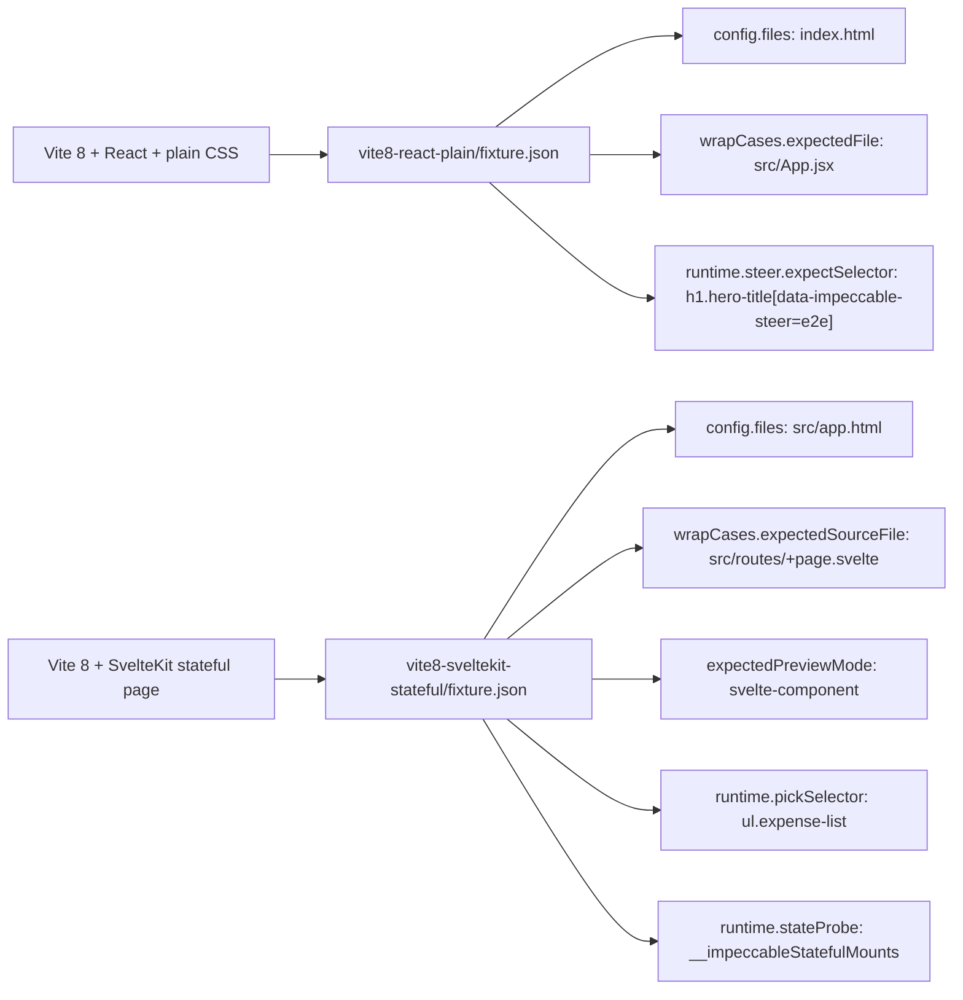
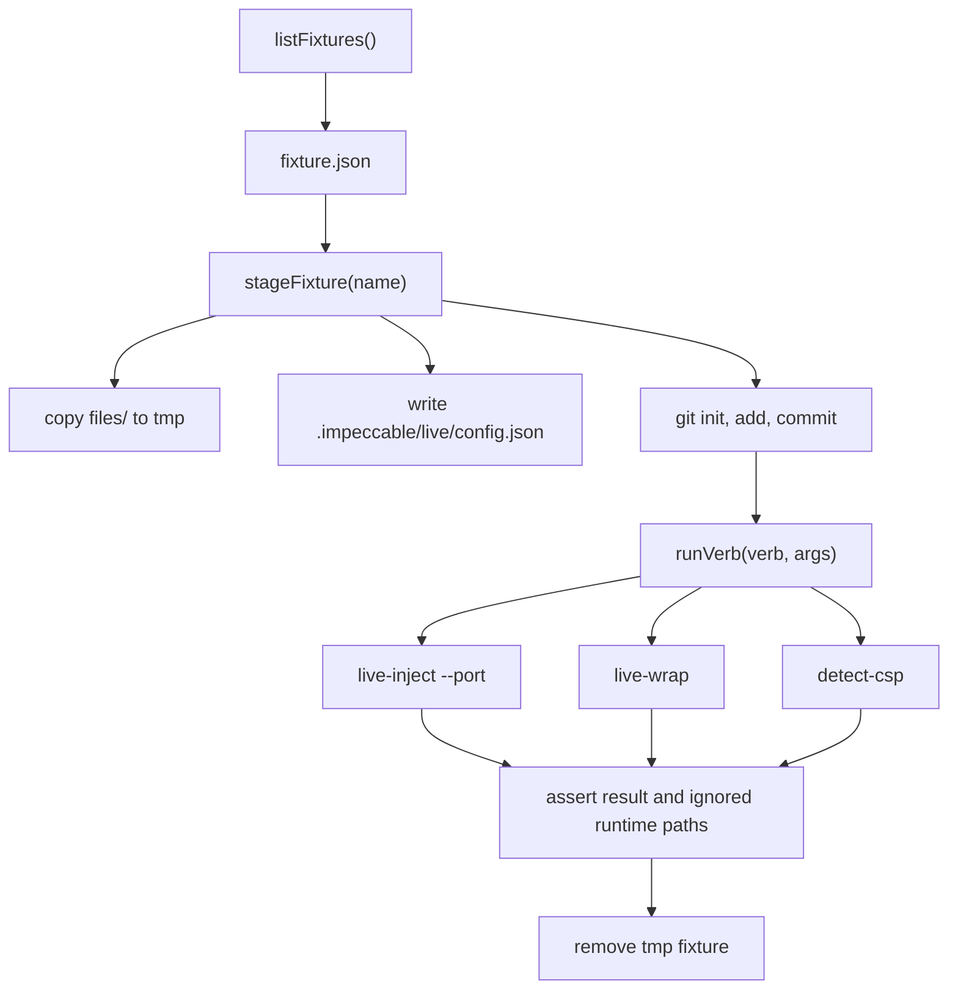
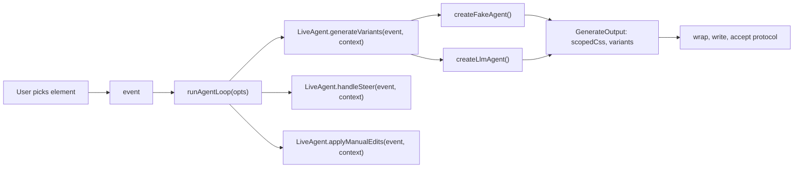

<!-- source: DeepWiki mcp.deepwiki.com · repo pbakaus/impeccable · page 8.3 Framework Fixtures and Live E2E · fetched 2026-10-30 -->

# Framework Fixtures and Live E2E

Relevant source files

The following files were used as context for generating this wiki page:

- [tests/framework-fixtures.test.mjs](tests/framework-fixtures.test.mjs)
- [tests/framework-fixtures/README.md](tests/framework-fixtures/README.md)
- [tests/framework-fixtures/astro-vite7/files/package.json](tests/framework-fixtures/astro-vite7/files/package.json)
- [tests/framework-fixtures/nextjs-proxy-csp/files/app/layout.tsx](tests/framework-fixtures/nextjs-proxy-csp/files/app/layout.tsx)
- [tests/framework-fixtures/nextjs-proxy-csp/files/proxy.ts](tests/framework-fixtures/nextjs-proxy-csp/files/proxy.ts)
- [tests/framework-fixtures/nextjs-proxy-csp/fixture.json](tests/framework-fixtures/nextjs-proxy-csp/fixture.json)
- [tests/framework-fixtures/nextjs-proxy-csp/gitignore.txt](tests/framework-fixtures/nextjs-proxy-csp/gitignore.txt)
- [tests/framework-fixtures/vite8-react-plain/fixture.json](tests/framework-fixtures/vite8-react-plain/fixture.json)
- [tests/framework-fixtures/vite8-sveltekit-stateful/files/src/routes/+page.svelte](tests/framework-fixtures/vite8-sveltekit-stateful/files/src/routes/+page.svelte)
- [tests/framework-fixtures/vite8-sveltekit-stateful/fixture.json](tests/framework-fixtures/vite8-sveltekit-stateful/fixture.json)
- [tests/live-e2e-agent-output.test.mjs](tests/live-e2e-agent-output.test.mjs)
- [tests/live-e2e-cli-options.test.mjs](tests/live-e2e-cli-options.test.mjs)
- [tests/live-e2e-llm-agent.test.mjs](tests/live-e2e-llm-agent.test.mjs)
- [tests/live-e2e.test.mjs](tests/live-e2e.test.mjs)
- [tests/live-e2e/agent.mjs](tests/live-e2e/agent.mjs)
- [tests/live-e2e/agents/llm-agent.mjs](tests/live-e2e/agents/llm-agent.mjs)
- [tests/live-e2e/cli-options.mjs](tests/live-e2e/cli-options.mjs)
- [tests/live-e2e/preactions.mjs](tests/live-e2e/preactions.mjs)
- [tests/live-e2e/session.mjs](tests/live-e2e/session.mjs)
- [tests/live-e2e/ui.mjs](tests/live-e2e/ui.mjs)
- [tests/oracle/golden/live-accept-astro-discard.json](tests/oracle/golden/live-accept-astro-discard.json)
- [tests/oracle/golden/live-accept-astro-variant-2-steps.json](tests/oracle/golden/live-accept-astro-variant-2-steps.json)
- [tests/oracle/live-helpers.mjs](tests/oracle/live-helpers.mjs)

## Purpose and scope

This page documents the framework-fixture sweeps and live-mode end-to-end harness: how fixture projects describe framework-specific source layouts and expected outcomes, how the static sweep exercises engine verbs, and how runtime fixtures connect a dev server, browser UI, and agent loop. The fixture system supports static checks for every registered fixture and an optional runtime pass for fixtures that declare `runtime`.[tests/framework-fixtures/README.md:1-5]() [tests/framework-fixtures/README.md:100-110]()

Sources: [tests/framework-fixtures/README.md:1-5]() [tests/framework-fixtures/README.md:100-110]()

## Fixture model and coverage

A framework fixture is a small project tree with `files/`, `gitignore.txt`, and `fixture.json`. The JSON supplies the live-injection `config`, source and generated file classifications, wrap cases, CSP expectations, and—optionally—runtime test settings.[tests/framework-fixtures/README.md:7-16]() [tests/framework-fixtures/README.md:18-46]()

The fixture catalog is data-driven: the static test discovers fixture directories containing `fixture.json`, stages each project into a temporary Git repository, and runs engine verbs against it. The documented static sweep covers `live-inject`, `live-wrap`, and `detect-csp`; the README also describes `live-accept` as a verb exercised against fixtures.[tests/framework-fixtures.test.mjs:30-35]() [tests/framework-fixtures.test.mjs:41-50]() [tests/framework-fixtures.test.mjs:68-87]() [tests/framework-fixtures/README.md:1-5]()

| Fixture field | Role |
|---|---|
| `config` | Supplies live-injection configuration; the harness writes it to `.impeccable/live/config.json` in the staged project.[tests/framework-fixtures/README.md:16-22]() [tests/framework-fixtures.test.mjs:46-50]() |
| `sourceFiles`, `generatedFiles` | Declare paths expected to be classified as source or generated.[tests/framework-fixtures/README.md:20-24]() |
| `wrapCases` | Describe wrap inputs and expected output files; cases can also specify an expected error.[tests/framework-fixtures/README.md:25-30]() |
| `csp` | Describes the CSP shape, diagnostic signals, patch target, and a reference post-patch file.[tests/framework-fixtures/README.md:31-36]() |
| `runtime` | Opts a fixture into dependency installation, dev-server startup, and browser-driven E2E checks.[tests/framework-fixtures/README.md:37-46]() [tests/framework-fixtures/README.md:100-110]() |

The documented CSP shapes include `shared-helper`, `inline-headers`, `middleware`, `meta-tag`, and `null`. The legacy `middleware` label includes the Next.js `proxy.*` convention as well as `middleware.*` files.[tests/framework-fixtures/README.md:31-36]() [tests/framework-fixtures/README.md:97-98]()

Sources: [tests/framework-fixtures/README.md:7-46]() [tests/framework-fixtures/README.md:97-110]() [tests/framework-fixtures.test.mjs:30-50]()

### Framework and project-shape matrix

Fixtures encode framework conventions through project files, injection configuration, and wrap expectations rather than through a single universal app layout.[tests/framework-fixtures/README.md:7-16]() [tests/framework-fixtures/README.md:25-30]() The supplied examples include a Vite 8 + React fixture whose injection entry is `index.html` and whose hero-title wrap should land in `src/App.jsx`.[tests/framework-fixtures/vite8-react-plain/fixture.json:1-27]() A Vite 8 + SvelteKit fixture instead injects through `src/app.html`; its wrap cases expect Svelte component previews targeting `src/routes/+page.svelte`.[tests/framework-fixtures/vite8-sveltekit-stateful/fixture.json:1-39]()

| Project shape or behavior | Fixture-level representation |
|---|---|
| Vite + React + plain CSS | `index.html` injection; `src/App.jsx` source wrap target; runtime starts Vite.[tests/framework-fixtures/vite8-react-plain/fixture.json:1-27]() [tests/framework-fixtures/vite8-react-plain/fixture.json:28-47]() |
| Vite + SvelteKit stateful page | `src/app.html` injection; Svelte component-preview wrap cases for the page and an each-block list.[tests/framework-fixtures/vite8-sveltekit-stateful/fixture.json:1-39]() |
| CSP variants | `csp.shape` and related fields capture detection signals and expected patch references; the `middleware` shape also accommodates Next.js `proxy.*`.[tests/framework-fixtures/README.md:31-36]() [tests/framework-fixtures/README.md:97-100]() |
| Nested application / monorepo-style app root | `runtime.appDir` separates the app directory from the temporary repository root; installation, dev-server startup, and app-relative paths use the app directory.[tests/framework-fixtures/README.md:112-121]() |
| Astro runtime example | The supplied Astro package manifest defines `astro dev --host 127.0.0.1` as its dev command.[tests/framework-fixtures/astro-vite7/files/package.json:1-13]() |

Sources: [tests/framework-fixtures/README.md:31-46]() [tests/framework-fixtures/README.md:97-121]() [tests/framework-fixtures/vite8-react-plain/fixture.json:1-47]() [tests/framework-fixtures/vite8-sveltekit-stateful/fixture.json:1-39]() [tests/framework-fixtures/astro-vite7/files/package.json:1-13]()

### Natural language to code entities: fixture definitions

The fixture names and human-readable descriptions in `fixture.json` connect framework-level concepts to the concrete paths and selectors that the harness uses. For example, “SvelteKit stateful page” maps to `src/app.html`, `src/routes/+page.svelte`, `ul.expense-list`, and the `stateProbe` configuration.[tests/framework-fixtures/vite8-sveltekit-stateful/fixture.json:1-16]() [tests/framework-fixtures/vite8-sveltekit-stateful/fixture.json:41-41]() [tests/framework-fixtures/vite8-sveltekit-stateful/fixture.json:66-80]() [tests/framework-fixtures/vite8-sveltekit-stateful/fixture.json:109-115]()

**Diagram: framework fixture concepts mapped to fixture entities**

Sources: [tests/framework-fixtures/vite8-react-plain/fixture.json:1-53]() [tests/framework-fixtures/vite8-sveltekit-stateful/fixture.json:1-16]() [tests/framework-fixtures/vite8-sveltekit-stateful/fixture.json:41-80]() [tests/framework-fixtures/README.md:31-46]()

The documented fixture schema also expresses general runtime needs such as `appDir`, `install`, `devCommand`, `readyPattern`, `pickSelector`, and `variantSequence`. These fields let a fixture describe a framework project without hard-coding its startup command or source structure into the test runner.[tests/framework-fixtures/README.md:37-50]()

Sources: [tests/framework-fixtures/README.md:37-50]()

## Static framework-fixture sweep

`tests/framework-fixtures.test.mjs` enumerates directories under `tests/framework-fixtures` that contain `fixture.json`. For each fixture, `stageFixture` copies its `files/` tree into a new temporary directory, installs the fixture’s Git ignore rules and live config, and initializes and commits a Git repository.[tests/framework-fixtures.test.mjs:25-35]() [tests/framework-fixtures.test.mjs:37-75]()

The engine executable is resolved through `findEngineBinary()`. Tests are marked skipped when no engine binary is available; when present, `runVerb` invokes the binary with the verb arguments and fixture directory as its working directory.[tests/framework-fixtures.test.mjs:23-28]() [tests/framework-fixtures.test.mjs:77-95]()

The `live-inject --port` test checks that injection succeeds and that runtime artifacts are ignored. For SvelteKit, it additionally checks that the adapter marker and `ImpeccableLiveRoot` appear in `src/routes/+layout.svelte` while `src/app.html` remains untouched.[tests/framework-fixtures.test.mjs:107-143]()

**Diagram: static fixture staging and engine-verb flow**

Sources: [tests/framework-fixtures.test.mjs:23-50]() [tests/framework-fixtures.test.mjs:68-95]() [tests/framework-fixtures.test.mjs:107-143]() [tests/framework-fixtures/README.md:1-5]()

Sources: [tests/framework-fixtures.test.mjs:30-50]() [tests/framework-fixtures.test.mjs:68-87]() [tests/framework-fixtures.test.mjs:93-105]() [tests/framework-fixtures.test.mjs:107-143]()

### Staging details and Svelte support

The static runner optionally makes the repository’s installed Svelte package available in the staged project. It symlinks `node_modules/svelte` when possible and falls back to copying when symlinks are unavailable, including on Windows without Developer Mode.[tests/framework-fixtures.test.mjs:52-66]()

The runtime fixture path has its own staging and installation implementation in `tests/live-e2e/session.mjs`. Its `stageFixture` creates a temporary repo, copies the fixture tree, writes `.gitignore` and `.impeccable/live/config.json`, and commits the files.[tests/live-e2e/session.mjs:88-109]() This is separate from the static test’s staging helper, though both establish a temporary Git-backed project.[tests/framework-fixtures.test.mjs:37-75]() [tests/live-e2e/session.mjs:88-109]()

Sources: [tests/framework-fixtures.test.mjs:37-75]() [tests/framework-fixtures.test.mjs:52-66]() [tests/live-e2e/session.mjs:88-109]()

## Runtime E2E harness

A fixture opts into runtime E2E by defining `runtime` in `fixture.json`. The runner discovers only fixtures with that block, then supports fixture filtering via `IMPECCABLE_E2E_ONLY`; an unknown requested fixture name raises an error rather than silently reducing coverage.[tests/live-e2e.test.mjs:78-105]() The README describes the runtime sequence: stage the project, install dependencies, start live mode and the framework dev server, open Playwright Chromium, verify the browser handshake, exercise Steer and the pick/variant/accept flow, then tear down.[tests/framework-fixtures/README.md:100-110]()

The session helper resolves the engine binary using `findEngineBinary()`, exposes `runEngineSync()` for engine verbs, and arms a live-server reaper for detached server processes.[tests/live-e2e/session.mjs:29-46]() [tests/live-e2e/session.mjs:48-65]() Fixture installation applies npm defaults for optional dependencies and includes a Darwin arm64 Rollup repair path.[tests/live-e2e/session.mjs:111-147]()

The test suite refuses to run when runtime fixtures exist but `ENGINE_BIN` is unavailable, so missing engine coverage is surfaced as an error rather than silently treated as a passing run.[tests/live-e2e.test.mjs:175-180]()

**Diagram: runtime E2E data flow**

Sources: [tests/framework-fixtures/README.md:100-110]() [tests/live-e2e.test.mjs:78-105]() [tests/live-e2e/session.mjs:29-65]() [tests/live-e2e/session.mjs:88-123]()

```mermaid
flowchart LR
  Runtime["fixture.json runtime block"] --> Discover["listRuntimeFixtures()"]
  Discover --> Filter["IMPECCABLE_E2E_ONLY"]
  Filter --> Stage["stageFixture()"]
  Stage --> Install["runtime.install"]
  Install --> LiveServer["impeccable live-server --background"]
  LiveServer --> Inject["impeccable live-inject --port"]
  Inject --> DevServer["runtime.devCommand"]
  DevServer --> Chromium["Playwright Chromium"]
  Chromium --> Handshake["waitForHandshake()"]
  Handshake --> Agent["fake agent or LLM agent"]
  Agent --> UserFlow["Steer, pick, Go, cycle, accept"]
  UserFlow --> Assertions["source and rendered-DOM assertions"]
  Assertions --> Teardown["teardown()"]
```

Sources: [tests/framework-fixtures/README.md:100-110]() [tests/live-e2e.test.mjs:78-105]() [tests/live-e2e/session.mjs:88-123]()

### App roots and nested project layouts

`runtime.appDir` supports a served application that is nested under the repository root. `appDirFor()` returns a non-empty app directory other than `.`; `appRootFor()` resolves it under the temporary repository. The session documentation says that installation, dev-server startup, live config, and fixture-relative source paths then belong to the app directory, while Git remains rooted at the repository directory.[tests/live-e2e/session.mjs:68-86]() [tests/framework-fixtures/README.md:112-121]()

For fixtures with `appDir`, the README specifies a different boot route: invoke `impeccable live` from the temporary repository root instead of separately invoking `live-server` and `live-inject`. The session exposes both `session.tmp` and `session.appRoot`; the README further describes assertions on `roots.appRoot`, `roots.contextRoot`, `roots.json`, and the repo-root pointer.[tests/framework-fixtures/README.md:112-121]()

Sources: [tests/live-e2e/session.mjs:68-86]() [tests/framework-fixtures/README.md:112-121]()

### Browser handshake, console, and framework startup

`waitForHandshake()` waits for `window.__IMPECCABLE_LIVE_INIT__`, installs query helpers, and waits for the global live bar to be queryable. Its comments identify the handshake as involving initialization, bar mounting, and the SSE connection’s transition to picking mode.[tests/live-e2e/ui.mjs:44-68]()

The E2E runner distinguishes benign console noise from failures. React DevTools and StrictMode messages are allowlisted, as are resource 404 messages only when they refer to a favicon. A message matching the live-tree URL pattern is never considered benign.[tests/live-e2e.test.mjs:148-173]()

Sources: [tests/live-e2e/ui.mjs:44-68]() [tests/live-e2e.test.mjs:148-173]()

## Agent protocol and deterministic testing

The live E2E agent module separates the protocol driver from variant-content generation. `runAgentLoop(opts)` is described as the shared deterministic poll/wrap/write/accept wrapper; fake and LLM agents provide the content-production methods through the same `LiveAgent` interface.[tests/live-e2e/agent.mjs:1-20]() The interface includes `generateVariants(event, context)` and optional `handleSteer(event, context)` and `applyManualEdits(event, context)` methods.[tests/live-e2e/agent.mjs:69-76]()

`createFakeAgent()` produces deterministic variants and supports insert mode and Svelte component-preview handling. Its output contract includes `scopedCss`, a variant list, and optional parameter manifests; the documented fake variants are intended to make style changes observable through computed-style assertions.[tests/live-e2e/agent.mjs:79-120]() [tests/live-e2e/agent.mjs:131-156]() The README describes the runtime suite’s fake-agent flow as a Steer smoke followed by pick, Go, cycle, and accept.[tests/framework-fixtures/README.md:107-110]()

The LLM agent implements the same interface and supplies `generateVariants`, `applyManualEdits`, and `handleSteer`; its module documents provider selection and states that it returns `null` when the selected provider’s API key is absent.[tests/live-e2e/agents/llm-agent.mjs:1-26]() Provider configuration, parsing, validation, and replay behavior also have a dedicated test file.[tests/live-e2e-llm-agent.test.mjs:1-21]() [tests/live-e2e-llm-agent.test.mjs:23-34]()

**Diagram: natural-language agent roles mapped to protocol entities**

Sources: [tests/live-e2e/agent.mjs:1-20]() [tests/live-e2e/agent.mjs:69-76]() [tests/live-e2e/agent.mjs:93-120]() [tests/live-e2e/agents/llm-agent.mjs:1-26]()

Sources: [tests/live-e2e/agent.mjs:1-20]() [tests/live-e2e/agent.mjs:69-76]() [tests/live-e2e/agent.mjs:93-120]() [tests/live-e2e/agents/llm-agent.mjs:1-26]()

## UI automation and runtime assertions

`tests/live-e2e/ui.mjs` uses stable `impeccable-live-*` selectors for the live bar, picker, docks, and controls. It also uses visible button text, glyphs, or an accessible label for controls whose selectors are not the primary stable handle.[tests/live-e2e/ui.mjs:5-42]() Query helpers search the live UI root when available and fall back to the document, allowing tests to interact with UI rendered in either location.[tests/live-e2e/ui.mjs:130-154]()

The UI helper exports cover handshake, bottom-bar checks, element picking, variant cycling, acceptance, manual edit actions, annotations, and other user-visible controls; the main test imports these helpers to drive scenarios.[tests/live-e2e.test.mjs:37-74]() [tests/live-e2e/ui.mjs:44-68]() The fixture schema allows runtime assertions to be expressed as selectors, expected source content, expected DOM content, and computed-state probes.[tests/framework-fixtures/README.md:47-58]()

For example, the SvelteKit stateful fixture creates three expense rows through configured pre-actions, checks the open-count text, and probes `window.__impeccableStatefulMounts` for a single mount that remains unchanged. It also specifies source-preservation and mounted-DOM probes for the accepted variant.[tests/framework-fixtures/vite8-sveltekit-stateful/fixture.json:83-115]() [tests/framework-fixtures/vite8-sveltekit-stateful/fixture.json:138-148]()

Sources: [tests/live-e2e.test.mjs:37-74]() [tests/live-e2e/ui.mjs:5-42]() [tests/live-e2e/ui.mjs:44-68]() [tests/live-e2e/ui.mjs:130-154]() [tests/framework-fixtures/README.md:47-58]() [tests/framework-fixtures/vite8-sveltekit-stateful/fixture.json:83-115]() [tests/framework-fixtures/vite8-sveltekit-stateful/fixture.json:138-148]()

## CLI options and scenario selection

The main E2E runner supports fixture selection with `IMPECCABLE_E2E_ONLY`, scenario selection with `IMPECCABLE_E2E_SCENARIOS`, a manual-only mode, variant reload control, a test timeout, and an atomic-delay setting for reproducing a scaffold/write race.[tests/live-e2e.test.mjs:96-117]() Fixture and scenario filters accept comma- or whitespace-separated names; scenario execution is unrestricted when no scenario filter is set or when `all` is selected.[tests/live-e2e.test.mjs:128-146]()

The supplied files identify a separate `tests/live-e2e-cli-options.test.mjs` suite and `tests/live-e2e/cli-options.mjs` helper, but their contents are not included here; details of their specific option cases are therefore not enumerated.[tests/live-e2e.test.mjs:19-20]()

| Option | Effect described in the runner |
|---|---|
| `IMPECCABLE_E2E_ONLY` | Restricts the run to named runtime fixtures; unknown names cause an error.[tests/live-e2e.test.mjs:96-105]() |
| `IMPECCABLE_E2E_SCENARIOS` | Restricts scenario execution; an empty filter or `all` allows all scenarios.[tests/live-e2e.test.mjs:111-112]() [tests/live-e2e.test.mjs:144-146]() |
| `IMPECCABLE_E2E_MANUAL_ONLY` | Enables manual-only mode for `1` or `true`.[tests/live-e2e.test.mjs:107-108]() |
| `IMPECCABLE_E2E_RELOAD_VARIANTS` | Enables variant reload behavior for `1` or `true`.[tests/live-e2e.test.mjs:109-110]() |
| `IMPECCABLE_E2E_TEST_TIMEOUT_MS` | Supplies a positive test timeout value.[tests/live-e2e.test.mjs:112-113]() [tests/live-e2e.test.mjs:137-142]() |
| `IMPECCABLE_E2E_ATOMIC_DELAY_MS` | Adds a delay used to widen the preflight-scaffold-to-variant-write window.[tests/live-e2e.test.mjs:114-117]() |

Sources: [tests/live-e2e.test.mjs:96-117]() [tests/live-e2e.test.mjs:128-146]()

## Working with and extending fixtures

To add or adjust coverage, define the framework project under a fixture’s `files/` directory, provide `gitignore.txt`, and specify the framework-specific configuration and expected behavior in `fixture.json`.[tests/framework-fixtures/README.md:7-16]() Use `sourceFiles`, `generatedFiles`, `wrapCases`, and `csp` for static fixture expectations; add `runtime` only when the fixture should participate in dependency installation and browser E2E.[tests/framework-fixtures/README.md:18-46]() [tests/framework-fixtures/README.md:100-110]()

For runtime cases, align `readyPattern` with the dev server’s output and ensure its first capture group is the port. Specify the target element with `pickSelector`; when a container’s center is obscured by a child, configure `pickPosition` to aim at a point owned by the container.[tests/framework-fixtures/README.md:43-50]() [tests/framework-fixtures/README.md:123-128]() `variantSequence` determines cycling order, and its final entry is the accepted variant.[tests/framework-fixtures/README.md:130-133]()

For nested applications, set `runtime.appDir` and keep clear which paths belong to the application and which operations belong to the repository root.[tests/framework-fixtures/README.md:112-121]() When changing UI text or selectors in the live bar, keep `tests/live-e2e/ui.mjs` synchronized with `skill/scripts/live-browser.js`, as the UI helper documents.[tests/live-e2e/ui.mjs:5-12]()

Sources: [tests/framework-fixtures/README.md:7-50]() [tests/framework-fixtures/README.md:100-110]() [tests/framework-fixtures/README.md:112-133]() [tests/live-e2e/ui.mjs:5-12]()

---

