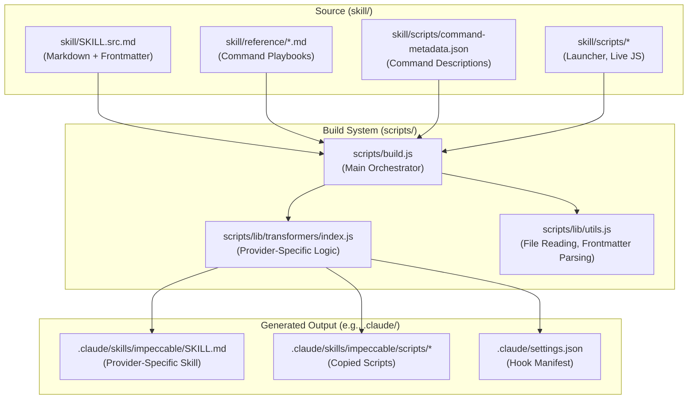
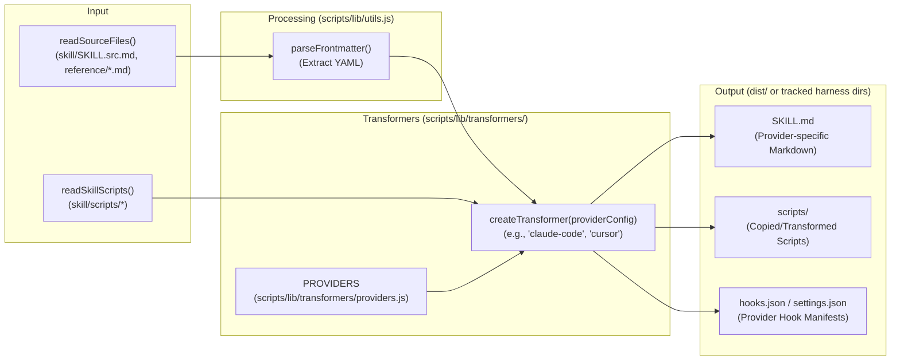
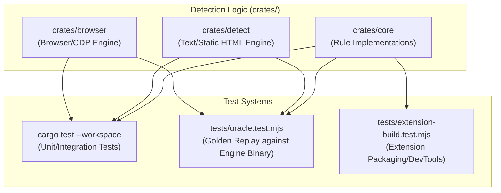

<!-- source: DeepWiki mcp.deepwiki.com · repo pbakaus/impeccable · page 9 Development Guide · fetched 2026-10-30 -->

# Development Guide

<details>
<summary>Relevant source files</summary>

The following files were used as context for generating this wiki page:

- [.github/CODEOWNERS](.github/CODEOWNERS)
- [.github/ISSUE_TEMPLATE/bug_report.md](.github/ISSUE_TEMPLATE/bug_report.md)
- [.github/ISSUE_TEMPLATE/feature_request.md](.github/ISSUE_TEMPLATE/feature_request.md)
- [.github/PULL_REQUEST_TEMPLATE.md](.github/PULL_REQUEST_TEMPLATE.md)
- [.github/workflows/ci.yml](.github/workflows/ci.yml)
- [.github/workflows/sync-generated-output.yml](.github/workflows/sync-generated-output.yml)
- [.gitignore](.gitignore)
- [AGENTS.md](AGENTS.md)
- [CLAUDE.md](CLAUDE.md)
- [README.md](README.md)
- [README.npm.md](README.npm.md)
- [crates/context/src/pin.rs](crates/context/src/pin.rs)
- [crates/skills/src/providers.rs](crates/skills/src/providers.rs)
- [docs/DEVELOP.md](docs/DEVELOP.md)
- [docs/HARNESSES.md](docs/HARNESSES.md)
- [scripts/build.js](scripts/build.js)
- [scripts/lib/transformers/index.js](scripts/lib/transformers/index.js)
- [scripts/lib/transformers/providers.js](scripts/lib/transformers/providers.js)
- [scripts/lib/utils.js](scripts/lib/utils.js)
- [scripts/test-suites.mjs](scripts/test-suites.mjs)
- [tests/lib/transformers/providers.test.js](tests/lib/transformers/providers.test.js)

</details>


This guide covers the development workflow for contributors who want to modify, extend, or test Impeccable locally. It explains prerequisites, repository structure, the development cycle, and testing approaches.

For detailed instructions on specific tasks:
- [Development Workflow](#9.1) — Covers environment setup, the source-first workflow, rules for generated output, and automation contracts.
- [Adding Rules, Commands, and Providers](#9.2) — Provides step-by-step guidance for extending the detector, skill commands, and provider support.
- [Runtime Environment and Operational Docs](#9.3) — Summarizes key operational documentation and environment variables.

---

## Prerequisites

Impeccable requires **Bun** as its primary runtime, package manager, and test runner. The project minimizes external dependencies to maintain a fast, portable build system.

| Dependency | Purpose | Required For |
|------------|---------|--------------|
| **Bun** | Runtime, Package Manager, Test Runner | All development tasks [AGENTS.md:13]() |
| **Rust Toolchain** | Engine compilation | Building the `impeccable` binary [CLAUDE.md:19-20]() |
| **Playwright** | Headless browser automation | E2E tests and Live Mode verification [AGENTS.md:19]() |
| **Puppeteer** | Headless browser automation | Detector tests [README.npm.md:89-90]() |

Sources: [AGENTS.md:13-20](), [CLAUDE.md:19-20](), [README.npm.md:89-90]()

---

## Repository Structure Overview

The repository follows a strict "Source of Truth" architecture where skills are authored in `skill/`. The `dist/` and `build/` directories are ephemeral build artifacts, while root harness folders like `.claude/` are generated but tracked.

```
impeccable/
├── skill/                     # Source of truth for the Impeccable skill [AGENTS.md:5]()
│   ├── SKILL.src.md           # Master template for the impeccable skill [CLAUDE.md:7]()
│   ├── reference/             # Command-specific reference files (.md) [CLAUDE.md:8]()
│   ├── scripts/               # Launcher, engine version, live-mode JS [CLAUDE.md:10-11]()
│   └── agents/                # Sub-agents (e.g., for Codex) [AGENTS.md:5]()
├── crates/                    # Rust workspace for the engine binary [CLAUDE.md:19]()
│   ├── cli/                   # CLI command dispatch [CLAUDE.md:16]()
│   ├── core/                  # Core detection rules [CLAUDE.md:20]()
│   └── ...                    # Other engine components (detect, html, browser, live)
├── scripts/                   # Build system and automation [AGENTS.md:5]()
│   ├── build.js               # Main orchestrator for skill transformation [scripts/build.js:1-16]()
│   └── lib/                   # Transformers, zip logic, and utilities [scripts/build.js:23-25]()
├── cli/                       # npm shim for the engine binary [AGENTS.md:5]()
├── extension/                 # Chrome DevTools extension source [AGENTS.md:5]()
├── tests/                     # Multi-layer test suite (fixtures, E2E, oracle) [AGENTS.md:5]()
├── .claude/                   # Generated Claude Code skill output (tracked) [AGENTS.md:27]()
├── .cursor/                   # Generated Cursor skill output (tracked) [AGENTS.md:27]()
└── plugin/                    # Generated plugin output (tracked) [AGENTS.md:27]()
```

Sources: [AGENTS.md:5](), [CLAUDE.md:5-21](), [scripts/build.js:1-25]()

---

## Development Cycle

The core development cycle involves modifying source files, running the build process, and testing the generated output. The project emphasizes a "source-first" workflow.

### System Flow: Source to Code Entity

This diagram bridges the gap between natural language authoring in Markdown and the resulting code entities in the build system.



Sources: [CLAUDE.md:5-11](), [scripts/build.js:1-25](), [scripts/lib/transformers/index.js](), [scripts/lib/utils.js:124-128]()

---

## Build System Architecture

The build system transforms universal source files into specific formats for over 20 different AI providers (Harnesses).

### Transformation Pipeline



**Key Transformation Functions**:
- `readSourceFiles()`: Aggregates `skill/SKILL.src.md` and its associated reference documents [scripts/build.js:21]().
- `parseFrontmatter(content)`: Extracts YAML metadata from source files [scripts/lib/utils.js:128-133]().
- `createTransformer(providerConfig)`: Generates a transformer function based on provider-specific rules defined in `scripts/lib/transformers/providers.js` [scripts/build.js:23](), [scripts/lib/transformers/providers.js:12-181]().
- `PROVIDERS`: A map defining configurations for each AI harness, including `providerTags`, `configDir`, `frontmatterFields`, and `emitHooks` [scripts/lib/transformers/providers.js:12-181]().

Sources: [scripts/build.js:1-25](), [scripts/lib/utils.js:89-122](), [scripts/lib/utils.js:124-215](), [scripts/lib/transformers/index.js](), [scripts/lib/transformers/providers.js:12-181]()

---

## Local Testing and Validation

### Testing the Detection Engine

The detection engine is validated through Rust unit tests, oracle golden replay, and extension-specific tests.



**Validation Rules**:
- **Count Validation**: The build generates `counts.js` and verifies that all documentation (README, site, plugin manifests) refers to the correct number of commands and rules [scripts/build.js:35-112]().
- **Generated Output Drift**: CI checks `git diff --exit-code` on tracked generated directories (`.agents`, `.claude`, `.cursor`, etc.) to ensure `bun run build` output matches committed versions [AGENTS.md:27-30](), [.github/workflows/ci.yml:156-161]().
- **Skill Behavior**: `bun run test:skill-behavior` uses real LLMs to verify that the `SKILL.md` Setup flow actually drives the agent [AGENTS.md:20](), [scripts/test-suites.mjs:10]().

Sources: [scripts/build.js:35-112](), [AGENTS.md:20](), [AGENTS.md:27-30](), [AGENTS.md:49-50](), [scripts/test-suites.mjs:10](), [.github/workflows/ci.yml:156-161]()

---

## Versioning and Release

Release coordination involves updating versions across multiple manifests. The build system ensures that plugin versions and skill versions remain synchronized to avoid drift.

| Component | Target File | Purpose |
|-----------|-------------|---------|
| **Engine** | `ENGINE_VERSION` (repo root) | Pins the released engine binary version [CLAUDE.md:26]() |
| **Skill** | `skill/scripts/VERSION` | Read by the launcher to determine engine download/cache [CLAUDE.md:26]() |
| **CLI** | `package.json` | NPM package versioning for `npx impeccable` [README.npm.md:5]() |
| **Extension** | `extension/manifest.json` | Chrome Web Store metadata [AGENTS.md:5]() |

Sources: [CLAUDE.md:26](), [README.npm.md:5](), [AGENTS.md:5]()

---

