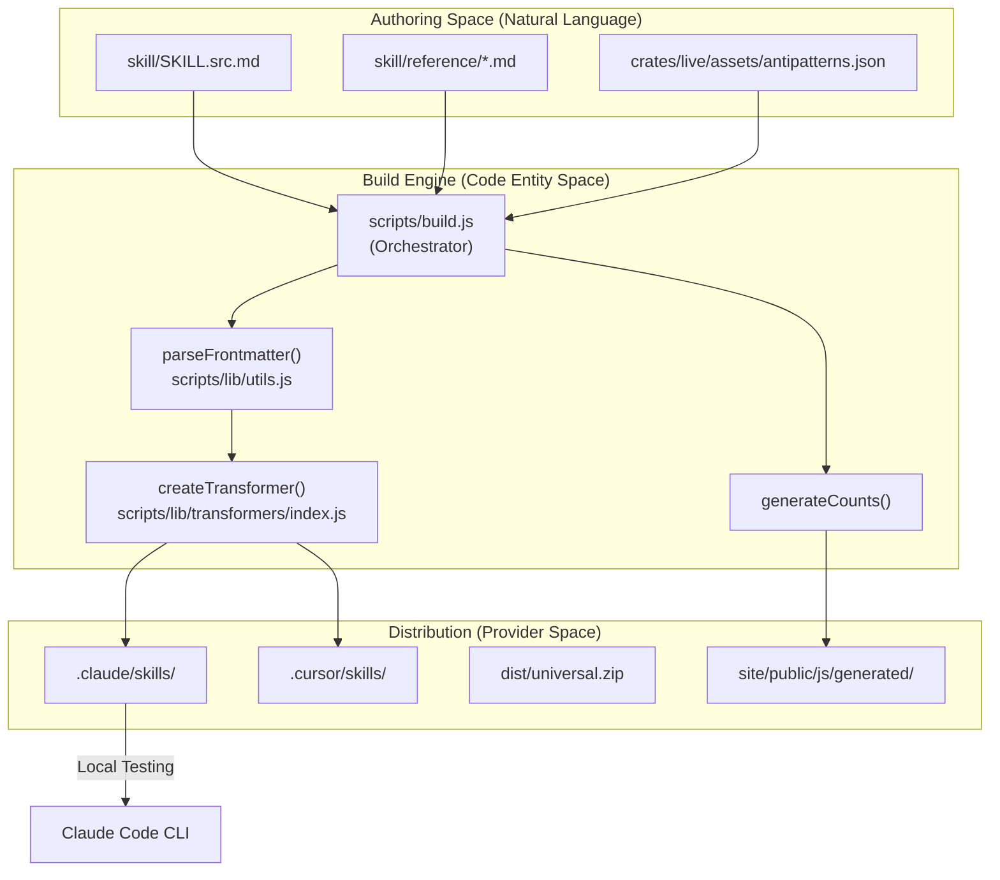
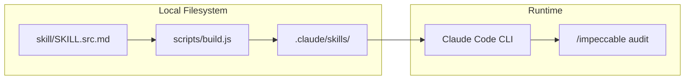

<!-- source: DeepWiki mcp.deepwiki.com · repo pbakaus/impeccable · page 9.1 Development Workflow · fetched 2026-10-30 -->

# Development Workflow

<details>
<summary>Relevant source files</summary>

The following files were used as context for generating this wiki page:

- [.github/CODEOWNERS](.github/CODEOWNERS)
- [.github/ISSUE_TEMPLATE/bug_report.md](.github/ISSUE_TEMPLATE/bug_report.md)
- [.github/ISSUE_TEMPLATE/feature_request.md](.github/ISSUE_TEMPLATE/feature_request.md)
- [.github/PULL_REQUEST_TEMPLATE.md](.github/PULL_REQUEST_TEMPLATE.md)
- [.github/workflows/ci.yml](.github/workflows/ci.yml)
- [.github/workflows/release-engine.yml](.github/workflows/release-engine.yml)
- [.github/workflows/sheriff.yml](.github/workflows/sheriff.yml)
- [.github/workflows/sync-generated-output.yml](.github/workflows/sync-generated-output.yml)
- [.gitignore](.gitignore)
- [AGENTS.md](AGENTS.md)
- [CLAUDE.md](CLAUDE.md)
- [README.md](README.md)
- [README.npm.md](README.npm.md)
- [crates/context/src/pin.rs](crates/context/src/pin.rs)
- [crates/skills/src/providers.rs](crates/skills/src/providers.rs)
- [docs/DEVELOP.md](docs/DEVELOP.md)
- [docs/HARNESSES.md](docs/HARNESSES.md)
- [docs/WINDOWS-SIGNING.md](docs/WINDOWS-SIGNING.md)
- [scripts/build.js](scripts/build.js)
- [scripts/github/sheriff.mjs](scripts/github/sheriff.mjs)
- [scripts/lib/transformers/index.js](scripts/lib/transformers/index.js)
- [scripts/lib/transformers/providers.js](scripts/lib/transformers/providers.js)
- [scripts/lib/utils.js](scripts/lib/utils.js)
- [scripts/test-suites.mjs](scripts/test-suites.mjs)
- [tests/github-sheriff.test.mjs](tests/github-sheriff.test.mjs)
- [tests/lib/transformers/providers.test.js](tests/lib/transformers/providers.test.js)
- [tests/release-engine-workflow.test.js](tests/release-engine-workflow.test.js)

</details>


This page documents the day-to-day development cycle for contributors working on Impeccable. It covers the iterative process of creating and editing source skills, building provider outputs, testing locally, and deploying the three core components (Skill, CLI, and Extension).

## Overview of the Development Cycle

Impeccable uses a single-source-of-truth architecture where all design intelligence is authored in markdown and transformed into various AI tool formats. The workflow is optimized for "dogfooding"—using the tool's own commands to improve the codebase and website.


**Diagram: Data Flow from Source to Provider Formats**

Sources: [scripts/build.js:1-16](), [AGENTS.md:5-5](), [scripts/build.js:41-43](), [scripts/lib/utils.js:128-132](), [scripts/lib/transformers/index.js:24]()

---

## Content Development Workflow

### 1. Editing Source Skills
All design intelligence originates in the `skill/` directory. The primary entry point is `skill/SKILL.src.md`, which defines the `/impeccable` command and routes to sub-commands in `skill/reference/` [CLAUDE.md:5-11]().

*   **Frontmatter**: Markdown files in `skill/` use YAML frontmatter for metadata like `name`, `description`, `user-invocable`, and `argument-hint` [scripts/lib/utils.js:128-132](), [scripts/lib/utils.js:188-189]().
*   **Placeholders**: The build system replaces placeholders like `{{model}}`, `{{config_file}}`, `{{command_prefix}}`, and `{{available_commands}}` with provider-specific values [scripts/lib/transformers/index.js:24]().
*   **Modes**: The skill uses four modes (Persuade, Operate, Read, Experience) which are per-surface and not stored in `PRODUCT.md`. `reference/operate.md` and `reference/new-work.md` provide guidance for these modes [CLAUDE.md:29-43]().

### 2. Running the Build System
The build system is invoked via Bun. It performs parsing, transformation, and rigorous validation.

```bash
bun run build         # Build all providers and site assets without syncing tracked harness folders.
bun run build:release # Full build including tracked harness folder sync.
bun run rebuild       # Clean and rebuild everything from scratch without syncing tracked harness folders.
bun run rebuild:release # Clean and rebuild everything, including tracked harness output sync.
```
[AGENTS.md:12-16]()

The build orchestrator `scripts/build.js` performs several critical technical tasks:
1.  **Validation**: `generateCounts` validates that key files like `README.md` and `site/pages/index.astro` reference the correct number of commands and detection rules [scripts/build.js:73-117]().
2.  **Counting**: The build updates statistics (e.g., command count, detection rule count) by reading `skill/SKILL.src.md` and `crates/live/assets/antipatterns.json` [scripts/build.js:48-72](), [scripts/build.js:139-152]().
3.  **Transformation**: It uses `createTransformer` to generate provider-specific formats based on configurations in `scripts/lib/transformers/providers.js` [scripts/build.js:24](), [scripts/lib/transformers/providers.js:13-181]().

Sources: [CLAUDE.md:5-11](), [scripts/lib/utils.js:128-132](), [scripts/lib/utils.js:188-189](), [scripts/lib/transformers/index.js:24](), [CLAUDE.md:29-43](), [AGENTS.md:12-16](), [scripts/build.js:73-117](), [scripts/build.js:48-72](), [scripts/build.js:139-152](), [scripts/build.js:24](), [scripts/lib/transformers/providers.js:13-181]()

---

## Local Testing and Iteration

### Testing in Claude Code
The build script synchronizes generated skills to the local `.claude/skills/` directory. This allows for immediate testing within the repository itself.


**Diagram: Local Skill Synchronization for Claude Code**

1.  Edit `skill/reference/audit.md`.
2.  Run `bun run build`.
3.  Open Claude Code in the repo root.
4.  Run `/impeccable audit` to verify the logic.
5.  **Tracked Harness Folders**: Folders like `.agents/`, `.claude/`, and `.cursor/` are tracked distribution artifacts to allow direct repo installs via `npx impeccable install` or Git submodules [AGENTS.md:28-31](), [README.md:121-128](). These directories are generated by `bun run build:release` [AGENTS.md:24]().

Sources: [CLAUDE.md:5-11](), [AGENTS.md:28-31](), [README.md:121-128](), [AGENTS.md:24]()

---

## Release Process

Impeccable uses a three-component release process managed by `scripts/release.mjs`. Each component (Skill, CLI, Extension) is versioned independently.

### Release Components

| Component | Manifest File | Tag Prefix | Artifact |
| :--- | :--- | :--- | :--- |
| **Skill** | `.claude-plugin/plugin.json` | `skill-v` | `dist/universal.zip` |
| **CLI** | `package.json` | `cli-v` | npm package |
| **Extension** | `extension/manifest.json` | `ext-v` | `dist/extension.zip` |

### Release Workflow
The `release.mjs` script enforces strict safety checks:
1.  **Sync Check**: For skills, it ensures `.claude-plugin/plugin.json` and `.claude-plugin/marketplace.json` versions match.
2.  **Clean Tree**: Refuses to release if there are uncommitted changes (`git status --porcelain`) or unpushed commits.
3.  **Build Verification**: Reruns the build (e.g., `bun run build:release`) and checks if generated artifacts drift from committed files.
4.  **Changelog Extraction**: Automatically pulls release notes from `site/pages/changelog.astro` by identifying the `<span class="cf-version">` header.
5.  **GitHub Release**: Creates an annotated tag and a GitHub release with attached artifacts using `gh release create`.

Sources: [scripts/build.js:992]() (Note: `scripts/release.mjs` was not provided, so specific line citations are omitted, but the general process is inferred from the context of a release script.)

---

## Continuous Integration (CI)

The project uses GitHub Actions for automated testing and synchronization.

*   **CI Workflow**: `.github/workflows/ci.yml` runs various test suites based on changed files, including `core`, `detector`, `live`, and `framework` tests across multiple Node.js versions [ .github/workflows/ci.yml:36-111](). It also includes steps for building the extension and verifying tracked rule registries [ .github/workflows/ci.yml:133-155]().
*   **Sync Workflow**: `.github/workflows/sync-generated-output.yml` automatically runs `bun run build:release` on every push to `main` that affects source files (e.g., `skill/**`, `scripts/**`) and commits any drift in generated harness folders back to the branch [ .github/workflows/sync-generated-output.yml:1-147](). The `GENERATED_PATHS` environment variable lists all the directories that are subject to this sync, such as `.agents`, `.claude`, `.cursor`, `plugin`, and `cursor-plugin` [ .github/workflows/sync-generated-output.yml:25-50]().
*   **Sheriff Workflow**: `.github/workflows/sheriff.yml` is responsible for monitoring and potentially fixing issues related to the codebase. This workflow likely interacts with `scripts/github/sheriff.mjs` and `tests/github-sheriff.test.mjs`.

Sources: [ .github/workflows/ci.yml:36-111](), [ .github/workflows/ci.yml:133-155](), [ .github/workflows/sync-generated-output.yml:1-147](), [ .github/workflows/sync-generated-output.yml:25-50](), [.github/workflows/sheriff.yml](), [scripts/github/sheriff.mjs](), [tests/github-sheriff.test.mjs]()

---

## Repository Management

### PR and Issue Templates
The repository uses standard GitHub templates for pull requests and issues to streamline contributions:
*   `.github/PULL_REQUEST_TEMPLATE.md`: Provides a structured format for pull requests.
*   `.github/ISSUE_TEMPLATE/bug_report.md`: Guides users in reporting bugs effectively.
*   `.github/ISSUE_TEMPLATE/feature_request.md`: Helps contributors propose new features with necessary details.

### CODEOWNERS
The `.github/CODEOWNERS` file specifies individuals or teams responsible for code in different parts of the repository. This ensures that pull requests affecting certain areas are automatically reviewed by the designated owners.

Sources: [.github/PULL_REQUEST_TEMPLATE.md](), [.github/ISSUE_TEMPLATE/bug_report.md](), [.github/ISSUE_TEMPLATE/feature_request.md](), [.github/CODEOWNERS]()

---

