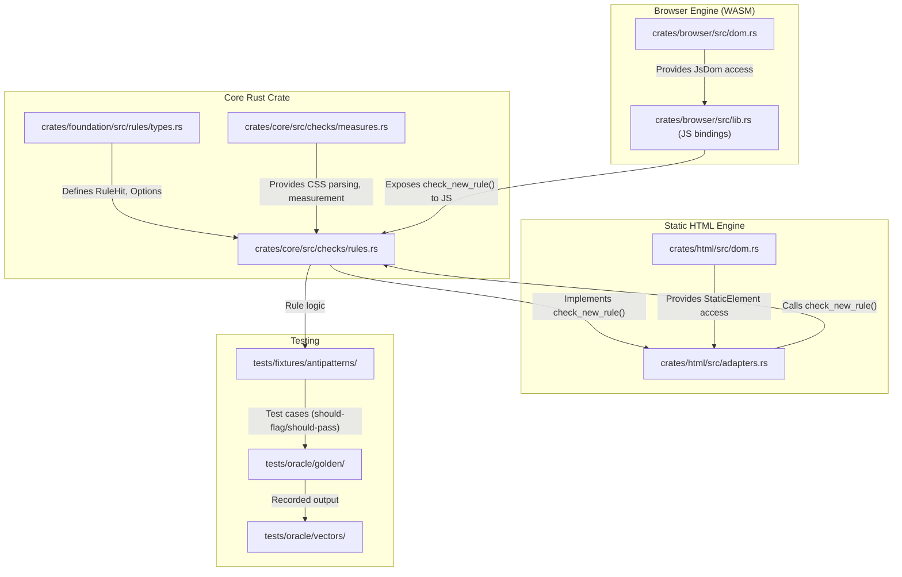
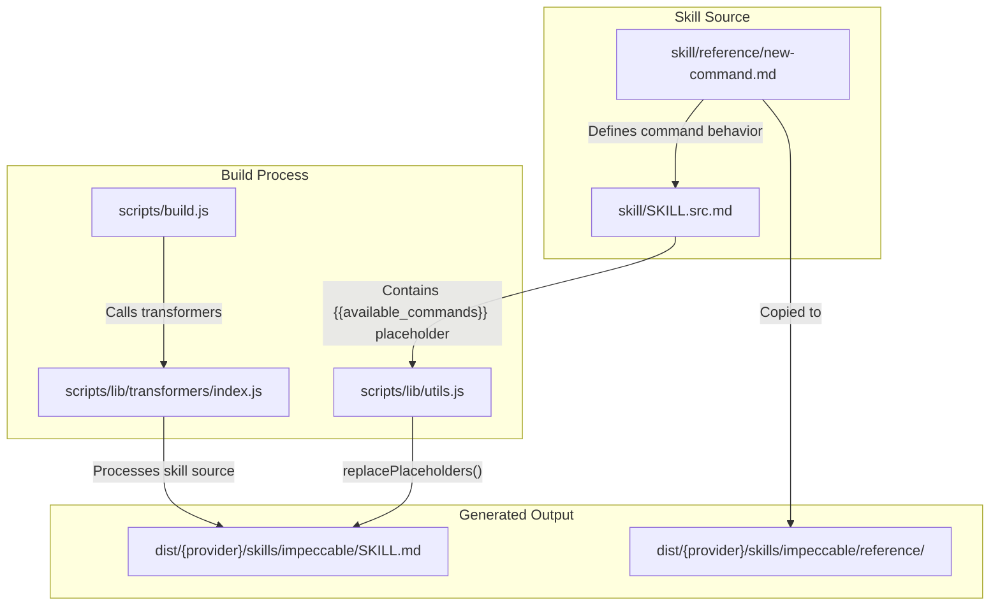
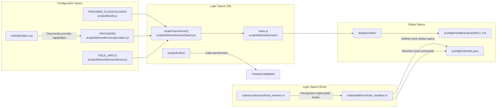

<!-- source: DeepWiki mcp.deepwiki.com · repo pbakaus/impeccable · page 9.2 Adding Rules, Commands, and Providers · fetched 2026-10-30 -->

# Adding Rules, Commands, and Providers

Relevant source files

The following files were used as context for generating this wiki page:

- [.gitattributes](.gitattributes)
- [crates/context/src/hook_markers.rs](crates/context/src/hook_markers.rs)
- [crates/core/src/checks/measures.rs](crates/core/src/checks/measures.rs)
- [crates/core/src/checks/rules.rs](crates/core/src/checks/rules.rs)
- [crates/core/src/checks/vectors_a.rs](crates/core/src/checks/vectors_a.rs)
- [crates/foundation/src/css/measures.rs](crates/foundation/src/css/measures.rs)
- [crates/foundation/src/rules/types.rs](crates/foundation/src/rules/types.rs)
- [crates/hook/src/admin.rs](crates/hook/src/admin.rs)
- [crates/html/src/adapters.rs](crates/html/src/adapters.rs)
- [crates/skills/src/bundle.rs](crates/skills/src/bundle.rs)
- [crates/skills/src/commands.rs](crates/skills/src/commands.rs)
- [crates/skills/src/hook_manifest.rs](crates/skills/src/hook_manifest.rs)
- [crates/skills/tests/drift_ports_tests.rs](crates/skills/tests/drift_ports_tests.rs)
- [crates/skills/tests/hook_manifest_tests.rs](crates/skills/tests/hook_manifest_tests.rs)
- [scripts/lib/transformers/factory.js](scripts/lib/transformers/factory.js)
- [skill/reference/adapt.md](skill/reference/adapt.md)
- [skill/reference/adapt.native.md](skill/reference/adapt.native.md)
- [skill/reference/animate.md](skill/reference/animate.md)
- [skill/reference/audit.md](skill/reference/audit.md)
- [skill/reference/audit.native.md](skill/reference/audit.native.md)
- [skill/reference/critique.md](skill/reference/critique.md)
- [skill/reference/distill.md](skill/reference/distill.md)
- [skill/reference/extract.md](skill/reference/extract.md)
- [skill/reference/harden.md](skill/reference/harden.md)
- [skill/reference/layout.md](skill/reference/layout.md)
- [skill/reference/optimize.md](skill/reference/optimize.md)
- [skill/reference/quieter.md](skill/reference/quieter.md)
- [skill/reference/typeset.md](skill/reference/typeset.md)
- [tests/build.test.js](tests/build.test.js)
- [tests/lib/utils.test.js](tests/lib/utils.test.js)
- [tests/skill-reference.test.mjs](tests/skill-reference.test.mjs)

This page provides a step-by-step guide for extending the Impeccable system. It covers the creation of new detector rules, skill commands, and the integration of new AI providers using the factory-driven build pipeline.

---

## 1. Adding a Detector Rule

Adding a new detector rule involves defining the rule in the core Rust crate, implementing its detection logic across the static HTML and browser engines, and creating corresponding fixtures and golden tests.

### Rule Implementation Flow

**Sources:** [crates/core/src/checks/rules.rs:1-26](), [crates/core/src/checks/measures.rs:1-20](), [crates/foundation/src/rules/types.rs](), [crates/html/src/adapters.rs:1-52](), [crates/html/src/dom.rs](), [crates/browser/src/lib.rs](), [crates/browser/src/dom.rs](), [tests/fixtures/antipatterns]()

### Step-by-Step: Adding a New Detector Rule

1.  **Define Rule in `impeccable_foundation`**:
    *   Add a new `RuleId` enum variant in `crates/foundation/src/rules/types.rs`.
    *   If the rule requires specific input parameters, define a new `struct` for its options (e.g., `NewRuleOpts`) in the same file.
    *   Add a `RuleHit` variant if the rule produces unique output data.
    *   Ensure the new `RuleId` is added to the `ALL_RULE_IDS` array for enumeration.

2.  **Implement Core Logic in `impeccable_core`**:
    *   In `crates/core/src/checks/rules.rs`, create a new function, e.g., `check_new_rule(opts: NewRuleOpts, ...)` that encapsulates the pure detection logic. This function should take plain data types as input and return `Vec<RuleHit>`.
    *   Utilize helper functions from `crates/core/src/checks/measures.rs` for CSS value parsing and measurement (e.g., `parse_radius_to_px`, `resolve_length_px`).
    *   If the rule involves text analysis, consider helpers from `impeccable_core::checks::text_rules`.

3.  **Integrate with Static HTML Engine (`impeccable_html`)**:
    *   In `crates/html/src/adapters.rs`, create an adapter function, e.g., `check_new_rule_adapter(el: &StaticElement<'_>, style: &StyleValues, ...)` that reads the `StaticElement` and its computed `StyleValues`.
    *   This adapter should extract the necessary data from the DOM and style, convert it into the `NewRuleOpts` format, and call the core `check_new_rule` function.
    *   Add the adapter to the main detection loop in `crates/html/src/lib.rs` (e.g., within `detect_static_html`).
    *   Handle `data-impeccable-ignore` attributes using `scoped_ignore_active` [crates/html/src/adapters.rs:77-95]().

4.  **Integrate with Browser Engine (`impeccable_browser`)**:
    *   In `crates/browser/src/lib.rs`, create a new `#[wasm_bindgen]` function, e.g., `check_new_rule_browser(dom: &JsDom, ...)` that exposes the rule to the JavaScript environment.
    *   This function will use the `JsDom` to query the live DOM, extract data, and call the core `check_new_rule` function.
    *   Ensure any necessary DOM measurements or style computations are performed using `JsDom` methods.

5.  **Create Fixtures**:
    *   Add new HTML files to `tests/fixtures/antipatterns/should-flag/` that demonstrate the rule being triggered.
    *   Add new HTML files to `tests/fixtures/antipatterns/should-pass/` that demonstrate the rule *not* being triggered.
    *   These fixtures are crucial for verifying the rule's behavior across different engines. Ensure they are tracked with `text eol=lf` in `.gitattributes` [tests/fixtures/** -text]().

6.  **Generate Goldens**:
    *   Run the test suite to generate new golden files in `tests/oracle/golden/` and `tests/oracle/vectors/`.
    *   Review the generated goldens to ensure the rule produces the expected `RuleHit` output.
    *   Goldens are `linguist-generated` and `-diff` in `.gitattributes` because they are machine-written and often contain large escaped strings [tests/oracle/golden/** -diff linguist-generated]().

### Example: `is_rounded_away_from_side`

The `is_rounded_away_from_side` function [crates/core/src/checks/rules.rs:48-54]() determines if a box's corners are rounded away from a given side, a key indicator for AI card tells.

*   **Core Logic**: `is_rounded_away_from_side` takes `Corners` and an index `i` as input. It checks if the two corners "away from" the side `i` are greater than `SIDE_ACCENT_MIN_RADIUS_PX` [crates/core/src/checks/rules.rs:37]().
*   **Measures**: `parse_radius_corners_em` [crates/foundation/src/css/measures.rs:144-163]() is used to resolve `border-radius` values into `Corners` structs, handling various CSS units and shorthands.
*   **HTML Adapter**: An adapter in `crates/html/src/adapters.rs` would read the `border-radius` style property of a `StaticElement`, call `parse_radius_corners_em` to get the `Corners`, and then pass this to `is_rounded_away_from_side`.

---

## 2. Adding Skill Commands

Adding a new skill command involves defining its reference documentation, integrating it into the skill routing mechanism, and ensuring it's discoverable by agents.

### Command Integration Flow

**Sources:** [skill/SKILL.src.md](), [scripts/build.js:148-159](), [scripts/lib/utils.js:13](), [scripts/lib/transformers/factory.js:211-222]()

### Step-by-Step: Adding a New Skill Command

1.  **Create Command Reference**:
    *   Create a new Markdown file for your command under `skill/reference/`, e.g., `skill/reference/new-command.md`.
    *   This file should detail the command's purpose, hard invariants, setup steps, assessment orchestration, and output contract. Follow the structure of existing command references like `critique.md` [skill/reference/critique.md:1-17]().
    *   Ensure the command reference includes sections for accessibility, performance, theming, responsive design, and implementation integrity if applicable, similar to `audit.md` [skill/reference/audit.md:11-64]().
    *   If the command involves visual decisions or browser interaction, include guidance on `--wait` capability and structured tool usage, as seen in `new-work.md` [tests/skill-reference.test.mjs:83-103]().
    *   For commands that modify code, ensure guidance on content fingerprinting and snapshot inheritance is consistent with `critique.md` and `polish.md` [tests/skill-reference.test.mjs:68-81]().

2.  **Update `SKILL.src.md`**:
    *   Add an entry for your new command in `skill/SKILL.src.md`. This typically involves adding a new `## Command: <command-name>` section.
    *   Include a brief description and a link to its reference file (e.g., `[new-command.md](new-command.md)`).
    *   Ensure the command is listed in the `{{available_commands}}` placeholder if it's user-invocable. The `{{available_commands}}` placeholder is automatically replaced during the build process with a list of available commands [scripts/lib/transformers/factory.js:211-222]().

3.  **Update `HARNESSES.md` (if applicable)**:
    *   If your command has specific harness capabilities or limitations (e.g., native platform support), update `HARNESSES.md` to reflect this. For example, `critique.md` and `audit.md` explicitly mention native platform routing [skill/reference/critique.md:31-33](), [skill/reference/audit.md:5-6]().

4.  **Test the Command Reference**:
    *   Add a new test case to `tests/skill-reference.test.mjs` to validate the content and structure of your new command's reference documentation. This ensures adherence to authoring contracts [tests/skill-reference.test.mjs:9-103]().
    *   For example, verify that reduced-motion guidance is present for animation-related commands like `animate.md` [tests/skill-reference.test.mjs:56-66]().

---

## 3. Adding a Provider

Impeccable uses a factory pattern to generate provider-specific outputs. Adding a provider involves updating configurations in the `scripts/lib/` directory and potentially adding new hook manifest handling in the Rust `impeccable_skills` crate.

### Provider Transformation Flow

**Sources:** [scripts/lib/transformers/providers.js:12-125](), [scripts/lib/transformers/factory.js:24-59](), [scripts/lib/transformers/index.js:1-20](), [scripts/build.js:34-42](), [crates/skills/src/hook_manifest.rs:1-19](), [crates/context/src/hook_markers.rs](), [HARNESSES.md]()

### Step-by-Step: Adding a New Provider

1.  **Define Placeholders**:
    *   Add a new entry to `PROVIDER_PLACEHOLDERS` in `scripts/lib/utils.js`. This object maps provider names to specific values for `model`, `config_file`, and `ask_instruction` placeholders.
    *   Example: `newProvider: { model: 'New AI Model', config_file: '.newproviderconfig', ask_instruction: 'What should I do next?' }`.

2.  **Configure Transformer**:
    *   Add a new configuration object to the `PROVIDERS` array in `scripts/lib/transformers/providers.js`.
    *   The `provider` field should match the key used in `PROVIDER_PLACEHOLDERS`.
    *   Specify `configDir` (e.g., `.newprovider`) for the output directory.
    *   Define `frontmatterFields` to control which skill frontmatter fields are included in the generated `SKILL.md` for this provider. Use `FIELD_SPECS` from `scripts/lib/transformers/factory.js` [scripts/lib/transformers/factory.js:24-59]().
    *   If the provider supports subagents, define `agentBuilder` (e.g., `buildCodexAgent`, `buildClaudeAgent`) to format agent definitions correctly [scripts/lib/transformers/factory.js:108-154]().

3.  **Export Transformer**:
    *   In `scripts/lib/transformers/index.js`, add a new export for your provider's transformer.
    *   Use the `createTransformer` factory function: `export const transformNewProvider = createTransformer(PROVIDERS.newProvider);`.

4.  **Update Build Integration**:
    *   In `scripts/build.js`, ensure your new transformer is called during the build process. Add a line like `transformers.transformNewProvider(skills, DIST_DIR, patterns);` alongside existing transformer calls [tests/build.test.js:39-42]().

5.  **Update `HARNESSES.md`**:
    *   Add a new row to the `HARNESSES.md` table for your new provider.
    *   Document its capabilities, such as `subagent`, `hooks`, `live`, `cdp`, `wait`, `native`, and `toml`. This matrix informs which features are supported by the provider.

6.  **Handle Hook Manifests (if applicable)**:
    *   If the new provider uses a hook system (e.g., `hooks.json` or `settings.json`), you'll need to integrate it with the Rust `impeccable_skills` crate.
    *   In `crates/skills/src/hook_manifest.rs`:
        *   Add an entry to `provider_hook_artifacts` [crates/skills/src/hook_manifest.rs:34-44]() to specify the source and destination paths for hook manifests.
        *   Implement any provider-specific logic for rewriting hook commands (e.g., handling project-relative paths, Windows command formats) within `rewrite_hook_commands_for_platform` [crates/skills/src/hook_manifest.rs:11-12]().
        *   Ensure that the `launcher_rel_path` and `launcher_path` functions correctly resolve the path to the `impeccable` binary for your provider [crates/skills/src/hook_manifest.rs:122-146]().
    *   In `crates/context/src/hook_markers.rs`, ensure that `is_impeccable_hook_command` and `is_launcher_hook_command` can correctly identify your provider's hook commands [crates/context/src/hook_markers.rs:20-21]().

7.  **Update `.gitattributes`**:
    *   Add an entry for your new provider's generated output directory (e.g., `.newprovider/** linguist-generated`) to `.gitattributes`. This marks the generated files as machine-written for better `git diff` and GitHub UI behavior [tests/build.test.js:151-152](), [.gitattributes:41-64]().

---

## 4. Porting Guidance from `docs/PORTING-GUIDE.md`

The `docs/PORTING-GUIDE.md` contains valuable insights for maintaining consistency across the codebase. When adding new features, ensure the following principles are applied:

*   **Deterministic Output**: All detector rules and skill commands should produce deterministic output. This is critical for the oracle golden test system [tests/oracle/golden]() and for consistent agent behavior.
*   **Platform Agnostic Core**: Core logic (e.g., in `impeccable_core`) should be platform-agnostic, taking simple data structures as input and returning simple data structures as output. Platform-specific adaptations (DOM access, file system operations) should be handled in the respective engine crates (`impeccable_html`, `impeccable_browser`) or CLI.
*   **Clear Separation of Concerns**: Maintain a clear boundary between pure logic (Rust `checks::rules`), DOM interaction (Rust `html::adapters`, `browser::dom`), and skill orchestration (Markdown references, build transformers).
*   **Test Coverage**: Every new rule or command requires comprehensive test coverage, including unit tests for core logic, fixtures for engine integration, and golden tests for end-to-end verification.
*   **Placeholder Usage**: Leverage the `{{...}}` placeholder system in skill definitions to ensure provider compatibility and reduce duplication.
*   **Hook Manifest Consistency**: When adding new providers with hook capabilities, ensure the hook manifest generation and parsing logic in `impeccable_skills::hook_manifest` is updated to correctly handle the provider's specific requirements and maintain the `impeccable_hook_marker` for recognition.

By following these guidelines, new rules, commands, and providers can be integrated seamlessly into the Impeccable ecosystem.

---

