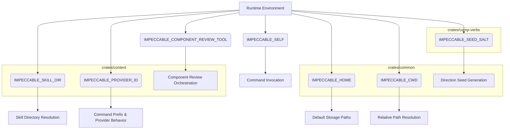

<!-- source: DeepWiki mcp.deepwiki.com · repo pbakaus/impeccable · page 9.3 Runtime Environment and Operational Docs · fetched 2026-10-30 -->

# Runtime Environment and Operational Docs

<details>
<summary>Relevant source files</summary>

The following files were used as context for generating this wiki page:

- [NOTICE.md](NOTICE.md)
- [crates/browser/src/cdp.rs](crates/browser/src/cdp.rs)
- [crates/cli/src/asset_capture.rs](crates/cli/src/asset_capture.rs)
- [crates/cli/src/capture_service.rs](crates/cli/src/capture_service.rs)
- [crates/cli/src/capture_snapshot.rs](crates/cli/src/capture_snapshot.rs)
- [crates/cli/src/component_capture.rs](crates/cli/src/component_capture.rs)
- [crates/cli/src/entry_capture.rs](crates/cli/src/entry_capture.rs)
- [crates/cli/src/raster_coverage.js](crates/cli/src/raster_coverage.js)
- [crates/cli/tests/entry_capture.rs](crates/cli/tests/entry_capture.rs)
- [crates/common/src/launcher.rs](crates/common/src/launcher.rs)
- [crates/common/src/lib.rs](crates/common/src/lib.rs)
- [crates/comp-verbs/src/build_phase.rs](crates/comp-verbs/src/build_phase.rs)
- [crates/comp-verbs/src/build_phase/integrity_tests.rs](crates/comp-verbs/src/build_phase/integrity_tests.rs)
- [crates/context/src/component_review/mod.rs](crates/context/src/component_review/mod.rs)
- [crates/context/src/provider.rs](crates/context/src/provider.rs)
- [docs/NATIVE-CAPTURE.md](docs/NATIVE-CAPTURE.md)
- [docs/RUNTIME-ENV.md](docs/RUNTIME-ENV.md)
- [skill/reference/component-review.md](skill/reference/component-review.md)
- [tests/oracle/cases/comp.mjs](tests/oracle/cases/comp.mjs)
- [tests/oracle/golden/build-phase-decision-comp-option-one.json](tests/oracle/golden/build-phase-decision-comp-option-one.json)
- [tests/oracle/golden/build-phase-usage.json](tests/oracle/golden/build-phase-usage.json)

</details>


This page summarizes key operational documentation and environment variables that influence the Impeccable engine's behavior. It covers runtime environment configuration, native capture mechanisms, styling guidelines, plan review processes, architectural decision records (ADRs), licensing, and environment variables.

## Operational Documentation Overview

The `docs/` directory contains several important operational documents that guide the development, deployment, and understanding of the Impeccable system.

### `docs/RUNTIME-ENV.md`
This document details the expected runtime environment for the Impeccable engine. It covers dependencies, system requirements, and general setup instructions for various operating systems. It ensures that developers and users can correctly configure their environments for optimal performance and compatibility.

### `docs/ENGINE.md`
`ENGINE.md` provides a high-level overview of the Impeccable engine's architecture and core components. It describes how different parts of the engine interact, its primary responsibilities (e.g., detection, hooks, live mode, comp pipeline), and its distribution as an `npm` CLI. This document is crucial for understanding the overall system design.

### `docs/NATIVE-CAPTURE.md`
This document focuses on the native capture capabilities of Impeccable. It explains how the system interacts with headless browsers (like Chromium) to capture visual artifacts, measure raster coverage, and perform component reviews. It details the underlying mechanisms, such as the Chrome DevTools Protocol (CDP) client [crates/browser/src/cdp.rs:1-17](), and how snapshots of HTML/CSS are frozen for consistent rendering [crates/cli/src/capture_snapshot.rs:1-112]().

#### Native Capture Process
The native capture process involves several steps to ensure accurate and reproducible visual data:
1.  **Browser Launch**: A headless Chromium instance is launched with specific arguments to ensure a consistent environment [crates/browser/src/cdp.rs:66-117]().
2.  **Snapshot Freezing**: The target HTML, CSS, and other static assets are "frozen" into an `HtmlSnapshot` [crates/cli/src/capture_snapshot.rs:58-112](). This snapshot includes all explicit local static dependencies and ensures that the capture is based on a fixed set of files.
3.  **Page Rendering**: The `HtmlSnapshot` is served locally, and the headless browser navigates to the entry URL [crates/cli/src/component_capture.rs:74-75]().
4.  **Viewport Configuration**: The browser's viewport is set to specific dimensions, and reduced motion is enabled [crates/cli/src/component_capture.rs:79-81]().
5.  **Clock Pinning**: The page's clock can be pinned to a specific time to ensure consistent rendering of time-dependent elements [crates/cli/src/component_capture.rs:82]().
6.  **Resource Settlement**: The system waits for fonts to load and images to decode to ensure the page is fully settled before capture [crates/cli/src/asset_capture.rs:107-110]().
7.  **Raster Coverage Measurement**: Optionally, the share of the viewport painted by raster images is measured using `raster_coverage.js` [crates/cli/src/asset_capture.rs:31-35](), [crates/cli/src/raster_coverage.js:1-274](). This helps identify areas where design might rely too heavily on raster graphics.
8.  **Screenshot and Cropping**: A full-page screenshot is taken, and specific regions are cropped based on the component's defined box [crates/cli/src/component_capture.rs:39-60]().

##### Native Capture Data Flow
```mermaid
graph TD
    A[User/Agent Request Capture] --> B{CdpAssetRenderer::capture_batch};
    B --> C[discovery::find_browser];
    C --> D[Browser::launch];
    D --> E[HtmlSnapshot::freeze];
    E --> F[HtmlSnapshot::serve_assembled];
    F --> G[Browser::new_page];
    G --> H[Page::set_viewport];
    H --> I[Page::pin_clock];
    I --> J[Page::goto];
    J --> K[Page::evaluate_value_in_world<br/>(resource settlement)];
    K --> L[Page::evaluate_value_in_world<br/>(raster_coverage.js)];
    L --> M[Page::screenshot];
    M --> N[crop_viewport];
    N --> O[AssetCapture Result];

    subgraph "crates/cli"
        B
        E
        F
        L
        N
        O
    end

    subgraph "crates/browser"
        C
        D
        G
        H
        I
        J
        K
        M
    end
```
Sources: [crates/browser/src/cdp.rs:1-17](), [crates/cli/src/capture_snapshot.rs:1-112](), [crates/cli/src/component_capture.rs:74-75](), [crates/cli/src/component_capture.rs:79-82](), [crates/cli/src/asset_capture.rs:31-35](), [crates/cli/src/raster_coverage.js:1-274](), [crates/cli/src/component_capture.rs:39-60](), [crates/cli/src/asset_capture.rs:44-50]()

### `docs/STYLE.md`
`STYLE.md` outlines the coding style, conventions, and best practices for contributing to the Impeccable codebase. This includes guidelines for Rust, JavaScript, and documentation, ensuring consistency and maintainability across the project.

### `docs/PLAN-REVIEW.md`
This document describes the process for reviewing design plans and assets, particularly in comp-led builds. It details how `component-review` commands are used to plan, capture, serve, and verify design components. It also explains how user decisions (approve, revise, reclassify) are applied and how the build process proceeds based on these decisions [skill/reference/component-review.md:1-60]().

#### Plan Review Workflow
The `component-review` verb in `crates/context/src/component_review/mod.rs` orchestrates the plan review process.
1.  **Plan Generation**: `impeccable component-review plan` generates a manifest (`.impeccable/review/components.json`) from the measured spec, comp, and plate files [skill/reference/component-review.md:7-8](). This manifest details assets, plan items, and code regions.
2.  **Capture**: If a hosted review tool is not used, `impeccable component-review capture --manifest <path>` is run. This command uses a `ComponentCapturer` (either `PlanCapturer` or a native capturer) to generate visual evidence of the components [crates/context/src/component_review/mod.rs:90-107]().
3.  **Serve**: `impeccable component-review serve --session <id>` starts a local server to present the review to the user [skill/reference/component-review.md:11](). The server waits for user decisions.
4.  **Verify**: `impeccable component-review verify --manifest <path>` confirms approval and refuses pending, needs-work, or stale input [skill/reference/component-review.md:11]().
5.  **Decision Application**: Based on user feedback (approve, revise, reclassify), the regions file is updated, and new plates might be produced [skill/reference/component-review.md:17-25]().

##### Plan Review Command Flow
```mermaid
graph TD
    A[User/Agent] --> B{impeccable component-review plan};
    B --> C[Generate components.json manifest];
    C --> D{impeccable component-review capture};
    D --> E[ComponentCapturer (PlanCapturer or Native)];
    E --> F[Store captured state];
    F --> G{impeccable component-review serve};
    G --> H[Local server for user review];
    H --> I[User decisions (approve, revise)];
    I --> J{impeccable component-review verify};
    J --> K[Verify approval status];
    K --> L[Apply decisions to regions file];
    L --> B;
```
Sources: [skill/reference/component-review.md:7-8](), [skill/reference/component-review.md:11](), [crates/context/src/component_review/mod.rs:90-107](), [skill/reference/component-review.md:17-25]()

### ADRs and Rewrite Plans
The `docs/` directory may also contain Architectural Decision Records (ADRs) and rewrite plans. These documents capture significant architectural decisions, their context, and consequences, providing a historical record of design choices. Rewrite plans outline strategies for refactoring or re-implementing parts of the codebase, ensuring a clear path for future development.

### Licensing and `NOTICE.md`
The `NOTICE.md` file [NOTICE.md:1-11]() lists third-party content used in the project and their respective licenses. This ensures compliance with open-source licensing requirements and provides proper attribution. For example, the `skill/reference/ios.md` and `skill/reference/android.md` files are derived from `ehmo/platform-design-skills` under the MIT license [NOTICE.md:4-11]().

## Environment Variables Affecting the Engine

Several environment variables can influence the behavior of the Impeccable engine, allowing for customization and debugging.

### `IMPECCABLE_SELF`
This variable specifies the command used to invoke the Impeccable binary. It's used by the skill launcher and internal commands to correctly reference the `impeccable` executable. If not set, it defaults to the executable's path [crates/context/src/provider.rs:104-107](). The `impeccable_common::launcher::spell_self` function handles platform-specific quoting for this command [crates/common/src/launcher.rs](), [crates/context/src/provider.rs:108]().

### `IMPECCABLE_SKILL_DIR`
This variable explicitly sets the path to the skill directory. If not provided, the engine attempts to discover the skill directory by walking up from the executable's path until it finds a `reference/ios.md` file [crates/context/src/provider.rs:8-12]().

### `IMPECCABLE_PROVIDER_ID`
This variable defines the provider ID, which determines the command prefix (e.g., `$` for `codex`, `/` for others) and other provider-specific behaviors. If not set, it's derived from the skill directory's harness folder (e.g., `.codex` -> `codex`) or defaults to `source` [crates/context/src/provider.rs:13-19]().

### `IMPECCABLE_BIN`
This variable (not explicitly shown in provided snippets but implied by launcher logic) would typically point to the location of the Impeccable binary, especially in distributed or cached scenarios.

### `IMPECCABLE_SEED_SALT`
Used in the `impeccable_common::seed` module (if enabled) to salt seed keys, ensuring unique references for directions [crates/comp-verbs/src/build_phase.rs:136]().

### `IMPECCABLE_COMPONENT_REVIEW_TOOL`
When set, this variable indicates that a hosted human review tool is in use for component review. The `component-review capture` command will then instruct the user to call this tool instead of performing a native capture [crates/context/src/component_review/mod.rs:93-96]().

### `IMPECCABLE_NO_SANDBOX`
While not a direct environment variable, the `dangerous_no_sandbox` argument in `cdp::default_chrome_args` [crates/browser/src/cdp.rs:66] implies that a mechanism (potentially an environment variable or CLI flag) can disable the Chrome sandbox. This is generally used for debugging or in environments where sandboxing is not feasible.

### `IMPECCABLE_DEBUG_CDP`
(Implied by `cdp.rs` but not explicitly shown) A common pattern for debugging CDP interactions would involve an environment variable to enable verbose logging of CDP messages.

### `IMPECCABLE_DEBUG_LIVE`
(Implied by `live` crate but not explicitly shown) Similar to CDP debugging, an environment variable might exist to enable verbose logging for live mode operations.

### `IMPECCABLE_ENGINE_VERSION`
(Implied by build/release processes) This variable would typically hold the version of the Rust engine, used for release management and compatibility checks.

### `IMPECCABLE_HOME`
(Implied by `Io::home` [crates/common/src/lib.rs:102-110]()) This variable, or `USERPROFILE` on Windows, specifies the user's home directory, which is used to locate configuration files or default storage paths (e.g., for component review stores [crates/context/src/component_review/mod.rs:55-57]()).

### `IMPECCABLE_CWD`
(Implied by `Io::cwd` [crates/common/src/lib.rs:68]()) The current working directory, which is fundamental for resolving relative paths and project context.

### `IMPECCABLE_STDOUT_IS_TTY`, `IMPECCABLE_STDERR_IS_TTY`, `IMPECCABLE_STDIN_IS_TTY`
(Implied by `Io::stdin_is_tty` [crates/common/src/lib.rs:69]()) These variables or similar mechanisms would indicate whether standard I/O streams are connected to a TTY, influencing how output is formatted or if stdin is read [crates/common/src/lib.rs:73-86]().

#### Environment Variable Influence Diagram

Sources: [crates/context/src/provider.rs:104-107](), [crates/common/src/launcher.rs](), [crates/context/src/provider.rs:108](), [crates/context/src/provider.rs:8-12](), [crates/context/src/provider.rs:13-19](), [crates/comp-verbs/src/build_phase.rs:136](), [crates/context/src/component_review/mod.rs:93-96](), [crates/browser/src/cdp.rs:66](), [crates/common/src/lib.rs:102-110](), [crates/context/src/component_review/mod.rs:55-57](), [crates/common/src/lib.rs:68](), [crates/common/src/lib.rs:69](), [crates/common/src/lib.rs:73-86]()

---

