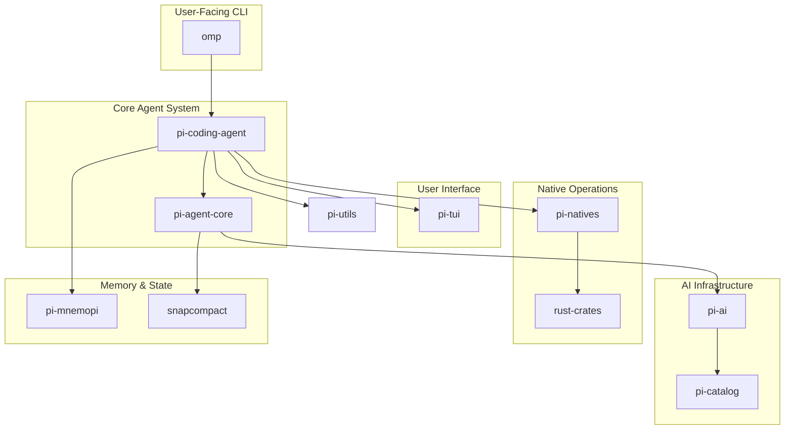
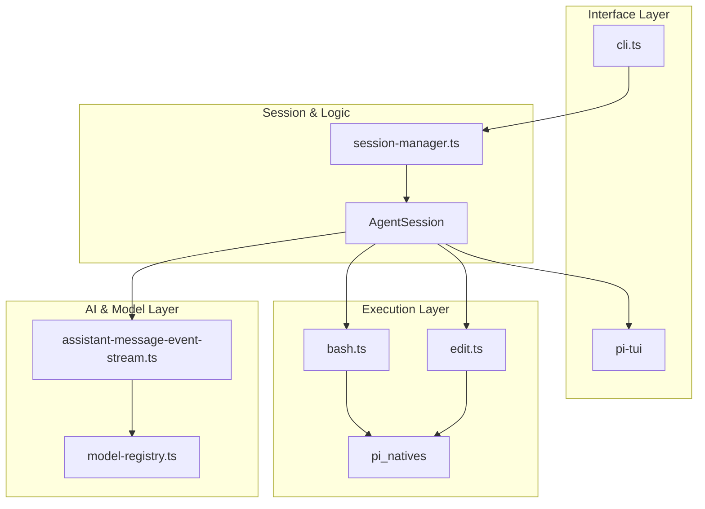
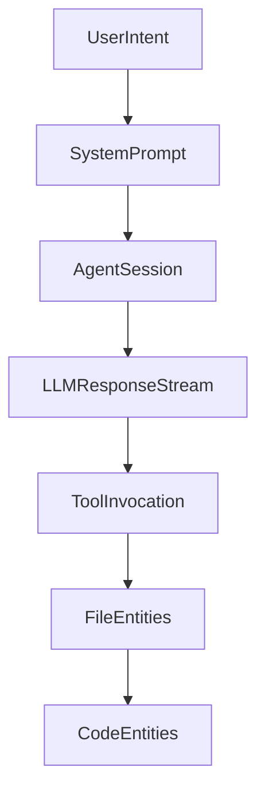
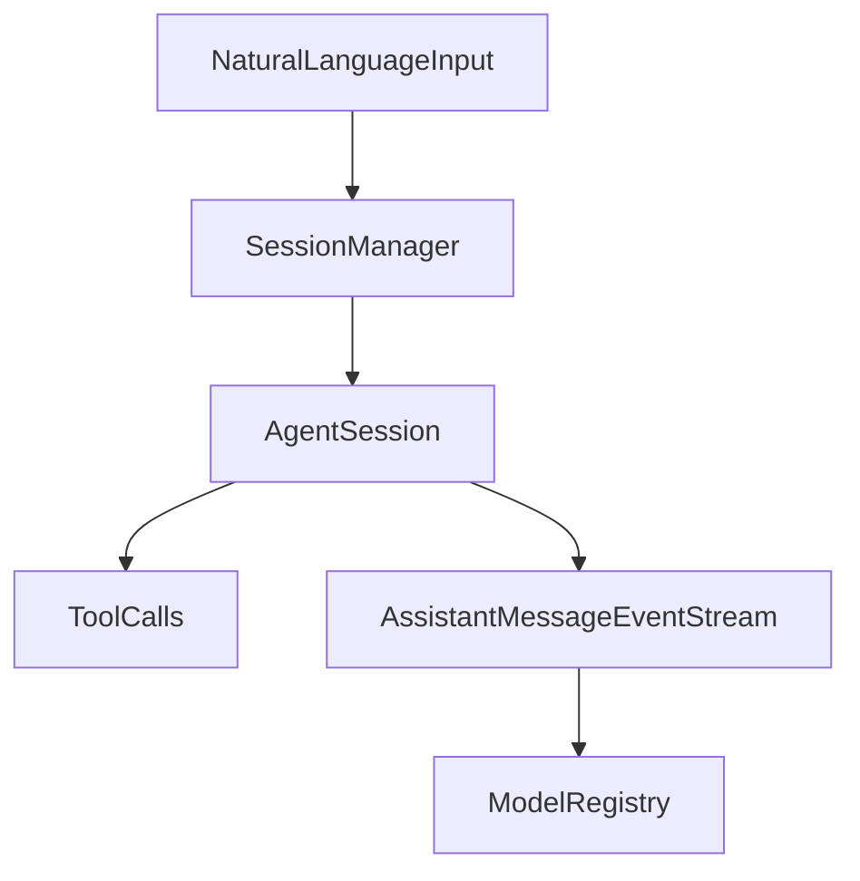

<!-- source: DeepWiki mcp.deepwiki.com · repo can1357/oh-my-pi · page 1 Overview · fetched 2026-10-30 -->

# Overview

Relevant source files

The following files were used as context for generating this wiki page:

- [AGENTS.md](AGENTS.md)
- [Cargo.lock](Cargo.lock)
- [Cargo.toml](Cargo.toml)
- [README.md](README.md)
- [bun.lock](bun.lock)
- [docs/environment-variables.md](docs/environment-variables.md)
- [docs/providers.md](docs/providers.md)
- [packages/agent/package.json](packages/agent/package.json)
- [packages/ai/README.md](packages/ai/README.md)
- [packages/ai/package.json](packages/ai/package.json)
- [packages/catalog/src/compat/auth-ids.ts](packages/catalog/src/compat/auth-ids.ts)
- [packages/catalog/src/compat/provider-ids.ts](packages/catalog/src/compat/provider-ids.ts)
- [packages/catalog/src/compat/rules/auth/_order.kdl](packages/catalog/src/compat/rules/auth/_order.kdl)
- [packages/coding-agent/README.md](packages/coding-agent/README.md)
- [packages/coding-agent/package.json](packages/coding-agent/package.json)
- [packages/coding-agent/src/cli/help-extra.ts](packages/coding-agent/src/cli/help-extra.ts)
- [packages/natives/package.json](packages/natives/package.json)
- [packages/natives/scripts/build-bindings.ts](packages/natives/scripts/build-bindings.ts)
- [packages/stats/package.json](packages/stats/package.json)
- [packages/tui/package.json](packages/tui/package.json)
- [packages/utils/package.json](packages/utils/package.json)
- [scripts/install-tests/binary.dockerfile](scripts/install-tests/binary.dockerfile)
- [scripts/install-tests/source.dockerfile](scripts/install-tests/source.dockerfile)
- [scripts/install-tests/tarball.dockerfile](scripts/install-tests/tarball.dockerfile)
- [scripts/install.ps1](scripts/install.ps1)
- [scripts/install.sh](scripts/install.sh)

This document introduces **oh-my-pi**, an advanced AI-powered coding agent designed as a terminal assistant for software development workflows. It explains the purpose, high-level architecture, and key capabilities of oh-my-pi, providing a technical foundation and mapping of core components along with illustrative diagrams.

---

## What is oh-my-pi

**oh-my-pi** is a terminal-based AI assistant that helps software developers interact with their code and environment through natural language and programmable commands. It is implemented primarily in TypeScript (running on the Bun JavaScript runtime) with Rust components to accelerate native performance tasks.

oh-my-pi combines large language models (LLMs) from more than 50 providers with a rich ecosystem of development tools—supporting code reading, editing, execution, and session management—accessible through a unified CLI tool named `omp`. This integration allows users to run interactive sessions, automation scripts, or integrate with IDEs and external tooling via RPC.

Key features include:  
- **Multi-Mode CLI** — The CLI supports:  
  - *Interactive mode* with streaming output, multi-line editing, and conversational AI interaction.  
  - *RPC mode* providing JSON-based API for IDEs and external clients.  
  - *Print mode* for scripting and CI/CD workflows.  
  - *Agent Client Protocol (ACP)* mode for agent interoperability.  
- **Unified AI Provider Interface** — Seamless access to models from Anthropic, OpenAI, Google, Amazon Bedrock, Cursor, Gemini, Ollama, LMStudio, and others with automatic discovery and streaming.  
- **Native High-Performance Tools** — Rust-powered modules handle shell execution, text search (grep/regex), PTY management, and semantic code parsing.  
- **Session & Context Management** — Robust conversation state with automatic token-budget-aware compaction and visual "snapcompact" archives.  
- **Extensibility & Autonomy** — Plugin system, concurrent task delegation with isolation, Model Context Protocol (MCP) integration, and autonomous memory with embeddings.  

Sources: [packages/coding-agent/package.json:1-90](), [packages/ai/package.json:1-46](), [packages/agent/package.json:1-77](), [packages/coding-agent/CHANGELOG.md:1-70]()

---

## Package Structure

oh-my-pi is developed as a monorepo managed by Bun workspaces. The project is modularized into specialized packages arranged in dependency layers for maintainability and extensibility. For details on the monorepo directory layout, see [Repository Layout](#1.2).

### Dependency Graph

### Figure 1: Monorepo Package Dependency Graph

| Package           | Location                     | Role                                                                                           |
|-------------------|------------------------------|------------------------------------------------------------------------------------------------|
| `pi-coding-agent` | [packages/coding-agent/]()   | CLI interface, tool definitions, session management, terminal UI orchestration.               |
| `pi-agent-core`   | [packages/agent/]()          | Core agent engine, conversation state, transport abstractions.                                |
| `pi-ai`           | [packages/ai/]()             | Unified large language model API, provider abstraction, streaming normalization.              |
| `pi-catalog`      | [packages/catalog/]()        | Central registry of models and provider metadata.                                             |
| `pi-tui`          | [packages/tui/]()            | Terminal UI components including differential rendering and text editor widgets.              |
| `pi-natives`      | [packages/natives/]()        | Rust native bindings for grep, shell, PTY, image processing, and syntax highlighting.         |
| `pi-mnemopi`      | [packages/mnemopi/]()        | Autonomous long-term memory with embeddings and fact extraction.                              |
| `snapcompact`     | [packages/snapcompact/]()    | Visual/textual context compaction for session history.                                        |
| `pi-utils`        | [packages/utils/]()          | Shared utilities, logging, and stream helpers.                                                |

Sources: [bun.lock:4-230](), [packages/coding-agent/package.json:1-90](), [packages/ai/package.json:1-134](), [packages/agent/package.json:1-77](), [packages/tui/package.json:1-69](), [packages/natives/package.json:1-66](), [packages/mnemopi/package.json:1-107]()

---

## System Architecture

oh-my-pi bridges natural language inputs to code and file system operations via a layered architecture involving session management, AI orchestration, tool execution, and terminal UI.

### High-Level Architecture Diagram

### Figure 2: System Architecture Overview

**Component Roles:**

- **CLI & Terminal UI (Interface Layer):**
  - The entrypoint `src/cli.ts` parses arguments, selects operational mode, and launches agent sessions.  
  - The terminal UI, implemented in `pi-tui`, handles efficient differential rendering, multi-line editors, streaming output, and user interactivity.  

- **Agent Session & Management:**
  - `AgentSession` (in `pi-agent-core`) manages the conversational state, orchestrates LLM requests and tool calls.  
  - `SessionManager` (in `pi-coding-agent`) creates, resumes, branches, and persists sessions.  

- **AI Model Interface:**
  - `ModelRegistry` dynamically discovers and manages AI models and providers.  
  - `AssistantMessageEventStream` streams responses from AI models, including text, "thinking" states, and tool-call instructions.  

- **Execution Layer:**
  - Tools like `bash` (shell commands) and `edit` enable code execution and file editing.  
  - Native Rust bindings (`pi-natives`) power high-performance operations including shell and PTY management, grep-style searching, and syntax tree analysis.  

Sources: [packages/coding-agent/src/cli.ts:31-31](), [packages/tui/package.json:5-5](), [packages/agent/package.json:3-5](), [packages/coding-agent/src/session/session-manager.ts:78-78](), [packages/coding-agent/src/config/model-registry.ts:33-33](), [packages/ai/src/assistant-message-event-stream.ts:1-1](), [packages/coding-agent/src/tools/bash.ts:1-1](), [packages/coding-agent/src/tools/edit.ts:1-1](), [packages/natives/package.json:4-4]()

---

## Bridging Natural Language to Code Entities

oh-my-pi's core purpose is to translate natural language developer intents into precise code and file operations, bridging from human commands to machine actions.

### Conceptual Pipeline

### Figure 3: Conceptual Pipeline from Natural Language to Code Entities

**Process Explanation:**

- **User Intent:** Developers issue natural language requests describing software tasks.  
- **System Prompt Construction:** The system assembles contextual prompts from session data, config files (`AGENTS.md`, `SYSTEM.md`), and capability rules.  
- **AgentSession:** Maintains conversation context, feeds prompts to LLM, interprets responses including tool-call instructions.  
- **LLM Response Stream:** The large language model streams text, reasoning thoughts, and structured tool calls.  
- **Tool Invocation:** Activated tools (e.g. `bash`, `read`, `write`, `edit`) operate on files or environment as per LLM instructions.  
- **File Entities:** File and line addresses use cryptographic hashlines for stable referencing despite shifting lines.  
- **Code Entities:** AST tools analyze program structure for semantic and syntactic integrity.  

Sources: [packages/agent/src/session/agent-session.ts:1-1](), [packages/ai/src/assistant-message-event-stream.ts:1-1](), [packages/coding-agent/src/tools/bash.ts:1-1](), [packages/coding-agent/src/tools/read.ts:1-1](), [packages/coding-agent/src/tools/write.ts:1-1](), [packages/coding-agent/src/tools/edit.ts:1-1](), [Cargo.lock:261-264]()

---

### Mapping Natural Language to System Code Entities

This diagram illuminates how user input travels through system components and source code files:

### Figure 4: Code Entity Mapping for Natural Language Processing

**Codebase Component Relationships:**  
- **Natural Language:** Input is initially processed in `SessionManager` which manages session state and orchestration.  
- **SessionManager:** Creates and delegates interactions to `AgentSession` instances.  
- **AgentSession:** Core entity maintaining conversation logic, handles AI requests, and schedules tool invocation.  
- **AssistantMessageEventStream:** Processes streamed model responses including text and tool calls.  
- **ModelRegistry:** Provides dynamic model and provider discovery and configuration.  
- **Tool Calls:** Actual commands executed by tools implemented in the coding-agent package (e.g. bash shell, file operations, editing).

Sources: [packages/coding-agent/src/session/session-manager.ts:78-78](), [packages/agent/src/session/agent-session.ts:1-1](), [packages/ai/src/assistant-message-event-stream.ts:1-1](), [packages/coding-agent/src/config/model-registry.ts:33-33](), [packages/coding-agent/src/tools/bash.ts:1-1](), [packages/coding-agent/src/tools/edit.ts:1-1]()

---

## Key Capabilities

### 1. Unified AI Provider Layer

- Supports more than 50 model providers including OpenAI, Anthropic, Google, Amazon Bedrock, Cursor, Gemini, Ollama, LMStudio, and custom local/self-hosted models.  
- Dynamic model discovery, caching, and version management in `ModelRegistry`.  
- Streaming LLM event support via `AssistantMessageEventStream` for text, reasoning states, and structured tool-call integration.  
- Advanced reasoning support with configurable reasoning-effort modes and signature preservation.  

Sources: [packages/ai/CHANGELOG.md:13-23](), [packages/ai/CHANGELOG.md:55-56](), [packages/coding-agent/src/config/model-registry.ts:33-33](), [packages/ai/src/assistant-message-event-stream.ts:1-1](), [packages/coding-agent/src/thinking.ts:85-85]()

### 2. High-Performance Native Tool Chain

- Rust bindings (`pi-natives`) accelerate grep-based text search, PTY management, shell commands, clipboard, and syntax highlighting.  
- Stable text editing uses cryptographic hashline addresses to make edits robust to line shifts.  
- Semantic code AST usage with `ast-grep-core` and `tree-sitter` integration enables precise structural modifications and queries.  

Sources: [packages/natives/package.json:1-66](), [Cargo.lock:261-264](), [packages/coding-agent/package.json:55-55]()

### 3. Rich Session and Context Management

- Persistent session state with message transcripts, tool results, and metadata supports branching, forking, and autosaving.  
- Automatic token-budget-aware context compaction strategies maintain conversation window size, supported by visual snapcompact archives.  
- Autonomous memory (`pi-mnemopi`) extracts facts and embeddings from sessions for durable knowledge reuse.  

Sources: [packages/agent/package.json:5-5](), [packages/coding-agent/package.json:66-66](), [packages/mnemopi/package.json:3-5]()

### 4. Extensibility and Orchestration

- Plugin and extension system supports lifecycle hooks, custom commands, and tools for feature addition.  
- Task delegation runs parallel subagents with filesystem isolation (`pi-iso`), handling concurrency and subprocesses.  
- Real-time collaboration with `/collab` command uses encrypted relay architecture for live session sharing, including a React web client (`collab-web`).  

Sources: [packages/coding-agent/src/extensibility/extensions/runner.ts:1-1](), [Cargo.toml:1-172](), [packages/collab-web/package.json:3-5]()

---

## Summary

oh-my-pi is a modular, extensible AI-powered coding agent platform optimized for terminal-driven software development. It bridges developers' natural language intent to precise code and environment operations through a layered architecture comprising AI model integration, native performance tooling, session management, and a versatile extension system.

For installation instructions, initial setup, authentication configuration, and usage guidance, see the child page **[Getting Started](#1.1)**. To understand the monorepo layout and how the TypeScript, Rust, and Python components interrelate, see **[Repository Layout](#1.2)**.

Sources:  
- [packages/coding-agent/package.json:1-90]()  
- [packages/ai/package.json:1-134]()  
- [packages/agent/package.json:1-77]()  
- [packages/natives/package.json:1-66]()  
- [bun.lock:4-230]()  
- [Cargo.toml:1-172]()  
- [packages/coding-agent/CHANGELOG.md:1-70]()

---

