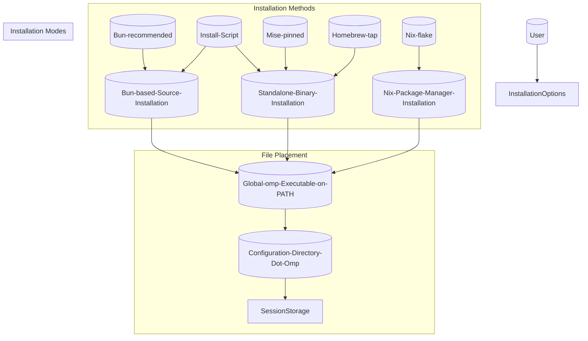
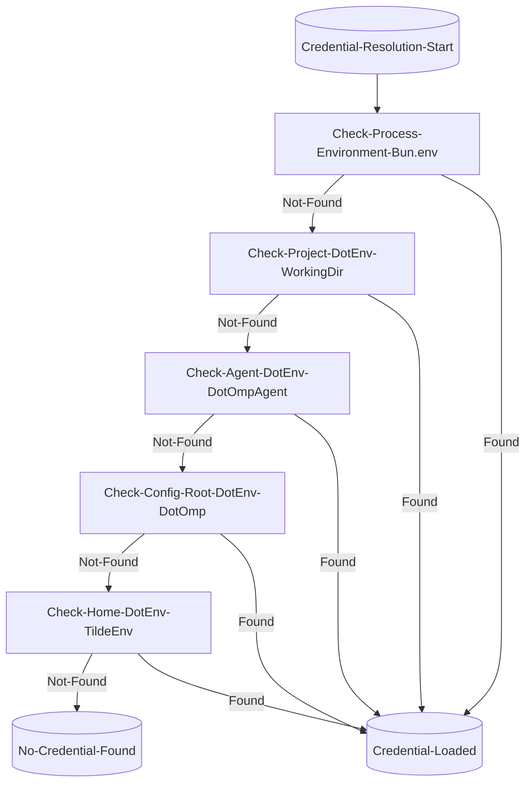
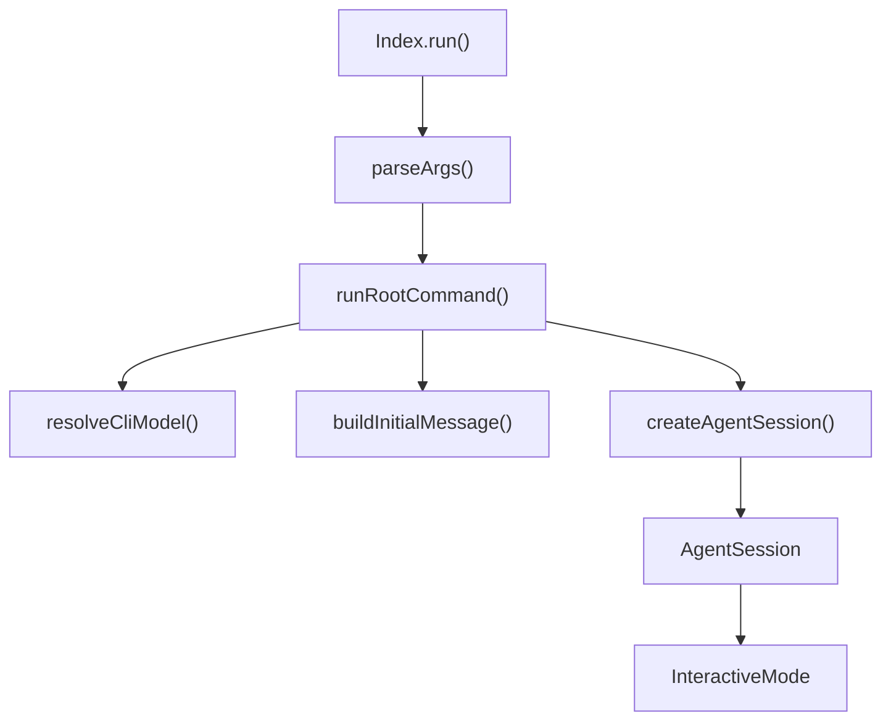
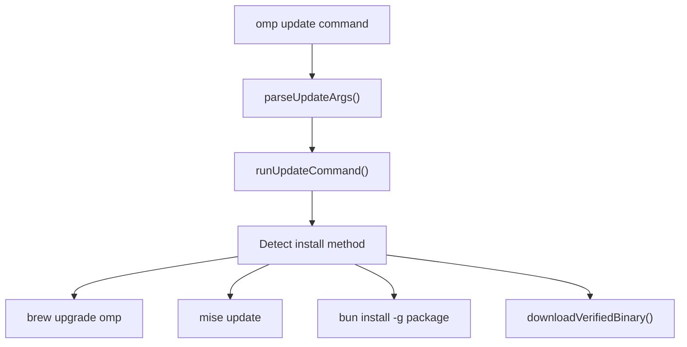
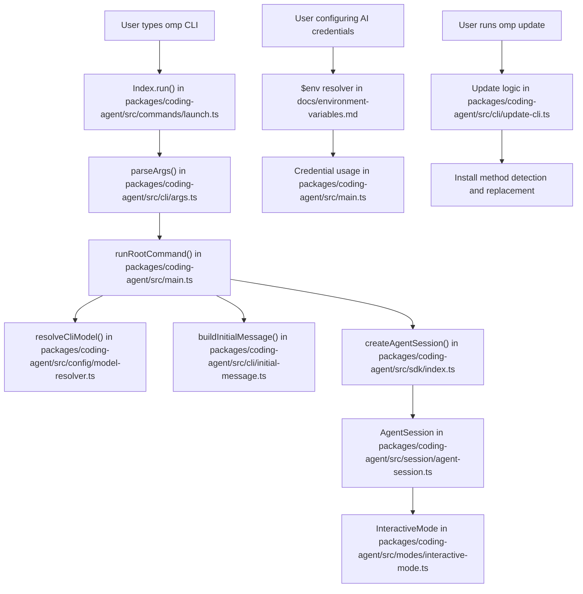

<!-- source: DeepWiki mcp.deepwiki.com · repo can1357/oh-my-pi · page 1.1 Getting Started · fetched 2026-10-30 -->

# Getting Started

<details>
<summary>Relevant source files</summary>

The following files were used as context for generating this wiki page:

- [AGENTS.md](AGENTS.md)
- [README.md](README.md)
- [docs/environment-variables.md](docs/environment-variables.md)
- [docs/providers.md](docs/providers.md)
- [packages/ai/README.md](packages/ai/README.md)
- [packages/catalog/src/compat/auth-ids.ts](packages/catalog/src/compat/auth-ids.ts)
- [packages/catalog/src/compat/provider-ids.ts](packages/catalog/src/compat/provider-ids.ts)
- [packages/catalog/src/compat/rules/auth/_order.kdl](packages/catalog/src/compat/rules/auth/_order.kdl)
- [packages/coding-agent/README.md](packages/coding-agent/README.md)
- [packages/coding-agent/src/cli/args.ts](packages/coding-agent/src/cli/args.ts)
- [packages/coding-agent/src/cli/extension-flags.ts](packages/coding-agent/src/cli/extension-flags.ts)
- [packages/coding-agent/src/cli/flag-tables.ts](packages/coding-agent/src/cli/flag-tables.ts)
- [packages/coding-agent/src/cli/help-extra.ts](packages/coding-agent/src/cli/help-extra.ts)
- [packages/coding-agent/src/commands/launch.ts](packages/coding-agent/src/commands/launch.ts)
- [packages/coding-agent/src/main.ts](packages/coding-agent/src/main.ts)
- [packages/coding-agent/src/session/session-manager.ts](packages/coding-agent/src/session/session-manager.ts)
- [packages/coding-agent/test/acp-mcp-isolation.test.ts](packages/coding-agent/test/acp-mcp-isolation.test.ts)
- [packages/coding-agent/test/acp-session-effects.test.ts](packages/coding-agent/test/acp-session-effects.test.ts)
- [packages/coding-agent/test/cli-explicit-extension-isolation.test.ts](packages/coding-agent/test/cli-explicit-extension-isolation.test.ts)
- [packages/coding-agent/test/cli-unknown-flag.test.ts](packages/coding-agent/test/cli-unknown-flag.test.ts)
- [packages/coding-agent/test/extension-flag-dispatch.test.ts](packages/coding-agent/test/extension-flag-dispatch.test.ts)
- [packages/coding-agent/test/extension-flag-initial-message.test.ts](packages/coding-agent/test/extension-flag-initial-message.test.ts)
- [packages/coding-agent/test/flag-tables.test.ts](packages/coding-agent/test/flag-tables.test.ts)
- [packages/coding-agent/test/initial-message.test.ts](packages/coding-agent/test/initial-message.test.ts)
- [packages/coding-agent/test/main-session-resolution-error.test.ts](packages/coding-agent/test/main-session-resolution-error.test.ts)
- [packages/coding-agent/test/session-manager/move-to.test.ts](packages/coding-agent/test/session-manager/move-to.test.ts)
- [packages/coding-agent/test/session-manager/title-source-persistence.test.ts](packages/coding-agent/test/session-manager/title-source-persistence.test.ts)
- [packages/natives/scripts/build-bindings.ts](packages/natives/scripts/build-bindings.ts)
- [scripts/install-tests/binary.dockerfile](scripts/install-tests/binary.dockerfile)
- [scripts/install-tests/source.dockerfile](scripts/install-tests/source.dockerfile)
- [scripts/install-tests/tarball.dockerfile](scripts/install-tests/tarball.dockerfile)
- [scripts/install.ps1](scripts/install.ps1)
- [scripts/install.sh](scripts/install.sh)

</details>


This page guides users through installing the `oh-my-pi` coding agent, configuring authentication, setting up the runtime environment, and running initial commands. The agent is a high-performance terminal assistant designed to integrate AI coding capabilities directly into your local development environment. It supports multiple AI providers, features sophisticated tool integrations, and facilitates seamless interactive development and automation.

---

## Installation

The coding agent is distributed primarily as the `@oh-my-pi/pi-coding-agent` package [packages/coding-agent/README.md:1-3](). It requires Bun runtime version 1.3.14 or later when running from source [README.md:96]().

### Installation Methods Overview

The agent supports multiple installation methods tailored to diverse platforms and user preferences:


Sources: [README.md:35-91]()

### Detailed Instructions

- **Bun Installation (Recommended):**
  Install globally using Bun’s package manager [README.md:53-57]():
  ```bash
  bun install -g @oh-my-pi/pi-coding-agent
  ```
  This installs the `omp` CLI accessible system-wide.

- **Install Script:**
  - For macOS/Linux [README.md:37-41]():
    ```bash
    curl -fsSL https://omp.sh/install | sh
    ```
  - For Windows (PowerShell) [README.md:84-88]():
    ```powershell
    irm https://omp.sh/install.ps1 | iex
    ```

- **Homebrew [README.md:47-51]()**
  ```bash
  brew install can1357/tap/omp
  ```

- **Pinned Versions with Mise [README.md:90-94]()**
  ```bash
  mise use -g github:can1357/oh-my-pi
  ```

- **Nix [README.md:59-67]()**
  Run without installing:
  ```bash
  nix run github:can1357/oh-my-pi
  ```
  Or install into your user profile:
  ```bash
  nix profile install github:can1357/oh-my-pi
  ```

### Notes
- Alpine Linux users must pre-install `libstdc++` and `libgcc` to satisfy dynamic linking requirements [README.md:45]().
- The agent establishes `~/.omp` as the default configuration directory.

Sources: [README.md:35-96](), [packages/coding-agent/README.md:1-3]()

---

## Initial Setup

After installation, executing `omp` initializes the working environment, creating necessary directories and default configuration files on first run.

### Configuration Directory Layout
`oh-my-pi` stores global state and runtime data under `~/.omp`:

| Path                  | Purpose                                                      |
|-----------------------|--------------------------------------------------------------|
| `~/.omp/config.yml`   | Primary user configuration and model role definitions        |
| `~/.omp/sessions/`    | Persistent session transcripts and artifacts in JSONL format |
| `~/.omp/plugins/`     | Installed extensions and plugins                              |
| `~/.omp/natives/`     | Cached native addons for runtime performance and Windows update compatibility |

### Profile Management
Profiles partition agent state to support multiple independent workflows:
- Use the `--profile <name>` command-line flag or set the `OMP_PROFILE` environment variable to select a profile [packages/coding-agent/src/cli/args.ts:26-31]().
- Profiles encapsulate separate session histories, cached data, credentials, and settings.

Sources: [packages/coding-agent/src/main.ts:130-153](), [packages/coding-agent/src/cli/args.ts:26-31]()

---

## Authentication Configuration

AI model providers require API credentials for usage. The agent implements a layered environment-based credential resolution scheme designed for flexibility.

### Credential Resolution Flow


Sources: [docs/environment-variables.md:15-23]()

### Common Provider Environment Variables

| Provider          | Environment Variable(s)                       |
|-------------------|----------------------------------------------|
| Anthropic         | `ANTHROPIC_API_KEY`, `ANTHROPIC_OAUTH_TOKEN`|
| OpenAI            | `OPENAI_API_KEY`, `OPENAI_CODEX_OAUTH_TOKEN`|
| Google Gemini     | `GEMINI_API_KEY`                             |
| Groq              | `GROQ_API_KEY`                               |
| Cerebras          | `CEREBRAS_API_KEY`                           |
| Together          | `TOGETHER_API_KEY`                           |
| Hugging Face      | `HUGGINGFACE_HUB_TOKEN`, `HF_TOKEN`         |

Sources: [docs/environment-variables.md:39-57]()

---

## Running Your First Commands

Once installed and configured, you use the `omp` binary to interact with the coding agent.

### CLI Command Flow Architecture


Sources: [packages/coding-agent/src/commands/launch.ts:20-33](), [packages/coding-agent/src/cli/args.ts:25-40](), [packages/coding-agent/src/main.ts:20-74]()

### Basic Usage Patterns
- **Interactive Session:**
  ```bash
  omp
  ```
- **One-off Prompt:**
  ```bash
  omp "Refactor this function to use async/await"
  ```
- **Resume Previous Session:**
  ```bash
  omp --continue
  ```
- **Model Selection:**
  ```bash
  omp --model gpt-4o-mini
  ```
- **Print Mode (CI/Scripting):**
  ```bash
  omp -p "Summarize README.md"
  ```

Sources: [packages/coding-agent/src/main.ts:20-74]()

---

## Updating the Agent

`oh-my-pi` includes an integrated update system that detects installation methods and updates automatically.

### Update Command Flow


Sources: [packages/coding-agent/src/cli/update-cli.ts:1-195](), [packages/coding-agent/src/commands/update.ts:1-10]()

To check for and install updates, execute:
```bash
omp update
```

Sources: [packages/coding-agent/src/cli/update-cli.ts:1-195](), [packages/coding-agent/src/commands/update.ts:1-10]()

---

## Appendix: Natural Language Space to Code Entity Mapping

This diagram bridges user-level commands and configuration concepts to their corresponding code implementations.


Sources: [packages/coding-agent/src/commands/launch.ts:20-33](), [packages/coding-agent/src/cli/args.ts:25-40](), [packages/coding-agent/src/main.ts:20-74](), [packages/coding-agent/src/cli/update-cli.ts:1-195]()

---

