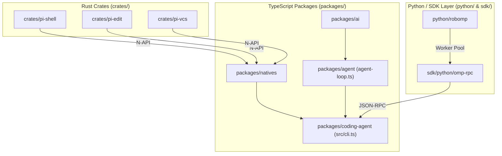
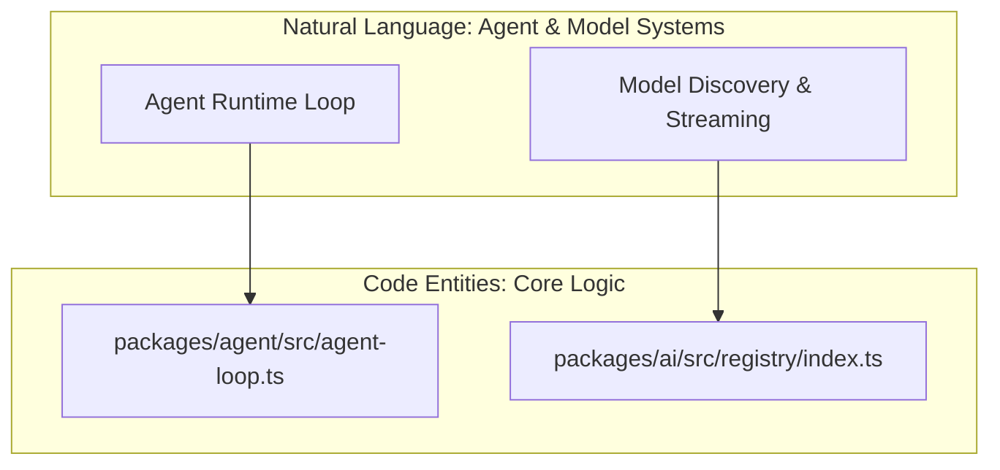
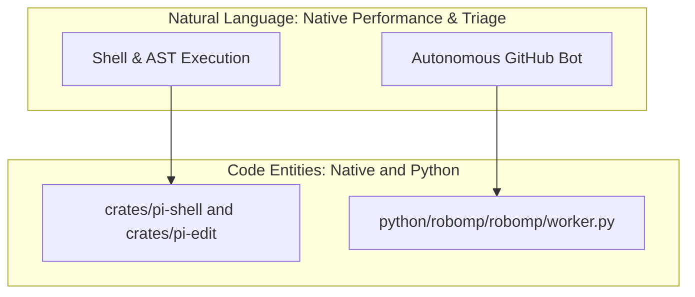

<!-- source: DeepWiki mcp.deepwiki.com · repo can1357/oh-my-pi · page 1.2 Repository Layout · fetched 2026-10-30 -->

# Repository Layout

Relevant source files

The following files were used as context for generating this wiki page:

- [.cargo/config.toml](.cargo/config.toml)
- [.github/workflows/ci.yml](.github/workflows/ci.yml)
- [Cargo.lock](Cargo.lock)
- [Cargo.toml](Cargo.toml)
- [bun.lock](bun.lock)
- [crates/pi-natives/src/spelling.rs](crates/pi-natives/src/spelling.rs)
- [crates/pi-shell/src/git.rs](crates/pi-shell/src/git.rs)
- [crates/pi-shell/src/git/guard.rs](crates/pi-shell/src/git/guard.rs)
- [docs/fs-scan-cache-architecture.md](docs/fs-scan-cache-architecture.md)
- [docs/natives-addon-loader-runtime.md](docs/natives-addon-loader-runtime.md)
- [docs/natives-architecture.md](docs/natives-architecture.md)
- [docs/natives-binding-contract.md](docs/natives-binding-contract.md)
- [docs/natives-build-release-debugging.md](docs/natives-build-release-debugging.md)
- [docs/natives-media-system-utils.md](docs/natives-media-system-utils.md)
- [docs/natives-rust-task-cancellation.md](docs/natives-rust-task-cancellation.md)
- [docs/natives-shell-pty-process.md](docs/natives-shell-pty-process.md)
- [docs/natives-text-search-pipeline.md](docs/natives-text-search-pipeline.md)
- [docs/porting-from-pi-mono.md](docs/porting-from-pi-mono.md)
- [docs/porting-to-natives.md](docs/porting-to-natives.md)
- [docs/user-facing-packages.md](docs/user-facing-packages.md)
- [package.json](package.json)
- [packages/agent/package.json](packages/agent/package.json)
- [packages/ai/package.json](packages/ai/package.json)
- [packages/browser-relay/README.md](packages/browser-relay/README.md)
- [packages/browser-relay/extension/chrome.d.ts](packages/browser-relay/extension/chrome.d.ts)
- [packages/coding-agent/package.json](packages/coding-agent/package.json)
- [packages/coding-agent/src/cli/browser-relay-cli.ts](packages/coding-agent/src/cli/browser-relay-cli.ts)
- [packages/coding-agent/src/exec/settings.ts](packages/coding-agent/src/exec/settings.ts)
- [packages/natives/package.json](packages/natives/package.json)
- [packages/stats/package.json](packages/stats/package.json)
- [packages/tui/package.json](packages/tui/package.json)
- [packages/utils/package.json](packages/utils/package.json)
- [rust-toolchain.toml](rust-toolchain.toml)

This page provides a technical mapping of the oh-my-pi monorepo layout, detailing disk organization, the responsibilities of core directories, and the cross-language integration mechanics connecting the TypeScript, Rust, and Python halves.

Sources: [`package.json:1-40`](), [`Cargo.toml:1-25`]()

---

## Monorepo Top-Level Directories

The oh-my-pi project is structured as a multi-language monorepo. The top-level directories divide responsibilities across runtime engines, native performance layers, build orchestration, and infrastructure:

| Directory | Purpose |
|---|---|
| `packages/` | TypeScript packages implementing the core agent CLI, AI integrations, tool registry, and TUI UI [`package.json:7-9`]() |
| `crates/` | Rust native crates compiled via N-API for performance-intensive shell, AST, and file operations [`Cargo.toml:6-24`]() |
| `python/` | Python components including the `robomp` GitHub triage bot and RPC client libraries [`package.json:10-11`]() |
| `sdk/` | Client SDKs (Go, Rust, Python) providing programmatic RPC control over agent sessions [`package.json:8-12`]() |
| `scripts/` | TypeScript/Bun automation scripts for testing, CI/CD orchestration, and release management [`package.json:72-124`]() |
| `bazel/` | Bazel build definitions managing hermetic multi-language compilation and cross-ecosystem dependencies [`MODULE.bazel:1-15`]() |
| `nix/` | Nix derivations and development shell configurations for reproducible build environments |
| `infra/` | Infrastructure deployment manifests, Kata Containers setups, and CI runner Dockerfiles |
| `docs/` | Comprehensive user and developer Markdown documentation |
| `.omp/` | Per-user local runtime directory for session persistence logs, native addon caches, and plugin state |
| `assets/` | Static visual artifacts, icons, and frontend UI templates |

Sources: [`package.json:1-40`](), [`Cargo.toml:1-25`](), [`.github/workflows/ci.yml:1-35`]()

---

## TypeScript Packages (`packages/`)

The `packages/` directory contains interdependent TypeScript modules that implement the core control plane, agent loops, AI abstraction layer, and terminal interface:

- **`coding-agent`**: The primary CLI driver package (`packages/coding-agent`) that exposes the `omp` executable, handles command-line argument parsing, session orchestration, and interactive terminal lifecycles [`packages/coding-agent/package.json:1-30`]().
- **`agent`**: Implements the transport-agnostic agent execution loop (`packages/agent`), managing state machines, tool-call scheduling, steering prompts, and replay policies [`packages/agent/package.json:1-30`]().
- **`ai`**: Provides unified LLM abstractions, automated model discovery, provider integrations (OpenAI, Anthropic, Google/Gemini), and event streaming (`packages/ai`) [`packages/ai/package.json:1-40`]().
- **`tui`**: A differential rendering Terminal User Interface engine (`packages/tui`) supporting rich components, markdown viewers, input editors, and keybinding management [`packages/tui/package.json:1-30`]().
- **`natives`**: Manages N-API loader state and architecture-specific bindings to underlying Rust addon binaries (`packages/natives`) [`packages/natives/package.json:1-35`]().
- **`utils`**: Shared utilities (`packages/utils`) providing logging, async primitives, file locking, streams, and crash diagnostics [`packages/utils/package.json:1-30`]().
- **`mnemopi`**: Local autonomous memory and vector embedding extraction system (`packages/mnemopi`) [`bun.lock:168-193`].
- **`snapcompact`**: Context compaction and token budget threshold monitoring utilities [`packages/agent/package.json:1-45`].
- **`catalog`**: KDL-driven model registry, prompt metadata, and compatibility rules engine (`packages/catalog`) [`bun.lock:64-76`].
- **`wire`**: Shared protocol wire definitions and collaborative editing types (`packages/collab-web`) [`bun.lock:118-134`].
- **`stats`**: Local telemetry, observability, and usage analytics dashboard (`packages/stats`) [`packages/stats/package.json:1-35`].

Sources: [`packages/coding-agent/package.json:1-80`](), [`packages/ai/package.json:1-68`](), [`packages/tui/package.json:1-60`](), [`packages/agent/package.json:1-78`]()

---

## Rust Native Crates (`crates/`)

The `crates/` workspace defines high-performance system crates that compile to native Node.js addons via N-API and integrate core performance features:

- **`pi-natives`**: Fast grep, globbing, diffing, syntax highlighting, and process utilities.
- **`pi-shell`**: Embedded shell builtins, PTY management, and process control built atop vendored `brush-core` [`Cargo.toml:8-19`].
- **`pi-edit`**: Tree-sitter-based structural AST search and editing tooling (`crates/pi-ast`, `crates/pi-edit`) [`Cargo.toml:7-10`].
- **`pi-vcs`**: Native Git repository access, diff tracking, and mutation interfaces (`crates/pi-vcs`) [`Cargo.toml:15-15`].
- **`pi-iso`**: Sandbox workspace isolation and filesystem overlay implementations (`crates/pi-iso`) [`Cargo.toml:11-11`].

Sources: [`Cargo.toml:1-25`](), [`Cargo.toml:35-49`]()

---

## Python Components and Client SDKs (`python/`, `sdk/`)

- **`python/robomp`**: An autonomous self-hosted GitHub triage bot built with FastAPI and SQLite that drives an `omp` agent instance running in JSON RPC mode [`package.json:8-12`].
- **`sdk/python/omp-rpc`**: Client SDK libraries for Python, Go, and Rust (`sdk/`) that communicate with the agent core over structured JSON RPC pipes [`package.json:8-12`].

Sources: [`package.json:8-12`]()

---

## Cross-Language Architecture and Control Flow

Sources: [`packages/coding-agent/package.json:27-29`](), [`packages/natives/package.json:59-62`]()

---

## Natural Language to Code Entity Mappings

The following diagrams map natural language conceptual domains to precise code entities within the monorepo architecture.

### Diagram 1: Control Plane and AI Engine Mapping

Sources: [`packages/agent/package.json:1-35`](), [`packages/ai/package.json:1-40`]()

### Diagram 2: Native Layer and Autonomous Triage Bot Mapping

Sources: [`Cargo.toml:6-24`](), [`package.json:8-12`]()

---

# End of Page

---

