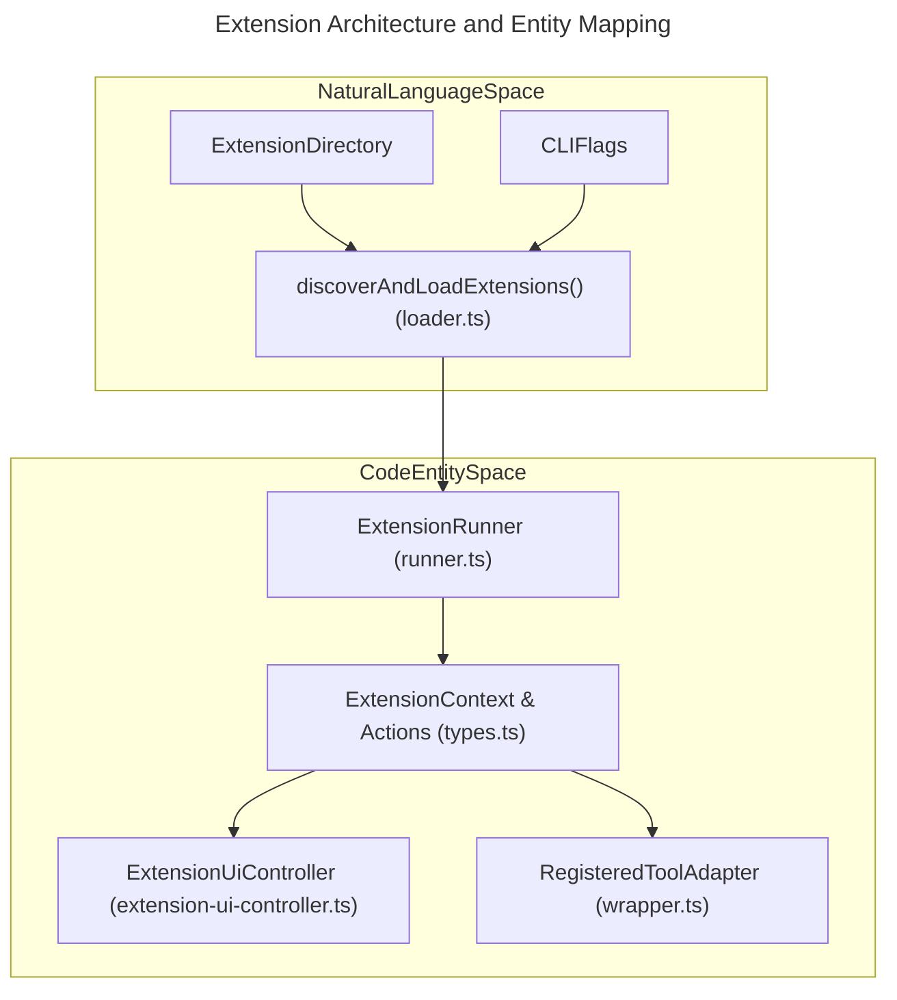
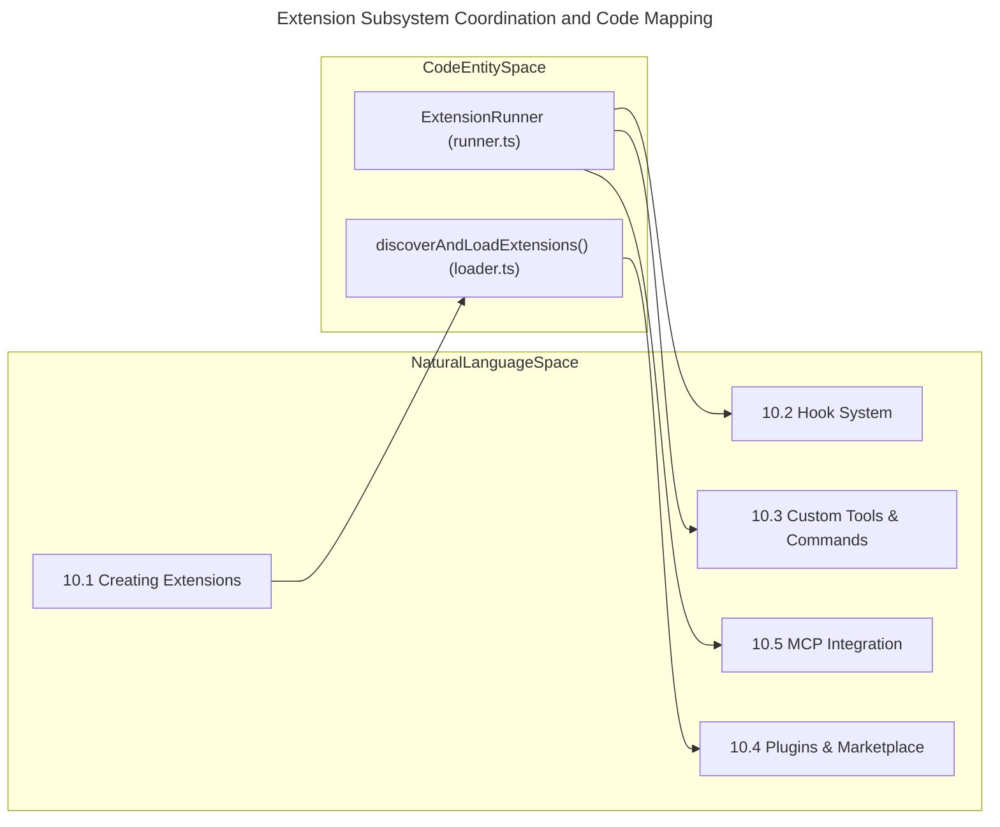

<!-- source: DeepWiki mcp.deepwiki.com · repo can1357/oh-my-pi · page 10 Extension System · fetched 2026-10-30 -->

# Extension System

Relevant source files

The following files were used as context for generating this wiki page:

- [docs/approval-mode.md](docs/approval-mode.md)
- [docs/extensions.md](docs/extensions.md)
- [docs/hooks.md](docs/hooks.md)
- [docs/skills/authoring-hooks.md](docs/skills/authoring-hooks.md)
- [packages/agent/test/utils/get-current-time.ts](packages/agent/test/utils/get-current-time.ts)
- [packages/coding-agent/src/eval/preludes.ts](packages/coding-agent/src/eval/preludes.ts)
- [packages/coding-agent/src/extensibility/custom-tools/types.ts](packages/coding-agent/src/extensibility/custom-tools/types.ts)
- [packages/coding-agent/src/extensibility/custom-tools/wrapper.ts](packages/coding-agent/src/extensibility/custom-tools/wrapper.ts)
- [packages/coding-agent/src/extensibility/extensions/loader.ts](packages/coding-agent/src/extensibility/extensions/loader.ts)
- [packages/coding-agent/src/extensibility/extensions/runner.ts](packages/coding-agent/src/extensibility/extensions/runner.ts)
- [packages/coding-agent/src/extensibility/extensions/types.ts](packages/coding-agent/src/extensibility/extensions/types.ts)
- [packages/coding-agent/src/extensibility/extensions/wrapper.ts](packages/coding-agent/src/extensibility/extensions/wrapper.ts)
- [packages/coding-agent/src/extensibility/hooks/runner.ts](packages/coding-agent/src/extensibility/hooks/runner.ts)
- [packages/coding-agent/src/extensibility/hooks/tool-wrapper.ts](packages/coding-agent/src/extensibility/hooks/tool-wrapper.ts)
- [packages/coding-agent/src/extensibility/hooks/types.ts](packages/coding-agent/src/extensibility/hooks/types.ts)
- [packages/coding-agent/src/extensibility/shared-events.ts](packages/coding-agent/src/extensibility/shared-events.ts)
- [packages/coding-agent/src/extensibility/tool-event-input.ts](packages/coding-agent/src/extensibility/tool-event-input.ts)
- [packages/coding-agent/src/extensibility/tool-proxy.ts](packages/coding-agent/src/extensibility/tool-proxy.ts)
- [packages/coding-agent/src/modes/controllers/extension-ui-controller.ts](packages/coding-agent/src/modes/controllers/extension-ui-controller.ts)
- [packages/coding-agent/src/tools/approval.ts](packages/coding-agent/src/tools/approval.ts)
- [packages/coding-agent/src/tools/ask.ts](packages/coding-agent/src/tools/ask.ts)
- [packages/coding-agent/test/ask-timeout.test.ts](packages/coding-agent/test/ask-timeout.test.ts)
- [packages/coding-agent/test/extensibility/tool-proxy.test.ts](packages/coding-agent/test/extensibility/tool-proxy.test.ts)
- [packages/coding-agent/test/extensions-runner.test.ts](packages/coding-agent/test/extensions-runner.test.ts)
- [packages/coding-agent/test/hook-tool-wrapper-input.test.ts](packages/coding-agent/test/hook-tool-wrapper-input.test.ts)
- [packages/coding-agent/test/modes/controllers/extension-ui-controller.test.ts](packages/coding-agent/test/modes/controllers/extension-ui-controller.test.ts)
- [packages/coding-agent/test/tools/approval.test.ts](packages/coding-agent/test/tools/approval.test.ts)
- [packages/coding-agent/test/tools/ask.test.ts](packages/coding-agent/test/tools/ask.test.ts)
- [packages/tui/src/overlays/approval-dialog.ts](packages/tui/src/overlays/approval-dialog.ts)
- [packages/tui/test/dialogs-native.test.ts](packages/tui/test/dialogs-native.test.ts)

The extension system provides a modular plugin architecture enabling customization and extension of the `oh-my-pi` coding agent’s functionality without modifying core source code. Extensions are TypeScript or JavaScript modules that subscribe to agent lifecycle events, register LLM-callable tools, define custom slash commands, add UI components, and integrate with external protocols such as the Model Context Protocol (MCP) [docs/extensions.md:1-12]().

This page gives a high-level overview of the extension architecture, discovery mechanisms, extension types, and the `ExtensionContext` API. Detailed technical guidance is provided in the child pages:
- [Creating Extensions](#10.1) — Guide to authoring extensions: manifest format, package layout, loader, discovery order, and legacy compatibility.
- [Hook System](#10.2) — Lifecycle hooks, event system, tool wrappers, and custom behavior implementations.
- [Custom Tools and Commands](#10.3) — Custom tool creation, slash commands, bundled commands, skills, and capability rules.
- [Plugins and Marketplace](#10.4) — Plugin manager, marketplace, CLI, git URL handling, and settings UI.
- [MCP Integration](#10.5) — Model Context Protocol integration: lifecycle, transports, OAuth, tool bridge, config scopes, registry.

---

## Extension Architecture and Lifecycle

Extensions discoverability and loading is handled by `discoverAndLoadExtensions()` in [packages/coding-agent/src/extensibility/extensions/loader.ts]() which scans configured local directories (e.g., `~/.omp/extensions`), plugin roots, and explicit CLI paths. Extensions may be standalone `.ts`/`.js` files or organized as packages with entry points [packages/coding-agent/src/extensibility/extensions/loader.ts:1-38]().

Each extension module exports a default factory function accepting an `ExtensionAPI` object to register event handlers, tools, commands, UI components, and more. Modules are imported concurrently during startup, but their factory functions are executed sequentially by path order, ensuring deterministic setup [docs/extensions.md:17-67]().

Once loaded, the `ExtensionRunner` class in [packages/coding-agent/src/extensibility/extensions/runner.ts]() manages active extensions' lifecycles during agent operation. It dispatches events to handlers, wraps tool executions for interception, and provides extension-specific runtime contexts for session-aware actions and UI interactions [packages/coding-agent/src/extensibility/extensions/runner.ts:62-106]().

Method calls that modify session state (e.g., `sendMessage()`) are disallowed during initial extension load to avoid inconsistent states and throw `ExtensionRuntimeNotInitializedError` if invoked prematurely [packages/coding-agent/src/extensibility/extensions/loader.ts:90-94]().

### Diagram: Extension Architecture and Entity Mapping

*This diagram shows extension source discovery flowing into runtime management and user interaction abstractions.*

Sources: [packages/coding-agent/src/extensibility/extensions/loader.ts:1-38](), [packages/coding-agent/src/extensibility/extensions/runner.ts:62-106](), [packages/coding-agent/src/extensibility/extensions/types.ts:60-140](), [packages/coding-agent/src/extensibility/extensions/wrapper.ts:66-146]()

---

## Subsystem Overview

The extension system comprises several coordinated subsystems responsible for different extensibility aspects. These subsystems are reflected in documentation chapters and mapped to core source files.

### Diagram: Extension Subsystem Coordination and Code Mapping

*Shows how major extension subdomains relate and where they are implemented.*

Sources: [packages/coding-agent/src/extensibility/extensions/loader.ts:1-38](), [packages/coding-agent/src/extensibility/extensions/runner.ts:62-106]()

---

### 10.1 Creating Extensions

Extensions are authored as TS/JS modules exporting a default factory: `(pi: ExtensionAPI) => void | Promise<void>`. This `ExtensionAPI` provides registration methods for event handlers (`pi.on()`), LLM-callable tools (`pi.registerTool()`), slash commands, shortcuts, message renderers, and more [docs/extensions.md:19-67]().

During extension load, runtime action methods like `pi.sendMessage()` are non-functional and throw until `ExtensionRunner.initialize()` is called at session startup. Extensions must defer runtime interaction to event handlers or commands invoked after initialization [docs/extensions.md:62-67]().

This page covers manifest format, package layout, loader behavior, extension discovery, and legacy compatibility shims. See the child page [Creating Extensions](#10.1) for full details.

Sources: [docs/extensions.md:17-67](), [packages/coding-agent/src/extensibility/extensions/loader.ts:90-172]()

---

### 10.2 Hook System

Hooks are a subsystem providing granular interception points and event handlers across the agent and session lifecycle (e.g., `session_start`, `session_before_compact`, `tool_call`). Hooks may intercept or block tool execution, inject context, or observe session flow [packages/coding-agent/src/extensibility/extensions/types.ts:100-138](), [packages/coding-agent/src/extensibility/extensions/runner.ts:97-106]().

Hooks share event and payload shapes with extensions but expose a reduced UI API to guarantee safe execution inside the agent loop, restricting editor and theme mutation [docs/hooks.md:1-95]().

Hooks are discovered ambiently from `.omp/hooks/pre` and `.omp/hooks/post` directories, loaded and treated similarly to extensions but on a legacy subsystem basis [docs/hooks.md:6-95]().

See [Hook System](#10.2) for detailed API, available events, and patterns.

Sources: [packages/coding-agent/src/extensibility/extensions/types.ts:100-138](), [packages/coding-agent/src/extensibility/extensions/runner.ts:97-106](), [docs/hooks.md:1-95]()

---

### 10.3 Custom Tools and Commands

Extensions can provide additional LLM-callable tools with strongly-typed argument schemas validated by omptype libraries such as `zod`, `arktype`, and legacy `typebox` [packages/coding-agent/src/extensibility/custom-tools/types.ts:72-77](). These tools implement custom logic and optional UI rendering [packages/coding-agent/src/extensibility/custom-tools/types.ts:1-6]().

In addition to tools, extensions may register slash commands and keyboard shortcuts, including bundled commands like `review` and `ci-green`. Capability rules allow enabling/disabling tools dynamically.

For API specs, implementation details, validation schemes, and usage patterns, see [Custom Tools and Commands](#10.3).

Sources: [packages/coding-agent/src/extensibility/custom-tools/types.ts:1-82](), [docs/extensions.md:87-107]()

---

### 10.4 Plugins and Marketplace

The plugin system enables discovery, installation, update, and configuration of externally distributed plugins leveraging extension APIs. It supports CLI-based plugin management, marketplace fetching, git URL resolution, and UI integration for plugin settings management [docs/extensions.md:13-15]().

Once loaded, plugins act as extensions managed by `ExtensionRunner`. The marketplace handles dependency tracking and versioning to ensure smooth user experience.

Refer to [Plugins and Marketplace](#10.4) for details.

Sources: [docs/extensions.md:13-15](), [packages/coding-agent/src/extensibility/extensions/loader.ts:37-38]()

---

### 10.5 MCP Integration

MCP (Model Context Protocol) integration extends `oh-my-pi` by connecting to external context and tool providers over stdio, HTTP, or SSE channels. It includes OAuth credential discovery and authentication, scoped configuration management, and Registry-driven extension metadata and inspection.

The protocol manager manages lifecycle and event transport, exposing integration points to extensions via a tool bridge for seamless runtime interoperability.

See [MCP Integration](#10.5) for comprehensive coverage.

Sources: [packages/coding-agent/test/tools/approval.test.ts:16-17]()

---

### ExtensionContext API

Extensions interact with `ExtensionContext` objects providing the following capabilities:
- Access to session and working directory context.
- APIs for sending messages (`sendMessage`, `sendUserMessage`, `appendEntry`).
- Query and control of active tools and commands.
- Setting session parameters (`setModel`, `setThinkingLevel`, etc.).
- Registering handlers for lifecycle events.
- Access to UI primitives via `ExtensionUIContext`.
- Integration with capability rules, flag values, and service tiers.

The contexts are created fresh per extension invocation with immutable bindings to ensure safe and side-effect-contained operations during an agent session [packages/coding-agent/src/extensibility/extensions/types.ts:60-140](), [packages/coding-agent/src/extensibility/extensions/runner.ts:108-156]().

---

Sources:  
- [packages/coding-agent/src/extensibility/extensions/loader.ts:1-172]()  
- [packages/coding-agent/src/extensibility/extensions/runner.ts:62-156]()  
- [packages/coding-agent/src/extensibility/extensions/types.ts:60-140]()  
- [packages/coding-agent/src/extensibility/extensions/wrapper.ts:66-146]()  
- [docs/extensions.md:1-188]()  
- [packages/coding-agent/src/extensibility/custom-tools/types.ts:1-82]()

---

