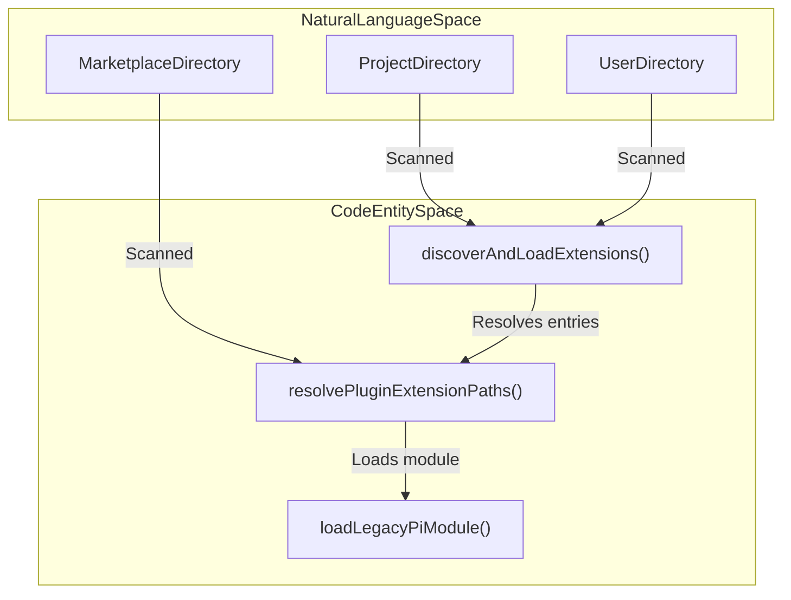
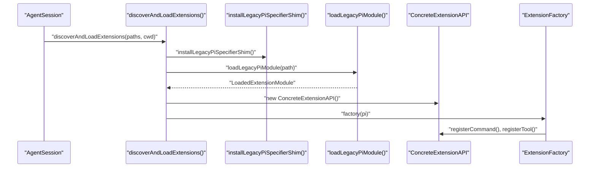
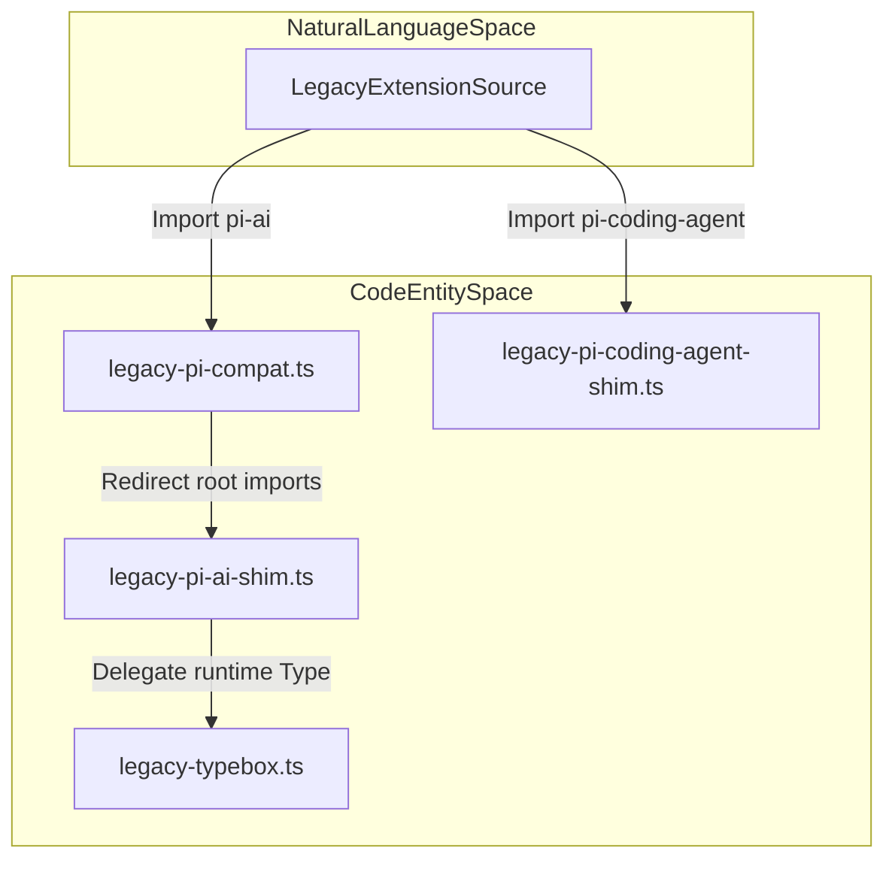

<!-- source: DeepWiki mcp.deepwiki.com · repo can1357/oh-my-pi · page 10.1 Creating Extensions · fetched 2026-10-30 -->

# Creating Extensions

<details>
<summary>Relevant source files</summary>

The following files were used as context for generating this wiki page:

- [docs/approval-mode.md](docs/approval-mode.md)
- [docs/extensions.md](docs/extensions.md)
- [docs/hooks.md](docs/hooks.md)
- [docs/skills/authoring-hooks.md](docs/skills/authoring-hooks.md)
- [packages/agent/test/utils/get-current-time.ts](packages/agent/test/utils/get-current-time.ts)
- [packages/coding-agent/scripts/legacy-pi-virtual-module.ts](packages/coding-agent/scripts/legacy-pi-virtual-module.ts)
- [packages/coding-agent/src/discovery/omp-extension-roots.ts](packages/coding-agent/src/discovery/omp-extension-roots.ts)
- [packages/coding-agent/src/eval/preludes.ts](packages/coding-agent/src/eval/preludes.ts)
- [packages/coding-agent/src/extensibility/custom-tools/types.ts](packages/coding-agent/src/extensibility/custom-tools/types.ts)
- [packages/coding-agent/src/extensibility/custom-tools/wrapper.ts](packages/coding-agent/src/extensibility/custom-tools/wrapper.ts)
- [packages/coding-agent/src/extensibility/extensions/directory-resolution.ts](packages/coding-agent/src/extensibility/extensions/directory-resolution.ts)
- [packages/coding-agent/src/extensibility/extensions/loader.ts](packages/coding-agent/src/extensibility/extensions/loader.ts)
- [packages/coding-agent/src/extensibility/extensions/runner.ts](packages/coding-agent/src/extensibility/extensions/runner.ts)
- [packages/coding-agent/src/extensibility/extensions/types.ts](packages/coding-agent/src/extensibility/extensions/types.ts)
- [packages/coding-agent/src/extensibility/extensions/wrapper.ts](packages/coding-agent/src/extensibility/extensions/wrapper.ts)
- [packages/coding-agent/src/extensibility/hooks/runner.ts](packages/coding-agent/src/extensibility/hooks/runner.ts)
- [packages/coding-agent/src/extensibility/hooks/tool-wrapper.ts](packages/coding-agent/src/extensibility/hooks/tool-wrapper.ts)
- [packages/coding-agent/src/extensibility/hooks/types.ts](packages/coding-agent/src/extensibility/hooks/types.ts)
- [packages/coding-agent/src/extensibility/legacy-pi-ai-shim.ts](packages/coding-agent/src/extensibility/legacy-pi-ai-shim.ts)
- [packages/coding-agent/src/extensibility/legacy-pi-coding-agent-shim.ts](packages/coding-agent/src/extensibility/legacy-pi-coding-agent-shim.ts)
- [packages/coding-agent/src/extensibility/legacy-pi-transcript.ts](packages/coding-agent/src/extensibility/legacy-pi-transcript.ts)
- [packages/coding-agent/src/extensibility/legacy-pi-tui-shim.ts](packages/coding-agent/src/extensibility/legacy-pi-tui-shim.ts)
- [packages/coding-agent/src/extensibility/plugins/legacy-pi-compat.ts](packages/coding-agent/src/extensibility/plugins/legacy-pi-compat.ts)
- [packages/coding-agent/src/extensibility/plugins/legacy-pi-virtual-modules.d.ts](packages/coding-agent/src/extensibility/plugins/legacy-pi-virtual-modules.d.ts)
- [packages/coding-agent/src/extensibility/plugins/loader.ts](packages/coding-agent/src/extensibility/plugins/loader.ts)
- [packages/coding-agent/src/extensibility/shared-events.ts](packages/coding-agent/src/extensibility/shared-events.ts)
- [packages/coding-agent/src/extensibility/tool-event-input.ts](packages/coding-agent/src/extensibility/tool-event-input.ts)
- [packages/coding-agent/src/extensibility/tool-proxy.ts](packages/coding-agent/src/extensibility/tool-proxy.ts)
- [packages/coding-agent/src/modes/controllers/extension-ui-controller.ts](packages/coding-agent/src/modes/controllers/extension-ui-controller.ts)
- [packages/coding-agent/src/tools/approval.ts](packages/coding-agent/src/tools/approval.ts)
- [packages/coding-agent/src/tools/ask.ts](packages/coding-agent/src/tools/ask.ts)
- [packages/coding-agent/test/ask-timeout.test.ts](packages/coding-agent/test/ask-timeout.test.ts)
- [packages/coding-agent/test/extensibility/legacy-pi-ai-root-exports.test.ts](packages/coding-agent/test/extensibility/legacy-pi-ai-root-exports.test.ts)
- [packages/coding-agent/test/extensibility/legacy-pi-ai-type-remap.test.ts](packages/coding-agent/test/extensibility/legacy-pi-ai-type-remap.test.ts)
- [packages/coding-agent/test/extensibility/legacy-pi-bundled-subpath-overrides.test.ts](packages/coding-agent/test/extensibility/legacy-pi-bundled-subpath-overrides.test.ts)
- [packages/coding-agent/test/extensibility/legacy-pi-bunfs-root.test.ts](packages/coding-agent/test/extensibility/legacy-pi-bunfs-root.test.ts)
- [packages/coding-agent/test/extensibility/legacy-pi-compaction-helpers.test.ts](packages/coding-agent/test/extensibility/legacy-pi-compaction-helpers.test.ts)
- [packages/coding-agent/test/extensibility/legacy-pi-default-resource-loader.test.ts](packages/coding-agent/test/extensibility/legacy-pi-default-resource-loader.test.ts)
- [packages/coding-agent/test/extensibility/legacy-pi-inplace-load.test.ts](packages/coding-agent/test/extensibility/legacy-pi-inplace-load.test.ts)
- [packages/coding-agent/test/extensibility/legacy-pi-override-fallback.test.ts](packages/coding-agent/test/extensibility/legacy-pi-override-fallback.test.ts)
- [packages/coding-agent/test/extensibility/legacy-pi-settings-manager.test.ts](packages/coding-agent/test/extensibility/legacy-pi-settings-manager.test.ts)
- [packages/coding-agent/test/extensibility/legacy-pi-upstream-root-bridges-alias.test.ts](packages/coding-agent/test/extensibility/legacy-pi-upstream-root-bridges-alias.test.ts)
- [packages/coding-agent/test/extensibility/legacy-pi-upstream-root-bridges.test.ts](packages/coding-agent/test/extensibility/legacy-pi-upstream-root-bridges.test.ts)
- [packages/coding-agent/test/extensibility/tool-proxy.test.ts](packages/coding-agent/test/extensibility/tool-proxy.test.ts)
- [packages/coding-agent/test/extensions-runner.test.ts](packages/coding-agent/test/extensions-runner.test.ts)
- [packages/coding-agent/test/fixtures/legacy-pi-babel-cache-positive-control.ts](packages/coding-agent/test/fixtures/legacy-pi-babel-cache-positive-control.ts)
- [packages/coding-agent/test/fixtures/legacy-pi-babel-cache-probe.ts](packages/coding-agent/test/fixtures/legacy-pi-babel-cache-probe.ts)
- [packages/coding-agent/test/hook-tool-wrapper-input.test.ts](packages/coding-agent/test/hook-tool-wrapper-input.test.ts)
- [packages/coding-agent/test/issue-973-legacy-pi-plugin.test.ts](packages/coding-agent/test/issue-973-legacy-pi-plugin.test.ts)
- [packages/coding-agent/test/legacy-pi-ast-behavior.test.ts](packages/coding-agent/test/legacy-pi-ast-behavior.test.ts)
- [packages/coding-agent/test/legacy-pi-traverse-runtime.test.ts](packages/coding-agent/test/legacy-pi-traverse-runtime.test.ts)
- [packages/coding-agent/test/modes/controllers/extension-ui-controller.test.ts](packages/coding-agent/test/modes/controllers/extension-ui-controller.test.ts)
- [packages/coding-agent/test/plugin-extensions-discovery.test.ts](packages/coding-agent/test/plugin-extensions-discovery.test.ts)
- [packages/coding-agent/test/plugin-manifest-paths.test.ts](packages/coding-agent/test/plugin-manifest-paths.test.ts)
- [packages/coding-agent/test/plugin-stale-lockfile-entry.test.ts](packages/coding-agent/test/plugin-stale-lockfile-entry.test.ts)
- [packages/coding-agent/test/plugin-unreadable-root.test.ts](packages/coding-agent/test/plugin-unreadable-root.test.ts)
- [packages/coding-agent/test/sdk-skills.test.ts](packages/coding-agent/test/sdk-skills.test.ts)
- [packages/coding-agent/test/tools/approval.test.ts](packages/coding-agent/test/tools/approval.test.ts)
- [packages/coding-agent/test/tools/ask.test.ts](packages/coding-agent/test/tools/ask.test.ts)
- [packages/tui/src/overlays/approval-dialog.ts](packages/tui/src/overlays/approval-dialog.ts)
- [packages/tui/test/dialogs-native.test.ts](packages/tui/test/dialogs-native.test.ts)

</details>


## Purpose and Scope

This section details how to create extensions for the `oh-my-pi` coding agent. It covers the extension manifest format, explains package structure conventions, describes the extension loader and runtime execution model via `ExtensionRuntime` [packages/coding-agent/src/extensibility/extensions/loader.ts:90-172]() and `ConcreteExtensionAPI`, outlines extension discovery order, and discusses the legacy compatibility shims in `legacy-pi-compat.ts` [packages/coding-agent/src/extensibility/plugins/legacy-pi-compat.ts:1-45]() that enable extensions originally developed for older `pi-coding-agent` and `pi-ai` packages to work transparently.

Sources:  
[packages/coding-agent/src/extensibility/extensions/loader.ts:1-60](),  
[packages/coding-agent/src/extensibility/plugins/legacy-pi-compat.ts:1-45]()

---

## Extension Discovery Order and Scopes

Extensions in `oh-my-pi` are discovered from multiple prioritized locations, where earlier sources override later ones in case of conflicts.

### Discovery Priority Matrix

| Priority | Scope              | Location / Source                               |
| -------- | ------------------ | -----------------------------------------------|
| 1        | **Project-scoped** | `<cwd>/.omp/extensions/`                        |
| 2        | **User-scoped**    | `~/.omp/agent/extensions/`                      |
| 3        | **Marketplace**    | `~/.omp/plugins/node_modules/`                  |
| 4        | **CLI Flags**      | Explicit `--extension` flag paths                |
| 5        | **Settings**       | Paths configured in `settings.json` under `extensions` |

This ordering allows project-specific extensions to supersede user-global ones, and plugin marketplace extensions to augment or replace defaults.

### Entry Point Resolution and Extension Path Lookup

When the extension path is a directory rather than a file, resolution heuristics apply in this order:

1. Look for `package.json` with an `omp.extensions` field listing relative extension entry scripts.  
2. Fallback to legacy `pi.extensions` field for older extensions.  
3. Search for `index.ts` or `index.js` files in the directory as defaults.  

This layered resolution supports both modern extension packages and legacy formats distributed via the marketplace or plugins [packages/coding-agent/src/extensibility/plugins/loader.ts:30-56](), [packages/coding-agent/src/extensibility/extensions/loader.ts:36-39]().

### Discovery to Loaded Module Bridge



Sources:  
[packages/coding-agent/src/extensibility/plugins/loader.ts:30-56](),  
[packages/coding-agent/src/extensibility/extensions/loader.ts:36-39]()

---

## Package Structure and Manifest Format

Extensions can be simple single-file modules or full packages that expose multiple extensions.

### Manifest Format

Packages supporting extensions declare their entry points under the `omp.extensions` field in their `package.json`:

```json
{
  "name": "@example/plugin",
  "version": "1.0.0",
  "omp": {
    "extensions": ["./dist/extension.ts"]
  }
}
```

Legacy extensions may declare `pi.extensions` to maintain compatibility:

```json
{
  "name": "legacy-pi-extension",
  "version": "1.0.0",
  "pi": {
    "extensions": ["./dist/extension.ts"]
  }
}
```

The loader consults these fields to determine the files to load as extensions [packages/coding-agent/src/extensibility/extensions/loader.ts:36-39](), [packages/coding-agent/src/extensibility/plugins/loader.ts:30-56]().

### Typical Directory Layout

A canonical extension package layout might be:

```
extension-root/
 ├─ package.json                    # Declares omp.extensions array
 ├─ dist/
 │   └─ extension.ts               # Main TypeScript/JavaScript extension module(s)
 ├─ assets/
 │   ├─ ui.html                   # Optional UI overlays or assets
 │   └─ style.css                 
 ├─ README.md                     # Documentation (recommended)
 └─ node_modules/                 # Dependencies (especially for marketplace plugins)
```

Extensions export a default factory function taking an `ExtensionAPI` instance [docs/extensions.md:19-27]() and [packages/coding-agent/src/extensibility/extensions/loader.ts:175-197]():

```ts
export default function (pi) {
  pi.registerCommand("my-command", { handler: async () => {} });
}
```

Sources:  
[docs/extensions.md:17-37](),  
[packages/coding-agent/src/extensibility/extensions/loader.ts:175-197]()

---

## Loader Architecture and Execution Model

Extensions are loaded through a runtime-managed process emphasizing legacy compatibility and sandboxing.

### Core Loader Components

- **`discoverAndLoadExtensions()`**: Orchestrates discovery and loading of extensions from specified paths [packages/coding-agent/src/extensibility/extensions/loader.ts:36-60]().

- **`loadLegacyPiModule()`**: Loads modules in a manner compatible with legacy Pi extension source structures via Babel AST rewriting for import specifiers, enabling remapping of legacy package imports to current implementations [packages/coding-agent/src/extensibility/plugins/legacy-pi-compat.ts:64-92]().

- **`ExtensionRuntime`** and **`ConcreteExtensionAPI`**: Classes that instantiate and maintain the extension runtime state and provide the API surface to extensions during initialization [packages/coding-agent/src/extensibility/extensions/loader.ts:100-197]().

### Loading Flow

1. CLI or session triggers extension discovery by calling `discoverAndLoadExtensions()` with a list of paths and current working directory.  
2. The discovery step resolves paths and then loads modules using `loadLegacyPiModule()` on each resolved extension entry file.  
3. Each loaded module exports a factory function which is invoked with a `ConcreteExtensionAPI` instance, hooking into runtime actions like registering tools and commands [docs/extensions.md:38-60]().  
4. Registered features populate global state, available tools, and command registries in the running agent.  

### Loading Sequence Diagram



Sources:  
[packages/coding-agent/src/extensibility/extensions/loader.ts:36-197](),  
[packages/coding-agent/src/extensibility/plugins/legacy-pi-compat.ts:64-92]()

---

## Legacy Compatibility Shims

Legacy extensions built for older versions of the `pi-ai` and `pi-coding-agent` packages rely on certain runtime behaviors and package interfaces that have since evolved. `oh-my-pi` maintains shims to support these extensions with minimal changes.

### Specifier Rewriting, Import Remapping, and In-Place Loading

- The `legacy-pi-compat.ts` module scans and parses extension source files at load time, rewriting imports of legacy package names (e.g. `@mariozechner/pi-ai`) to current shim modules via Babel AST parsing [packages/coding-agent/src/extensibility/plugins/legacy-pi-compat.ts:64-92]().
  
- Extensions are loaded **in place**, directly from their on-disk location, preserving `import.meta.url` to enable loading of static assets such as HTML, CSS, or image files [packages/coding-agent/test/extensibility/legacy-pi-inplace-load.test.ts:14-20]().

- This approach handles mixed ESM/CommonJS packages and supports dynamic import resolution peculiarities found in legacy extensions [packages/coding-agent/test/extensibility/legacy-pi-inplace-load.test.ts:96-122]().

### Legacy pi-coding-agent Shim

- Legacy extensions importing the package root of `pi-coding-agent` receive a compatibility shim via `legacy-pi-coding-agent-shim.ts` that re-exports core agent classes, tool definitions, and utility functions expected by older plugins [packages/coding-agent/src/extensibility/legacy-pi-coding-agent-shim.ts:1-25]().

- This shim sidesteps conflicts caused by overlapping CLI and package root entrypoints within Bun bundling, maintaining import identity and ensuring backwards compatibility.

### Legacy Pi Compatibility Shim Resolution Diagram



Sources:  
[packages/coding-agent/src/extensibility/plugins/legacy-pi-compat.ts:1-92](),  
[packages/coding-agent/src/extensibility/legacy-pi-ai-shim.ts:1-20](),  
[packages/coding-agent/src/extensibility/legacy-pi-coding-agent-shim.ts:1-25](),  
[packages/coding-agent/test/extensibility/legacy-pi-inplace-load.test.ts:14-20]()

---

## Summary Table: Mapping Natural Language Concepts to Code Entities

| Concept                    | Code Entity / Symbol                                                                                     | Description                                                |
| -------------------------- | ------------------------------------------------------------------------------------------------------- | ---------------------------------------------------------- |
| Extension Discovery        | `discoverAndLoadExtensions` [packages/coding-agent/src/extensibility/extensions/loader.ts:36-60]()         | Extension discovery entrypoint and resolution logic       |
| Extension Runtime          | `ExtensionRuntime`, `ConcreteExtensionAPI` [packages/coding-agent/src/extensibility/extensions/loader.ts:100-197]() | Extension runtime and API proxy classes                    |
| Legacy Pi Compatibility    | `legacy-pi-compat.ts`, `legacy-pi-ai-shim.ts`, `legacy-pi-coding-agent-shim.ts` [packages/coding-agent/src/extensibility/]() | Compatibility shims and loaders for legacy extensions     |
| Manifest Definition        | `package.json` fields `omp.extensions` or legacy `pi.extensions`                                        | Extension entry configuration in the package manifest     |
| Extension Module Loading   | `loadLegacyPiModule()` [packages/coding-agent/src/extensibility/plugins/legacy-pi-compat.ts:64-92]()       | AST-driven import rewriting and module loading for legacy  |

Sources:  
[packages/coding-agent/src/extensibility/extensions/loader.ts:36-197](),  
[packages/coding-agent/src/extensibility/plugins/legacy-pi-compat.ts:64-92](),  
[packages/coding-agent/src/extensibility/legacy-pi-ai-shim.ts:1-20](),  
[packages/coding-agent/src/extensibility/legacy-pi-coding-agent-shim.ts:1-25]()

---

