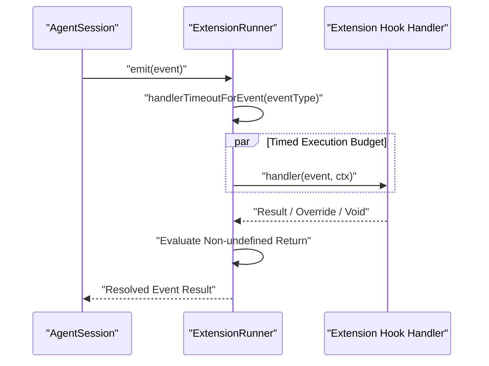
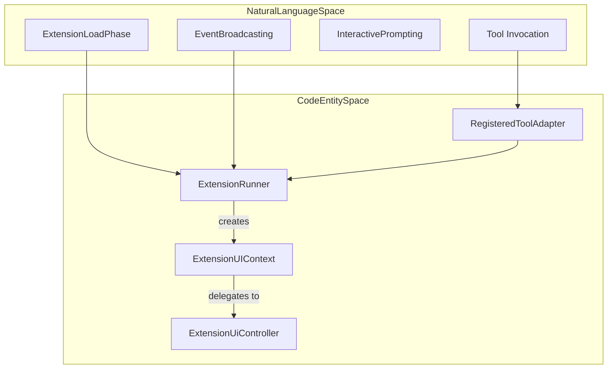
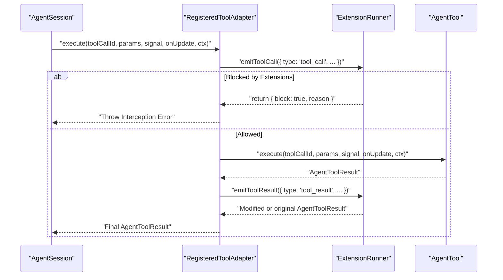

<!-- source: DeepWiki mcp.deepwiki.com · repo can1357/oh-my-pi · page 10.2 Hook System · fetched 2026-10-30 -->

# Hook System

Relevant source files

The following files were used as context for generating this wiki page:

- [docs/approval-mode.md](docs/approval-mode.md)
- [docs/extensions.md](docs/extensions.md)
- [docs/hooks.md](docs/hooks.md)
- [docs/skills/authoring-hooks.md](docs/skills/authoring-hooks.md)
- [packages/agent/test/utils/get-current-time.ts](packages/agent/test/utils/get-current-time.ts)
- [packages/coding-agent/src/eval/preludes.ts](packages/coding-agent/src/eval/preludes.ts)
- [packages/coding-agent/src/extensibility/custom-tools/types.ts](packages/coding-agent/src/extensibility/custom-tools/types.ts)
- [packages/coding-agent/src/extensibility/custom-tools/wrapper.ts](packages/coding-agent/src/extensibility/custom-tools/wrapper.ts)
- [packages/coding-agent/src/extensibility/extensions/loader.ts](packages/coding-agent/src/extensibility/extensions/loader.ts)
- [packages/coding-agent/src/extensibility/extensions/runner.ts](packages/coding-agent/src/extensibility/extensions/runner.ts)
- [packages/coding-agent/src/extensibility/extensions/types.ts](packages/coding-agent/src/extensibility/extensions/types.ts)
- [packages/coding-agent/src/extensibility/extensions/wrapper.ts](packages/coding-agent/src/extensibility/extensions/wrapper.ts)
- [packages/coding-agent/src/extensibility/hooks/runner.ts](packages/coding-agent/src/extensibility/hooks/runner.ts)
- [packages/coding-agent/src/extensibility/hooks/tool-wrapper.ts](packages/coding-agent/src/extensibility/hooks/tool-wrapper.ts)
- [packages/coding-agent/src/extensibility/hooks/types.ts](packages/coding-agent/src/extensibility/hooks/types.ts)
- [packages/coding-agent/src/extensibility/shared-events.ts](packages/coding-agent/src/extensibility/shared-events.ts)
- [packages/coding-agent/src/extensibility/tool-event-input.ts](packages/coding-agent/src/extensibility/tool-event-input.ts)
- [packages/coding-agent/src/extensibility/tool-proxy.ts](packages/coding-agent/src/extensibility/tool-proxy.ts)
- [packages/coding-agent/src/modes/controllers/extension-ui-controller.ts](packages/coding-agent/src/modes/controllers/extension-ui-controller.ts)
- [packages/coding-agent/src/tools/approval.ts](packages/coding-agent/src/tools/approval.ts)
- [packages/coding-agent/src/tools/ask.ts](packages/coding-agent/src/tools/ask.ts)
- [packages/coding-agent/test/ask-timeout.test.ts](packages/coding-agent/test/ask-timeout.test.ts)
- [packages/coding-agent/test/extensibility/tool-proxy.test.ts](packages/coding-agent/test/extensibility/tool-proxy.test.ts)
- [packages/coding-agent/test/extensions-runner.test.ts](packages/coding-agent/test/extensions-runner.test.ts)
- [packages/coding-agent/test/hook-tool-wrapper-input.test.ts](packages/coding-agent/test/hook-tool-wrapper-input.test.ts)
- [packages/coding-agent/test/modes/controllers/extension-ui-controller.test.ts](packages/coding-agent/test/modes/controllers/extension-ui-controller.test.ts)
- [packages/coding-agent/test/tools/approval.test.ts](packages/coding-agent/test/tools/approval.test.ts)
- [packages/coding-agent/test/tools/ask.test.ts](packages/coding-agent/test/tools/ask.test.ts)
- [packages/tui/src/overlays/approval-dialog.ts](packages/tui/src/overlays/approval-dialog.ts)
- [packages/tui/test/dialogs-native.test.ts](packages/tui/test/dialogs-native.test.ts)

The purpose of this page is to document the lifecycle hooks, shared events, tool wrappers, and implementation patterns for custom extension behavior within the `oh-my-pi` coding agent. The hook system enables extensions and custom tools to intercept, observe, and modify agent execution at major lifecycle boundaries.

Sources: [docs/extensions.md:1-37]()

---

## Overview and Event Dispatch Mechanics

The hook system is centrally coordinated by the `ExtensionRunner` class, which manages extension loading, event broadcasting to registered handlers, error capturing, and enforcing execution time limits [packages/coding-agent/src/extensibility/extensions/runner.ts:1-3](). The core runtime for the hook system resides in `packages/coding-agent/src/extensibility/extensions/runner.ts`.

### Event Registration

Extensions register lifecycle hooks and event listeners by invoking `pi.on(event, handler)` during their synchronous load-time initialization. These handlers receive events like `session_start`, `tool_call`, `turn_start`, and more, which correspond to significant lifecycle moments of the agent and its session.

### Timeout and Abort Management

To maintain responsiveness and prevent stalled execution, `ExtensionRunner` enforces strict timeout budgets on event handler invocations:

- **Default timeout:** 30,000 milliseconds (`EXTENSION_HANDLER_TIMEOUT_MS`) for most events [packages/coding-agent/src/extensibility/extensions/runner.ts:133-134]().
- **Session shutdown timeout:** 2,000 milliseconds (`SESSION_SHUTDOWN_HANDLER_TIMEOUT_MS`) for `session_shutdown` handlers, ensuring a quick teardown and preventing the process from hanging on slow or stuck extensions [packages/coding-agent/src/extensibility/extensions/runner.ts:148-157]().

Each event handler receives an abort signal, allowing it to cooperatively cancel ongoing asynchronous workloads if the event cycle is aborted.

### Event Dispatch Flow

When the agent or session emits an event, `ExtensionRunner`:

1. Determines the timeout budget using `handlerTimeoutForEvent(eventType)` [packages/coding-agent/src/extensibility/extensions/runner.ts:166-168]().
2. Dispatches the event to all registered handlers sequentially or concurrently.
3. Collects any overrides or return values from handlers.
4. Aggregates results, resolves conflicts, and emits final event results downstream.

**Diagram: Event Dispatch & Timeout Enforcement (`ExtensionRunner`)**

Sources: [packages/coding-agent/src/extensibility/extensions/runner.ts:116-168]()

---

## Component Architecture and Context API

The hook subsystem bridges core agent internal mechanisms with user-defined extensions through well-defined context and UI abstractions.

- **`ExtensionRunner`**  
  Manages the lifecycle of all loaded extensions, dispatches events, coordinates tool wrapper interception, and maintains the extension runtime context [packages/coding-agent/src/extensibility/extensions/runner.ts:1-3]().

- **`ExtensionContext`**  
  Passed to extension event handlers, it provides access to session state, environment details (like current working directory), user actions, and APIs to send messages or invoke tools [packages/coding-agent/src/extensibility/extensions/types.ts:67-70]().

- **`ExtensionUIContext`**  
  An asynchronous UI API surfaced to extensions to prompt the user with selectors, confirmation dialogs, input requests, and notifications. It integrates tightly with the interactive terminal UI (TUI) components [packages/modes/controllers/extension-ui-controller.ts:150-155]().

- **`ExtensionUiController`**  
  Implements the actual TUI overlay components and manages modal dialog queues, user input events, and concurrency [packages/coding-agent/src/modes/controllers/extension-ui-controller.ts:108-132]().

- **`RegisteredToolAdapter`**  
  Wraps native agent tools to intercept tool call and result events, enabling extensions to observe, modify, or block tool execution [packages/coding-agent/src/extensibility/extensions/wrapper.ts:66-111]().

### UI Handler Timeout Management

The `ExtensionRunner` carefully manages timeouts, suspending abort timers while waiting for user input to prevent premature cancellation during potentially lengthy interactions.

**Diagram: Component Architecture & Context Mapping (Natural Language to Code Entity Space)**

Sources: [packages/coding-agent/src/extensibility/extensions/runner.ts:1-3](), [packages/coding-agent/src/extensibility/extensions/wrapper.ts:66-146](), [packages/coding-agent/src/modes/controllers/extension-ui-controller.ts:108-155]()

---

## Lifecycle Hooks and Shared Events

The hook system exposes a rich set of lifecycle events that cover key moments in the agent and session lifecycles. These events are shared with the hooks and extensions subsystems and are codified in `packages/coding-agent/src/extensibility/shared-events.ts`.

| Hook Event               | Triggered When                                         | Can Override | Primary Use Cases                                    |
|--------------------------|-------------------------------------------------------|--------------|-----------------------------------------------------|
| `session_start`          | After session creation or load                         | No           | Initialize session state, start watchers            |
| `session_before_compact` | Before session compaction runs                         | Yes          | Customize compaction prompt, cancel compaction      |
| `session_compact`        | After session compaction completes                     | No           | Log compaction result, update indices                |
| `session_shutdown`       | On process exit or session termination                 | No           | Clean up resources, save telemetry                    |
| `tool_call`              | Immediately before tool execution                       | Yes          | Block or mutate tool call arguments                   |
| `tool_result`            | Immediately after tool execution                        | Yes          | Inspect or modify tool results                         |
| `auto_compaction_start`  | When auto-compaction triggers                           | No           | Notify UI or metrics collection                        |
| `turn_start`             | Start of each agent's reasoning or tool call turn      | No           | Track timing, reset turn state                         |

Extensions can register handlers on these events to hook into the agent lifecycle for customization, safety policies, monitoring, or augmenting behavior.

Sources: [packages/coding-agent/src/extensibility/extensions/types.ts:100-138]()

---

## Tool Interception and Wrappers

Tools executed by the agent are wrapped transparently by `RegisteredToolAdapter`, allowing the extension system to intercept calls and results [packages/coding-agent/src/extensibility/extensions/wrapper.ts:66-111]().

### Execution Flow

1. When an extension-enabled agent triggers a tool execution, the call goes through the `RegisteredToolAdapter.execute()` method [packages/coding-agent/src/extensibility/extensions/wrapper.ts:113-138]().

2. The wrapper normalizes input parameters and emits a **`tool_call`** event to all registered extension handlers. These handlers may:
   - Return `{ block: true, reason }` to abort the tool execution (enforced fail-closed).
   - Modify the tool call's arguments.
   - Allow the call to proceed unmodified.

3. If unblocked, the wrapper invokes the original native tool asynchronously [packages/coding-agent/src/extensibility/extensions/wrapper.ts:126-137]().

4. After the tool completes, the wrapper emits a **`tool_result`** event, permitting extensions to inspect or alter the output before it is returned.

5. The final (possibly modified) tool result is returned back to the agent or caller.

This layered interception mechanism provides comprehensive extension points for enforcing policies, approval workflows, data logging, telemetry augmentation, and custom result postprocessing.

**Diagram: Tool Interception Flow (`RegisteredToolAdapter`)**

Sources: [packages/coding-agent/src/extensibility/extensions/wrapper.ts:66-146]()

---

## Implementing Custom Behavior and Safeguards

Extension authors and runtime integrators must follow these guidelines and patterns to ensure correctness, safety, and robustness:

### 1. Load Phase Registration Only
- All event handler, tool, command, keyboard shortcut, and flag registrations **must** occur during the synchronous extension factory loading phase.
- Calling runtime session or agent actions (like `pi.sendMessage()`) during load throws an `ExtensionRuntimeNotInitializedError` [packages/coding-agent/src/extensibility/extensions/loader.ts:90-94]().
- This separation ensures side-effect-free initialization and consistent runtime binding.

### 2. Enforced Handler Timeouts
- Extensions must respect the handler timeout budgets (default 30 seconds; 2 seconds for shutdown) [packages/coding-agent/src/extensibility/extensions/runner.ts:133-157]().
- Each handler receives an abort signal that should be checked during async operations to enable cooperative cancellation.
- Handler errors or timeouts are caught and logged by the runner, preventing one faulty extension from blocking the system.

### 3. Fail-Closed Policy for Tool Calls
- When a `tool_call` handler throws an error or returns `{ block: true }`, the tool execution is immediately aborted to preserve safety.
- Extensions may implement flexible blocking policies by catching internal errors and returning appropriate override objects.
- This policy prevents unsafe actions from proceeding due to extension bugs or unexpected states.

### 4. UI Integration via ExtensionUIContext
- Extensions leverage the `ExtensionUIContext` to open selectors, input dialogs, confirmation windows, notifications, and custom widgets [packages/coding-agent/src/extensibility/extensions/types.ts:151-170]().
- The UI context APIs handle concurrency, safe queuing, and timeout interactions, exposing a consistent terminal UI experience.
- Internally, this layer is driven by `ExtensionUiController` integrating with native TUI components like `AskDialogComponent` and `ApprovalDialogComponent` [packages/modes/controllers/extension-ui-controller.ts:30-41]().

### 5. Tool Wrapping and Request Flow
- Custom tools can be registered through the extension API, exposed as wrapped `AgentTool` adapters [packages/coding-agent/src/extensibility/extensions/wrapper.ts:144-146]().
- Tool call inputs are normalized before event dispatch, ensuring consistent data shape.
- Tool call events enable authorization, argument validation, logging, and telemetry instrumentation.
- Tool result events permit post-processing, modification, or replacement of tool outputs before returning to the agent.

Sources: [packages/coding-agent/src/extensibility/extensions/loader.ts:90-94](), [packages/coding-agent/src/extensibility/extensions/runner.ts:133-157](), [packages/coding-agent/src/extensibility/extensions/wrapper.ts:144-146]()

---

## Summary

The hook system in `oh-my-pi` offers a powerful extensibility model based on lifecycle events and tool interception. Centered on the `ExtensionRunner`, it:

- Dispatches typed lifecycle and tool events to registered extensions with strict timeout and abort semantics.
- Provides interactive UI contexts for extensions to request user input safely.
- Wraps agent tools to allow pre- and post-execution interception, modification, or blocking.
- Enforces best practices like load-time only registration and fail-closed safety.

This system enables rich customization of the agent's runtime behavior while preserving robustness and maintainability.

Sources: [packages/coding-agent/src/extensibility/extensions/runner.ts:1-194](), [packages/coding-agent/src/extensibility/extensions/wrapper.ts:66-146]()

---

