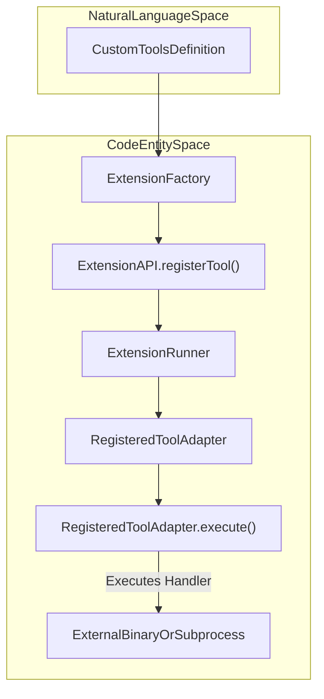
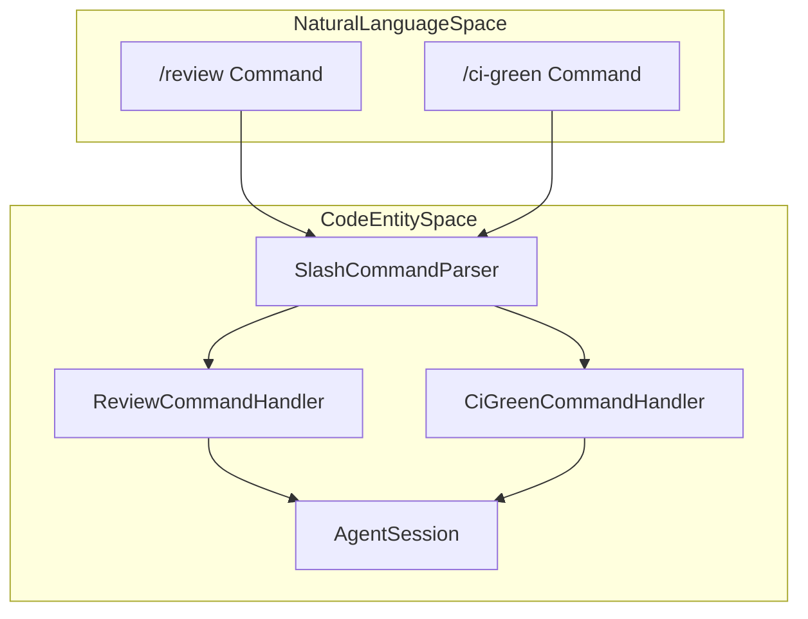
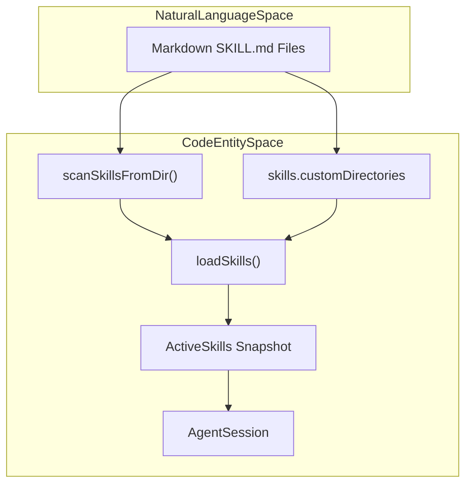
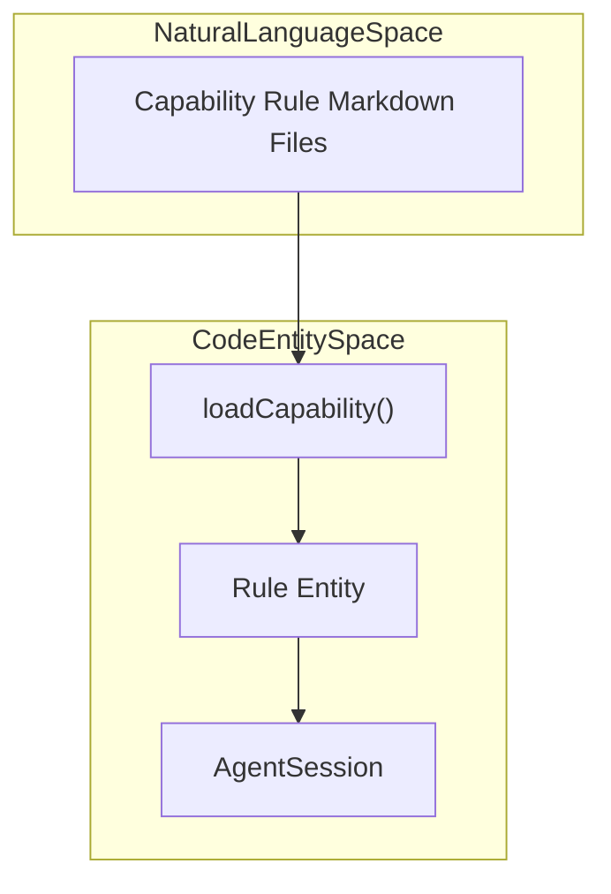
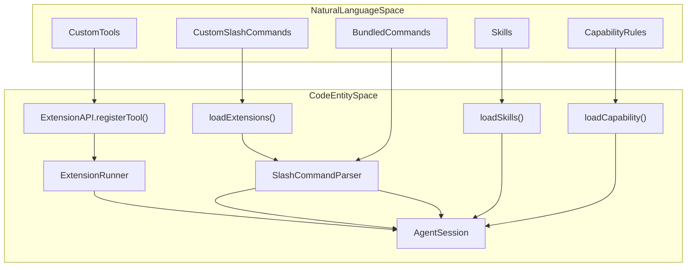

<!-- source: DeepWiki mcp.deepwiki.com · repo can1357/oh-my-pi · page 10.3 Custom Tools and Commands · fetched 2026-10-30 -->

# Custom Tools and Commands

Relevant source files

The following files were used as context for generating this wiki page:

- [docs/approval-mode.md](docs/approval-mode.md)
- [docs/extensions.md](docs/extensions.md)
- [docs/hooks.md](docs/hooks.md)
- [docs/skills.md](docs/skills.md)
- [docs/skills/authoring-hooks.md](docs/skills/authoring-hooks.md)
- [packages/agent/test/utils/get-current-time.ts](packages/agent/test/utils/get-current-time.ts)
- [packages/coding-agent/src/capability/skill.ts](packages/coding-agent/src/capability/skill.ts)
- [packages/coding-agent/src/discovery/agent-plugin-format.ts](packages/coding-agent/src/discovery/agent-plugin-format.ts)
- [packages/coding-agent/src/discovery/agent-plugins.ts](packages/coding-agent/src/discovery/agent-plugins.ts)
- [packages/coding-agent/src/discovery/agents-md.ts](packages/coding-agent/src/discovery/agents-md.ts)
- [packages/coding-agent/src/discovery/agents.ts](packages/coding-agent/src/discovery/agents.ts)
- [packages/coding-agent/src/discovery/claude-md.ts](packages/coding-agent/src/discovery/claude-md.ts)
- [packages/coding-agent/src/discovery/contained-path.ts](packages/coding-agent/src/discovery/contained-path.ts)
- [packages/coding-agent/src/eval/preludes.ts](packages/coding-agent/src/eval/preludes.ts)
- [packages/coding-agent/src/extensibility/custom-tools/types.ts](packages/coding-agent/src/extensibility/custom-tools/types.ts)
- [packages/coding-agent/src/extensibility/custom-tools/wrapper.ts](packages/coding-agent/src/extensibility/custom-tools/wrapper.ts)
- [packages/coding-agent/src/extensibility/extensions/loader.ts](packages/coding-agent/src/extensibility/extensions/loader.ts)
- [packages/coding-agent/src/extensibility/extensions/runner.ts](packages/coding-agent/src/extensibility/extensions/runner.ts)
- [packages/coding-agent/src/extensibility/extensions/types.ts](packages/coding-agent/src/extensibility/extensions/types.ts)
- [packages/coding-agent/src/extensibility/extensions/wrapper.ts](packages/coding-agent/src/extensibility/extensions/wrapper.ts)
- [packages/coding-agent/src/extensibility/hooks/runner.ts](packages/coding-agent/src/extensibility/hooks/runner.ts)
- [packages/coding-agent/src/extensibility/hooks/tool-wrapper.ts](packages/coding-agent/src/extensibility/hooks/tool-wrapper.ts)
- [packages/coding-agent/src/extensibility/hooks/types.ts](packages/coding-agent/src/extensibility/hooks/types.ts)
- [packages/coding-agent/src/extensibility/shared-events.ts](packages/coding-agent/src/extensibility/shared-events.ts)
- [packages/coding-agent/src/extensibility/skills.ts](packages/coding-agent/src/extensibility/skills.ts)
- [packages/coding-agent/src/extensibility/tool-event-input.ts](packages/coding-agent/src/extensibility/tool-event-input.ts)
- [packages/coding-agent/src/extensibility/tool-proxy.ts](packages/coding-agent/src/extensibility/tool-proxy.ts)
- [packages/coding-agent/src/mcp/transports/header-policy.ts](packages/coding-agent/src/mcp/transports/header-policy.ts)
- [packages/coding-agent/src/modes/controllers/extension-ui-controller.ts](packages/coding-agent/src/modes/controllers/extension-ui-controller.ts)
- [packages/coding-agent/src/task/discovery.ts](packages/coding-agent/src/task/discovery.ts)
- [packages/coding-agent/src/tools/approval.ts](packages/coding-agent/src/tools/approval.ts)
- [packages/coding-agent/src/tools/ask.ts](packages/coding-agent/src/tools/ask.ts)
- [packages/coding-agent/src/utils/open.ts](packages/coding-agent/src/utils/open.ts)
- [packages/coding-agent/test/ask-timeout.test.ts](packages/coding-agent/test/ask-timeout.test.ts)
- [packages/coding-agent/test/discovery/agent-plugins.test.ts](packages/coding-agent/test/discovery/agent-plugins.test.ts)
- [packages/coding-agent/test/discovery/agents-monorepo-skills.test.ts](packages/coding-agent/test/discovery/agents-monorepo-skills.test.ts)
- [packages/coding-agent/test/discovery/claude-md.test.ts](packages/coding-agent/test/discovery/claude-md.test.ts)
- [packages/coding-agent/test/extensibility/tool-proxy.test.ts](packages/coding-agent/test/extensibility/tool-proxy.test.ts)
- [packages/coding-agent/test/extensions-runner.test.ts](packages/coding-agent/test/extensions-runner.test.ts)
- [packages/coding-agent/test/fixtures/mcp-idle-wait-probe.ts](packages/coding-agent/test/fixtures/mcp-idle-wait-probe.ts)
- [packages/coding-agent/test/hook-tool-wrapper-input.test.ts](packages/coding-agent/test/hook-tool-wrapper-input.test.ts)
- [packages/coding-agent/test/issue-851-repro.test.ts](packages/coding-agent/test/issue-851-repro.test.ts)
- [packages/coding-agent/test/mcp-long-wait.test.ts](packages/coding-agent/test/mcp-long-wait.test.ts)
- [packages/coding-agent/test/modes/controllers/extension-ui-controller.test.ts](packages/coding-agent/test/modes/controllers/extension-ui-controller.test.ts)
- [packages/coding-agent/test/skill-prompt-message.test.ts](packages/coding-agent/test/skill-prompt-message.test.ts)
- [packages/coding-agent/test/skill-protocol-customdirs.test.ts](packages/coding-agent/test/skill-protocol-customdirs.test.ts)
- [packages/coding-agent/test/skills.test.ts](packages/coding-agent/test/skills.test.ts)
- [packages/coding-agent/test/task/discovery.test.ts](packages/coding-agent/test/task/discovery.test.ts)
- [packages/coding-agent/test/tools/approval.test.ts](packages/coding-agent/test/tools/approval.test.ts)
- [packages/coding-agent/test/tools/ask.test.ts](packages/coding-agent/test/tools/ask.test.ts)
- [packages/coding-agent/test/tools/windows-drive-alias.test.ts](packages/coding-agent/test/tools/windows-drive-alias.test.ts)
- [packages/coding-agent/test/utils/open.test.ts](packages/coding-agent/test/utils/open.test.ts)
- [packages/tui/src/overlays/approval-dialog.ts](packages/tui/src/overlays/approval-dialog.ts)
- [packages/tui/test/dialogs-native.test.ts](packages/tui/test/dialogs-native.test.ts)

This page explains how to extend `oh-my-pi` with custom tools (including wrappers for external binaries), custom slash commands, bundled workflow commands (`review`, `ci-green`), modular capabilities called skills, and capability rules. It covers their implementation details, data flow, key classes/functions, and discovery mechanisms.

---

## 1. Custom Tools and External Binary Wrappers

Extensions add custom tools by invoking the `registerTool` method on the `ExtensionAPI` interface during extension initialization (`docs/extensions.md`) [docs/extensions.md:17-110](). These tools expose new functionalities to the AI agent, accessible through a defined schema with parameter validation and a standard asynchronous execution model.

### Implementation Details

- **Tool Definition:**  
  A tool is registered with a unique tool name, a description string to inform prompting, parameter validation schemas (using TypeBox, ArkType, or Zod), and an async `execute` function implementing the tool logic `[packages/coding-agent/src/extensibility/extensions/types.ts:1-188]()`.
- **Execution:**  
  The `execute` method may call out to external binaries or system processes in a controlled environment, with input validation and path containment guards.
- **Classes and Interfaces:**  
  - `ExtensionAPI.registerTool()` defines the registration contract `[docs/extensions.md:112-132]()`.  
  - `ExtensionRunner` integrates and dispatches tools at runtime `[packages/coding-agent/src/extensibility/extensions/runner.ts:1-106]()`.  
  - `RegisteredToolAdapter` wraps each registered tool into an `AgentTool` instance `[packages/coding-agent/src/extensibility/extensions/wrapper.ts:66-139]()`.

### Data Flow Diagram

Title: Custom Tool Execution Data Flow

Sources:  
[packages/coding-agent/src/extensibility/extensions/types.ts:1-188](),  
[packages/coding-agent/src/extensibility/extensions/wrapper.ts:66-153](),  
[docs/extensions.md:17-110]()

---

## 2. Custom Slash Commands

Custom slash commands are textual commands accessible from the terminal UI or RPC interface to trigger predefined workflows or agent behaviors.

### Key Points

- Extensions dynamically register slash commands via `pi.registerCommand()` during initialization `[docs/extensions.md:17-110]().`
- Each command optionally provides argument completion and a handler function receiving an `ExtensionCommandContext` `[packages/coding-agent/src/extensibility/extensions/types.ts:67-68]()`.
- The command handler provides access to agent session APIs, UI elements (prompts, selects), and tool registries.

### Discovery and Registration

Custom slash commands are discovered alongside tools and skills dynamically during extension loading by the extension loader module `[packages/coding-agent/src/extensibility/extensions/loader.ts:1-197]()`.

Sources:  
[packages/coding-agent/src/extensibility/extensions/loader.ts:1-197](),  
[packages/coding-agent/src/extensibility/extensions/types.ts:67-68]()

---

## 3. Bundled Commands (`review`, `ci-green`)

`oh-my-pi` provides builtin bundled commands that implement sophisticated, multi-step workflows tailored for common developer tasks.

### Architecture Overview

- Bundled commands are implemented as command handler classes exposing an `execute` method.
- They encapsulate complex logic to sequence AI sessions, tool invocations, and interactive UI inputs.
- Examples:
  - **`review`**: Specialized code review command analyzing diffs from version control systems.
  - **`ci-green`**: Automates iterative test fixing via running CI workflows and applying fixes.

### Command Handling Flow

Title: Bundled Command Execution Pipeline

Sources:  
[packages/coding-agent/src/extensibility/extensions/runner.ts:1-106]()

---

## 4. Skills

Skills extend the agent's reasoning with modular, file-backed prompt packages described by markdown files (`SKILL.md`) containing YAML frontmatter metadata `[packages/coding-agent/src/extensibility/skills.ts:31-50]().`

### Skill Discovery and Loading

- Skills are discovered from native user/project-level directories, Claude marketplace plugin skill directories, and custom directories (`skills.customDirectories`) `[packages/coding-agent/test/skills.test.ts:95-150]()`.
- Discovery performs a non-recursive scan for skill directories directly under a `skills/` folder, expecting each skill in `<skillname>/SKILL.md` `[packages/coding-agent/src/extensibility/skills.ts:74-93]()`.
- The discovery function `loadSkills()` combines and deduplicates skills from multiple sources, resolves naming collisions with a deterministic priority scheme, and namespaces duplicates `[packages/coding-agent/src/extensibility/skills.ts:119-147]()`.

### Skill Data Structure

Each skill includes key metadata used in runtime:

| Field          | Description                                                       |
|----------------|------------------------------------------------------------------|
| `name`         | Skill name (used as invocation and key identifier)               |
| `description`  | Brief description for prompts and awareness                      |
| `filePath`     | Full path to the `SKILL.md` file                                 |
| `baseDir`      | Directory root of the skill                                       |
| `source`       | Skill provider ID, e.g., `"custom"`, `"native"`, `"skillshare"` |
| `hide`         | Boolean to hide the skill from listings but keep it invocable    |
| `containRoot`  | Root directory for agent plugin skills resolving resources       |
| `_source`      | Internal source metadata for display and caching                  |

### Skill Discovery Flow

Title: Skill Discovery and Loading Architecture

Sources:  
[packages/coding-agent/src/extensibility/skills.ts:1-156](),  
[packages/coding-agent/test/skills.test.ts:1-150](),  
[docs/skills.md]()

---

## 5. Capability Rules

Capability rules express conditional policies that shape agent runtime behavior—enabling or disabling features, tools, or interaction modes dynamically based on session context or environment.

### Rule Discovery and Data Structure

- Rules are defined as Markdown files with YAML frontmatter specifying conditions.
- Each rule is parsed and evaluated against session constraints.
- The agent session evaluates active capability rules to guard tool usage, customize prompt construction, and control feature availability `[packages/coding-agent/src/extensibility/extensions/runner.ts:31-31]()`.

### Rule Processing Flow

Title: Capability Rule Evaluation Pipeline

Sources:  
[packages/coding-agent/src/extensibility/extensions/runner.ts:31-31](),  
[packages/coding-agent/src/extensibility/skills.ts:9-9]()

---

# Summary Diagram: Natural Language Extensions to Code Entities

This diagram bridges the concepts of natural language visible constructs (custom tools, commands, skills, and rules) to their key runtime implementation entities within the codebase:

Title: Natural Language to Code Entity Mapping

Sources:  
[packages/coding-agent/src/extensibility/extensions/types.ts:1-188](),  
[packages/coding-agent/src/extensibility/extensions/runner.ts:1-106](),  
[packages/coding-agent/src/extensibility/skills.ts:1-156](),  
[packages/coding-agent/src/extensibility/extensions/loader.ts:1-197]()

---

# References

- Custom tool registration and wrappers:  
  [packages/coding-agent/src/extensibility/extensions/types.ts:1-188](),  
  [packages/coding-agent/src/extensibility/extensions/wrapper.ts:66-153]()

- Slash commands and extension loader:  
  [packages/coding-agent/src/extensibility/extensions/loader.ts:1-197](),  
  [packages/coding-agent/src/extensibility/extensions/types.ts:67-68]()

- Extension runner execution:  
  [packages/coding-agent/src/extensibility/extensions/runner.ts:1-106]()

- Skills loading and management:  
  [packages/coding-agent/src/extensibility/skills.ts:1-156](),  
  [packages/coding-agent/test/skills.test.ts:1-150](),  
  [docs/skills.md]()

---

