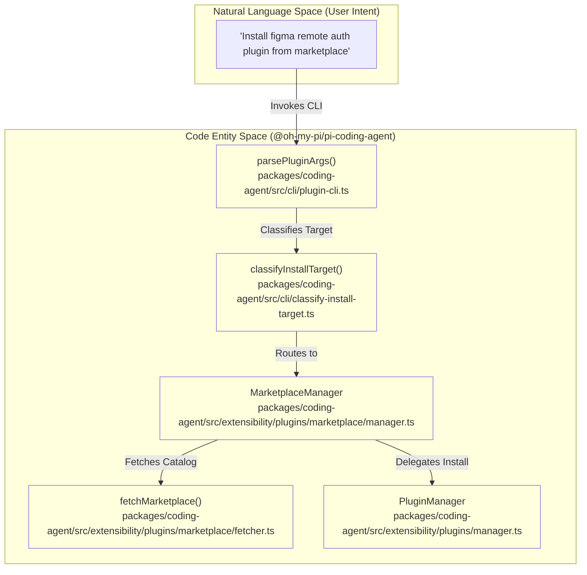
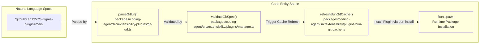

<!-- source: DeepWiki mcp.deepwiki.com · repo can1357/oh-my-pi · page 10.4 Plugins and Marketplace · fetched 2026-10-30 -->

# Plugins and Marketplace

Relevant source files

The following files were used as context for generating this wiki page:

- [docs/marketplace.md](docs/marketplace.md)
- [docs/plugin-manager-installer-plumbing.md](docs/plugin-manager-installer-plumbing.md)
- [packages/coding-agent/scripts/legacy-pi-virtual-module.ts](packages/coding-agent/scripts/legacy-pi-virtual-module.ts)
- [packages/coding-agent/src/cli/classify-install-target.ts](packages/coding-agent/src/cli/classify-install-target.ts)
- [packages/coding-agent/src/cli/plugin-cli.ts](packages/coding-agent/src/cli/plugin-cli.ts)
- [packages/coding-agent/src/discovery/omp-extension-roots.ts](packages/coding-agent/src/discovery/omp-extension-roots.ts)
- [packages/coding-agent/src/extensibility/extensions/directory-resolution.ts](packages/coding-agent/src/extensibility/extensions/directory-resolution.ts)
- [packages/coding-agent/src/extensibility/legacy-pi-ai-shim.ts](packages/coding-agent/src/extensibility/legacy-pi-ai-shim.ts)
- [packages/coding-agent/src/extensibility/legacy-pi-coding-agent-shim.ts](packages/coding-agent/src/extensibility/legacy-pi-coding-agent-shim.ts)
- [packages/coding-agent/src/extensibility/legacy-pi-transcript.ts](packages/coding-agent/src/extensibility/legacy-pi-transcript.ts)
- [packages/coding-agent/src/extensibility/legacy-pi-tui-shim.ts](packages/coding-agent/src/extensibility/legacy-pi-tui-shim.ts)
- [packages/coding-agent/src/extensibility/plugins/bun-cli.ts](packages/coding-agent/src/extensibility/plugins/bun-cli.ts)
- [packages/coding-agent/src/extensibility/plugins/bun-git-cache.ts](packages/coding-agent/src/extensibility/plugins/bun-git-cache.ts)
- [packages/coding-agent/src/extensibility/plugins/git-url.ts](packages/coding-agent/src/extensibility/plugins/git-url.ts)
- [packages/coding-agent/src/extensibility/plugins/installer.ts](packages/coding-agent/src/extensibility/plugins/installer.ts)
- [packages/coding-agent/src/extensibility/plugins/legacy-pi-compat.ts](packages/coding-agent/src/extensibility/plugins/legacy-pi-compat.ts)
- [packages/coding-agent/src/extensibility/plugins/legacy-pi-virtual-modules.d.ts](packages/coding-agent/src/extensibility/plugins/legacy-pi-virtual-modules.d.ts)
- [packages/coding-agent/src/extensibility/plugins/loader.ts](packages/coding-agent/src/extensibility/plugins/loader.ts)
- [packages/coding-agent/src/extensibility/plugins/manager.ts](packages/coding-agent/src/extensibility/plugins/manager.ts)
- [packages/coding-agent/src/extensibility/plugins/marketplace-auto-update.ts](packages/coding-agent/src/extensibility/plugins/marketplace-auto-update.ts)
- [packages/coding-agent/src/extensibility/plugins/marketplace/cache.ts](packages/coding-agent/src/extensibility/plugins/marketplace/cache.ts)
- [packages/coding-agent/src/extensibility/plugins/marketplace/fetcher.ts](packages/coding-agent/src/extensibility/plugins/marketplace/fetcher.ts)
- [packages/coding-agent/src/extensibility/plugins/marketplace/manager.ts](packages/coding-agent/src/extensibility/plugins/marketplace/manager.ts)
- [packages/coding-agent/src/extensibility/plugins/marketplace/registry.ts](packages/coding-agent/src/extensibility/plugins/marketplace/registry.ts)
- [packages/coding-agent/src/extensibility/plugins/marketplace/source-resolver.ts](packages/coding-agent/src/extensibility/plugins/marketplace/source-resolver.ts)
- [packages/coding-agent/src/extensibility/plugins/marketplace/types.ts](packages/coding-agent/src/extensibility/plugins/marketplace/types.ts)
- [packages/coding-agent/src/extensibility/plugins/parser.ts](packages/coding-agent/src/extensibility/plugins/parser.ts)
- [packages/coding-agent/src/extensibility/plugins/runtime-config.ts](packages/coding-agent/src/extensibility/plugins/runtime-config.ts)
- [packages/coding-agent/src/extensibility/plugins/types.ts](packages/coding-agent/src/extensibility/plugins/types.ts)
- [packages/coding-agent/test/extensibility/legacy-pi-ai-root-exports.test.ts](packages/coding-agent/test/extensibility/legacy-pi-ai-root-exports.test.ts)
- [packages/coding-agent/test/extensibility/legacy-pi-ai-type-remap.test.ts](packages/coding-agent/test/extensibility/legacy-pi-ai-type-remap.test.ts)
- [packages/coding-agent/test/extensibility/legacy-pi-bundled-subpath-overrides.test.ts](packages/coding-agent/test/extensibility/legacy-pi-bundled-subpath-overrides.test.ts)
- [packages/coding-agent/test/extensibility/legacy-pi-bunfs-root.test.ts](packages/coding-agent/test/extensibility/legacy-pi-bunfs-root.test.ts)
- [packages/coding-agent/test/extensibility/legacy-pi-compaction-helpers.test.ts](packages/coding-agent/test/extensibility/legacy-pi-compaction-helpers.test.ts)
- [packages/coding-agent/test/extensibility/legacy-pi-default-resource-loader.test.ts](packages/coding-agent/test/extensibility/legacy-pi-default-resource-loader.test.ts)
- [packages/coding-agent/test/extensibility/legacy-pi-inplace-load.test.ts](packages/coding-agent/test/extensibility/legacy-pi-inplace-load.test.ts)
- [packages/coding-agent/test/extensibility/legacy-pi-override-fallback.test.ts](packages/coding-agent/test/extensibility/legacy-pi-override-fallback.test.ts)
- [packages/coding-agent/test/extensibility/legacy-pi-settings-manager.test.ts](packages/coding-agent/test/extensibility/legacy-pi-settings-manager.test.ts)
- [packages/coding-agent/test/extensibility/legacy-pi-upstream-root-bridges-alias.test.ts](packages/coding-agent/test/extensibility/legacy-pi-upstream-root-bridges-alias.test.ts)
- [packages/coding-agent/test/extensibility/legacy-pi-upstream-root-bridges.test.ts](packages/coding-agent/test/extensibility/legacy-pi-upstream-root-bridges.test.ts)
- [packages/coding-agent/test/fixtures/legacy-pi-babel-cache-positive-control.ts](packages/coding-agent/test/fixtures/legacy-pi-babel-cache-positive-control.ts)
- [packages/coding-agent/test/fixtures/legacy-pi-babel-cache-probe.ts](packages/coding-agent/test/fixtures/legacy-pi-babel-cache-probe.ts)
- [packages/coding-agent/test/git-url.test.ts](packages/coding-agent/test/git-url.test.ts)
- [packages/coding-agent/test/issue-14518-malformed-plugin-overrides.test.ts](packages/coding-agent/test/issue-14518-malformed-plugin-overrides.test.ts)
- [packages/coding-agent/test/issue-973-legacy-pi-plugin.test.ts](packages/coding-agent/test/issue-973-legacy-pi-plugin.test.ts)
- [packages/coding-agent/test/legacy-pi-ast-behavior.test.ts](packages/coding-agent/test/legacy-pi-ast-behavior.test.ts)
- [packages/coding-agent/test/legacy-pi-traverse-runtime.test.ts](packages/coding-agent/test/legacy-pi-traverse-runtime.test.ts)
- [packages/coding-agent/test/marketplace/cache.test.ts](packages/coding-agent/test/marketplace/cache.test.ts)
- [packages/coding-agent/test/marketplace/cli.test.ts](packages/coding-agent/test/marketplace/cli.test.ts)
- [packages/coding-agent/test/marketplace/fetcher.test.ts](packages/coding-agent/test/marketplace/fetcher.test.ts)
- [packages/coding-agent/test/marketplace/manager.test.ts](packages/coding-agent/test/marketplace/manager.test.ts)
- [packages/coding-agent/test/marketplace/parse-internal-url.test.ts](packages/coding-agent/test/marketplace/parse-internal-url.test.ts)
- [packages/coding-agent/test/marketplace/registry.test.ts](packages/coding-agent/test/marketplace/registry.test.ts)
- [packages/coding-agent/test/marketplace/source-resolver.test.ts](packages/coding-agent/test/marketplace/source-resolver.test.ts)
- [packages/coding-agent/test/modes/components/plugin-list-marketplace.test.ts](packages/coding-agent/test/modes/components/plugin-list-marketplace.test.ts)
- [packages/coding-agent/test/plugin-config-validate.test.ts](packages/coding-agent/test/plugin-config-validate.test.ts)
- [packages/coding-agent/test/plugin-config.test.ts](packages/coding-agent/test/plugin-config.test.ts)
- [packages/coding-agent/test/plugin-doctor-version-drift.test.ts](packages/coding-agent/test/plugin-doctor-version-drift.test.ts)
- [packages/coding-agent/test/plugin-extensions-discovery.test.ts](packages/coding-agent/test/plugin-extensions-discovery.test.ts)
- [packages/coding-agent/test/plugin-install-git.test.ts](packages/coding-agent/test/plugin-install-git.test.ts)
- [packages/coding-agent/test/plugin-install-local.test.ts](packages/coding-agent/test/plugin-install-local.test.ts)
- [packages/coding-agent/test/plugin-install-npm-dedupe.test.ts](packages/coding-agent/test/plugin-install-npm-dedupe.test.ts)
- [packages/coding-agent/test/plugin-install-validation.test.ts](packages/coding-agent/test/plugin-install-validation.test.ts)
- [packages/coding-agent/test/plugin-lockfile-permissions.test.ts](packages/coding-agent/test/plugin-lockfile-permissions.test.ts)
- [packages/coding-agent/test/plugin-manifest-paths.test.ts](packages/coding-agent/test/plugin-manifest-paths.test.ts)
- [packages/coding-agent/test/plugin-stale-lockfile-entry.test.ts](packages/coding-agent/test/plugin-stale-lockfile-entry.test.ts)
- [packages/coding-agent/test/plugin-uninstall-dry-run.test.ts](packages/coding-agent/test/plugin-uninstall-dry-run.test.ts)
- [packages/coding-agent/test/plugin-unreadable-root.test.ts](packages/coding-agent/test/plugin-unreadable-root.test.ts)
- [packages/coding-agent/test/sdk-skills.test.ts](packages/coding-agent/test/sdk-skills.test.ts)

The Plugins and Marketplace subsystem manages third-party extension distribution, installation, versioning, runtime configuration, and user interface controls within `oh-my-pi`. It bridges remote registries, git repositories, and local filesystem paths with local execution environments through the `PluginManager` [packages/coding-agent/src/extensibility/plugins/manager.ts:148-185]() and `MarketplaceManager` [packages/coding-agent/src/extensibility/plugins/marketplace/manager.ts:98-103]().

Sources: [packages/coding-agent/src/extensibility/plugins/manager.ts:148-185](), [packages/coding-agent/src/extensibility/plugins/marketplace/manager.ts:98-103]()

---

## Architecture Overview

The plugin subsystem connects user intent—such as installing a remote marketplace plugin, linking a local development path, or configuring plugin settings—to core runtime loaders, lockfiles, and interactive TUI overlays.

### Natural Language Space to Code Entity Space: Installation & Discovery

Sources: [packages/coding-agent/src/cli/plugin-cli.ts:42-56](), [packages/coding-agent/src/cli/classify-install-target.ts](), [packages/coding-agent/src/extensibility/plugins/marketplace/manager.ts:98-188](), [packages/coding-agent/src/extensibility/plugins/manager.ts:148-185]()

---

## Plugin Manager and Git URL Handling

The `PluginManager` class is responsible for local plugin persistence, package registration, dependency management in `plugins/package.json`, lockfile synchronization (`omp-plugins.lock.json`), runtime configuration management, and robust validation of plugin identifiers and sources [packages/coding-agent/src/extensibility/plugins/manager.ts:148-185]().

### Key Responsibilities

- **Runtime Configuration Management**  
  Loads and saves the runtime plugin configuration from a JSON lockfile (`omp-plugins.lock.json`). This file stores installed plugin versions, enabled/disabled status, enabled features, and project-specific overrides. It is lazily loaded and cached in-memory using private methods like `#ensureConfigLoaded()` and saved via `#saveRuntimeConfig()` [packages/coding-agent/src/extensibility/plugins/manager.ts:160-184]().

- **Filesystem and Directory Management**  
  Ensures existence and consistency of the plugin storage directories such as the plugin root, `node_modules`, and the `package.json` manifest. This includes methods that create directories recursively, initialize lockfiles, and manage package manifest contents [packages/coding-agent/src/extensibility/plugins/manager.ts:148-185]().

- **Validation of Plugin Specs**  
  - `validatePackageName(name: string)`: Enforces valid npm package name syntax, allowing scoped or unscoped names with optional version specs, and rejects shell meta-characters to defend against injection [packages/coding-agent/src/extensibility/plugins/manager.ts:53-63]().  
  - `validateGitSpec(spec: string)`: Accepts characters valid in git URLs (including `:`, `/`, `#`, `+`, `@`, `~`) but rejects shell metacharacters for safe downstream process invocation [packages/coding-agent/src/extensibility/plugins/manager.ts:72-76]().

- **Git URL Handling and Bun Integration**  
  Supports installation of plugins from git sources, including shorthand GitHub URLs (e.g., `github:user/repo#ref`) and full URLs. The function `gitInstallSpec` normalizes such URLs for compatibility with Bun, prefixing non-GitHub URLs with `git+` to ensure correct git cloning [packages/coding-agent/src/extensibility/plugins/manager.ts:78-98](). On reinstall, `refreshBunGitCache` clears Bun’s git cache to avoid stale installs [packages/coding-agent/src/extensibility/plugins/manager.ts:19](). The installation process detects the real installed package name by diffing `dependencies` in `plugins/package.json` before/after running `bun install` [packages/coding-agent/src/extensibility/plugins/manager.ts:100-110]().

### Runtime Configuration and Overrides

- **Project Plugins Overrides**  
  Project-scoped overrides (`plugin-overrides.json`) allow users to disable or tweak plugin features and enablement at the project level. These overrides are read-only from the manager's perspective and merged in-memory with the main runtime config [packages/coding-agent/src/extensibility/plugins/loader.ts:69-86]().

### Natural Language Space to Code Entity Space: Git & Package Resolution

Sources: [packages/coding-agent/src/extensibility/plugins/manager.ts:19-110](), [packages/coding-agent/src/extensibility/plugins/git-url.ts]()

---

## Marketplace Fetcher, Resolver, and Manager

The marketplace subsystem enables the management of remote marketplaces that aggregate curated collections of plugins. It includes fetching, caching, registry maintenance, and resolution of plugin sources within those marketplaces [packages/coding-agent/src/extensibility/plugins/marketplace/manager.ts:98-188]().

### Core Components

- **Marketplace Catalog Fetcher**  
  `fetchMarketplace` fetches and loads marketplace catalogs from diverse sources: remote git repositories, HTTP URL JSON manifests, or local directories. It downloads, clones, or copies marketplace data as needed and parses the catalog to enforce schema rules including unique case-insensitive plugin names, required fields, and valid plugin sources [packages/coding-agent/src/extensibility/plugins/marketplace/fetcher.ts]().

- **Registry Storage and Cache**  
  Multiple registry JSON files track installed marketplaces and installed plugins, segregated into user and project scopes. These registries enable enabling/disabling, version tracking, and plugin path resolution [packages/coding-agent/src/extensibility/plugins/marketplace/registry.ts](). Marketplace caches under the configured cache directories hold cloned data and persisted catalogs, which are promoted from temporary download clones to avoid partial corruptions [packages/coding-agent/src/extensibility/plugins/marketplace/cache.ts]().

- **Source Resolver**  
  `resolvePluginSource` turns marketplace plugin entries into absolute local paths based on the source type: relative paths inside the marketplace clone, git-based URLs, or git clones with subdirectory source paths. This includes strict validations to prevent path traversal [packages/coding-agent/src/extensibility/plugins/marketplace/source-resolver.ts:39-90]().

### Typical Operations on Marketplaces

- **Add Marketplace**: Fetches and caches the marketplace catalog, detects name conflicts to prevent duplicates, promotes clones, saves persistent catalog files, and updates the global marketplace registry via `addMarketplace(source: string)` [packages/coding-agent/src/extensibility/plugins/marketplace/manager.ts:115-164]().

- **Remove Marketplace**: Deletes the marketplace from the registry and prunes its cache directory recursively to free disk space via `removeMarketplace(name: string)` [packages/coding-agent/src/extensibility/plugins/marketplace/manager.ts:166-178]().

- **Update Marketplace**: Refetches marketplace data, verifying that the marketplace name has not changed upstream, and updates the cache and registry accordingly to keep plugin metadata fresh via `updateMarketplace(name: string)` [packages/coding-agent/src/extensibility/plugins/marketplace/manager.ts:180-188]().

Sources:  
- [packages/coding-agent/src/extensibility/plugins/marketplace/manager.ts:98-188]()  
- [packages/coding-agent/src/extensibility/plugins/marketplace/fetcher.ts]()  
- [packages/coding-agent/src/extensibility/plugins/marketplace/source-resolver.ts:39-90]()

---

## Plugin CLI (`omp plugin`)

The Command Line Interface entrypoint `omp plugin` offers a rich set of subcommands to manage plugin lifecycle and marketplace operations [packages/coding-agent/src/cli/plugin-cli.ts:42-194]().

### Supported Subcommands and Flags

| Subcommand    | Flags / Args                    | Description                                        |
|---------------|--------------------------------|--------------------------------------------------|
| `install`     | `<spec> [--scope user/project]` | Installs plugins by npm spec, marketplace ref, or local path |
| `uninstall`   | `<name> [--dry-run]`            | Removes an installed plugin                       |
| `list`        | `[--json]`                     | Lists all installed plugins                       |
| `link`        | `<local-path>`                 | Symlinks a local development plugin directory    |
| `doctor`      | `[--fix]`                     | Diagnostic tool to check and fix plugin issues    |
| `features`    | `<plugin> [--enable <feature>]` | Manage feature enablement states                   |
| `config`      | `<plugin> <key>=<value>`       | Set plugin runtime configuration keys             |
| `enable`      | `<plugin>`                     | Enable a plugin                                   |
| `disable`     | `<plugin>`                     | Disable a plugin                                  |
| `marketplace` | `add/remove/update <source>`   | Manage marketplace registries                     |
| `discover`    | (Not detailed here)            | Discover new plugins                              |
| `upgrade`     | (Not detailed here)            | Update plugins to newer versions                   |

### Installation Target Classification

The installation target string is classified with `classifyInstallTarget()` to route the request appropriately:

- **Local Path**: Detected if the spec looks like a path. Such specs route to `PluginManager.link()` which symlinks the directory into the local plugin root rather than trigger an npm install [packages/coding-agent/src/cli/classify-install-target.ts]().

- **Marketplace Reference**: A spec like `plugin-name@marketplace` that matches an installed marketplace's namespace routes to `MarketplaceManager` for installation and registry handling.

- **Scoped npm Packages and Others**: Normal npm or git specs fall through to `PluginManager.install()` for installation via Bun's package manager logic with npm and git support.

Sources: [packages/coding-agent/src/cli/plugin-cli.ts:42-194](), [packages/coding-agent/src/cli/classify-install-target.ts]()

---

## Plugin Settings UI

The terminal user interface provides interactive components to list plugins, view scopes and version info, and configure plugin enablement and feature flags [packages/coding-agent/test/modes/components/plugin-list-marketplace.test.ts]().

### Key Components

- **`PluginListComponent`**  
  Renders a combined view of installed plugins from both npm (local installs) and marketplaces, displaying the plugin ID (name + optional marketplace tag), version, scope tags (`[user]` or `[project]`), and whether a marketplace plugin is shadowed by a project-local install [packages/coding-agent/test/modes/components/plugin-list-marketplace.test.ts:57-114]().

- **`PluginSettingsComponent`**  
  Allows users to toggle plugin enablement and individual features. Changes trigger asynchronous callbacks to update the persistent runtime configuration and perform a reload [packages/coding-agent/test/modes/components/plugin-list-marketplace.test.ts:143-194]().

- **Settings Schema Integration**  
  Plugins declare settings schemas in their manifests (`package.json#omp.settings`) that define supported keys, types, default values, and validation constraints. Changes made through the TUI update the runtime lockfile (`omp-plugins.lock.json`) while respecting project overrides where applicable [packages/coding-agent/src/extensibility/plugins/manager.ts]().

Sources: [packages/coding-agent/test/modes/components/plugin-list-marketplace.test.ts]()

---

## Summary Table of Core Subsystems

| Subsystem                 | Primary Code Entity                                             | Responsibilities                                                          |
|---------------------------|-----------------------------------------------------------------|--------------------------------------------------------------------------|
| Plugin Manager            | `PluginManager` [packages/coding-agent/src/extensibility/plugins/manager.ts:148-185]() | Local plugin installation, runtime config, validation, git URL handling  |
| Marketplace Manager       | `MarketplaceManager` [packages/coding-agent/src/extensibility/plugins/marketplace/manager.ts:98-188]() | Marketplace lifecycle, catalog fetch, cache and registry management      |
| Installation Target Classifier | `classifyInstallTarget()` [packages/coding-agent/src/cli/classify-install-target.ts]() | Differentiates local paths, marketplace refs, npm packages               |
| Plugin CLI                | `runPluginCommand()` [packages/coding-agent/src/cli/plugin-cli.ts:153-194]() | CLI subcommand parsing and dispatch                                     |
| Plugin Settings UI        | `PluginListComponent`, `PluginSettingsComponent` [packages/coding-agent/test/modes/components/plugin-list-marketplace.test.ts]() | Terminal UI for plugin lists, scopes, and configuration                   |

Sources:  
- [packages/coding-agent/src/extensibility/plugins/manager.ts:148-185]()  
- [packages/coding-agent/src/extensibility/plugins/marketplace/manager.ts:98-188]()  
- [packages/coding-agent/src/cli/classify-install-target.ts]()  
- [packages/coding-agent/src/cli/plugin-cli.ts:153-194]()  
- [packages/coding-agent/test/modes/components/plugin-list-marketplace.test.ts]()

---

# End of Section 10.4: Plugins and Marketplace

---

