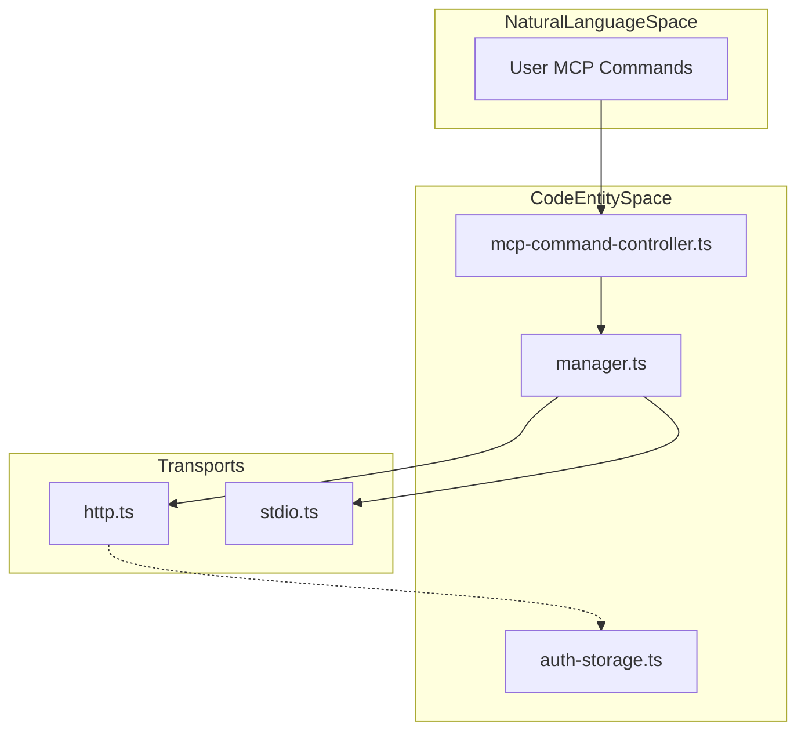
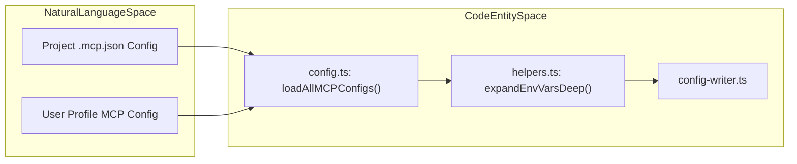
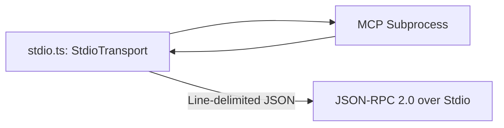
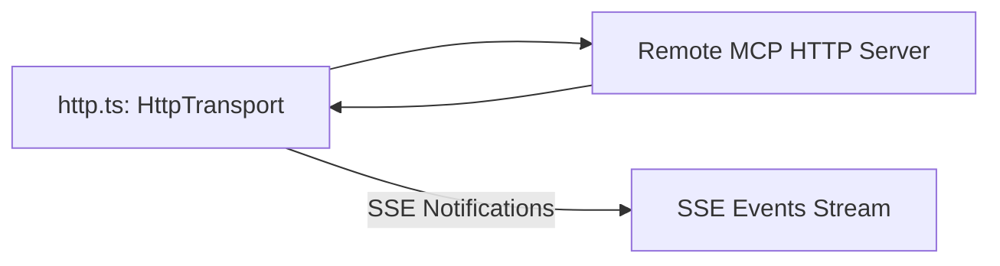
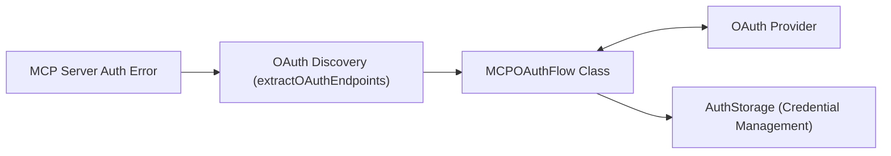

<!-- source: DeepWiki mcp.deepwiki.com · repo can1357/oh-my-pi · page 10.5 MCP Integration · fetched 2026-10-30 -->

# MCP Integration

Relevant source files

The following files were used as context for generating this wiki page:

- [docs/mcp-config.md](docs/mcp-config.md)
- [docs/mcp-protocol-transports.md](docs/mcp-protocol-transports.md)
- [docs/mcp-runtime-lifecycle.md](docs/mcp-runtime-lifecycle.md)
- [packages/coding-agent/src/capability/mcp.ts](packages/coding-agent/src/capability/mcp.ts)
- [packages/coding-agent/src/config/mcp-schema.json](packages/coding-agent/src/config/mcp-schema.json)
- [packages/coding-agent/src/discovery/builtin.ts](packages/coding-agent/src/discovery/builtin.ts)
- [packages/coding-agent/src/discovery/claude-plugins.ts](packages/coding-agent/src/discovery/claude-plugins.ts)
- [packages/coding-agent/src/discovery/helpers.ts](packages/coding-agent/src/discovery/helpers.ts)
- [packages/coding-agent/src/discovery/mcp-json.ts](packages/coding-agent/src/discovery/mcp-json.ts)
- [packages/coding-agent/src/discovery/omp-plugins.ts](packages/coding-agent/src/discovery/omp-plugins.ts)
- [packages/coding-agent/src/mcp/client.ts](packages/coding-agent/src/mcp/client.ts)
- [packages/coding-agent/src/mcp/errors.ts](packages/coding-agent/src/mcp/errors.ts)
- [packages/coding-agent/src/mcp/manager.ts](packages/coding-agent/src/mcp/manager.ts)
- [packages/coding-agent/src/mcp/oauth-discovery.ts](packages/coding-agent/src/mcp/oauth-discovery.ts)
- [packages/coding-agent/src/mcp/oauth-flow.ts](packages/coding-agent/src/mcp/oauth-flow.ts)
- [packages/coding-agent/src/mcp/transports/http.ts](packages/coding-agent/src/mcp/transports/http.ts)
- [packages/coding-agent/src/mcp/transports/sse.ts](packages/coding-agent/src/mcp/transports/sse.ts)
- [packages/coding-agent/src/mcp/transports/stdio.ts](packages/coding-agent/src/mcp/transports/stdio.ts)
- [packages/coding-agent/src/mcp/types.ts](packages/coding-agent/src/mcp/types.ts)
- [packages/coding-agent/src/modes/controllers/command-controller-shared.ts](packages/coding-agent/src/modes/controllers/command-controller-shared.ts)
- [packages/coding-agent/src/modes/controllers/mcp-command-controller.ts](packages/coding-agent/src/modes/controllers/mcp-command-controller.ts)
- [packages/coding-agent/src/prompts/agents/frontmatter.md](packages/coding-agent/src/prompts/agents/frontmatter.md)
- [packages/coding-agent/test/discovery/agent-fields.test.ts](packages/coding-agent/test/discovery/agent-fields.test.ts)
- [packages/coding-agent/test/discovery/builtin-rules-md.test.ts](packages/coding-agent/test/discovery/builtin-rules-md.test.ts)
- [packages/coding-agent/test/discovery/claude-plugins.test.ts](packages/coding-agent/test/discovery/claude-plugins.test.ts)
- [packages/coding-agent/test/fixtures/cancellable-mcp.ts](packages/coding-agent/test/fixtures/cancellable-mcp.ts)
- [packages/coding-agent/test/fixtures/delayed-tool-mcp.ts](packages/coding-agent/test/fixtures/delayed-tool-mcp.ts)
- [packages/coding-agent/test/fixtures/side-effect-mcp.ts](packages/coding-agent/test/fixtures/side-effect-mcp.ts)
- [packages/coding-agent/test/helpers/rejection.ts](packages/coding-agent/test/helpers/rejection.ts)
- [packages/coding-agent/test/issue-956-repro.test.ts](packages/coding-agent/test/issue-956-repro.test.ts)
- [packages/coding-agent/test/mcp-command-reauth.test.ts](packages/coding-agent/test/mcp-command-reauth.test.ts)
- [packages/coding-agent/test/mcp-command-toggle.test.ts](packages/coding-agent/test/mcp-command-toggle.test.ts)
- [packages/coding-agent/test/mcp-dispatched-replay.test.ts](packages/coding-agent/test/mcp-dispatched-replay.test.ts)
- [packages/coding-agent/test/mcp-env-policy.test.ts](packages/coding-agent/test/mcp-env-policy.test.ts)
- [packages/coding-agent/test/mcp-http-transport.test.ts](packages/coding-agent/test/mcp-http-transport.test.ts)
- [packages/coding-agent/test/mcp-legacy-sse-transport.test.ts](packages/coding-agent/test/mcp-legacy-sse-transport.test.ts)
- [packages/coding-agent/test/mcp-manager-initial-connection-cleanup.test.ts](packages/coding-agent/test/mcp-manager-initial-connection-cleanup.test.ts)
- [packages/coding-agent/test/mcp-profile-auth-binding.test.ts](packages/coding-agent/test/mcp-profile-auth-binding.test.ts)
- [packages/coding-agent/test/mcp-stdio-cancellation.test.ts](packages/coding-agent/test/mcp-stdio-cancellation.test.ts)
- [packages/coding-agent/test/mcp-stdio-transport.test.ts](packages/coding-agent/test/mcp-stdio-transport.test.ts)
- [packages/coding-agent/test/mcp/config-request-id-format.test.ts](packages/coding-agent/test/mcp/config-request-id-format.test.ts)
- [packages/coding-agent/test/oauth-discovery.test.ts](packages/coding-agent/test/oauth-discovery.test.ts)
- [packages/coding-agent/test/oauth-flow.test.ts](packages/coding-agent/test/oauth-flow.test.ts)

This document describes the Model Context Protocol (MCP) integration in `oh-my-pi`, enabling the agent to connect to external MCP servers, dynamically discover and execute their tools, manage server lifecycles, and handle OAuth authentication.

## Purpose and Scope

MCP integration allows `oh-my-pi` to:

- Connect to external MCP-compatible servers via **stdio**, **HTTP**, or **SSE** (Server-Sent Events) transports.
- Discover and bridge MCP tools into the agent's tool registry.
- Manage server lifecycles, circuit breakers, and automatic reconnection.
- Authenticate with OAuth-enabled MCP servers using dynamic discovery, Dynamic Client Registration (DCR), and transparent token refresh.
- Integrate with the **Smithery registry** for searching and provisioning MCP servers.

This page covers the detailed implementation, data flow, key classes and functions in the MCP integration layer, including manager lifecycle, transport implementations, OAuth handling, tool bridging, config scopes, the Smithery registry, and the TUI extension inspector view of MCP runtime.

Sources:  
[packages/coding-agent/src/mcp/transports/stdio.ts:1-78](), [packages/coding-agent/src/mcp/manager.ts:1-181](), [packages/coding-agent/src/mcp/oauth-flow.ts:1-96](), [packages/coding-agent/src/mcp/oauth-discovery.ts:1-58](), [packages/coding-agent/src/modes/controllers/mcp-command-controller.ts:1-70]()

---

## Architecture and Manager Lifecycle

The core MCP integration component is the `MCPManager` class (`packages/coding-agent/src/mcp/manager.ts`), responsible for:

- **Loading MCP server configurations** from multiple scopes (user profile, project directory) by invoking config loaders, which merge and validate server configs.

- **Managing live connections** to MCP servers:
  - Uses `connectToServer` to create transport instances and wire lifecycle event handlers including connect, disconnect, and error states [packages/coding-agent/src/mcp/manager.ts:17-29]().
  - Handles initialization handshakes, resource subscription, and prompt availability detection [packages/coding-agent/src/mcp/manager.ts:17-29]().
  - Supports multiple transport types dynamically — **stdio**, **http**, and **sse**.

- **Circuit breaker and reconnect rate limiting**:
  - Enforces per-server reconnect burst limits (`RECONNECT_BURST_LIMIT = 5` within a 30-second sliding window) to prevent process fork storms on stdio subprocesses [packages/coding-agent/src/mcp/manager.ts:111-112]().
  - Applies exponential backoff and retry policies (`DEFAULT_RECONNECT_POLICY`) to HTTP/SSE reconnects to balance responsiveness and server stability [packages/coding-agent/src/mcp/manager.ts:136-146]().

- **Tool lifecycle and deterministic ordering**:
  - Wraps remote MCP tool definitions into local `MCPTool` and `DeferredMCPTool` custom tool classes to integrate with the agent's tool registry [packages/coding-agent/src/mcp/manager.ts:46-47]().
  - Sorts tools by name via `sortMCPToolsByName` after every update to preserve prompt cache consistency for providers like Anthropic [packages/coding-agent/src/mcp/manager.ts:176-181]().

### Natural Language to Code Entity: High-Level Component Interaction

Sources:  
[packages/coding-agent/src/mcp/manager.ts:1-181](), [packages/coding-agent/src/modes/controllers/mcp-command-controller.ts:1-70]()

---

## Configuration Scopes and Discovery

MCP servers are configured across multiple scopes:

- **User profile config**, stored under profile-specific directories accessible via `getAgentDir()`, typically `~/.omp/agent/` [packages/coding-agent/src/discovery/helpers.ts:109-109]().
- **Project local config** under the current working directory, typically `.mcp.json`.

The manager uses config loader helpers (`packages/coding-agent/src/mcp/config.ts`) to aggregate these sources, recursively expanding environment variables to support dynamic values such as `${HOME}` or `${PROJECT_DIR}` [packages/coding-agent/src/mcp/manager.ts:30-36]().

Typical config fields:

| Field           | Description                                            |
|-----------------|--------------------------------------------------------|
| `name`          | Unique identifier for the server                      |
| `type`          | Transport type: `"stdio"`, `"http"`, or `"sse"`      |
| `command`       | For stdio: executable and args to spawn the process  |
| `url`           | For HTTP/SSE: base URL of the server endpoint         |
| `auth`          | Optional OAuth configuration block                     |
| `timeout`       | Connection/request timeout override                    |
| `enabled`       | Flag to enable/disable the server                      |

### Natural Language to Code Entity: Configuration Loading Pipeline

Sources:  
[packages/coding-agent/src/mcp/manager.ts:30-36](), [packages/coding-agent/src/discovery/helpers.ts:1-35](), [packages/coding-agent/src/modes/controllers/mcp-command-controller.ts:13-31]()

---

## Transport Layer

MCP supports multiple transport modes abstracted via `MCPTransport` interfaces [packages/coding-agent/src/mcp/manager.ts:61-62](). The main implementations are:

### Stdio Transport

- `StdioTransport` (`packages/coding-agent/src/mcp/transports/stdio.ts`) runs MCP servers as subprocesses communicating JSON-RPC 2.0 messages over newline-delimited JSON on their standard in/out streams.

- It carefully resolves executable paths on all platforms; on Windows, it detects `.cmd` shims via `resolveStdioSpawnCommand` and wraps invocation in `cmd.exe /d /e:ON /v:OFF /c "<command>"` ensuring correct argument parsing and console window hiding (`windowsHide: true`) [packages/coding-agent/src/mcp/transports/stdio.ts:35-78]().

- For POSIX-like systems, subprocesses are spawned in detached sessions (`detached: true`) to prevent terminal job control signals (e.g., Ctrl+Z) from stopping the server subprocess, avoiding read-blocking deadlocks [packages/coding-agent/src/mcp/transports/stdio.ts:49-55]().

Sources:  
[packages/coding-agent/src/mcp/transports/stdio.ts:1-78](), [packages/coding-agent/test/mcp-stdio-transport.test.ts:1-44]()

---

### HTTP and SSE Transport

- The `HttpTransport` communicates with MCP servers via HTTP REST endpoints supporting JSON-RPC requests over HTTP POST.

- To receive asynchronous notifications, it optionally establishes a secondary long-lived SSE (Server-Sent Events) connection.

- It manages connection lifecycle, handles header-based MCP protocol version negotiation, applies detailed error and timeout classification, and robustly reconnects with exponential backoff.

Sources:  
[packages/coding-agent/src/mcp/transports/stdio.ts:1-78](), [packages/coding-agent/test/mcp-http-transport.test.ts:1-57]()

---

## OAuth Discovery and Flow

OAuth authentication is integrated for MCP servers using:

- **OAuth endpoint discovery**: The function `extractOAuthEndpoints` inspects MCP server error messages for OAuth authorization and token endpoints, parsing WWW-Authenticate challenges and JSON error bodies to extract URLs and scope hints [packages/coding-agent/src/mcp/oauth-discovery.ts:1-58]().

- **OAuth flow orchestration**: The `MCPOAuthFlow` class implements the full OAuth2 authorization code grant including:
  - Dynamic Client Registration (DCR) support when the authorization server advertises it [packages/coding-agent/src/mcp/oauth-flow.ts:1-96]().
  - Launching a local HTTP callback server for loopback redirect.
  - Access token storage as `MCPStoredOAuthCredential` including refresh tokens [packages/coding-agent/src/mcp/oauth-flow.ts:79-95]().
  
- **Profile-scoped credentials**: Credential IDs uniquely bind MCP server URLs to active user profiles via `mcpOAuthCredentialId`, ensuring credential isolation (e.g., `mcp_oauth:profile:<profile>:<serverUrl>`) [packages/coding-agent/src/mcp/oauth-flow.ts:32-34]().

- Transparent token refresh and error handling are enforced via transport hooks [packages/coding-agent/src/mcp/manager.ts:73-79]().

Sources:  
[packages/coding-agent/src/mcp/oauth-flow.ts:1-96](), [packages/coding-agent/src/mcp/oauth-discovery.ts:1-58](), [packages/coding-agent/test/oauth-flow.test.ts:1-85]()

---

## Tool Bridging and Lifecycle

Remote MCP tools are exposed via local custom tool abstractions:

- The tool bridging module transforms MCP tool definitions into native agent tools with:
  - Validation of tool input schemas.
  - Metadata enrichment for better command help and rendering.
  - Argument preprocessing to remove ephemeral fields and resolve internal file URLs to accessible paths.

- Tool bridging manages retriable connection errors distinguishing temporary network or stale session states, enabling transparent retries.

- This bridge allows seamless agent-side invocation of remote tools as if local.

Sources:  
[packages/coding-agent/src/mcp/manager.ts:1-181](), [packages/coding-agent/src/mcp/oauth-flow.ts:1-96]()

---

## CLI, Interactive Management and Smithery Registry

The `MCPCommandController` (`packages/coding-agent/src/modes/controllers/mcp-command-controller.ts`) provides interactive slash commands to manage MCP servers:

- `/mcp add` - Add a new MCP server config [packages/coding-agent/src/modes/controllers/mcp-command-controller.ts:35-42]().
- `/mcp list` - List configured and connected MCP servers [packages/coding-agent/src/modes/controllers/mcp-command-controller.ts:33-33]().
- `/mcp remove` - Remove a server from config [packages/coding-agent/src/modes/controllers/mcp-command-controller.ts:38-38]().
- `/mcp test` - Test server connection and tool availability [packages/coding-agent/src/modes/controllers/mcp-command-controller.ts:24-24]().
- `/mcp reauth` - Trigger OAuth reauthentication flow [packages/coding-agent/src/modes/controllers/mcp-command-controller.ts:26-26]().
- `/mcp smithery-search` - Search MCP servers in the Smithery marketplace [packages/coding-agent/src/modes/controllers/mcp-command-controller.ts:60-60]().

The Smithery registry supports querying a curated marketplace of MCP servers and extensions, with CLI helpers to authenticate (`createSmitheryCliAuthSession` and `pollSmitheryCliAuthSession`) and cache tokens securely [packages/coding-agent/src/modes/controllers/mcp-command-controller.ts:49-56]().

Feedback is rendered through interactive TUI overlays such as `MCPAddWizard` and `ChatBlock` [packages/coding-agent/src/modes/controllers/mcp-command-controller.ts:69-72]().

Sources:  
[packages/coding-agent/src/modes/controllers/mcp-command-controller.ts:1-70](), [packages/coding-agent/src/discovery/helpers.ts:1-35]()

---

# References and Sources

- `packages/coding-agent/src/modes/controllers/mcp-command-controller.ts:1-70`
- `packages/coding-agent/src/discovery/helpers.ts:1-35`
- `packages/coding-agent/test/discovery/claude-plugins.test.ts:1-50`
- `packages/coding-agent/src/mcp/manager.ts:1-181`
- `packages/coding-agent/src/mcp/transports/stdio.ts:1-78`
- `packages/coding-agent/src/discovery/claude-plugins.ts:1-52`
- `packages/coding-agent/src/mcp/oauth-flow.ts:1-96`
- `packages/coding-agent/src/mcp/oauth-discovery.ts:1-58`
- `packages/coding-agent/test/oauth-flow.test.ts:1-85`
- `packages/coding-agent/test/mcp-stdio-transport.test.ts:1-44`
- `packages/coding-agent/test/mcp-http-transport.test.ts:1-57`
- `packages/coding-agent/test/oauth-discovery.test.ts:1-25`

---

