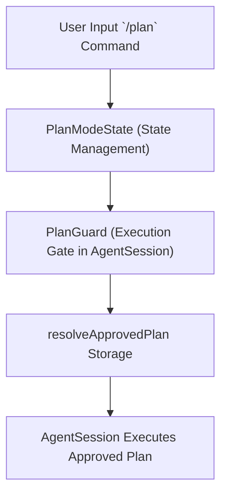
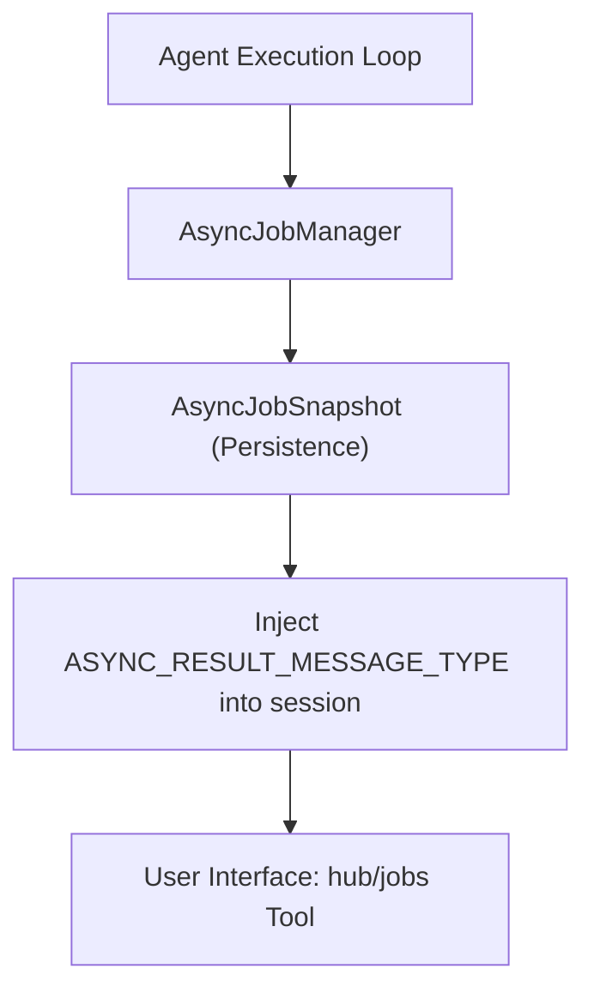
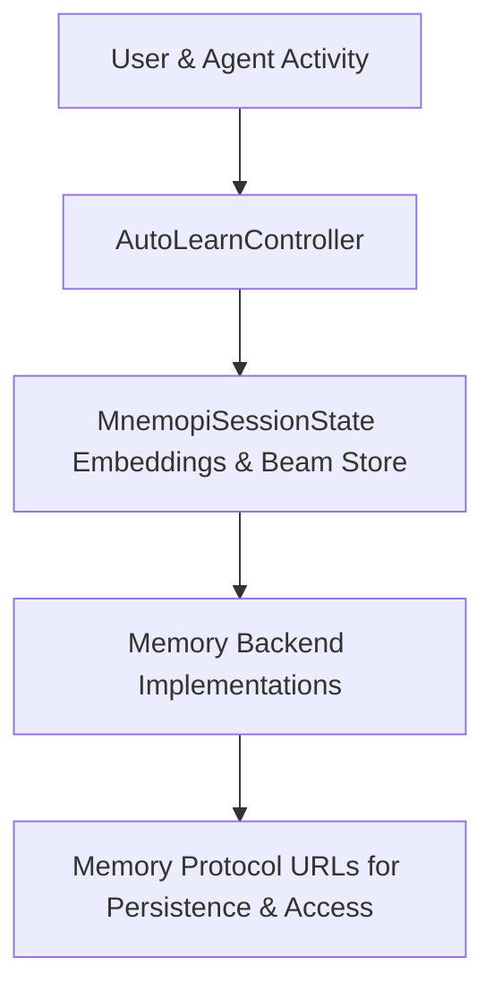
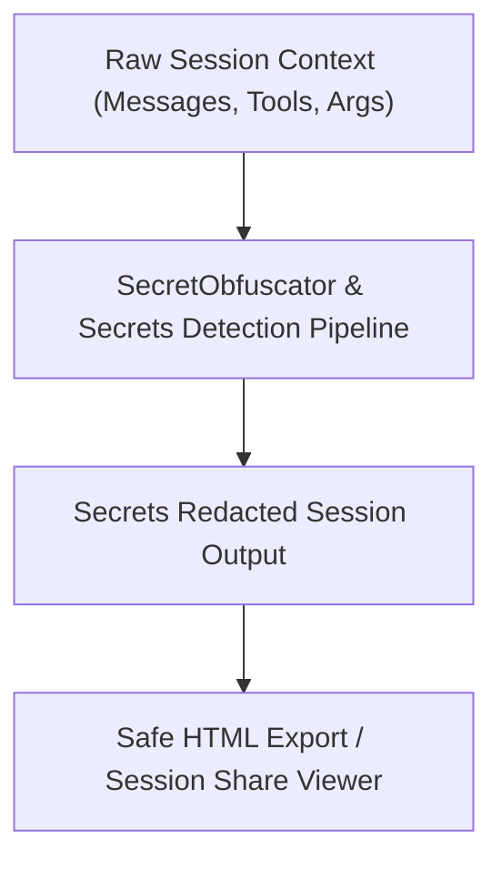
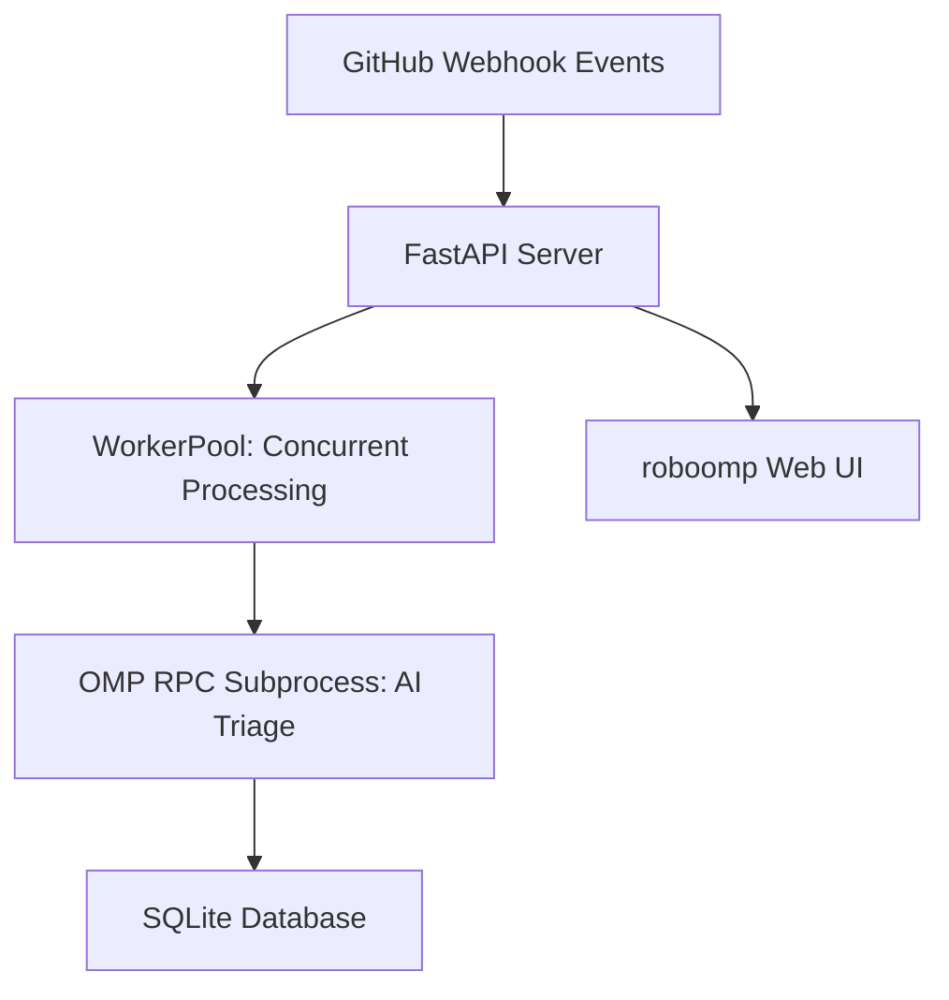
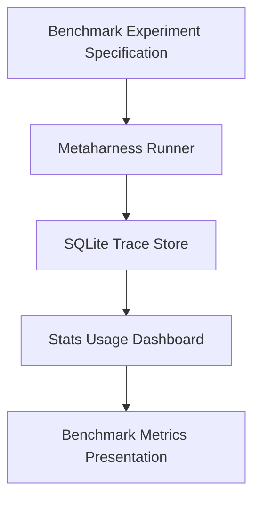
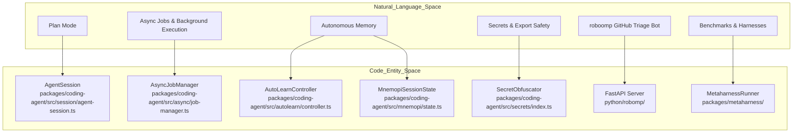
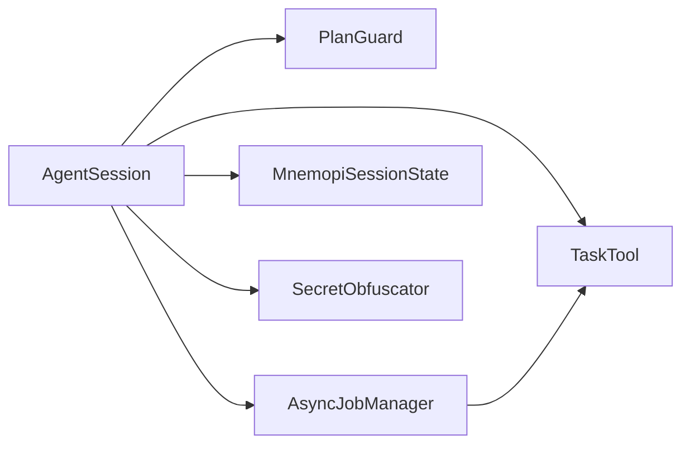

<!-- source: DeepWiki mcp.deepwiki.com · repo can1357/oh-my-pi · page 11 Advanced Features · fetched 2026-10-30 -->

# Advanced Features

Relevant source files

The following files were used as context for generating this wiki page:

- [docs/task-agent-discovery.md](docs/task-agent-discovery.md)
- [docs/tools/task.md](docs/tools/task.md)
- [packages/coding-agent/DEVELOPMENT.md](packages/coding-agent/DEVELOPMENT.md)
- [packages/coding-agent/src/prompts/tools/task.md](packages/coding-agent/src/prompts/tools/task.md)
- [packages/coding-agent/src/sdk.ts](packages/coding-agent/src/sdk.ts)
- [packages/coding-agent/src/session/agent-session.ts](packages/coding-agent/src/session/agent-session.ts)
- [packages/coding-agent/src/session/session-entries.ts](packages/coding-agent/src/session/session-entries.ts)
- [packages/coding-agent/src/task/executor.ts](packages/coding-agent/src/task/executor.ts)
- [packages/coding-agent/src/task/index.ts](packages/coding-agent/src/task/index.ts)
- [packages/coding-agent/src/task/persisted-revive.ts](packages/coding-agent/src/task/persisted-revive.ts)
- [packages/coding-agent/src/task/structured-subagent.ts](packages/coding-agent/src/task/structured-subagent.ts)
- [packages/coding-agent/src/task/types.ts](packages/coding-agent/src/task/types.ts)
- [packages/coding-agent/src/tools/index.ts](packages/coding-agent/src/tools/index.ts)
- [packages/coding-agent/test/agent-session-prompt-dispatch-race.test.ts](packages/coding-agent/test/agent-session-prompt-dispatch-race.test.ts)
- [packages/coding-agent/test/sdk-workpool-yield-schema.test.ts](packages/coding-agent/test/sdk-workpool-yield-schema.test.ts)
- [packages/coding-agent/test/task/autoload-skills.test.ts](packages/coding-agent/test/task/autoload-skills.test.ts)
- [packages/coding-agent/test/task/executor-async-quiescence.test.ts](packages/coding-agent/test/task/executor-async-quiescence.test.ts)
- [packages/coding-agent/test/task/executor-launch-startup.test.ts](packages/coding-agent/test/task/executor-launch-startup.test.ts)
- [packages/coding-agent/test/task/executor-pass-through.test.ts](packages/coding-agent/test/task/executor-pass-through.test.ts)
- [packages/coding-agent/test/task/executor-prewalk.test.ts](packages/coding-agent/test/task/executor-prewalk.test.ts)
- [packages/coding-agent/test/task/executor-recent-output.test.ts](packages/coding-agent/test/task/executor-recent-output.test.ts)
- [packages/coding-agent/test/task/executor-soft-budget.test.ts](packages/coding-agent/test/task/executor-soft-budget.test.ts)
- [packages/coding-agent/test/task/executor-subagent-reminders.test.ts](packages/coding-agent/test/task/executor-subagent-reminders.test.ts)
- [packages/coding-agent/test/task/executor-wall-clock.test.ts](packages/coding-agent/test/task/executor-wall-clock.test.ts)
- [packages/coding-agent/test/task/executor-yield-loop.test.ts](packages/coding-agent/test/task/executor-yield-loop.test.ts)
- [packages/coding-agent/test/task/persisted-revive.test.ts](packages/coding-agent/test/task/persisted-revive.test.ts)
- [packages/coding-agent/test/task/structured-subagent.test.ts](packages/coding-agent/test/task/structured-subagent.test.ts)
- [packages/coding-agent/test/task/subagent-lsp.test.ts](packages/coding-agent/test/task/subagent-lsp.test.ts)
- [packages/coding-agent/test/task/task-batch.test.ts](packages/coding-agent/test/task/task-batch.test.ts)
- [packages/coding-agent/test/task/task-guards.test.ts](packages/coding-agent/test/task/task-guards.test.ts)
- [packages/coding-agent/test/task/task-schema.test.ts](packages/coding-agent/test/task/task-schema.test.ts)
- [packages/coding-agent/test/task/wire-schema.test.ts](packages/coding-agent/test/task/wire-schema.test.ts)
- [packages/coding-agent/test/tools/index.test.ts](packages/coding-agent/test/tools/index.test.ts)
- [packages/coding-agent/test/tools/schema-validation.test.ts](packages/coding-agent/test/tools/schema-validation.test.ts)

## Purpose and Scope

This page introduces advanced capabilities and workflows for power users of the `oh-my-pi` coding agent. These features extend core capabilities with structured planning workflows, asynchronous job management, persistent autonomous memory, secrets protection for safe exports, GitHub triage automation, and benchmarking infrastructure.

These advanced features facilitate safer, scalable, and automated workflows essential for complex software development and continuous integration scenarios. Technical details and usage instructions reside in the dedicated child pages linked below.

For foundational concepts such as tool usage, session management, and extension development, please see [Tool System](#6), [Agent Sessions](#3), and [Extension System](#10).

Sources: `[packages/coding-agent/src/session/agent-session.ts:1-15]`, `[packages/coding-agent/src/sdk.ts:152-157]`

---

## 11.1. Plan Mode

Plan Mode provides a controlled two-phase workflow where the agent drafts an explicit action plan before performing any state-changing operations. This safeguards against accidental destructive changes by requiring explicit plan review and approval.

Key elements include:

- **Plan-mode system prompts** that steer agent behavior during planning.
- A **PlanGuard** within the `AgentSession` that ensures execution pauses pending approval.
- Durable storage and retrieval of approved plans.
- An interactive plan review overlay UI facilitating detailed examination and user consent.

After user approval, the session atomically executes the approved batch of steps, coordinating tightly with the session state and tools. This workflow enhances auditable, safe automation in complex tasks.

### Plan Mode Lifecycle Diagram

Sources: `[packages/coding-agent/src/session/agent-session.ts:2-176]`

For full details, see [Plan Mode](#11.1).

---

## 11.2. Async Jobs and Background Execution

The agent supports launching and managing asynchronous jobs via `AsyncJobManager`. This allows long-running tasks, delegated subagents, or background shell commands to execute without blocking the main agent interaction.

Features include:

- Job snapshotting to persist job state for reliability.
- Safe delivery and injection of asynchronous results into active sessions.
- Concurrency control through semaphores preventing overload.
- User monitoring and interaction through the `hub/jobs` tool.
- Support for persisted agent revival after restarts or crashes.

This subsystem enables scalable, non-blocking workflows critical for complex or resource-heavy operations.

### Async Jobs Architecture Diagram

Sources: `[packages/coding-agent/src/session/agent-session.ts:100]`, `[packages/coding-agent/src/async/job-manager.ts:1-20]`

For comprehensive documentation, see [Async Jobs and Background Execution](#11.2).

---

## 11.3. Autonomous Memory

Autonomous Memory extracts and manages durable knowledge automatically from interactions and system signals. This system is orchestrated by the `AutoLearnController`, which manages extraction pipelines and memory consolidation.

Core components include:

- `MnemopiSessionState`: Manages embeddings and beam stores for vectorized knowledge representation.
- Multi-modal memory capabilities integrated into session context.
- Flexible Memory Backends accessible via standard protocol URLs.
- Features such as autolearn (automatic knowledge absorbing), hindsight updates, and query memory tools (`/memory`).

This memory system enhances agent intelligence and continuity across sessions.

### Autonomous Memory Pipeline Diagram

Sources: `[packages/coding-agent/src/autolearn/controller.ts:50-60]`, `[packages/coding-agent/src/mnemopi/state.ts:150-170]`

For in-depth coverage, see [Autonomous Memory](#11.3).

---

## 11.4. Secrets and Export Safety

The agent integrates a rigorous secrets detection and obfuscation pipeline to prevent leakage of sensitive information.

Highlights:

- The `SecretObfuscator` detects secrets in messages, tool calls, and session context using heuristic and provider-specific rules.
- Secrets are redacted before session export or sharing to protect confidentiality.
- Export formats like HTML share viewers respect these redactions for safe external distribution.
- The secrets pipeline applies uniformly during real-time operation and offline processing.

This system is crucial for safely exporting or sharing session data without risking accidental secret disclosure.

### Secrets Detection and Redaction Flow Diagram

Sources: `[packages/coding-agent/src/sdk.ts:150-160]`, `[packages/coding-agent/src/secrets/index.ts:150-160]`

For full details and configuration, see [Secrets and Export Safety](#11.4).

---

## 11.5. roboomp — GitHub Triage Bot

`roboomp` is a Python-based self-hosted GitHub triage bot that orchestrates issue and pull request automation via the `omp` agent running in RPC mode.

Architecture components:

- **FastAPI** server handles GitHub webhook events and web requests.
- **SQLite** database stores state and task information.
- **WorkerPool** manages concurrent processing of triage workflows.
- The **omp RPC subprocess** provides AI-powered triage logic.
- A web UI for manual triage operations and monitoring.
- Docker Compose configurations for deployment.
- A **gh-proxy** trust boundary for secured GitHub API proxying.

This bot demonstrates practical self-hosted deployment of the `oh-my-pi` assistant for CI automation.

### roboomp Architecture Diagram

Sources: `[packages/coding-agent/src/session/agent-session.ts:3-14]`

For deployment and usage, see [roboomp — GitHub Triage Bot](#11.5).

---

## 11.6. Benchmarks and Harnesses

The benchmarking ecosystem orchestrates reproducible, traceable performance experiments.

Features include:

- The `metaharness` framework managing benchmark orchestration and experiment definitions.
- SQLite-based trace storage for experiment results.
- REST and SSE APIs for trace data access and visualization.
- The harbor runner to execute workload scenarios.
- Benchmarks such as `typescript-edit-benchmark`.
- The `snapcompact` corpus for research and evaluation.
- `omptype` metadata tools for coding and analysis.
- A stats dashboard presenting benchmark results and usage analytics.

This infrastructure supports continuous measurement and improvement of AI-powered coding agents.

### Benchmark Orchestration Diagram

Sources: `[packages/coding-agent/src/config/settings-schema.ts:2-4]`

See [Benchmarks and Harnesses](#11.6) for full documentation.

---

# Overview Diagrams Bridging Natural Language to Code Entities

### Natural Language Features to Codebase Components

Sources: `[packages/coding-agent/src/session/agent-session.ts:1-176]`, `[packages/coding-agent/src/sdk.ts:140-157]`, `[packages/coding-agent/src/async/job-manager.ts:1-20]`, `[packages/coding-agent/src/autolearn/controller.ts:50-60]`, `[packages/coding-agent/src/mnemopi/state.ts:150-170]`, `[packages/coding-agent/src/secrets/index.ts:150-160]`

---

### Core AgentSession Interactions with Advanced Features

Sources: `[packages/coding-agent/src/session/agent-session.ts:1-176]`, `[packages/coding-agent/src/async/job-manager.ts:1-20]`, `[packages/coding-agent/src/mnemopi/state.ts:150-170]`

---

This overview emphasizes the modular yet interconnected architecture of advanced systems within the `oh-my-pi` ecosystem. Each advanced feature augments core agent functionality for enhanced safety, scalability, automation, and intelligence in software development workflows.

For comprehensive technical details, examples, and development notes, please refer to the respective child pages listed in the sidebar.

Sources:  
`[packages/coding-agent/src/session/agent-session.ts:1-176]`,  
`[packages/coding-agent/src/sdk.ts:140-157]`,  
`[packages/coding-agent/src/async/job-manager.ts:1-20]`,  
`[packages/coding-agent/src/autolearn/controller.ts:50-60]`,  
`[packages/coding-agent/src/mnemopi/state.ts:150-170]`,  
`[packages/coding-agent/src/secrets/index.ts:150-160]`

---

