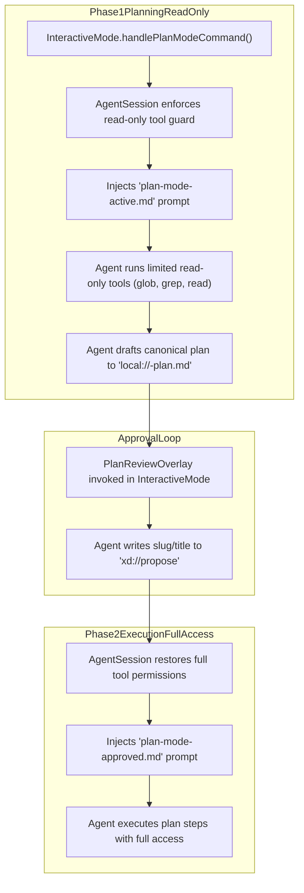
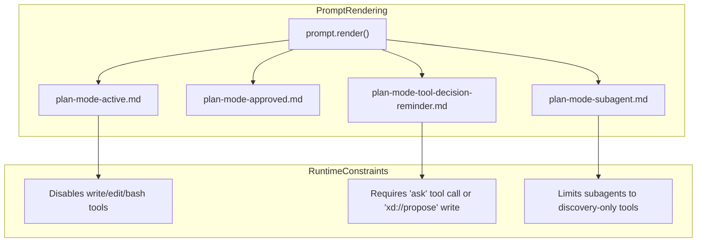
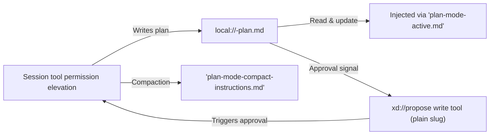
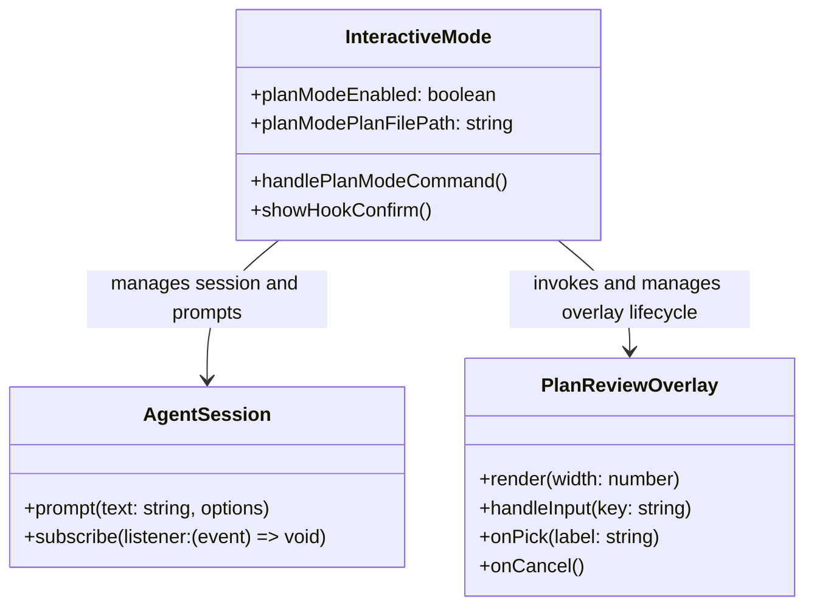
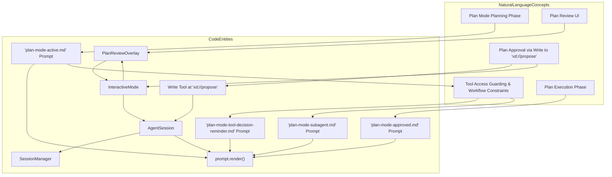

<!-- source: DeepWiki mcp.deepwiki.com · repo can1357/oh-my-pi · page 11.1 Plan Mode · fetched 2026-10-30 -->

# Plan Mode

Relevant source files

The following files were used as context for generating this wiki page:

- [packages/coding-agent/src/prompts/system/orchestrate-notice.md](packages/coding-agent/src/prompts/system/orchestrate-notice.md)
- [packages/coding-agent/src/prompts/system/plan-mode-active.md](packages/coding-agent/src/prompts/system/plan-mode-active.md)
- [packages/coding-agent/src/prompts/system/plan-mode-approved.md](packages/coding-agent/src/prompts/system/plan-mode-approved.md)
- [packages/coding-agent/src/prompts/system/plan-mode-compact-instructions.md](packages/coding-agent/src/prompts/system/plan-mode-compact-instructions.md)
- [packages/coding-agent/src/prompts/system/plan-mode-reference.md](packages/coding-agent/src/prompts/system/plan-mode-reference.md)
- [packages/coding-agent/src/prompts/system/plan-mode-subagent.md](packages/coding-agent/src/prompts/system/plan-mode-subagent.md)
- [packages/coding-agent/src/prompts/system/plan-mode-tool-decision-reminder.md](packages/coding-agent/src/prompts/system/plan-mode-tool-decision-reminder.md)
- [packages/coding-agent/test/agent-session-magic-keywords.test.ts](packages/coding-agent/test/agent-session-magic-keywords.test.ts)
- [packages/coding-agent/test/interactive-mode-plan-review.test.ts](packages/coding-agent/test/interactive-mode-plan-review.test.ts)
- [packages/coding-agent/test/plan-mode/reentry-prompt.test.ts](packages/coding-agent/test/plan-mode/reentry-prompt.test.ts)

## Purpose and Scope
Plan Mode in `oh-my-pi` enforces a disciplined workflow that separates planning and execution by constraining the agent’s permissions during initial exploration and plan composition. In this mode, the agent operates as a read-only architect, producing a canonical implementation plan stored locally within the session workspace. This mode ensures that only after explicit user approval of the plan may the agent be granted full tool permissions to perform potentially destructive actions. This page covers the plan-mode prompt templates, runtime guard behavior, storage conventions for approved plans, the terminal UI plan review overlay, and the plan approval workflow.

Sources:  
[packages/coding-agent/src/prompts/system/plan-mode-active.md:1-7]()  
[packages/coding-agent/src/prompts/system/plan-mode-approved.md:1-21]()

---

## Overview and Lifecycle Architecture

Plan mode lifecycle consists of three main phases:

- **Phase 1: Planning / Read-only**  
  The agent runs with restricted tools and is injected with the `plan-mode-active.md` system prompt which enforces read-only access and guides exploration. The agent uses discovery tools to investigate the environment and drafts a detailed plan in a special local artifact [packages/coding-agent/src/prompts/system/plan-mode-active.md:1-7]().

- **Approval Loop**  
  After drafting, the user reviews the plan via the `PlanReviewOverlay`. Approval is signaled by the agent writing a plain-text slug or title to the special `xd://propose` destination using the write tool, signaling the intent to transition to execution mode [packages/coding-agent/src/prompts/system/plan-mode-active.md:7]().

- **Phase 2: Execution / Full Access**  
  Upon receiving approval, the session flushes read-only constraints, injects the `plan-mode-approved.md` prompt, and the agent begins step-wise execution of the plan with unrestricted tooling [packages/coding-agent/src/prompts/system/plan-mode-approved.md:1-21]().

Sources:  
[packages/coding-agent/src/prompts/system/plan-mode-active.md:1-9]()  
[packages/coding-agent/src/prompts/system/plan-mode-approved.md:1-21]()  
[packages/coding-agent/test/interactive-mode-plan-review.test.ts:143-152]()

---

## Plan Mode Prompts and Guards

### Key Plan Mode System Prompts

| Prompt Filename                       | Role                                                                                                  | Description                                                                                                                   |
| ------------------------------------- | ----------------------------------------------------------------------------------------------------- | ----------------------------------------------------------------------------------------------------------------------------- |
| `plan-mode-active.md`                 | Planning Phase Prompt                                                                                 | Enforces strict read-only mode by disabling write/edit/bash tools. Orders the agent to compose a canonical plan at `local://<slug>-plan.md`. [packages/coding-agent/src/prompts/system/plan-mode-active.md:1-93]() |
| `plan-mode-approved.md`               | Execution Phase Prompt                                                                                | Injected after plan approval; contains the full plan inline and permits full tool access. Instructs the agent to execute and verify. [packages/coding-agent/src/prompts/system/plan-mode-approved.md:1-19]() |
| `plan-mode-tool-decision-reminder.md` | Workflow Enforcement Prompt                                                                           | Forces the agent to either call the `ask` tool for clarification or write the plan slug for approval before completing any turn. [packages/coding-agent/src/prompts/system/plan-mode-tool-decision-reminder.md:1-9]() |
| `plan-mode-subagent.md`               | Subagent Planning Prompt                                                                              | Restricts subagents spawned during the planning phase to read-only discovery tools only. [packages/coding-agent/src/prompts/system/plan-mode-subagent.md:1-33]() |

### Guard Behavior and Enforcement

All plan mode prompts are injected into the `AgentSession` via `prompt.render()` calls at runtime. These prompts enforce tool access guards according to the phase:

- The **read-only guard** disables all mutation-capable tools during the planning phase to prevent accidental changes [packages/coding-agent/src/prompts/system/plan-mode-active.md:3-4]().
- The **reminder prompt** mandates either making a clarifying `ask` tool call or writing the plan slug for approval [packages/coding-agent/src/prompts/system/plan-mode-tool-decision-reminder.md:4-7]().
- The **subagent prompt** restricts any spawned subagents under plan mode to discovery-only tools [packages/coding-agent/src/prompts/system/plan-mode-subagent.md:2-8]().

Sources:  
[packages/coding-agent/src/prompts/system/plan-mode-active.md:1-93]()  
[packages/coding-agent/src/prompts/system/plan-mode-approved.md:1-19]()  
[packages/coding-agent/src/prompts/system/plan-mode-tool-decision-reminder.md:1-9]()  
[packages/coding-agent/src/prompts/system/plan-mode-subagent.md:1-33]()

---

## Approved Plan Storage and Session Artifacts

Plan mode uses the session’s virtual file system to store and track canonical plan documents and approval signaling.

- **Canonical Plan File**  
  The plan is persistently stored as a markdown file under the session-local URL `local://<slug>-plan.md` where `<slug>` is a URL-safe, lowercase identifier used in the prompts and approval workflow [packages/coding-agent/src/prompts/system/plan-mode-active.md:4-5]().

- **Re-Entry and Plan Updates**  
  The prompt instructs the agent on multi-session or iterative usage: agents must never rename approved plans but may update or create new plans for new tasks [packages/coding-agent/src/prompts/system/plan-mode-active.md:46-58]().

- **Compaction and Plan Preservation**  
  Upon approval, a compaction process condenses session history into the approved plan file, removing redundant or noisy messages while preserving key decisions, rationale, and discovered facts [packages/coding-agent/src/prompts/system/plan-mode-compact-instructions.md:1-17]().

### Plan Storage and Workflow Data Flow

Sources:  
[packages/coding-agent/src/prompts/system/plan-mode-active.md:5-58]()  
[packages/coding-agent/src/prompts/system/plan-mode-reference.md:1-14]()  
[packages/coding-agent/src/prompts/system/plan-mode-compact-instructions.md:1-17]()

---

## TUI Review and Plan Review Overlay

The Terminal User Interface (TUI) includes a dedicated overlay component for plan review, allowing the user to navigate, annotate, and explicitly approve or reject plans.

### Key Classes and Interactions

- **`InteractiveMode`** manages the plan mode state, including enabling/disabling plan mode, tracking the current plan file, and handling modal confirmations for approving or aborting plans [packages/coding-agent/test/interactive-mode-plan-review.test.ts:146-176]().
- **`AgentSession`** encapsulates running the agent with restricted prompts and tool guards during planning [packages/coding-agent/test/interactive-mode-plan-review.test.ts:27-30]().
- **`PlanReviewOverlay`** provides an in-terminal scrolling display of the drafted plan, supporting navigation, annotation, and approval actions by the user [packages/coding-agent/test/interactive-mode-plan-review.test.ts:15]().

Sources:  
[packages/coding-agent/test/interactive-mode-plan-review.test.ts:135-170]()

---

## Approval Workflow and Execution Transition

Approval in plan mode is a controlled multi-step process:

- The agent signals plan approval by writing the plan’s slug or title as plain text to the special internal write destination `xd://propose`. This is detected as a synthetic prompt dispatch (`synthetic: true`) to the session prompt system [packages/coding-agent/test/interactive-mode-plan-review.test.ts:39-48]().
- Receiving this signal, the system disables the planning read-only guard, restoring full tool permissions to the session.
- It then injects the `plan-mode-approved.md` prompt inline with the full plan text, instructing the agent to begin execution and verification of individual plan steps with unrestricted tool access [packages/coding-agent/src/prompts/system/plan-mode-approved.md:1-21]().
- The plan file remains the main durable record for subsequent agent invocations or subagent spawning, ensuring continuity and traceability [packages/coding-agent/src/prompts/system/plan-mode-approved.md:7-9]().

Sources:  
[packages/coding-agent/src/prompts/system/plan-mode-active.md:7]()  
[packages/coding-agent/src/prompts/system/plan-mode-approved.md:1-21]()  
[packages/coding-agent/test/interactive-mode-plan-review.test.ts:34-39]()

---

## Summary Diagram: Plan Mode Mapping Between Natural Language Concepts and Code Entities

Sources: Entire cited files above.

---

## References
- [Plan Mode Active Prompt Template](packages/coding-agent/src/prompts/system/plan-mode-active.md)  
- [Plan Mode Approved Prompt Template](packages/coding-agent/src/prompts/system/plan-mode-approved.md)  
- [Plan Mode Tool Decision Reminder](packages/coding-agent/src/prompts/system/plan-mode-tool-decision-reminder.md)  
- [Plan Mode Subagent Prompt](packages/coding-agent/src/prompts/system/plan-mode-subagent.md)  
- [Plan Review Overlay Tests](packages/coding-agent/test/interactive-mode-plan-review.test.ts)  
- [Plan Mode Reference Prompt](packages/coding-agent/src/prompts/system/plan-mode-reference.md)  
- [Plan Mode Compaction Instructions](packages/coding-agent/src/prompts/system/plan-mode-compact-instructions.md)  

---

# End of Section 11.1 Plan Mode

---

