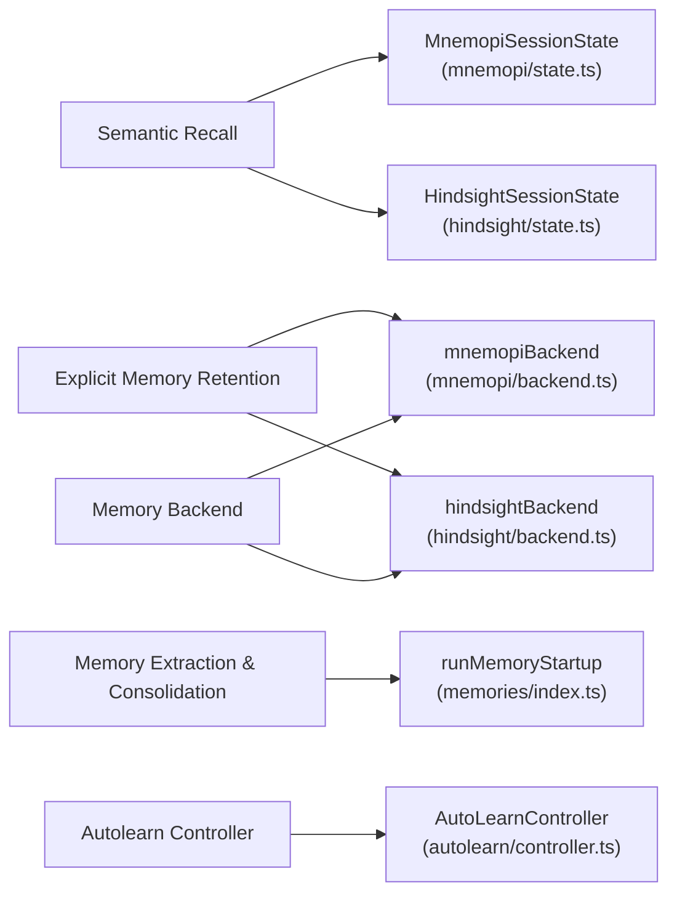
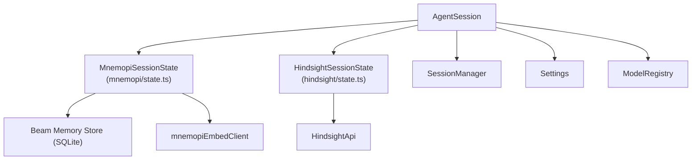

<!-- source: DeepWiki mcp.deepwiki.com · repo can1357/oh-my-pi · page 11.3 Autonomous Memory · fetched 2026-10-30 -->

# Autonomous Memory

<details>
<summary>Relevant source files</summary>

The following files were used as context for generating this wiki page:

- [docs/memory.md](docs/memory.md)
- [docs/mnemosyne-memory-backend.md](docs/mnemosyne-memory-backend.md)
- [packages/ai/test/auth-storage-sqlite-busy.test.ts](packages/ai/test/auth-storage-sqlite-busy.test.ts)
- [packages/ai/test/cursor-conversation-rotate.test.ts](packages/ai/test/cursor-conversation-rotate.test.ts)
- [packages/coding-agent/src/autolearn/controller.ts](packages/coding-agent/src/autolearn/controller.ts)
- [packages/coding-agent/src/hindsight/backend.ts](packages/coding-agent/src/hindsight/backend.ts)
- [packages/coding-agent/src/hindsight/state.ts](packages/coding-agent/src/hindsight/state.ts)
- [packages/coding-agent/src/memories/index.ts](packages/coding-agent/src/memories/index.ts)
- [packages/coding-agent/src/memories/storage.ts](packages/coding-agent/src/memories/storage.ts)
- [packages/coding-agent/src/memory-backend/index.ts](packages/coding-agent/src/memory-backend/index.ts)
- [packages/coding-agent/src/memory-backend/local-backend.ts](packages/coding-agent/src/memory-backend/local-backend.ts)
- [packages/coding-agent/src/memory-backend/off-backend.ts](packages/coding-agent/src/memory-backend/off-backend.ts)
- [packages/coding-agent/src/memory-backend/recall-entry.ts](packages/coding-agent/src/memory-backend/recall-entry.ts)
- [packages/coding-agent/src/memory-backend/resolve.ts](packages/coding-agent/src/memory-backend/resolve.ts)
- [packages/coding-agent/src/memory-backend/types.ts](packages/coding-agent/src/memory-backend/types.ts)
- [packages/coding-agent/src/mnemopi/backend.ts](packages/coding-agent/src/mnemopi/backend.ts)
- [packages/coding-agent/src/mnemopi/config.ts](packages/coding-agent/src/mnemopi/config.ts)
- [packages/coding-agent/src/mnemopi/state.ts](packages/coding-agent/src/mnemopi/state.ts)
- [packages/coding-agent/src/prompts/memories/consolidation_system.md](packages/coding-agent/src/prompts/memories/consolidation_system.md)
- [packages/coding-agent/src/prompts/system/btw-user.md](packages/coding-agent/src/prompts/system/btw-user.md)
- [packages/coding-agent/src/prompts/system/empty-stop-retry.md](packages/coding-agent/src/prompts/system/empty-stop-retry.md)
- [packages/coding-agent/src/prompts/system/memory-recall-changes.md](packages/coding-agent/src/prompts/system/memory-recall-changes.md)
- [packages/coding-agent/src/prompts/tools/checkpoint.md](packages/coding-agent/src/prompts/tools/checkpoint.md)
- [packages/coding-agent/src/sharpshooter/backend.ts](packages/coding-agent/src/sharpshooter/backend.ts)
- [packages/coding-agent/src/sharpshooter/consolidate.ts](packages/coding-agent/src/sharpshooter/consolidate.ts)
- [packages/coding-agent/src/sharpshooter/extract.ts](packages/coding-agent/src/sharpshooter/extract.ts)
- [packages/coding-agent/src/sharpshooter/scheduler.ts](packages/coding-agent/src/sharpshooter/scheduler.ts)
- [packages/coding-agent/src/sharpshooter/settings.ts](packages/coding-agent/src/sharpshooter/settings.ts)
- [packages/coding-agent/test/agent-session-empty-stop-guard.test.ts](packages/coding-agent/test/agent-session-empty-stop-guard.test.ts)
- [packages/coding-agent/test/agent-session-memory-backend.test.ts](packages/coding-agent/test/agent-session-memory-backend.test.ts)
- [packages/coding-agent/test/autolearn-controller.test.ts](packages/coding-agent/test/autolearn-controller.test.ts)
- [packages/coding-agent/test/autolearn-learn-local.test.ts](packages/coding-agent/test/autolearn-learn-local.test.ts)
- [packages/coding-agent/test/collab/discarded-entry-marker.test.ts](packages/coding-agent/test/collab/discarded-entry-marker.test.ts)
- [packages/coding-agent/test/hindsight-backend.test.ts](packages/coding-agent/test/hindsight-backend.test.ts)
- [packages/coding-agent/test/hindsight-retention-cache.test.ts](packages/coding-agent/test/hindsight-retention-cache.test.ts)
- [packages/coding-agent/test/memories-runtime.test.ts](packages/coding-agent/test/memories-runtime.test.ts)
- [packages/coding-agent/test/memories-storage.test.ts](packages/coding-agent/test/memories-storage.test.ts)
- [packages/coding-agent/test/memories/isolation.test.ts](packages/coding-agent/test/memories/isolation.test.ts)
- [packages/coding-agent/test/memory-backend-resolve.test.ts](packages/coding-agent/test/memory-backend-resolve.test.ts)
- [packages/coding-agent/test/memory-recall-resume.test.ts](packages/coding-agent/test/memory-recall-resume.test.ts)
- [packages/coding-agent/test/memory-tools.test.ts](packages/coding-agent/test/memory-tools.test.ts)
- [packages/coding-agent/test/mnemopi-bank-derivation.test.ts](packages/coding-agent/test/mnemopi-bank-derivation.test.ts)
- [packages/coding-agent/test/mnemopi-config.test.ts](packages/coding-agent/test/mnemopi-config.test.ts)
- [packages/coding-agent/test/mnemopi-recall-features.test.ts](packages/coding-agent/test/mnemopi-recall-features.test.ts)
- [packages/coding-agent/test/sdk-autolearn-active-tools.test.ts](packages/coding-agent/test/sdk-autolearn-active-tools.test.ts)
- [packages/coding-agent/test/session-manager-immediate-persist.test.ts](packages/coding-agent/test/session-manager-immediate-persist.test.ts)
- [packages/coding-agent/test/sharpshooter-backend.test.ts](packages/coding-agent/test/sharpshooter-backend.test.ts)
- [packages/coding-agent/test/sharpshooter-consolidate.test.ts](packages/coding-agent/test/sharpshooter-consolidate.test.ts)
- [packages/coding-agent/test/sharpshooter-extract.test.ts](packages/coding-agent/test/sharpshooter-extract.test.ts)
- [packages/mnemopi/CHANGELOG.md](packages/mnemopi/CHANGELOG.md)
- [packages/mnemopi/src/config.ts](packages/mnemopi/src/config.ts)
- [packages/mnemopi/src/core/beam/consolidate.ts](packages/mnemopi/src/core/beam/consolidate.ts)
- [packages/mnemopi/src/core/beam/index.ts](packages/mnemopi/src/core/beam/index.ts)
- [packages/mnemopi/src/core/beam/store.ts](packages/mnemopi/src/core/beam/store.ts)
- [packages/mnemopi/src/core/beam/types.ts](packages/mnemopi/src/core/beam/types.ts)
- [packages/mnemopi/src/core/embeddings.ts](packages/mnemopi/src/core/embeddings.ts)
- [packages/mnemopi/src/core/entities.ts](packages/mnemopi/src/core/entities.ts)
- [packages/mnemopi/src/core/episodic-graph.ts](packages/mnemopi/src/core/episodic-graph.ts)
- [packages/mnemopi/src/core/fastembed-model-cache.ts](packages/mnemopi/src/core/fastembed-model-cache.ts)
- [packages/mnemopi/src/core/memory.ts](packages/mnemopi/src/core/memory.ts)
- [packages/mnemopi/src/core/polyphonic-recall.ts](packages/mnemopi/src/core/polyphonic-recall.ts)
- [packages/mnemopi/test/beam-consolidate-unit.test.ts](packages/mnemopi/test/beam-consolidate-unit.test.ts)
- [packages/mnemopi/test/beam-store.test.ts](packages/mnemopi/test/beam-store.test.ts)
- [packages/mnemopi/test/corrupt-model-retry.test.ts](packages/mnemopi/test/corrupt-model-retry.test.ts)
- [packages/mnemopi/test/embedding-input-cap.test.ts](packages/mnemopi/test/embedding-input-cap.test.ts)
- [packages/mnemopi/test/entities.test.ts](packages/mnemopi/test/entities.test.ts)
- [packages/mnemopi/test/fastembed-model-cache.test.ts](packages/mnemopi/test/fastembed-model-cache.test.ts)
- [packages/mnemopi/test/graph-tools.test.ts](packages/mnemopi/test/graph-tools.test.ts)
- [packages/mnemopi/test/orchestrator.test.ts](packages/mnemopi/test/orchestrator.test.ts)
- [packages/mnemopi/test/polyphonic-recall.test.ts](packages/mnemopi/test/polyphonic-recall.test.ts)
- [packages/mnemopi/test/proactive-linking.test.ts](packages/mnemopi/test/proactive-linking.test.ts)
- [packages/mnemopi/test/recall-feature-flags.test.ts](packages/mnemopi/test/recall-feature-flags.test.ts)
- [packages/mnemopi/test/recall-feature-wiring.test.ts](packages/mnemopi/test/recall-feature-wiring.test.ts)

</details>


The Autonomous Memory system enables `oh-my-pi` to retain and retrieve knowledge autonomously across sessions. It extracts long-term facts, preferences, mental models, and summaries from past dialogues and project history, providing semantic recall and consolidation capabilities crucial for maintaining useful context beyond ephemeral conversations.

This page documents the core autonomous memory subsystems including the **mnemopi** embedding-backed beam store, the extraction and consolidation pipelines, memory backends, memory protocol URLs, the autolearn session controller, hindsight integration, and the `/memory` slash command interface.

---

## Overview and Memory Backends

The agent supports multiple memory backends selectable via the `memory.backend` setting, implementing a consistent interface for memory lifecycle, retention, recall, and clearing.

- **`off`** disables memory.
- **`local`** uses ephemeral local storage (file-backed learned lessons).
- **`hindsight`** integrates with a remote Hindsight API server.
- **`mnemopi`** is the advanced embedding-backed local system with vector similarity, episodic graphs, and semantic memory tiers.

Each backend exposes the `MemoryBackend` interface, implementing lifecycle methods such as `start()`, `buildDeveloperInstructions()`, `beforeAgentStartPrompt()`, `clear()`, and `enqueue()` to manage memory state, context injection, and consolidation cycles.

### MemoryBackend Interface Highlights

- `start(options: MemoryBackendStartOptions): Promise<void>`  
  Prepares session-local or remote backend state for use, including lazy initialization and state aliasing for subagents [packages/coding-agent/src/mnemopi/backend.ts:120-155]().

- `buildDeveloperInstructions(agentDir, cwd, settings, session): Promise<string | undefined>`  
  Provides augmented instructions to inject learned knowledge into the system prompt [packages/coding-agent/src/mnemopi/backend.ts:157-169]().

- `beforeAgentStartPrompt(session, promptText, signal): Promise<MemoryPromptPreparation | undefined>`  
  Returns prepared supplementary context for prompt injection with a `commit()` callback [packages/coding-agent/src/mnemopi/backend.ts:171-178]().

- `clear(agentDir, cwd, session): Promise<void>`  
  Clears local memory caches or persistent stores as appropriate [packages/coding-agent/src/mnemopi/backend.ts:1-2]().

- `enqueue(agentDir, cwd, session): Promise<void>`  
  Initiates pending memory retention or consolidation tasks.

Sources:  
[packages/coding-agent/src/mnemopi/backend.ts:117-178](),  
[packages/coding-agent/src/hindsight/backend.ts:31-154]()

---

## Mnemopi Embeddings and Beam Store

The **mnemopi** package provides the primary embedded memory store used with the `mnemopi` backend. It manages a SQLite-backed beam store with full-text search (FTS) and vector similarity indexes, embedding extraction isolated in subprocesses, and tiered episodic memory graphs.

### Architecture and Data Flow

```mermaid
graph TD
    subgraph "NaturalLanguageSpace"
        UserMessages["User Messages & Transcripts"]
        ExtractedFacts["Extracted Memory Facts"]
    end

    subgraph "AgentSessionState & Backend"
        MnemopiSessionState["MnemopiSessionState (state.ts)"]
        MnemopiBackend["mnemopiBackend (backend.ts)"]
        EmbedInit["installLocalModelInitializer()"]
        EmbedClient["mnemopiEmbedClient"]
    end

    subgraph "BeamMemoryStore (SQLite)"
        WorkingMemory["working_memory table"]
        EpisodicMemory["episodic_memory table"]
        FactMemory["fact table (read-only)"]
        SqliteIndexes["FTS & Vector Indexes"]
    end

    UserMessages --> MnemopiSessionState
    MnemopiSessionState -.->|"`remember()` & `recall()`"| BeamMemoryStore
    EmbedInit --> EmbedClient
    EmbedClient --> BeamMemoryStore
    BeamMemoryStore --> WorkingMemory
    BeamMemoryStore --> EpisodicMemory
    BeamMemoryStore --> FactMemory
```
Sources: [packages/coding-agent/src/mnemopi/state.ts:70-115](), [packages/coding-agent/src/mnemopi/backend.ts:117-155]()

### Key Implementation Details

- **Session State:**  
  The `MnemopiSessionState` class manages per-session configuration, tracks scoped memory banks, and mediates all memory interactions such as remembering, recalling, editing, and consolidating. It is installed per `AgentSession`, lazily loads the mnemopi modules, and provides methods for memory lifecycle and management [packages/coding-agent/src/mnemopi/state.ts:100-185]().

- **Lazy Loading and Embedding Subprocess Isolation:**  
  Local embedding models are initialized once through `installLocalModelInitializer()`, which routes embedding computations through a machine-shared subprocess client (`mnemopiEmbedClient`). This prevents native addon conflicts (notably with `onnxruntime-node`) and reduces memory overhead inside the main agent process [packages/coding-agent/src/mnemopi/state.ts:50-86]().

- **Memory Stores and Scoped Banks:**  
  The beam store distinguishes three tables:
  - `working_memory`: Mutable recent memories.
  - `episodic_memory`: Consolidated longer-term memories.
  - `fact`: Read-only extracted fact projections.

  Memories are scoped by a **bank** identifier (project or session logical grouping), facilitating modular memory management [packages/coding-agent/src/mnemopi/state.ts:105-139]().

- **Memory Protocol URLs:**  
  Memories are referenced as URLs of the form:
  ```
  memory://<bank>/<store>/<id>
  ```
  identifying the bank, underlying table/store, and row ID uniquely. This scheme supports precise editing, recall, and cross-referencing [packages/coding-agent/src/mnemopi/state.ts:120-140]().

- **Memory Editing Operations:**  
  Supported editing operations include update, forget, and invalidate. These are managed via the `MnemopiSessionState` API and exposed to tools for programmatic invocation [packages/coding-agent/src/mnemopi/state.ts:120-139]().

- **Memory Tools:**  
  Several memory tools leverage `MnemopiSessionState` methods for explicit memory interactions:
  - `memory_retain`: Fact and lesson storage.
  - `memory_recall`: Semantic query-based recall.
  - `memory_reflect`: Episodic reasoning over memories.
  - `memory_edit`: Edit or invalidate memories.

Sources:  
[packages/coding-agent/src/mnemopi/state.ts:1-97](),  
[packages/coding-agent/src/mnemopi/backend.ts:99-154]()

---

## Extraction and Consolidation Pipeline

The autonomous extraction and consolidation pipeline ingests agent dialogs and codebase events to create durable, semantically enriched memory artifacts that can be injected into new agent sessions.

### Pipeline Stages and Data Flow

```mermaid
flowchart LR
    SessionLogs["AgentSession Logs & Rollouts"]
    Stage1Jobs["Stage 1 Extraction Jobs"]
    Stage1Outputs["Stage 1 Summarized Raw Memories"]
    Stage2Consolidation["Phase 2 Consolidation"]
    ConsolidatedArtifacts["Summaries & Developer Instructions"]
    InjectedContext["Injected Context in System Prompts"]

    SessionLogs --> Stage1Jobs
    Stage1Jobs --> Stage1Outputs
    Stage1Outputs --> Stage2Consolidation
    Stage2Consolidation --> ConsolidatedArtifacts
    ConsolidatedArtifacts --> InjectedContext
```


Sources: [packages/coding-agent/src/memories/index.ts:130-160]()

- **Stage 1 Extraction:**  
  Recent session rollouts are scanned and claimed as extraction jobs. LLMs are invoked with prompt templates to generate summarized raw memories capturing lessons, facts, and refined context [packages/coding-agent/src/memories/index.ts:130-160]().

- **Phase 2 Consolidation:**  
  Raw stage 1 memories are deduplicated and combined into consolidated memory summaries plus developer instruction artifacts. These outputs are persisted inside the agent directory for later injection [packages/coding-agent/src/memories/index.ts:20-50]().

- **Developer Instruction Injection:**  
  The agent during prompt compilation injects consolidated outputs as developer instructions to assist reasoning and maintain context [packages/coding-agent/src/memories/index.ts:182-206]().

This pipeline complements the embedding-backed `mnemopi` backend by providing broader knowledge extraction and rich summary consolidation.

Sources: [packages/coding-agent/src/memories/index.ts:20-206]()

---

## Memory Protocol URLs and Storage Locations

Memories stored by the `mnemopi` backend are identified by protocol URLs with format:

```
memory://<bank>/<store>/<id>
```

- `<bank>`: Logical memory bank (e.g., project or session).
- `<store>`: One of `"working"`, `"episodic"`, or `"fact"`.
- `<id>`: Unique identifier within the store.

SQLite database files for each bank are resolved via helpers such as `getMnemopiScopedDbPaths()`, organizing files under agent session directories for isolation and modularity [packages/coding-agent/test/memory-tools.test.ts:22-29]().

These URLs enable unambiguous referencing, editing, and integration with tooling around memory content.

Sources: [packages/coding-agent/test/memory-tools.test.ts:22-29]()

---

## Autolearn Controller

The `AutoLearnController` observes tool usage during `AgentSession` runtime and triggers autonomous memory retention and learning without explicit user intervention.

### Behavior and Roles

- Monitors calls to autolearn-enabled tools, enforcing minimum call counts before triggering retention.
- Suppresses learn events during active plan or goal mode to avoid polluting the prompt context.
- Emits learn events asynchronously to avoid blocking agent operations.
- Integrates closely with the memory backend for persistence and context injection.

This facilitates continuous agent learning, evolving memory proactively as the session progresses.

Sources: [packages/coding-agent/src/autolearn/controller.ts:1-150]()

---

## Hindsight Backend: Remote Memory Integration

An alternative remote memory backend, `hindsight`, integrates with a remote Hindsight API service for memory persistence and query.

### Core Components

- **HindsightSessionState:** Per-session runtime state holding client instances, bank IDs, tag filters, and a debounced retain queue, bound to an `AgentSession` lifecycle [packages/coding-agent/src/hindsight/state.ts:70-138]().

- **Debounced Retain Queue:** Batches tool-initiated retain calls for efficient asynchronous flushing to the remote API, reducing load and network overhead [packages/coding-agent/src/hindsight/state.ts:71-140]().

- **Automatic Retention:** Configurable to retain memory autonomously every N agent user turns on `agent_end` events [packages/coding-agent/test/hindsight-backend.test.ts:125-160]().

- **Subagent Aliasing:** For subagent sessions (`taskDepth > 0`), aliases parent hindsight state to share banks and clients, avoiding duplication and redundant API calls [packages/coding-agent/src/hindsight/backend.ts:31-70]().

- **Developer Instructions:** Builds system prompt augmentations by combining static instructions, mental models snippets, and recall snippets to enhance semantic context [packages/coding-agent/src/hindsight/backend.ts:79-95]().

Sources:  
[packages/coding-agent/src/hindsight/backend.ts:31-154](),  
[packages/coding-agent/src/hindsight/state.ts:70-140]()

---

## `/memory` Slash Command and Tools Interface

The `/memory` slash command exposes subcommands and tools enabling direct control and inspection of the memory backends and state:

| Subcommand      | Description                                         |
|-----------------|-----------------------------------------------------|
| `/memory clear`   | Clears stored local memory or cache (local backends). |
| `/memory enqueue` | Triggers pending memory consolidation or retention cycles. |
| `/memory status`  | Reports backend status and loaded memory banks.     |

### Memory Tools

- **`memory_recall`**: Performs semantic recall queries with contextual filters.
- **`memory_retain`**: Explicitly stores facts or lessons into memory.
- **`memory_reflect`**: Conducts reasoning over episodic memory fragments.
- **`memory_edit`**: Allows update, deletion, or invalidation of existing memory records.

These commands and tools allow active management and querying of the autonomous memory during agent workflows, preserving semantic awareness.

Sources: [packages/coding-agent/src/mnemopi/backend.ts:117-178]()

---

## Configuration Reference

| Setting                        | Default  | Description                                                                                       |
|--------------------------------|----------|-------------------------------------------------------------------------------------------------|
| `memory.backend`                | `"local"`| Selects the memory backend: `"off"`, `"local"`, `"mnemopi"`, or `"hindsight"`.                  |
| `mnemopi.autoRecall`            | `true`   | Enables automatic semantic recall at session start (mnemopi backend only).                      |
| `mnemopi.autoRetain`            | `true`   | Enables automatic fact extraction and retention after agent turns (mnemopi backend only).      |
| `mnemopi.injectionTokenLimit`  | `1024`   | Maximum tokens of memory context injected into prompts (mnemopi backend only).                  |
| `hindsight.apiUrl`              | ---      | URL to the remote Hindsight API server (hindsight backend only).                                |
| `hindsight.retainEveryNTurns`  | `3`      | Frequency (in user turns) of automatic memory retention in hindsight backend.                   |

Sources: [packages/coding-agent/src/mnemopi/backend.ts:98-105](), [packages/coding-agent/src/mnemopi/config.ts:1-50]()

---

## Natural Language Space to Code Entity Mapping


Sources: [packages/coding-agent/src/mnemopi/state.ts:70-115](), [packages/coding-agent/src/hindsight/state.ts:202-230]()

---

## Session Architecture and State Association


Sources: [packages/coding-agent/src/mnemopi/state.ts:98-116](), [packages/coding-agent/src/hindsight/state.ts:202-220]()

---

