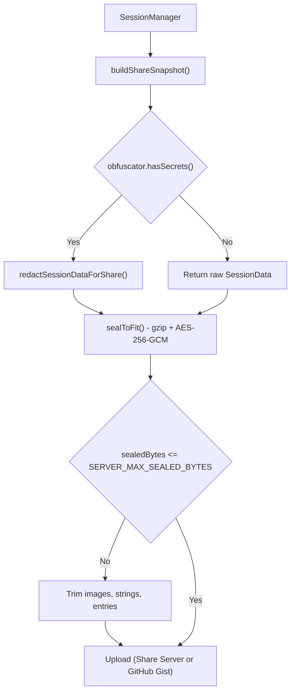
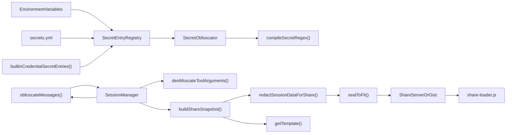

<!-- source: DeepWiki mcp.deepwiki.com · repo can1357/oh-my-pi · page 11.4 Secrets and Export Safety · fetched 2026-10-30 -->

# Secrets and Export Safety

<details>
<summary>Relevant source files</summary>

The following files were used as context for generating this wiki page:

- [docs/secrets.md](docs/secrets.md)
- [packages/coding-agent/bench/secrets-history.bench.ts](packages/coding-agent/bench/secrets-history.bench.ts)
- [packages/coding-agent/src/export/share.ts](packages/coding-agent/src/export/share.ts)
- [packages/coding-agent/src/secrets/index.ts](packages/coding-agent/src/secrets/index.ts)
- [packages/coding-agent/src/secrets/message-transform.ts](packages/coding-agent/src/secrets/message-transform.ts)
- [packages/coding-agent/src/secrets/obfuscator.ts](packages/coding-agent/src/secrets/obfuscator.ts)
- [packages/coding-agent/src/secrets/patterns.ts](packages/coding-agent/src/secrets/patterns.ts)
- [packages/coding-agent/src/secrets/placeholder-scan.ts](packages/coding-agent/src/secrets/placeholder-scan.ts)
- [packages/coding-agent/src/secrets/placeholder.ts](packages/coding-agent/src/secrets/placeholder.ts)
- [packages/coding-agent/src/secrets/registry-revision.ts](packages/coding-agent/src/secrets/registry-revision.ts)
- [packages/coding-agent/test/sdk-session-isolation.test.ts](packages/coding-agent/test/sdk-session-isolation.test.ts)
- [packages/coding-agent/test/secrets-fast-paths.test.ts](packages/coding-agent/test/secrets-fast-paths.test.ts)
- [packages/coding-agent/test/secrets-obfuscator.test.ts](packages/coding-agent/test/secrets-obfuscator.test.ts)
- [packages/coding-agent/test/secrets-prefilter.test.ts](packages/coding-agent/test/secrets-prefilter.test.ts)
- [packages/coding-agent/test/share.test.ts](packages/coding-agent/test/share.test.ts)

</details>


This page documents the security architecture of the `oh-my-pi` coding agent, focusing on the `SecretObfuscator` detection and transformation pipeline, cryptographic placeholder bindings, session sharing/export redaction, and HTML export/share viewer safety.

Sources: `docs/secrets.md` [docs/secrets.md:1-146](), `packages/coding-agent/src/secrets/obfuscator.ts` [packages/coding-agent/src/secrets/obfuscator.ts:1-172](), `packages/coding-agent/src/export/share.ts` [packages/coding-agent/src/export/share.ts:1-160]()

---

## 1. Secret Detection & Obfuscation Pipeline

The secret obfuscation subsystem prevents sensitive values—such as API keys, tokens, passwords, and credentials—from being transmitted to LLM providers. When enabled via settings (`secrets.enabled: true`), matches of configured secrets and built-in credential-shaped tokens are replaced with placeholders before provider-visible payloads leave the process. This includes session message content, tool outputs, and replay text fields. Static system prompts, static tool definitions, and binary payloads are not redacted by this subsystem [docs/secrets.md:1-12]().

### Sources of Secrets

Secrets are collected at session startup from several input sources:

- **Environment Variables**: Variables having names matching common secret-related keywords (e.g., `KEY`, `SECRET`, `TOKEN`, `PASSWORD`, `PASS`, `AUTH`, `CREDENTIAL`, `PRIVATE`, `OAUTH`) and with values at least 8 characters long are automatically collected as secrets. Passwords embedded inside connection URL environment variables are extracted even if the variable name would not match [docs/secrets.md:16-22]().

- **`secrets.yml` Files**: Custom secrets defined as YAML arrays of entries, located by default at:
  - Global: `<active-agent-dir>/secrets.yml` (e.g., `~/.omp/agent/secrets.yml`)
  - Project: `<cwd>/.omp/secrets.yml`
  
  Project-level secrets override global entries with matching content [docs/secrets.md:36-44]().

- **Built-in Credential Regexes**: A comprehensive set of built-in regex patterns covering common cloud/provider tokens is included (`CREDENTIAL_PATTERNS`). These reversible regex entries cover GitHub, GitLab, OpenAI, Anthropic, AWS, Google API, Slack, npm, Stripe, Hugging Face, SendGrid, JWTs, Bearer tokens, and PEM private key blocks. The built-in function `builtinCredentialSecretEntries()` returns these entries for use in the `SecretObfuscator`, which are also used in tests to validate correct reversible obfuscation and deobfuscation coverage [docs/secrets.md:19](), [packages/coding-agent/src/secrets/index.ts:7-31](), [packages/coding-agent/test/secrets-obfuscator.test.ts:77-156]().

### SecretEntry Configuration

Secrets are configured via `SecretEntry` objects of types `"plain"` (literal string) or `"regex"` (pattern), optionally with replacement mode and friendly names [packages/coding-agent/src/secrets/obfuscator.ts:50-64]():

| Field          | Purpose                                             |
|----------------|-----------------------------------------------------|
| `type`         | `"plain"` or `"regex"` identifying the secret form [packages/coding-agent/src/secrets/obfuscator.ts:50-64]() |
| `content`      | Secret string or regex pattern to detect            |
| `mode`         | `"obfuscate"` (reversible placeholder) or `"replace"` (one-way replacement) [packages/coding-agent/src/secrets/obfuscator.ts:50-64]() |
| `replacement`  | Replacement string for `"replace"` mode secrets     |
| `flags`        | Regex flags for `"regex"` entries                    |
| `friendlyName` | Optional sanitized label to display in placeholders |

Built-in credential regexes also provide `literalPrefixes` to optimize scanning by filtering out text ranges unlikely to contain secrets, improving performance [packages/coding-agent/src/secrets/obfuscator.ts:66-74]().

### Pipeline Initialization and Runtime Data Flow

```mermaid
graph TD
    Env["EnvVars"] --> Registry["SecretEntry Registry Collection"]
    Yaml["secrets.yml"] --> Registry
    Builtin["builtinCredentialSecretEntries()"] --> Registry

    Registry --> Init["SecretObfuscator.constructor()"]
    Init --> Comp["compileSecretRegex()"]
    Comp --> Obfuscator["SecretObfuscator instance"]

    SessionInput["Session Messages / Tool Output JSON"] --> Obfuscator
    Obfuscator -->|obfuscate()| ProviderView["Provider-Visible Text"]
```

*Figure 1: Secret obfuscation pipeline initialization and runtime obfuscation using concrete code entities.*

Sources: `docs/secrets.md` [docs/secrets.md:16-57](), `packages/coding-agent/src/secrets/obfuscator.ts` [packages/coding-agent/src/secrets/obfuscator.ts:46-165]()

---

## 2. Placeholder Mechanics & Cryptographic Binding

### Secret Placeholder Key

- Each install maintains a **per-install secret key** (32 bytes, base64url encoded) stored at `$XDG_STATE_HOME/omp/secret-placeholder.key` or `~/.omp/agent/secret-placeholder.key`, loaded by async `getSecretPlaceholderKey()` or sync `getSecretPlaceholderKeySync()` utilities [packages/coding-agent/src/secrets/index.ts:23-127]().

- The key is:
  - Lazily loaded or generated on first access.
  - Protected with file permission `0600`.
  - Cached in memory for idempotent placeholder generation.
  - If the key file is unwritable or unreadable, a **process-ephemeral fallback** key is used with a warning. This degrades cross-session placeholder stability but preserves runtime safety and idempotency [packages/coding-agent/src/secrets/index.ts:79-125]().

### Placeholder Format

1. Secrets (plain values or regex matches) are replaced by deterministic placeholders formatted as:

   ```
   $$[FRIENDLYNAME_]HASH[:CASEHINT]$$
   ```

2. Where:

   - `FRIENDLYNAME` is an optional sanitized label (sanitized to uppercase letters and digits, max 32 chars) that offers semantic context to the placeholder, e.g. `GITHUBTOKEN` [packages/coding-agent/src/secrets/placeholder.ts:34-40]().
   - `HASH` is a 12-character uppercase alphanumeric base36 string representing a truncated cryptographic digest of the secret and per-install key, providing collision resistance and uniqueness [packages/coding-agent/src/secrets/placeholder.ts:10-16]().
   - A trailing **case hint** suffix optionally encodes ASCII letter casing preservation:

     | Suffix  | Meaning                              |
     |---------|------------------------------------|
     | `:U`    | All ASCII letters uppercase        |
     | `:L`    | All ASCII letters lowercase        |
     | `:C`    | Capitalized (first letter uppercase) |
     | `:M`    | Mixed casing                       |

   This suffix enables reversible deobfuscation that respects the original letter cases in text [docs/secrets.md:76-90](), [packages/coding-agent/src/secrets/placeholder.ts:10-61]().

### Friendly Name Sanitization and Collision Avoidance

- Friendly names are sanitized aggressively via `sanitizeSecretFriendlyName()`:
  - Non-alphanumeric characters are stripped.
  - Resulting names must not collide with any configured secret literal or regex secret substring. If they do, the friendly name is dropped to avoid leaking secret fragments via the label.
  - The friendly name is truncated to 32 characters.
  - An empty sanitized name is omitted.

- Collision checks are performed by `SecretValueSet` normalizing and indexing all secret values, accelerating detection of potential leaks through labels [packages/coding-agent/src/secrets/placeholder.ts:34-156]().

Sources: `docs/secrets.md` [docs/secrets.md:76-96](), `packages/coding-agent/src/secrets/index.ts` [packages/coding-agent/src/secrets/index.ts:23-127](), `packages/coding-agent/src/secrets/placeholder.ts` [packages/coding-agent/src/secrets/placeholder.ts:34-156]()

---

## 3. Bidirectional Transformation & Tool Execution Safety

### Problem Statement

- Model prompts and tool inputs may echo secret placeholders verbatim.
- Tools, however, may require plaintext secrets for correct operation (e.g., edit-tools matching original text from user).
- Previous bugs (e.g., Issue #6968) demonstrated failures when placeholders permanently replaced secrets in tool arguments, causing tools to mismatch file contents or commands [packages/coding-agent/test/secrets-obfuscator.test.ts:74-80]().

### Bi-directional Mapping Design

- **Forward path** (`obfuscate()` and `obfuscateMessages()`):
  - Secrets in provider-facing content are replaced with placeholders [packages/coding-agent/src/secrets/obfuscator.ts:1-172]().
  - Placeholders are **deterministic and stable** across the session lifetime but irreversibly map a secret to a unique token.
  - Repeated obfuscation calls on already-obfuscated text are no-ops to maintain idempotency [packages/coding-agent/test/secrets-obfuscator.test.ts:89-90]().
  - Secrets shorter than 8 characters are not obfuscated by default (`MIN_OBFUSCATE_SECRET_LEN`) to avoid censoring normal words [packages/coding-agent/src/secrets/placeholder.ts:18-19]().

- **Backward path** (`deobfuscateToolArguments()` and `deobfuscateAgentMessages()`):
  - Tool calls received from the model which contain placeholders are deeply walked [packages/coding-agent/src/secrets/message-transform.ts:28-114]().
  - Placeholder tokens are reversed to their original secret values before tool execution.
  - Deobfuscation relies on the securely scoped `#deobfuscateMap` binding placeholders to secrets generated at runtime under the same per-install placeholder key [packages/coding-agent/src/secrets/obfuscator.ts:157-165]().
  - Tokens synthesized by the model that do not match the current key are not deobfuscated, protecting against arbitrary placeholder injection attacks [packages/coding-agent/src/secrets/obfuscator.ts:157-165]().

- **Session display and resume**:
  - Session transcripts retain placeholders for human-safe viewing [packages/coding-agent/src/secrets/message-transform.ts:28-35]().
  - Dynamic replay/compaction contexts re-obfuscate for provider replay [docs/secrets.md:87-89]().
  - Deobfuscation is applied for tool arguments executed locally to restore plaintext secrets for tools [packages/coding-agent/test/secrets-obfuscator.test.ts:78-80]().

| Direction                   | Method                         | Description                                                            |
|----------------------------|--------------------------------|------------------------------------------------------------------------|
| Session → Provider          | `obfuscateMessages()`, `obfuscateProviderContext()` | Replace secrets with placeholders in all provider-visible text and JSON. |
| Provider → Tool             | `deobfuscateToolArguments()`   | Restore placeholders to plaintext secrets in live tool call arguments before execution. |
| Local Session Resume/Display| `deobfuscateSessionContext()`  | Display transcripts with placeholders restored to originals; re-obfuscate before replay. |

Sources: `packages/coding-agent/test/secrets-obfuscator.test.ts` [packages/coding-agent/test/secrets-obfuscator.test.ts:58-140](), `packages/coding-agent/src/secrets/index.ts` [packages/coding-agent/src/secrets/index.ts:152-160](), `packages/coding-agent/src/secrets/message-transform.ts` [packages/coding-agent/src/secrets/message-transform.ts:28-131]()

---

## 4. Session Export and Sharing Redaction

### Goals

- Prevent secrets or personally identifiable information (PII) leakage during session export and sharing.
- Implement client-side encryption and redaction prior to any upload.
- Keep the snapshot size within server limits by progressive trimming of large images, long strings, and oldest session entries.

### Workflow

1. `buildShareSnapshot(sm, options)` creates the snapshot for export/share by invoking `buildSessionData()` to retrieve the session structure [packages/coding-agent/src/export/share.ts:95-98]().

2. If an obfuscator with secrets is provided, the snapshot is redacted via a typed, traversal-based function (`redactSessionDataForShare()`), which applies secret obfuscation to all textual fields including:

   - Session header fields (`cwd`, `title`).
   - Bookmark labels and file mention paths [packages/coding-agent/test/share.test.ts:162-195]().
   - Assistant messages including tool calls, error messages, and bash metadata.
   - Message content, tool result outputs, and any text-bearing fields [packages/coding-agent/src/export/share.ts:110-160]().

3. Inline image data is preserved but size-trimmed when needed, or replaced with a 1×1 transparent GIF placeholder (`[image omitted from share]`) if the snapshot is too large [packages/coding-agent/src/export/share.ts:52-54]().

4. Untyped or opaque extension payloads (`details`, `data`, `outputSchema`) and provider replay data (`providerPayload`, `redactedThinking`) are dropped to ensure no accidental data leak [packages/coding-agent/src/export/share.ts:70-80]().

5. The JSON snapshot is compressed with gzip and encrypted with AES-256-GCM using a fresh random 12-byte IV and 32-byte key [packages/coding-agent/src/export/share.ts:4-5]().

6. The encrypted blob is uploaded to either:

   - The **share server**, capped at 1 MB (`SERVER_MAX_SEALED_BYTES`) [packages/coding-agent/src/export/share.ts:38-39]().
   - A **GitHub secret Gist**, capped approximately at 5 MB, with fallback to the server [packages/coding-agent/src/export/share.ts:8-14]().

7. The share URL contains the blob ID and base64url encryption key in the URL fragment for **zero-knowledge sharing**. The key never leaves the client browser [packages/coding-agent/src/export/share.ts:15-18]().

### Limits and Truncation

- When the sealed blob exceeds the upload limit (`SERVER_MAX_SEALED_BYTES`, 1MB by default), `sealToFit()` progressively trims the snapshot using heuristics:

  1. Replace large inline images with placeholders.
  2. Apply successively stricter caps on text string length (from 32 KB down to 512 bytes).
  3. Drop the oldest entries from the session to fit the target size.

- This ensures shared sessions retain structure but with truncated content so uploads succeed.

### Session Sharing Redaction Data Flow



*Figure 2: Session export and sharing pipeline, including secret redaction, size trimming, and upload.*

Sources: `packages/coding-agent/src/export/share.ts` [packages/coding-agent/src/export/share.ts:38-160](), `packages/coding-agent/test/share.test.ts` [packages/coding-agent/test/share.test.ts:56-111]()

---

## 5. HTML Export & Share Viewer Architecture

### Overview

- Session exports produce standalone, self-contained HTML files bundling minified CSS, React tool views, and JavaScript application code for transcript replay rendering.

- The HTML export is generated by the `getTemplate()` function within the export HTML package, which assembles static assets plus session snapshot data.

- The web share viewer (`share-loader.js`) running client-side performs:

  - Fetching the encrypted session blob (from the share server or GitHub gist).
  - Using the URL fragment key to decrypt with AES-256-GCM.
  - Decompressing the JSON via gunzip.
  - Parsing and rendering the session securely in-browser [packages/coding-agent/src/export/share.ts:15-18]().

### Security Properties

- The server never receives the decryption key, instituting a **zero-knowledge sharing model**: only the client-side browser obtains the plaintext session for rendering [packages/coding-agent/src/export/share.ts:15-18]().

- All cryptographic operations on shared data occur client-side, eliminating the risk of secret or placeholder leakage on the network.

- The viewer safely renders transcript data, avoiding execution of arbitrary extension code or untrusted payloads embedded in sessions.

Sources: `packages/coding-agent/src/export/html/index.ts` [packages/coding-agent/src/export/html/index.ts:1-159](), `packages/coding-agent/src/export/share.ts` [packages/coding-agent/src/export/share.ts:1-18](), `packages/coding-agent/test/share.test.ts` [packages/coding-agent/test/share.test.ts:27-34]()

---

## Summary Diagram Bridging Natural Language Concepts to Code Entities



*Figure 3: Detailed mapping of secrets management and export safety pipeline from natural language concepts to concrete code entities.*

Sources: `docs/secrets.md` [docs/secrets.md:1-146](), `packages/coding-agent/src/secrets/obfuscator.ts` [packages/coding-agent/src/secrets/obfuscator.ts:1-172](), `packages/coding-agent/src/secrets/index.ts` [packages/coding-agent/src/secrets/index.ts:1-161](), `packages/coding-agent/src/secrets/message-transform.ts` [packages/coding-agent/src/secrets/message-transform.ts:1-124](), `packages/coding-agent/test/secrets-obfuscator.test.ts` [packages/coding-agent/test/secrets-obfuscator.test.ts:1-156](), `packages/coding-agent/src/export/share.ts` [packages/coding-agent/src/export/share.ts:1-160](), `packages/coding-agent/test/share.test.ts` [packages/coding-agent/test/share.test.ts:1-196](), `packages/coding-agent/src/export/html/index.ts` [packages/coding-agent/src/export/html/index.ts:1-159]()

---

## Summary

The `oh-my-pi` coding agent protects secrets by:

- Identifying secrets from environment variables, `secrets.yml`, and built-in credential regex patterns [docs/secrets.md:16-20]().
- Obfuscating them with cryptographically bound placeholders using a per-install secret key [docs/secrets.md:91]().
- Guaranteeing reversible deobfuscation for live tool calls without leaking the secret [docs/secrets.md:3]().
- Redacting exported/sharable session data through typed traversal to prevent secret or PII leakage [packages/coding-agent/src/export/share.ts:95-160]().
- Encrypting shared session snapshots using AES-256-GCM with keys included only in the client URL fragment for zero-knowledge storage [packages/coding-agent/src/export/share.ts:14-17]().
- Delivering standalone, self-contained HTML exports and secure share viewer UIs that maintain themeability and ensure safety during replay [packages/coding-agent/src/export/html/index.ts:28-46]().

Sources:
- `docs/secrets.md` [docs/secrets.md:1-146]()
- `packages/coding-agent/src/secrets/obfuscator.ts` [packages/coding-agent/src/secrets/obfuscator.ts:1-172]()
- `packages/coding-agent/src/secrets/index.ts` [packages/coding-agent/src/secrets/index.ts:1-161]()
- `packages/coding-agent/src/secrets/message-transform.ts` [packages/coding-agent/src/secrets/message-transform.ts:1-124]()
- `packages/coding-agent/test/secrets-obfuscator.test.ts` [packages/coding-agent/test/secrets-obfuscator.test.ts:1-156]()
- `packages/coding-agent/src/export/share.ts` [packages/coding-agent/src/export/share.ts:1-160]()
- `packages/coding-agent/test/share.test.ts` [packages/coding-agent/test/share.test.ts:1-196]()
- `packages/coding-agent/src/export/html/index.ts` [packages/coding-agent/src/export/html/index.ts:1-159]()

---

