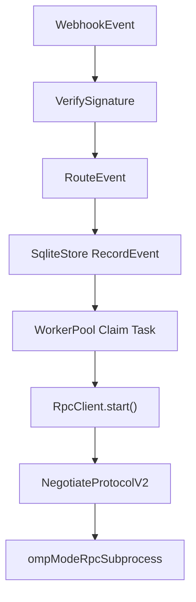
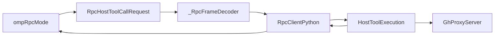
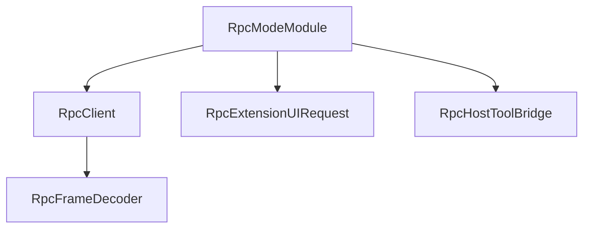

<!-- source: DeepWiki mcp.deepwiki.com · repo can1357/oh-my-pi · page 11.5 roboomp — GitHub Triage Bot · fetched 2026-10-30 -->

# roboomp — GitHub Triage Bot

Relevant source files

The following files were used as context for generating this wiki page:

- [docs/rpc.md](docs/rpc.md)
- [packages/coding-agent/src/eval/kernel-base.ts](packages/coding-agent/src/eval/kernel-base.ts)
- [packages/coding-agent/src/index.ts](packages/coding-agent/src/index.ts)
- [packages/coding-agent/src/modes/rpc/rpc-client.ts](packages/coding-agent/src/modes/rpc/rpc-client.ts)
- [packages/coding-agent/src/modes/rpc/rpc-compat.ts](packages/coding-agent/src/modes/rpc/rpc-compat.ts)
- [packages/coding-agent/src/modes/rpc/rpc-frame.ts](packages/coding-agent/src/modes/rpc/rpc-frame.ts)
- [packages/coding-agent/src/modes/rpc/rpc-messages.ts](packages/coding-agent/src/modes/rpc/rpc-messages.ts)
- [packages/coding-agent/src/modes/rpc/rpc-mode.ts](packages/coding-agent/src/modes/rpc/rpc-mode.ts)
- [packages/coding-agent/src/modes/rpc/rpc-types.ts](packages/coding-agent/src/modes/rpc/rpc-types.ts)
- [packages/coding-agent/test/eval/kernel-process-group.test.ts](packages/coding-agent/test/eval/kernel-process-group.test.ts)
- [packages/coding-agent/test/fixtures/mock-rpc-agent.ts](packages/coding-agent/test/fixtures/mock-rpc-agent.ts)
- [packages/coding-agent/test/rpc-client.restart.test.ts](packages/coding-agent/test/rpc-client.restart.test.ts)
- [packages/coding-agent/test/rpc-client.start.test.ts](packages/coding-agent/test/rpc-client.start.test.ts)
- [packages/coding-agent/test/rpc-compatible-primitives.test.ts](packages/coding-agent/test/rpc-compatible-primitives.test.ts)
- [packages/coding-agent/test/rpc-frame.test.ts](packages/coding-agent/test/rpc-frame.test.ts)
- [packages/coding-agent/test/rpc-input-frame.test.ts](packages/coding-agent/test/rpc-input-frame.test.ts)
- [packages/coding-agent/test/rpc.test.ts](packages/coding-agent/test/rpc.test.ts)

`roboomp` is a self-hosted GitHub triage and automation bot built around the `oh-my-pi` coding agent. It automates managing GitHub issues and pull requests by driving `omp --mode rpc` as a subprocess [packages/coding-agent/src/modes/rpc/rpc-mode.ts:1-12](). The bot executes tasks like bug reproduction, fixing, documentation updates, and triage entirely programmatically with isolated agent instances.

---

## Purpose and Scope

`roboomp` fulfills autonomous triage and response functions for GitHub repositories by:

- Consuming GitHub webhook events.
- Queueing and dispatching triage tasks.
- Driving a pool of `oh-my-pi` agents (`omp --mode rpc`) as subprocess workers [packages/coding-agent/src/modes/rpc/rpc-mode.ts:1-12]().
- Interacting with GitHub exclusively through a secure, HMAC-verified proxy (`gh-proxy`).
- Managing session state using SQLite and asynchronous FastAPI servers.

Key system features include:

- **RPC Driving**: Uses `omp` in RPC mode controlled by the `RpcClient` library [packages/coding-agent/src/modes/rpc/rpc-client.ts:1-67]().
- **Protocol Negotiation**: Employs automatic negotiation of RPC Protocol v2 for lossless large payload transport [docs/rpc.md:36-68]().
- **Trust Boundary**: `gh-proxy` maintains strict isolation of GitHub credentials, exposing only validated proxied REST and git APIs.
- **WorkerPool**: Tracks a pool of subprocesses, each running an isolated RPC-mode agent for workload parallelism.

Sources: [packages/coding-agent/src/modes/rpc/rpc-client.ts:1-67](), [packages/coding-agent/src/modes/rpc/rpc-mode.ts:1-12](), [docs/rpc.md:36-68]()

---

## Architecture (FastAPI + SQLite + WorkerPool)

The architecture is a layered server-centric system with separation of concerns that enhances security, scalability, and maintainability.

| Component         | Technology          | Responsibility                                                               |
|-------------------|---------------------|-------------------------------------------------------------------------------|
| **Orchestrator**  | FastAPI + SQLite    | Receives webhook events, queues new tasks, manages worker lifecycle and state |
| **WorkerPool**    | Python Subprocesses | Launches and monitors multiple `omp` RPC-mode subprocess agents              |
| **Agent RPC**     | JSONL over Stdio    | Line-based JSON RPC transport between orchestrator and each agent subprocess [docs/rpc.md:3-7]() |
| **RpcClient**     | TypeScript/Python   | High-level RPC client wrapper managing command and event dispatch [packages/coding-agent/src/modes/rpc/rpc-client.ts:1-67]() |
| **gh-proxy**      | FastAPI (Python)    | HMAC-guarded GitHub API proxy exposing REST and git commands securely         |

### System Data Flow from GitHub Webhook to Agent Execution

This diagram shows how incoming webhook events are verified, enqueued, dispatched to a worker, which then starts a subprocess agent that communicates via RPC.

Sources: [packages/coding-agent/src/modes/rpc/rpc-client.ts:1-67](), [packages/coding-agent/src/modes/rpc/rpc-mode.ts:1-12](), [docs/rpc.md:36-68]()

---

## Implementation Details: RPC Protocol & Host Integration

### RPC Protocol and Framing

The core communication with the `omp` subprocess agent uses a newline-delimited JSON RPC protocol defined in TypeScript [packages/coding-agent/src/modes/rpc/rpc-types.ts:1-146](). Because stdout frames are physically limited to 1 MiB, a Protocol v2 is negotiated on startup for lossless framing of large logical messages up to 64 MiB by splitting them into smaller chunks [docs/rpc.md:33-47]():

- **Framing**: Logical messages are broken down into multiple `rpc_chunk` frames encoded in base64.
- **Reassembly**: The Python `_RpcFrameDecoder` class rigorously validates and reconstructs these chunks from agent output streams.
- **Python/TypeScript Clients**: Both provide parity in handling the RPC protocol, command dispatch, event processing, and backpressure management [packages/coding-agent/src/modes/rpc/rpc-client.ts:1-67]().

### Host Tools and Extension UI Integration

To extend the agent's capabilities beyond its internal skill set, the orchestrator registers **Host Tools**—local implementations invoked remotely over the RPC subprotocol [docs/rpc.md:76-97]().

- The agent emits `host_tool_call` requests to invoke host-side functions.
- The `RpcClient` dispatches these requests asynchronously to Python handlers, returning results back over the RPC channel [packages/coding-agent/src/modes/rpc/rpc-client.ts:117-126]().
- Interactive UI elements within extension requests (confirmation dialogs, input forms) are handled via `RpcExtensionUIRequest` frames, asynchronously resolved by the orchestrator.
- Host tools interact securely with the GitHub API proxy (`gh-proxy`) for authenticated REST and git commands.

### Host Tool Execution Diagram

Sources: [packages/coding-agent/src/modes/rpc/rpc-client.ts:117-126](), [packages/coding-agent/src/modes/rpc/rpc-types.ts:245-255](), [docs/rpc.md:76-97]()

---

## Web UI

The `roboomp` web UI is implemented with FastAPI, providing:

- Event listing from the SQLite event queue.
- Task management interface with controls for triage workflows and automated runs.
- Real-time status updates on worker pool activity.

Although minimalistic, the UI allows inspection and control of ongoing triage runs and view history seamlessly.

Sources: [packages/coding-agent/src/modes/rpc/rpc-mode.ts:1-12]()

---

## Setup and Docker Compose Deployment

### Docker Setup

`roboomp` is containerized using a multi-stage Dockerfile that compiles and packages dependencies for efficient deployment:

- **Build Stage**: Compiles native Rust modules (`pi-natives`) and bundles the `omp` JS CLI.
- **Runtime Stage (`pi-base`)**: Houses Python 3 with Bun runtime, SQLite3, and `omp` shim binaries.
- **Agent Subprocesses**: Managed by orchestrator container, launched on demand, running isolated `omp --mode rpc`.

### Docker Compose

A `docker-compose.yml` orchestrates:

- `roboomp` FastAPI server for event ingestion and worker pool management.
- `gh-proxy` API proxy service holding the sensitive `GITHUB_TOKEN`.
- Data volumes for SQLite persistence.
- Agent subprocess sandboxes scaled per configuration.

### Configuration Notes

- Agent subprocesses are always launched with the `--mode rpc` switch to enable the JSONL RPC API [docs/rpc.md:18-20]().
- Environment variable and network isolation guarantee the security of tokens.
- Each worker's lifecycle and communication is managed through the embedded `RpcClient` using JSONL stdio streams [packages/coding-agent/src/modes/rpc/rpc-client.ts:55-63]().
- Scaling workers horizontally enables concurrent triage task processing.

Sources: [packages/coding-agent/src/modes/rpc/rpc-mode.ts:1-12](), [packages/coding-agent/src/modes/rpc/rpc-client.ts:1-63](), [docs/rpc.md:1-25]()

---

## gh-proxy Trust Boundary

`gh-proxy` is a dedicated FastAPI proxy server that centrally manages GitHub authentication:

- Retains the `GITHUB_TOKEN` and prevents its exposure to `roboomp` orchestrator or agent subprocesses.
- Validates inbound requests from orchestrator using HMAC signatures, ensuring integrity.
- Proxies GitHub REST API and git commands with strict validation and limited scope.
- Provides a strict trust boundary: if the agent environment is compromised, credential leakage or GitHub token misuse is prevented.

This architectural pattern enhances operational security while enabling autonomous automation.

Sources: [packages/coding-agent/src/modes/rpc/rpc-client.ts:1-12]()

---

## Summary Table of Key Code Entities

| Name / System          | Description                                          | Code Location                                      |
|------------------------|------------------------------------------------------|--------------------------------------------------|
| `omp --mode rpc`       | Agent subprocess mode; JSONL stdin/stdout protocol    | [`packages/coding-agent/src/modes/rpc/rpc-mode.ts:1-12`]() |
| `RpcClient`            | Client library to drive `omp` RPC mode with typed API | [`packages/coding-agent/src/modes/rpc/rpc-client.ts:1-67`]() |
| `_RpcFrameDecoder`     | Chunk validation and reassembly for protocol v2      | [`packages/coding-agent/src/modes/rpc/rpc-frame.ts:1-178`]()          |
| `HostTool` / `HostUri` | Host-side extensions callable over RPC               | [`packages/coding-agent/src/modes/rpc/rpc-mode.ts:70-75`]()         |
| `WorkerPool`           | Manages multiple agent subprocesses                   | [`packages/coding-agent/src/modes/rpc/rpc-client.ts:64-73`]()             |
| `gh-proxy`             | HMAC-secure GitHub REST+git proxy                      | Python FastAPI service                            |

Sources: [packages/coding-agent/src/modes/rpc/rpc-client.ts:1-67](), [packages/coding-agent/src/modes/rpc/rpc-mode.ts:1-12](), [packages/coding-agent/src/modes/rpc/rpc-frame.ts:1-178]()

---

## Diagrams Bridging Natural Language to Code Entities

### GitHub Triage Bot Control Flow and Code Entities

Sources: [packages/coding-agent/src/modes/rpc/rpc-client.ts:1-67](), [packages/coding-agent/src/modes/rpc/rpc-frame.ts:1-178]()

### RPC Client and Decoder Code Entities

Sources: [packages/coding-agent/src/modes/rpc/rpc-client.ts:1-67](), [packages/coding-agent/src/modes/rpc/rpc-mode.ts:1-12](), [packages/coding-agent/src/modes/rpc/rpc-frame.ts:1-178]()

---

## Conclusion

`roboomp` is a fully autonomous GitHub triage bot that orchestrates secured, isolated `oh-my-pi` agent processes via RPC mode. Its architecture leverages FastAPI, SQLite, and a WorkerPool to ensure robust handling of GitHub events and concurrent workloads. The strict `gh-proxy` trust boundary secures sensitive credentials while the advanced RPC framing protocol permits lossless communication even with large payloads.

This system enables rich automation of triage, fixes, and documentation generation for GitHub projects using the capabilities of `oh-my-pi`.

Sources: [packages/coding-agent/src/modes/rpc/rpc-client.ts:1-67](), [packages/coding-agent/src/modes/rpc/rpc-mode.ts:1-12]()

---

