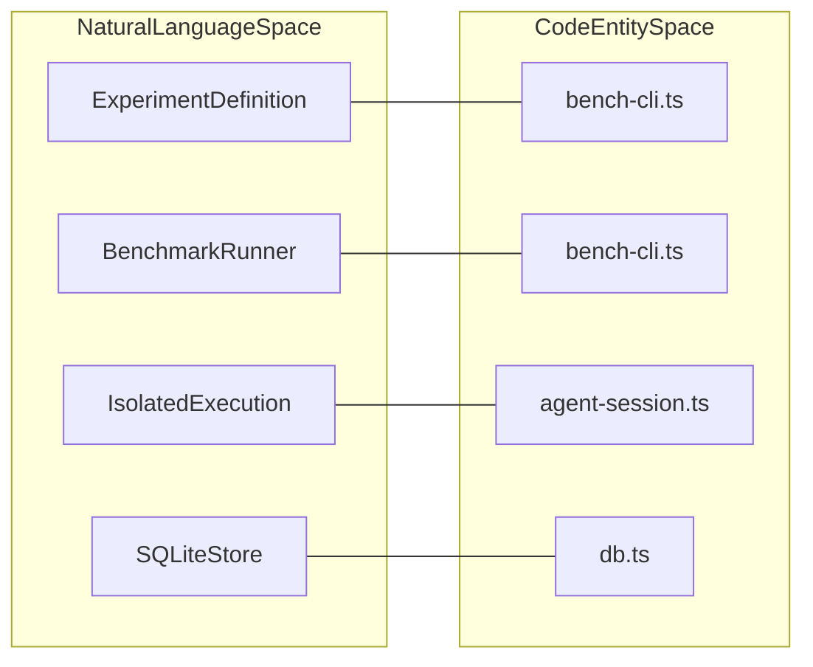
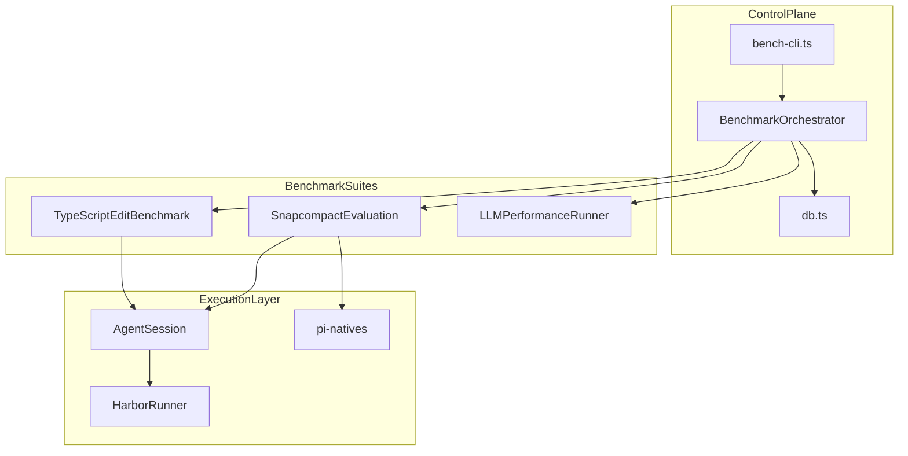
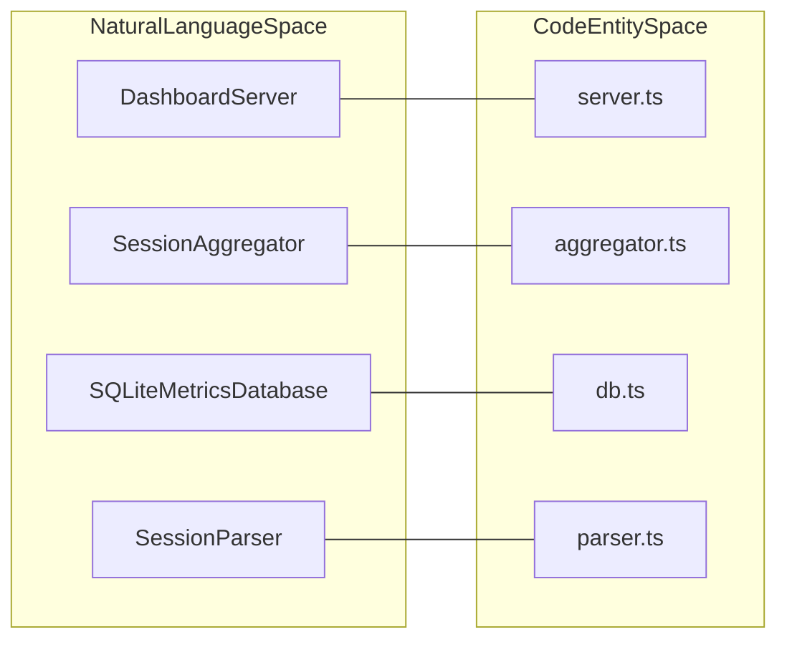

<!-- source: DeepWiki mcp.deepwiki.com · repo can1357/oh-my-pi · page 11.6 Benchmarks and Harnesses · fetched 2026-10-30 -->

# Benchmarks and Harnesses

Relevant source files

The following files were used as context for generating this wiki page:

- [docs/compaction.md](docs/compaction.md)
- [packages/agent/test/snapcompact-frames.test.ts](packages/agent/test/snapcompact-frames.test.ts)
- [packages/catalog/src/compat/image-tokenization.ts](packages/catalog/src/compat/image-tokenization.ts)
- [packages/catalog/src/compat/rules/classes/deepseek.kdl](packages/catalog/src/compat/rules/classes/deepseek.kdl)
- [packages/catalog/src/compat/rules/providers/cursor.kdl](packages/catalog/src/compat/rules/providers/cursor.kdl)
- [packages/catalog/test/cursor-pricing.test.ts](packages/catalog/test/cursor-pricing.test.ts)
- [packages/catalog/test/image-tokenization.test.ts](packages/catalog/test/image-tokenization.test.ts)
- [packages/coding-agent/src/cli-commands.ts](packages/coding-agent/src/cli-commands.ts)
- [packages/coding-agent/src/cli/bench-cli.ts](packages/coding-agent/src/cli/bench-cli.ts)
- [packages/coding-agent/src/cli/bench-runtime.ts](packages/coding-agent/src/cli/bench-runtime.ts)
- [packages/coding-agent/src/cli/command-help.ts](packages/coding-agent/src/cli/command-help.ts)
- [packages/coding-agent/src/cli/dry-balance-cli.ts](packages/coding-agent/src/cli/dry-balance-cli.ts)
- [packages/coding-agent/src/cli/stats-cli.ts](packages/coding-agent/src/cli/stats-cli.ts)
- [packages/coding-agent/src/commands/bench.ts](packages/coding-agent/src/commands/bench.ts)
- [packages/coding-agent/src/commands/dry-balance.ts](packages/coding-agent/src/commands/dry-balance.ts)
- [packages/coding-agent/src/commands/install.ts](packages/coding-agent/src/commands/install.ts)
- [packages/coding-agent/src/if-bench/actions.ts](packages/coding-agent/src/if-bench/actions.ts)
- [packages/coding-agent/src/if-bench/index.ts](packages/coding-agent/src/if-bench/index.ts)
- [packages/coding-agent/src/if-bench/prompts/system.md](packages/coding-agent/src/if-bench/prompts/system.md)
- [packages/coding-agent/src/if-bench/runner.ts](packages/coding-agent/src/if-bench/runner.ts)
- [packages/coding-agent/src/prompts/bench/chat.md](packages/coding-agent/src/prompts/bench/chat.md)
- [packages/coding-agent/src/prompts/bench/generation.md](packages/coding-agent/src/prompts/bench/generation.md)
- [packages/coding-agent/src/prompts/bench/prefill-instruction.md](packages/coding-agent/src/prompts/bench/prefill-instruction.md)
- [packages/coding-agent/src/prompts/dry-balance-bench.md](packages/coding-agent/src/prompts/dry-balance-bench.md)
- [packages/coding-agent/src/prompts/system/snapcompact-read-note.md](packages/coding-agent/src/prompts/system/snapcompact-read-note.md)
- [packages/coding-agent/src/session/snapcompact-inline.ts](packages/coding-agent/src/session/snapcompact-inline.ts)
- [packages/coding-agent/src/slash-commands/helpers/stats-dashboard.ts](packages/coding-agent/src/slash-commands/helpers/stats-dashboard.ts)
- [packages/coding-agent/test/agent-session-snapcompact-budget.test.ts](packages/coding-agent/test/agent-session-snapcompact-budget.test.ts)
- [packages/coding-agent/test/agent-session-snapcompact-trigger-room.test.ts](packages/coding-agent/test/agent-session-snapcompact-trigger-room.test.ts)
- [packages/coding-agent/test/bench-auth-fallback.test.ts](packages/coding-agent/test/bench-auth-fallback.test.ts)
- [packages/coding-agent/test/bench-cache.test.ts](packages/coding-agent/test/bench-cache.test.ts)
- [packages/coding-agent/test/bench-profiles.test.ts](packages/coding-agent/test/bench-profiles.test.ts)
- [packages/coding-agent/test/cli-argv-routing.test.ts](packages/coding-agent/test/cli-argv-routing.test.ts)
- [packages/coding-agent/test/dry-balance-config.test.ts](packages/coding-agent/test/dry-balance-config.test.ts)
- [packages/coding-agent/test/dry-balance-runtime.test.ts](packages/coding-agent/test/dry-balance-runtime.test.ts)
- [packages/coding-agent/test/if-bench.test.ts](packages/coding-agent/test/if-bench.test.ts)
- [packages/coding-agent/test/install-command.test.ts](packages/coding-agent/test/install-command.test.ts)
- [packages/coding-agent/test/plugin-verb-launch-leak.test.ts](packages/coding-agent/test/plugin-verb-launch-leak.test.ts)
- [packages/coding-agent/test/snapcompact-inline.test.ts](packages/coding-agent/test/snapcompact-inline.test.ts)
- [packages/coding-agent/test/stats-cli.test.ts](packages/coding-agent/test/stats-cli.test.ts)
- [packages/snapcompact/CHANGELOG.md](packages/snapcompact/CHANGELOG.md)
- [packages/snapcompact/README.md](packages/snapcompact/README.md)
- [packages/snapcompact/src/prompts/snapcompact-summary.md](packages/snapcompact/src/prompts/snapcompact-summary.md)
- [packages/snapcompact/src/snapcompact.ts](packages/snapcompact/src/snapcompact.ts)
- [packages/snapcompact/test/snapcompact.test.ts](packages/snapcompact/test/snapcompact.test.ts)
- [packages/stats/CHANGELOG.md](packages/stats/CHANGELOG.md)
- [packages/stats/src/aggregator.ts](packages/stats/src/aggregator.ts)
- [packages/stats/src/client/App.tsx](packages/stats/src/client/App.tsx)
- [packages/stats/src/client/api.ts](packages/stats/src/client/api.ts)
- [packages/stats/src/client/data/useHashRoute.ts](packages/stats/src/client/data/useHashRoute.ts)
- [packages/stats/src/client/routes/TracesRoute.tsx](packages/stats/src/client/routes/TracesRoute.tsx)
- [packages/stats/src/client/routes/index.ts](packages/stats/src/client/routes/index.ts)
- [packages/stats/src/client/traces/SummaryStrip.tsx](packages/stats/src/client/traces/SummaryStrip.tsx)
- [packages/stats/src/client/types.ts](packages/stats/src/client/types.ts)
- [packages/stats/src/db.ts](packages/stats/src/db.ts)
- [packages/stats/src/index.ts](packages/stats/src/index.ts)
- [packages/stats/src/parser.ts](packages/stats/src/parser.ts)
- [packages/stats/src/port-conflict.ts](packages/stats/src/port-conflict.ts)
- [packages/stats/src/server.ts](packages/stats/src/server.ts)
- [packages/stats/src/shared-types.ts](packages/stats/src/shared-types.ts)
- [packages/stats/src/trace.ts](packages/stats/src/trace.ts)
- [packages/stats/src/types.ts](packages/stats/src/types.ts)
- [packages/stats/src/usage-windows.ts](packages/stats/src/usage-windows.ts)
- [packages/stats/src/user-metrics.ts](packages/stats/src/user-metrics.ts)
- [packages/stats/test/behavior-backfill.test.ts](packages/stats/test/behavior-backfill.test.ts)
- [packages/stats/test/db-cost.test.ts](packages/stats/test/db-cost.test.ts)
- [packages/stats/test/parser-malformed-entries.test.ts](packages/stats/test/parser-malformed-entries.test.ts)
- [packages/stats/test/provider-stats.test.ts](packages/stats/test/provider-stats.test.ts)
- [packages/stats/test/server-port-conflict.test.ts](packages/stats/test/server-port-conflict.test.ts)
- [packages/stats/test/sync-serial.test.ts](packages/stats/test/sync-serial.test.ts)
- [packages/stats/test/trace-builder.test.ts](packages/stats/test/trace-builder.test.ts)
- [packages/stats/test/user-metrics.test.ts](packages/stats/test/user-metrics.test.ts)
- [packages/tui/test/box-border.test.ts](packages/tui/test/box-border.test.ts)
- [tsconfig.base.json](tsconfig.base.json)

The purpose of this page is to document the metaharness benchmark orchestration system, the typescript-edit-benchmark, the snapcompact research corpus, the omptype validation mechanism, and the stats usage dashboard within the `oh-my-pi` coding agent.

---

## 1. Overview and Data Model

The benchmarking infrastructure in `oh-my-pi` is centered on a hierarchical data model organizing benchmark evaluations into **experiments**, **runs**, and **traces**, all backed by SQLite storage to facilitate historic analysis and regression tracking.

| Entity        | Description                                                                                                   |
|---------------|---------------------------------------------------------------------------------------------------------------|
| **Experiment**| A high-level definition of a benchmark suite, e.g., the TypeScript Edit Benchmark or SnapCompact evaluation.  |
| **Run**       | A specific execution instance of an experiment, associated with parameters such as timestamp, model, and config.|
| **Trace**     | A detailed record of a single task or step within a run, including interaction logs, tool calls, and outcomes. |

The CLI `bench` command provides direct measurement of language model performance, capturing metrics such as time-to-first-token (TTFT), token throughput, and cache efficiencies. It distinguishes latency phases into cold start and warm, and supports various challenge kinds (`chat`, `prefill`, and `generation`) to isolate throughput and latency in different model usage scenarios `[packages/coding-agent/src/cli/bench-cli.ts:59-176]()`.

Sources:  
`[packages/coding-agent/src/cli/bench-cli.ts:59-176]()`

---

## 2. System Architecture and Harbor Runner

This benchmarking system bridges high-level orchestration, run isolation, and native performance tooling:

- **Harbor Runner** isolates benchmark agent sessions, enabling controlled environment executions and concurrency management.
- It coordinates benchmark runs, interacts with SQLite databases for storing results, and leverages native Rust-based snapcompact rendering for archival and image-based compaction.

### Natural Language to Code Entity Mapping: Harness Orchestration

### Metaharness Component Flow

Sources:  
`[packages/coding-agent/src/cli/bench-cli.ts:184-195]()`, `[packages/snapcompact/src/snapcompact.ts:1-46]()`, `[packages/stats/src/db.ts:134-175]()`

---

## 3. Core Benchmark Suites

### 3.1 TypeScript Edit Benchmark

The **TypeScript Edit Benchmark** evaluates the agent's ability to perform precise and validated code modifications in complex TypeScript codebases. It emphasizes:

- **Dry-Run Cost Balancing:** Simulates execution to validate token usage and cost prior to committing code changes.
- **Validation:** Utilizes tool invocations and output verification to ensure edits produce the expected changes in project files.

Orchestration is integrated into the benchmark runner and agent logic. The benchmark runs agent sessions performing scripted edits, recording outcomes and token usage, and verifying correctness through file content comparison `[packages/coding-agent/src/cli/bench-cli.ts:100-150]()`.

Sources:  
`[packages/coding-agent/src/cli/bench-cli.ts:100-150]()`

### 3.2 SnapCompact Research Corpus and Strategies

**Snapcompact** is an innovative compaction strategy archiving conversation history as **dense bitmap images** instead of textual summaries, allowing vision-capable models to decode full history visually `[packages/snapcompact/src/snapcompact.ts:1-54]()`:

- Conversation transcripts are rendered locally into PNG frames of pixel-font text with controlled font and cell geometry, preserving format details like line breaks and indentation.
- Frame shapes are provider-aware, optimized for billing and legibility trade-offs; common shapes include:
  - **Anthropic (`11on16-bw`)** — Black 8x13 glyphs on an 11px advance for high resolution.
  - **Google (`8on22-bw` @2048)** — Wider line pitch for better spacing on Google's models.
  - **OpenAI (`8on22-bw`)** — Matches Google's spacing, optimized for patch billing.
  - **Unknown providers** default to `8on22-bw`.

- Native rendering and encoding are implemented in Rust `[crates/pi-natives/src/snapcompact.rs]`, exporting rasterized PNG frames capturing the session history as images `[packages/snapcompact/src/snapcompact.ts:1-146]()`.
- Snapcompact archives are stored within compaction entries and reattached to session context rebuilds, offering a zero-API-key, deterministic archival suitable for long histories `[docs/compaction.md:1-65]()`.

Sources:  
`[packages/snapcompact/src/snapcompact.ts:1-140]()`, `[docs/compaction.md:1-65]()`

---

## 4. Type System and Validation (`omptype`)

`omptype` is a strict TypeScript schema validation system used to enforce and validate benchmark metrics, trace payload formats, and configuration schemas.

- It supports normalized versioned schemas for serialized session and benchmark data like trace logs and configuration parameters.
- Ensures that benchmark outputs adhere to expected formats for tooling and regression analysis.
- Used throughout the benchmark definitions and result ingestion paths to maintain correctness and cross-tool consistency.

Sources:  
`[packages/snapcompact/src/snapcompact.ts:48-52]()`

---

## 5. Stats Usage Dashboard and Aggregation

The `stats` package offers a real-time dashboard and backend aggregation pipeline capturing comprehensive usage metrics `[packages/stats/src/CHANGELOG.md:1-90]()`:

- Aggregated token usage, cost estimates, and behavioral metrics for AI model calls across sessions.
- Detailed breakdown by model, provider, project folder, tool usage, and agent type.
- Supports complex queries for recent sessions, frustration rates, provider subscriptions, and cost trends.
- Data is stored in an SQLite database (`db.ts`), with tables like `messages` capturing extensive per-request metadata including token buckets and cost breakdowns `[packages/stats/src/db.ts:134-175]()`.

### Natural Language to Code Entity Mapping: Stats System

The aggregation process:
- Parses session JSONL files, extracting messages, usage, and tool call statistics `[packages/stats/src/parser.ts:30-54]()`.
- Detects agent types (`main`, `subagent`, `advisor`) and classifies service tiers `[packages/stats/src/parser.ts:47-55]()`.
- Tracks premium requests and enforces backfill repairs on historical data for consistency `[packages/stats/src/db.ts:89-124]()`.
- Supports atomic ingestion with inter-process locking `[packages/stats/src/aggregator.ts:70-81]()`, `[packages/stats/src/server.ts:1-200]()`.

Sources:  
`[packages/stats/src/db.ts:134-175]()`, `[packages/stats/src/aggregator.ts:70-81]()`, `[packages/stats/src/parser.ts:30-54]()`

---

## 6. REST / SSE API and Analysis Metrics

The metaharness benchmark runner leverages SSE streams to capture fine-grained performance details from LLM endpoints:

- Measures **Time-To-First-Token (TTFT)** by detecting initial delta events of types like `text_delta`, `thinking_delta`, and `toolcall_delta` `[packages/coding-agent/src/cli/bench-cli.ts:151-178]()`.
- Logs cache efficiency, including observed cache read/write token usage during model runs.
- Emits structured benchmark results encompassing phases of latency, throughput, and utilization metrics.
- Enables isolating cold vs warm request latencies and throughput via challenge kinds (`chat`, `prefill`, `generation`) `[packages/coding-agent/src/cli/bench-cli.ts:75-115]()`.

Sources:  
`[packages/coding-agent/src/cli/bench-cli.ts:59-178]()`

---

# Summary

The benchmarking and harnessing systems in `oh-my-pi` comprise:

- A **metaharness orchestration** layer controlling experiments, runs, and trace data with isolation support.
- Specialized benchmarks like the **TypeScript Edit Benchmark** for precise, validated code editing performance measurement.
- The **SnapCompact** archival method rendering conversation history into bitmap PNG frames for vision-based compaction and archival.
- Rigorous **omptype** schemas enforcing structured validation of benchmark and trace data.
- A powerful **stats usage dashboard** reflecting token consumption, cost, and usage patterns backed by SQLite and real-time aggregation.
- A **benchmark CLI** that implements SSE streaming performance measurement for precise latency and throughput analysis.

Sources:  
- `[packages/coding-agent/src/cli/bench-cli.ts:59-178]()`  
- `[packages/snapcompact/src/snapcompact.ts:1-140]()`  
- `[packages/stats/src/db.ts:1-175]()`, `[packages/stats/src/aggregator.ts:70-81]()`, `[packages/stats/src/parser.ts:30-54]()`

---

