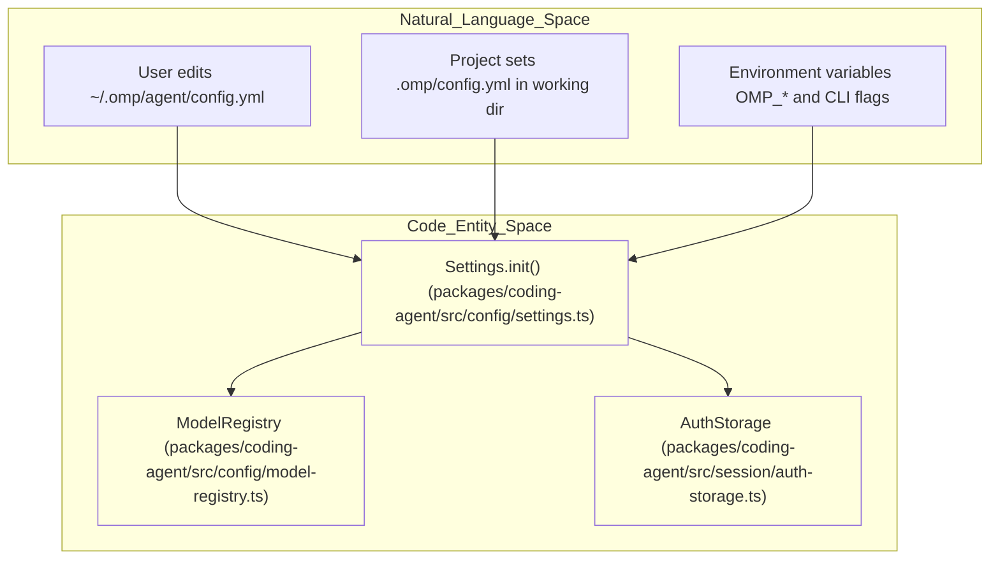
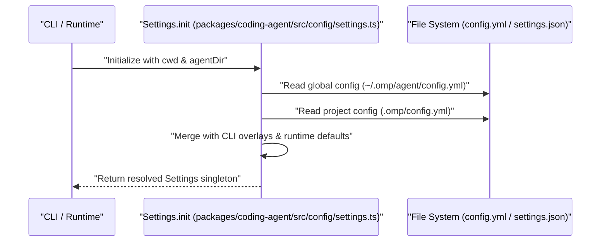
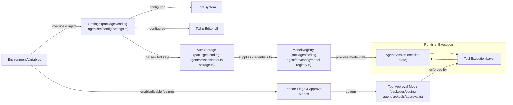

<!-- source: DeepWiki mcp.deepwiki.com · repo can1357/oh-my-pi · page 12 Configuration Reference · fetched 2026-10-30 -->

# Configuration Reference

Relevant source files

The following files were used as context for generating this wiki page:

- [docs/advisor-watchdog.md](docs/advisor-watchdog.md)
- [docs/models.md](docs/models.md)
- [docs/settings.md](docs/settings.md)
- [packages/ai/test/bedrock-on-payload.test.ts](packages/ai/test/bedrock-on-payload.test.ts)
- [packages/catalog/src/compat/rules/auth/llama.cpp.kdl](packages/catalog/src/compat/rules/auth/llama.cpp.kdl)
- [packages/coding-agent/src/advisor/advise-tool.ts](packages/coding-agent/src/advisor/advise-tool.ts)
- [packages/coding-agent/src/advisor/delta-split.ts](packages/coding-agent/src/advisor/delta-split.ts)
- [packages/coding-agent/src/advisor/emission-guard.ts](packages/coding-agent/src/advisor/emission-guard.ts)
- [packages/coding-agent/src/advisor/runtime.ts](packages/coding-agent/src/advisor/runtime.ts)
- [packages/coding-agent/src/advisor/transcript-recorder.ts](packages/coding-agent/src/advisor/transcript-recorder.ts)
- [packages/coding-agent/src/config/custom-models.ts](packages/coding-agent/src/config/custom-models.ts)
- [packages/coding-agent/src/config/model-discovery.ts](packages/coding-agent/src/config/model-discovery.ts)
- [packages/coding-agent/src/config/model-patch.ts](packages/coding-agent/src/config/model-patch.ts)
- [packages/coding-agent/src/config/model-registry.ts](packages/coding-agent/src/config/model-registry.ts)
- [packages/coding-agent/src/config/models-config-schema-bundle.ts](packages/coding-agent/src/config/models-config-schema-bundle.ts)
- [packages/coding-agent/src/config/models-config.ts](packages/coding-agent/src/config/models-config.ts)
- [packages/coding-agent/src/config/settings.ts](packages/coding-agent/src/config/settings.ts)
- [packages/coding-agent/src/mcp/timeout.ts](packages/coding-agent/src/mcp/timeout.ts)
- [packages/coding-agent/src/session/session-advisors.ts](packages/coding-agent/src/session/session-advisors.ts)
- [packages/coding-agent/src/session/session-history-format.ts](packages/coding-agent/src/session/session-history-format.ts)
- [packages/coding-agent/test/advisor-context-maintenance.test.ts](packages/coding-agent/test/advisor-context-maintenance.test.ts)
- [packages/coding-agent/test/advisor-toggle.test.ts](packages/coding-agent/test/advisor-toggle.test.ts)
- [packages/coding-agent/test/advisor/advisor.test.ts](packages/coding-agent/test/advisor/advisor.test.ts)
- [packages/coding-agent/test/advisor/delta-split-obfuscation.test.ts](packages/coding-agent/test/advisor/delta-split-obfuscation.test.ts)
- [packages/coding-agent/test/advisor/delta-split.test.ts](packages/coding-agent/test/advisor/delta-split.test.ts)
- [packages/coding-agent/test/advisor/emission-guard.test.ts](packages/coding-agent/test/advisor/emission-guard.test.ts)
- [packages/coding-agent/test/advisor/fingerprint-multi-message.test.ts](packages/coding-agent/test/advisor/fingerprint-multi-message.test.ts)
- [packages/coding-agent/test/advisor/replay-observability.test.ts](packages/coding-agent/test/advisor/replay-observability.test.ts)
- [packages/coding-agent/test/advisor/transcript-recorder.test.ts](packages/coding-agent/test/advisor/transcript-recorder.test.ts)
- [packages/coding-agent/test/config/model-registry.test.ts](packages/coding-agent/test/config/model-registry.test.ts)
- [packages/coding-agent/test/config/models-config-validation.test.ts](packages/coding-agent/test/config/models-config-validation.test.ts)
- [packages/coding-agent/test/headless-persistence-shutdown.test.ts](packages/coding-agent/test/headless-persistence-shutdown.test.ts)
- [packages/coding-agent/test/issue-986-compaction-auth-fallback.test.ts](packages/coding-agent/test/issue-986-compaction-auth-fallback.test.ts)
- [packages/coding-agent/test/main-headless-timing.test.ts](packages/coding-agent/test/main-headless-timing.test.ts)
- [packages/coding-agent/test/mcp-timeout.test.ts](packages/coding-agent/test/mcp-timeout.test.ts)
- [packages/coding-agent/test/model-discovery.test.ts](packages/coding-agent/test/model-discovery.test.ts)
- [packages/coding-agent/test/model-registry-runtime-provider.test.ts](packages/coding-agent/test/model-registry-runtime-provider.test.ts)
- [packages/coding-agent/test/model-registry.test.ts](packages/coding-agent/test/model-registry.test.ts)
- [packages/coding-agent/test/session/session-history-format.test.ts](packages/coding-agent/test/session/session-history-format.test.ts)
- [packages/coding-agent/test/settings-manager.test.ts](packages/coding-agent/test/settings-manager.test.ts)
- [packages/coding-agent/test/xiaomi-tp-discovery-merge.test.ts](packages/coding-agent/test/xiaomi-tp-discovery-merge.test.ts)

This page provides an overview of the configuration mechanisms in oh-my-pi, covering configuration formats, layering, discovery, and how global, project, model, and environment settings interact at a high level. It serves as a guide to understanding the main configuration components and their interrelations within the system.

For detailed, in-depth documentation of specific configuration areas, please see the linked child pages:
- [Settings Schema](#12.1) — Complete reference for all settings in `settings.json` / `config.yml`, including UI metadata and controls on compaction, TTSR, LSP, edit modes, and tool enablement.
- [Model Configuration](#12.2) — Explanation of `models.yml` format, JSON schema bundle, provider and model overrides, custom models, command-backed config values, and discovery configuration.
- [Authentication Configuration](#12.3) — Documentation of authentication mechanisms including API keys, OAuth flows for providers, credential storage, the auth broker, and token refresh management.
- [Environment Variables and Approval Modes](#12.4) — Full reference of environment variables configuring providers, feature flags, runtime behavior, plus approval modes (always-ask/write/yolo) and bash pattern policies.

---

## Configuration System Architecture

oh-my-pi employs a layered configuration system combining multiple sources with clear precedence rules, enabling flexible and context-sensitive configuration. The core configuration interface is accessed through the `Settings` class, which is initialized during session and tool startup [packages/coding-agent/src/config/settings.ts:1-60]().

The settings loader supports the following configuration scopes:

- **Global scope:** Per-user persistent configuration stored primarily in `~/.omp/agent/config.yml`, with legacy support for `settings.json` stored in `~/.omp/agent/settings.json` [docs/settings.md:17-22]().
- **Project scope:** Repository-specific configuration held in the `.omp/config.yml` file inside the working directory [docs/settings.md:19-20]().
- **CLI overlays:** Ephemeral overrides supplied as `--config <file>` overlays or command-line flags, active only during the current process [docs/settings.md:21-22]().
- **Runtime overrides:** In-memory dynamic changes that affect the current execution context but are never persisted.

These layers merge at runtime to create the effective configuration used across the system.

### Natural Language to Code Entity Mapping

Sources:  
[packages/coding-agent/src/config/settings.ts:1-60](),  
[docs/settings.md:17-22]()

---

## Configuration Hierarchy and Precedence

Settings are resolved through an ordered precedence chain combining defaults, global user config, project-specific overrides, CLI overlays, and runtime flags. This layering enables distinct projects to maintain different configurations without affecting the user's overall environment.

The approximate sequence is:
1. **Global config file** is loaded first, providing persistent system-wide defaults.
2. **Project config file** layers on top, applied when running from within a project directory containing `.omp/`.
3. **CLI overlays** introduce config from extra provided files or flags (repeatable).
4. **Runtime in-memory overrides** adjust settings dynamically for the current session only (not persisted).

This resolution ensures last input wins, with overlays and runtime flags able to override any static files.

### Configuration Resolution Sequence

Sources:  
[packages/coding-agent/src/config/settings.ts:155-168](),  
[docs/settings.md:3-23]()

---

## Core Configuration Domains

oh-my-pi’s configuration divides into four major domains, each with specific formats, storage locations, and subsystems:

| Domain                              | Files / Artifacts                              | Description / Role                                                                                 | More Info                           |
|-----------------------------------|------------------------------------------------|--------------------------------------------------------------------------------------------------|-----------------------------------|
| **Settings & Operational Preferences** | `~/.omp/agent/config.yml`, `.omp/config.yml`, legacy `settings.json` | Controls UI themes, compaction policies, TTSR, LSP integration, edit modes, tool enablement, defaults | For details, see [Settings Schema](#12.1)       |
| **AI Models and Providers**        | `models.yml`, JSON Schema bundle                 | Defines model registry, provider API endpoints, provider and model overrides, custom models, and discovery | For details, see [Model Configuration](#12.2)  |
| **Authentication & Credentials**  | `agent.db` (SQLite), Auth Broker server          | Manages API keys, OAuth tokens, credential storage, token refresh, and auth broker flows         | For details, see [Authentication Configuration](#12.3) |
| **Environment & Approval Policies** | Environment variables (e.g. `OMP_*`), approval mode flags | Controls runtime feature flags, approval modes (`always-ask`, `write`, `yolo`), bash pattern consent policies | For details, see [Environment Variables and Approval Modes](#12.4) |

Sources:  
[packages/coding-agent/src/config/settings.ts:1-55](),  
[docs/settings.md:13-23]()

---

## Interaction of Configuration Components

The different configuration domains interoperate to provide a powerful and flexible system tailored to user needs and security constraints.

### Component Dependency and Runtime Flow

- `Settings` centralizes user and process configuration for UI, tools, LSP, compaction, and other preferences [packages/coding-agent/src/config/settings.ts:1-60]().
- `ModelRegistry` manages available AI models, including custom entries and discovery, dependent on API key credentials [packages/coding-agent/src/config/model-registry.ts:1-55]().
- `AuthStorage` secures and refreshes API keys and tokens, mediating OAuth and broker flows.
- Environment variables act as an upper override layer influencing global feature flags and runtime behavior.
- Approval modes, configured via env vars or settings, control how the system requests user consent for potentially sensitive operations.
- The tool system queries these policies to decide whether to permit or prompt for tool execution at runtime.

Sources:  
[packages/coding-agent/src/config/settings.ts:1-60](),  
[packages/coding-agent/src/config/model-registry.ts:1-55](),  
[docs/settings.md:13-23]()

---

## Summary and Next Steps

Configuration in oh-my-pi is organized into clear domains and layered resolution scopes. For detailed references, consult the dedicated child pages:

- [Settings Schema](#12.1)
- [Model Configuration](#12.2)
- [Authentication Configuration](#12.3)
- [Environment Variables and Approval Modes](#12.4)

---

