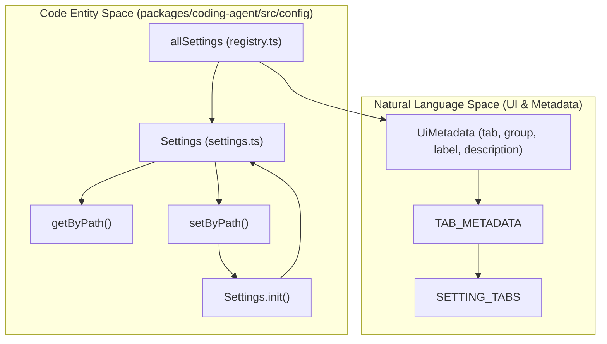
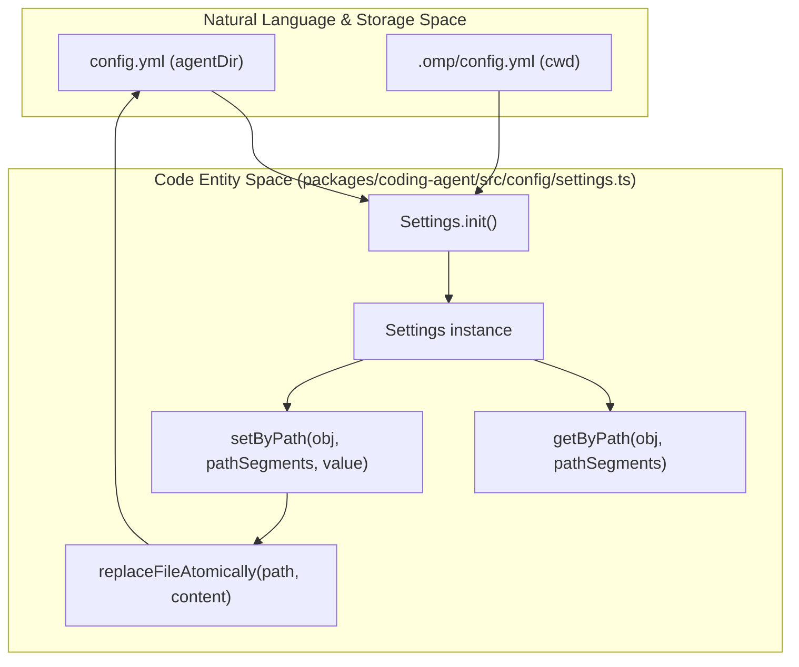

<!-- source: DeepWiki mcp.deepwiki.com · repo can1357/oh-my-pi · page 12.1 Settings Schema · fetched 2026-10-30 -->

# Settings Schema

<details>
<summary>Relevant source files</summary>

The following files were used as context for generating this wiki page:

- [docs/advisor-watchdog.md](docs/advisor-watchdog.md)
- [docs/rulebook-matching-pipeline.md](docs/rulebook-matching-pipeline.md)
- [docs/settings.md](docs/settings.md)
- [docs/ttsr-injection-lifecycle.md](docs/ttsr-injection-lifecycle.md)
- [packages/coding-agent/src/advisor/advise-tool.ts](packages/coding-agent/src/advisor/advise-tool.ts)
- [packages/coding-agent/src/advisor/delta-split.ts](packages/coding-agent/src/advisor/delta-split.ts)
- [packages/coding-agent/src/advisor/emission-guard.ts](packages/coding-agent/src/advisor/emission-guard.ts)
- [packages/coding-agent/src/advisor/runtime.ts](packages/coding-agent/src/advisor/runtime.ts)
- [packages/coding-agent/src/advisor/transcript-recorder.ts](packages/coding-agent/src/advisor/transcript-recorder.ts)
- [packages/coding-agent/src/capability/rule-buckets.ts](packages/coding-agent/src/capability/rule-buckets.ts)
- [packages/coding-agent/src/capability/rule.ts](packages/coding-agent/src/capability/rule.ts)
- [packages/coding-agent/src/cli/ttsr-cli.ts](packages/coding-agent/src/cli/ttsr-cli.ts)
- [packages/coding-agent/src/commands/ttsr.ts](packages/coding-agent/src/commands/ttsr.ts)
- [packages/coding-agent/src/config/settings.ts](packages/coding-agent/src/config/settings.ts)
- [packages/coding-agent/src/export/ttsr.ts](packages/coding-agent/src/export/ttsr.ts)
- [packages/coding-agent/src/prompts/system/ttsr-tool-reminder.md](packages/coding-agent/src/prompts/system/ttsr-tool-reminder.md)
- [packages/coding-agent/src/session/session-advisors.ts](packages/coding-agent/src/session/session-advisors.ts)
- [packages/coding-agent/src/session/session-history-format.ts](packages/coding-agent/src/session/session-history-format.ts)
- [packages/coding-agent/src/session/ttsr-coordinator.ts](packages/coding-agent/src/session/ttsr-coordinator.ts)
- [packages/coding-agent/src/session/ttsr-outputs.ts](packages/coding-agent/src/session/ttsr-outputs.ts)
- [packages/coding-agent/test/advisor-context-maintenance.test.ts](packages/coding-agent/test/advisor-context-maintenance.test.ts)
- [packages/coding-agent/test/advisor-toggle.test.ts](packages/coding-agent/test/advisor-toggle.test.ts)
- [packages/coding-agent/test/advisor/advisor.test.ts](packages/coding-agent/test/advisor/advisor.test.ts)
- [packages/coding-agent/test/advisor/delta-split-obfuscation.test.ts](packages/coding-agent/test/advisor/delta-split-obfuscation.test.ts)
- [packages/coding-agent/test/advisor/delta-split.test.ts](packages/coding-agent/test/advisor/delta-split.test.ts)
- [packages/coding-agent/test/advisor/emission-guard.test.ts](packages/coding-agent/test/advisor/emission-guard.test.ts)
- [packages/coding-agent/test/advisor/fingerprint-multi-message.test.ts](packages/coding-agent/test/advisor/fingerprint-multi-message.test.ts)
- [packages/coding-agent/test/advisor/replay-observability.test.ts](packages/coding-agent/test/advisor/replay-observability.test.ts)
- [packages/coding-agent/test/advisor/transcript-recorder.test.ts](packages/coding-agent/test/advisor/transcript-recorder.test.ts)
- [packages/coding-agent/test/agent-session-concurrent.test.ts](packages/coding-agent/test/agent-session-concurrent.test.ts)
- [packages/coding-agent/test/capability/rule-agents.test.ts](packages/coding-agent/test/capability/rule-agents.test.ts)
- [packages/coding-agent/test/capability/rule-buckets.test.ts](packages/coding-agent/test/capability/rule-buckets.test.ts)
- [packages/coding-agent/test/cli/ttsr-cli.test.ts](packages/coding-agent/test/cli/ttsr-cli.test.ts)
- [packages/coding-agent/test/issue-2375-repro.test.ts](packages/coding-agent/test/issue-2375-repro.test.ts)
- [packages/coding-agent/test/issue-986-compaction-auth-fallback.test.ts](packages/coding-agent/test/issue-986-compaction-auth-fallback.test.ts)
- [packages/coding-agent/test/session/session-history-format.test.ts](packages/coding-agent/test/session/session-history-format.test.ts)
- [packages/coding-agent/test/settings-manager.test.ts](packages/coding-agent/test/settings-manager.test.ts)
- [packages/coding-agent/test/ttsr-bridged-passive-context.test.ts](packages/coding-agent/test/ttsr-bridged-passive-context.test.ts)
- [packages/coding-agent/test/ttsr-coordinator-buffer.test.ts](packages/coding-agent/test/ttsr-coordinator-buffer.test.ts)
- [packages/coding-agent/test/ttsr-incremental-match.test.ts](packages/coding-agent/test/ttsr-incremental-match.test.ts)
- [packages/coding-agent/test/ttsr-inline-flags-scope.test.ts](packages/coding-agent/test/ttsr-inline-flags-scope.test.ts)
- [packages/coding-agent/test/ttsr-judged-rules.test.ts](packages/coding-agent/test/ttsr-judged-rules.test.ts)
- [packages/utils/src/frontmatter.ts](packages/utils/src/frontmatter.ts)
- [packages/utils/test/frontmatter.test.ts](packages/utils/test/frontmatter.test.ts)

</details>


## Purpose and Scope

The settings schema defines the comprehensive configuration surface for the oh-my-pi coding agent. It provides type-safe, path-based access to all configurable behaviors including AI model parameters, UI appearance, tool enablement, context management strategies, Text-to-Speech / Speech-to-Text (TTSR), Language Server Protocol (LSP) integration, and editing modes.

Settings are declared and registered in the codebase to enforce types, defaults, and metadata that drives UI representations and persistence as YAML mappings. The schema supports multiple configuration layers: global settings (persisted per user), project-scoped overrides (scoped to the current working directory), CLI overlay files (one-shot per process), and ephemeral in-memory runtime overrides.

This layered model enables use cases like repository-specific provider selection, model role assignments, tool enablement, and specialized user experience adjustments, all without affecting machine-wide global defaults.

- For model/provider credentials, `.env` files, and the environment variable resolution table, see [Providers (4.7)]().
- For custom model definitions, see [Model Configuration (12.2)]().
- For environment variables and approval mode reference, see [Environment Variables and Approval Modes (12.4)]().

Sources: [packages/coding-agent/src/config/settings.ts:1-168](), [docs/settings.md:1-12]()

---

## Schema Architecture & UI Metadata Model

### Type System and Metadata Model

Settings are declared as registry entries with associated types, defaults, and optional UI metadata. These declarations live alongside domain-specific implementations and are aggregated globally before any settings instance reads occur.

The supported value types include:

| Type            | Description                        |
|-----------------|----------------------------------|
| `boolean`       | Flag toggle                      |
| `string`        | Strings, often with enums        |
| `number`        | Numeric values                   |
| `enum`          | Enumerations of string literals  |
| `array`         | Lists of values                  |
| `record`        | Arbitrary key-value maps         |

Each registered setting can have UI metadata specifying:

- `tab`: categorize into functional UI tabs (e.g., `appearance`, `model`, `interaction`, `context`, `tools`)
- `group`: optional subgroup within tabs
- `label`: human-readable name for UI lists
- `description`: explanatory text shown in UI
- `options`: for enums and arrays, explicit allowed values that drive UI pickers

This structure allows building the interactive `/settings` panel with organized tabs and groups, consistent labeling, and dynamic value validation.

### Tab and Group Routing

Settings UI panels and CLI commands use the tab-group structure to organize settings. Typical tabs include:

- `appearance`: Theme, color scheme, and display options
- `model`: Model and provider selection, roles, and model tuning
- `interaction`: Input/output behavior like TTS, STT, and prompts
- `context`: Session management, compaction triggers, context file inclusion
- `tools`: Tool toggles, command behavior, concurrency controls

### Diagram: Settings Schema Type Hierarchy and UI Metadata Model



Sources: [packages/coding-agent/src/config/settings.ts:40-56](), [packages/coding-agent/test/settings-manager.test.ts:25-35]()

---

## Configuration Controls & Specialized Subsystems

This section enumerates key example subsystems exposed through the settings schema.

### Compaction Controls

Context compaction manages the conversation transcript size and prompt token budgets to stay within the limits of LLMs. Settings include:

| Setting Path                    | Type    | Default                | Description                                                    |
|--------------------------------|---------|------------------------|----------------------------------------------------------------|
| `compaction.enabled`            | boolean | `true`                 | Enable or disable automatic context compaction                |
| `compaction.strategy`           | enum    | `"context-full"`       | Compaction method strategy: `context-full`, `handoff`, `snapcompact` |
| `compaction.thresholdPercent`  | number  | `80`                   | Percentage of token usage at which compaction triggers        |
| `compaction.methodOrder`        | array   | Default compaction order | Method order for trying compaction algorithms                 |

These control when, how, and which methods the agent uses to trim or summarize context to optimize model input size and responsiveness.

Sources: [packages/coding-agent/src/session/context-settings.ts](), [docs/settings.md:15-45]()

---

### Edit Modes and LSP Integration

Settings for code editing modes and integration with the Language Server Protocol include:

| Setting Path           | Type    | Default     | Description                                  |
|------------------------|---------|-------------|----------------------------------------------|
| `edit.mode`            | enum    | `"hashline"`| Edit mode variant; options: `replace`, `patch`, `hashline` |
| `edit.fuzzyMatch`      | boolean | `true`      | Allows fuzzy matches on whitespace/indentation |
| `lsp.enabled`          | boolean | `true`      | Enable Language Server Protocol client usage |

These configure the agent's internal editing strategies and finer integration behavior with language servers for diagnostics and code actions.

Sources: [packages/coding-agent/src/edit/settings](), [packages/coding-agent/src/task/settings.ts]()

---

### TTSR (Text-to-Speech and Speech-to-Text) Controls

Voice interaction capabilities are configured via:

| Setting Path          | Type   | Default                               | Description                                  |
|-----------------------|--------|-------------------------------------|----------------------------------------------|
| `stt.model`           | enum   | `DEFAULT_STT_MODEL_KEY`              | Selected speech-to-text backend/model key    |
| `stt.submitTrigger`   | enum   | `STT_SUBMIT_TRIGGER_VALUES`          | Defines when STT submits input (e.g., pause, enter) |
| `tts.localModel`      | enum   | `DEFAULT_TTS_LOCAL_MODEL_KEY`        | Selected local TTS model/key                   |
| `tts.localVoice`      | enum   | `DEFAULT_TTS_VOICE`                  | Voice profile for local TTS synthesis          |
| `live.voice`          | string | `DEFAULT_LIVE_VOICE`                  | Profile for live voice playback at runtime    |

These settings govern voice recognition and synthesis layers of the assistant for interactive voice I/O.

Sources: [packages/coding-agent/src/config/settings.ts:1-12]()

---

### Tool Enablement and Behavior

Tool enablement toggles and behavioral knobs for core and extension tools include:

- Tool activation booleans: e.g., `lsp.enabled`, `bash.enabled`, `edit.enabled`, `grep.enabled`, `xdev.enabled`, `computer.enabled`
- Tool-specific limits and concurrency settings: e.g., `task.maxConcurrency`, `task.isolation.enabled`
- Task delegation and isolation policies for safety and parallelism

Settings affect runtime capabilities and responsiveness, directing which tools the agent can invoke and how.

Sources: [packages/coding-agent/src/tools/settings.ts](), [packages/coding-agent/src/task/settings.ts]()

---

## Runtime Architecture and Access Patterns

### The `Settings` Singleton and Layered Store

The `Settings` class (`packages/coding-agent/src/config/settings.ts`) provides a layered configuration repository with typed accessors and background persistence. It encapsulates reading from multiple scopes and merging values with precedence.

Typical layers (from highest to lowest precedence):

- **runtime overrides:** ephemeral in-memory overrides, e.g., CLI flags
- **CLI overlays:** one-shot config files specified with `--config` option
- **project settings:** scoped to `.omp/config.yml` under working directory
- **global settings:** user-wide YAML config file, e.g., `~/.omp/agent/config.yml` or legacy `config.yaml`
- **defaults:** internal registered default values

The `Settings` instance supports synchronous typed reads and async writes that persist to disk transparently.

Example usage:

```typescript
import { Settings } from "@oh-my-pi/pi-coding-agent/config/settings";

// Create isolated instance, useful for tests or special overrides
const isolated = Settings.isolated({ "compaction.enabled": false });

// Synchronous typed read
const compactionEnabled = cfgCompactionEnabled.get(isolated);

// Update setting; saves asynchronously in background
cfgThemeDark.set(isolated, "titanium");
```

### Diagram: User Configuration Space to Settings Code Entities



Sources: [packages/coding-agent/src/config/settings.ts:110-198](), [packages/coding-agent/test/settings-manager.test.ts:110-183]()

---

## Persistence Mechanism & Resolution Order

Settings reside as YAML key-value mappings primarily in:

- **Global config**: `~/.omp/agent/config.yml` (written and read)
- **Project config**: `<cwd>/.omp/config.yml` (read-only from cli commands, merged)
- **Legacy JSON files**: `.omp/settings.json` and `~/.omp/agent/settings.json` (read-only, migrated once)
- **CLI overlays**: any arbitrary YAML/JSON file supplied with `--config`, non-persistent
- **Runtime overrides**: ephemeral object maps in memory

The loader reads the global and project settings, applies any CLI overlays in order, and then runtime in-memory overrides last.

Invalid or malformed files cause backup and recovery processes to prevent data loss, including `.broken-*` backups on write failures or parse errors.

Only the **global YAML file** is updated on write operations triggered by `/settings` CLI commands or interactive UI actions.

Value merging and read precedence order (highest to lowest) is:

`runtime` > `overlay` > `project` > `global` > `default`

Sources: [docs/settings.md:15-45](), [packages/coding-agent/src/config/settings.ts:28-50]()

---

## Summary

- The settings schema is the authoritative registry for all configurable options in oh-my-pi, with types, defaults, and UI metadata that drive persistent YAML configuration and runtime access [packages/coding-agent/src/config/settings.ts:1-12]().
- It centralizes controls for major subsystems such as **compaction**, **TTSR**, **LSP integration**, **edit modes**, **tools enablement**, and **model routing** [packages/coding-agent/src/config/settings.ts:50-56]().
- The `Settings` class provides a layered store with global, project, overlay, and runtime layers, supporting typed synchronous reads and async writes with background persistence [packages/coding-agent/src/config/settings.ts:1-11]().
- The UI metadata enables well-organized interactive settings panels with tabs and groups, supporting both CLI and TUI configuration flows [docs/settings.md:5-38]().
- The configuration files chiefly consist of YAML mappings per scope, with careful handling of legacy JSON and overlays [docs/settings.md:15-45]().
- Fine-grained, dynamically scoped runtime overrides enable convenient CLI flags, environment variable overrides, and temporary session-level adjustments.

Sources: [packages/coding-agent/src/config/settings.ts:1-168](), [docs/settings.md:1-61]()

---

