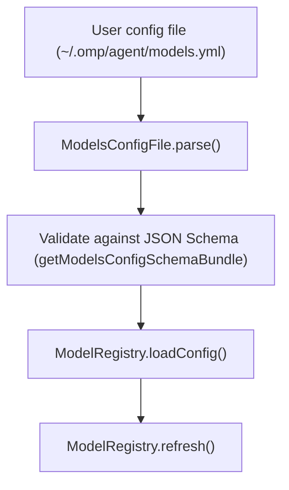
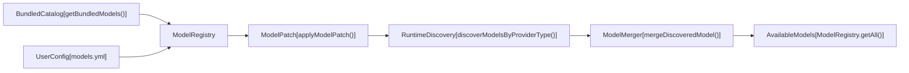
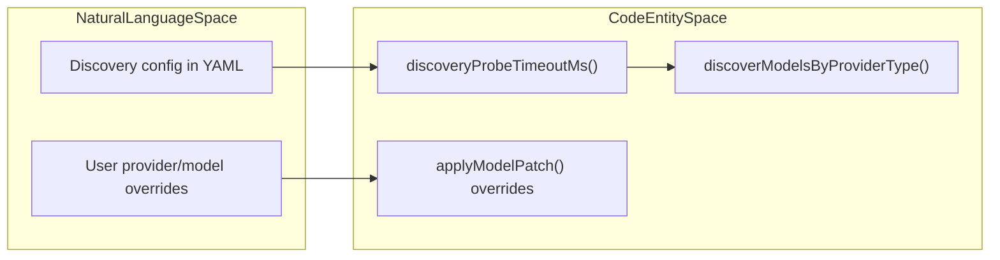

<!-- source: DeepWiki mcp.deepwiki.com · repo can1357/oh-my-pi · page 12.2 Model Configuration · fetched 2026-10-30 -->

# Model Configuration

<details>
<summary>Relevant source files</summary>

The following files were used as context for generating this wiki page:

- [docs/models.md](docs/models.md)
- [packages/ai/test/bedrock-on-payload.test.ts](packages/ai/test/bedrock-on-payload.test.ts)
- [packages/catalog/src/compat/rules/auth/llama.cpp.kdl](packages/catalog/src/compat/rules/auth/llama.cpp.kdl)
- [packages/coding-agent/src/config/custom-models.ts](packages/coding-agent/src/config/custom-models.ts)
- [packages/coding-agent/src/config/model-discovery.ts](packages/coding-agent/src/config/model-discovery.ts)
- [packages/coding-agent/src/config/model-patch.ts](packages/coding-agent/src/config/model-patch.ts)
- [packages/coding-agent/src/config/model-registry.ts](packages/coding-agent/src/config/model-registry.ts)
- [packages/coding-agent/src/config/model-resolver.ts](packages/coding-agent/src/config/model-resolver.ts)
- [packages/coding-agent/src/config/models-config-schema-bundle.ts](packages/coding-agent/src/config/models-config-schema-bundle.ts)
- [packages/coding-agent/src/config/models-config.ts](packages/coding-agent/src/config/models-config.ts)
- [packages/coding-agent/src/mcp/timeout.ts](packages/coding-agent/src/mcp/timeout.ts)
- [packages/coding-agent/src/session/retry-fallback-chains.ts](packages/coding-agent/src/session/retry-fallback-chains.ts)
- [packages/coding-agent/test/config/model-registry.test.ts](packages/coding-agent/test/config/model-registry.test.ts)
- [packages/coding-agent/test/config/models-config-validation.test.ts](packages/coding-agent/test/config/models-config-validation.test.ts)
- [packages/coding-agent/test/headless-persistence-shutdown.test.ts](packages/coding-agent/test/headless-persistence-shutdown.test.ts)
- [packages/coding-agent/test/issue-2750-subagent-runtime-fallback.test.ts](packages/coding-agent/test/issue-2750-subagent-runtime-fallback.test.ts)
- [packages/coding-agent/test/issue-985-subagent-auth-fallback.test.ts](packages/coding-agent/test/issue-985-subagent-auth-fallback.test.ts)
- [packages/coding-agent/test/main-headless-timing.test.ts](packages/coding-agent/test/main-headless-timing.test.ts)
- [packages/coding-agent/test/mcp-timeout.test.ts](packages/coding-agent/test/mcp-timeout.test.ts)
- [packages/coding-agent/test/model-discovery.test.ts](packages/coding-agent/test/model-discovery.test.ts)
- [packages/coding-agent/test/model-registry-runtime-provider.test.ts](packages/coding-agent/test/model-registry-runtime-provider.test.ts)
- [packages/coding-agent/test/model-registry.test.ts](packages/coding-agent/test/model-registry.test.ts)
- [packages/coding-agent/test/model-resolver.test.ts](packages/coding-agent/test/model-resolver.test.ts)
- [packages/coding-agent/test/retry-fallback.test.ts](packages/coding-agent/test/retry-fallback.test.ts)
- [packages/coding-agent/test/sdk-model-selection.test.ts](packages/coding-agent/test/sdk-model-selection.test.ts)
- [packages/coding-agent/test/task/coordination-advisory.test.ts](packages/coding-agent/test/task/coordination-advisory.test.ts)
- [packages/coding-agent/test/task/spawn-advisory.test.ts](packages/coding-agent/test/task/spawn-advisory.test.ts)
- [packages/coding-agent/test/xiaomi-tp-discovery-merge.test.ts](packages/coding-agent/test/xiaomi-tp-discovery-merge.test.ts)

</details>


## Purpose and Scope

This page documents the model configuration system in the `oh-my-pi` coding agent. It covers the format and semantics of the `models.yml` configuration file and the mechanisms by which it is parsed, validated, merged, and used at runtime. The key aspects include:

- **models.yml format and JSON schema bundle:** Defines how providers, models, and overrides are declared and validated.
- **Provider overrides and model overrides:** How user config overlays built-in models and provider data.
- **Custom models:** Support for user-defined model entries with validation.
- **Command-backed config values:** Dynamic resolution of shell commands embedded inside config values (e.g., for secrets).
- **Discovery config:** Runtime, HTTP-based model discovery of local/remote endpoints and integration into the registry.

This detailed system enables flexible, dynamic, and secure configuration of AI model providers and individual model properties within the agent.

Sources:  
[packages/coding-agent/src/config/model-registry.ts:1-175]()  
[docs/models.md:1-152]()  
[packages/coding-agent/src/config/models-config-schema-bundle.ts:1-174]()  
[packages/coding-agent/src/config/model-patch.ts:1-143]()  
[packages/coding-agent/src/config/model-discovery.ts:1-123]()

---

## Configuration File Location and Parsing

The model configuration typically lives in:

- `~/.omp/agent/models.yml` or `~/.omp/agent/models.yaml`

These are relative to the agent directory (overrideable via `PI_CODING_AGENT_DIR` or profile-specific paths). If no YAML files exist but a legacy `models.json` file is found, it is migrated automatically to YAML on load.

The file is parsed and validated by the `ModelsConfigFile` class which applies the JSON schema bundle defined by `getModelsConfigSchemaBundle()`. The file root consists solely of a `providers:` map whose keys identify provider IDs.



The validated config file yields hierarchical provider and model entries, ready for runtime merging with built-in data and runtime discovery overlays.

Sources:  
[docs/models.md:16-34]()  
[packages/coding-agent/src/config/models-config-schema-bundle.ts:20-174]()  

---

## Provider and Model Configuration Schema

### Overall Structure

`models.yml` uses the top-level key:

```yaml
providers:
  <provider-id>:
    # provider config and models
```

Where each `<provider-id>` corresponds to a known or custom provider identifier.

### Provider-Level Configuration Fields

- `baseUrl` (string): Base API endpoint URL for the provider.
- `apiKey` (string or command string): Static API key or command-backed secret.
- `api` (string): API subtype, e.g., `openai-completions`, `anthropic-messages`.
- `headers` (map): Static HTTP headers sent on requests.
- `authHeader` (boolean): Whether to send an Authorization header.
- `auth` (string): Authentication mode, e.g., `apiKey`, `oauth`, `none`.
- `disableStrictTools` (boolean): Compatibility toggle, e.g. for Anthropic.
- `discovery` (object): Runtime discovery details (see below).
- `modelOverrides` (map): Per-model config overrides keyed by model ID.
- `models` (array): Explicit model entries for this provider.

### Model-Level Configuration Fields

Each model under `models` defines:

- `id` (string): Canonical model identifier.
- `name` (string): User-friendly model name.
- `api` (string): Override API for this model.
- `reasoning` (boolean): Indicates if reasoning features enabled.
- `input` (array): List of input modes such as `[text]`.
- `cost` (object): Token cost metrics (`input`, `output`, `cacheRead`, `cacheWrite`).
- `contextWindow` (number): Base context token window size.
- `maxContextWindow` (number): Optional extended context window for `/extended-context` mode.
- `maxTokens` (number): Maximum tokens accepted per completion.
- `headers` (object): Model specific HTTP headers.
- `compat` (object): Compatibility flags for quirks and feature support.
- `tokenizer` (optional): Tokenizer mode or special parsing info.
- `compactionModel` (string): Optional ID of a compaction model fallback.
- `remoteCompaction` (object): Provider-side context compaction settings.

### Extended Context Behavior

- `contextWindow` defines the active prompt context window.
- `maxContextWindow` (optional) configures a larger prompt window toggleable with `/extended-context` commands.
- If `maxContextWindow` is omitted, the context window remains fixed.

### Discovery Configuration Example

```yaml
discovery:
  type: ollama
  timeoutMs: 10000
```

- `type`: Discovery protocol type (e.g., `ollama`, `lm-studio`).
- `timeoutMs`: Optional HTTP request timeout in milliseconds.

### Bedrock Guardrail Settings (Provider-level)

- `guardrailIdentifier`, `guardrailVersion`, `guardrailTrace`: Attach guardrails to Converse API requests.
- `requestMetadata`: Additional metadata tags for invocation.

### Sample YAML Snippet

```yaml
providers:
  openai:
    baseUrl: https://api.openai.com/v1
    apiKey: "! dotenv -p OPENAI_API_KEY"
    api: openai-completions
    headers:
      X-Custom-Header: value
    authHeader: true
    models:
      - id: gpt-4
        name: GPT-4
        reasoning: true
        input: [text]
        cost:
          input: 3
          output: 7
          cacheRead: 0
          cacheWrite: 0
        contextWindow: 8192
        maxTokens: 4096
        compat:
          supportsStore: true
          supportsReasoningEffort: true
```

Sources:  
[docs/models.md:38-121]()  
[packages/coding-agent/src/config/models-config-schema-bundle.ts:19-174]()  

---

## Command-Backed Configuration Values and Live Header Resolution

The model configuration system supports dynamic secrets and headers resolved at runtime by executing shell commands embedded in config strings, identified by a leading `!`.

Example usage in `models.yml`:

```yaml
providers:
  myprovider:
    apiKey: "! dotenv -p MY_SECRET_API_KEY"
    headers:
      X-Dynamic-Auth: "! fetch-auth-token --refresh"
```

### Implementation Details

- The predicate function `isCommandConfigValue(value: unknown)` detects strings starting with `!`.
- Such command strings are executed lazily and asynchronously before API requests, caching results per-context.
- Failures trigger exponential backoff to avoid retry storms on continuous failure.
- Header resolvers merge multiple header sources (provider, model, overrides), processed by `createConfigHeaderResolver()`.
- These resolvers are async functions called by the runtime request layer, enabling seamless injection and renewal of secrets.

This design allows secure injecting of ephemeral keys and tokens while keeping `models.yml` declarative and concise.

Sources:  
[packages/coding-agent/src/config/model-registry.ts:56-74]()  
[packages/coding-agent/src/config/model-patch.ts:10-12]()  

---

## Model Registry and Merging Pipeline (`ModelRegistry`)

The central class `ModelRegistry` manages the loaded models by merging multiple sources:

- **Bundled Built-in Models:** Loaded via `getBundledModels()` from `pi-catalog`.
- **User `models.yml` Overrides:** Parsed and validated config overlays providing provider-level and model-level patches.
- **Runtime Provider Registration:** Dynamic registration of providers/models (e.g., extensions).
- **Runtime Model Discovery:** HTTP probe results (e.g., from Ollama or LM Studio) providing discovered models.
- **Overlay Merging:** Models are merged via `mergeDiscoveredModel()` and `applyModelPatch()` to resolve properties like `baseUrl`, `headers`, `transport`, and `compat` flags.

`ModelRegistry` exposes APIs for querying models by provider, kind, or capabilities, as well as refreshing providers and the entire catalog.

### Composition Pipeline Diagram



This pipeline ensures all sources integrate seamlessly, validating and respecting user overrides while supporting live discovery and dynamic provider models.

Sources:  
[packages/coding-agent/src/config/model-registry.ts:28-46]()  
[packages/coding-agent/src/config/model-patch.ts:40-130]()  
[docs/models.md:1-152]()  

---

## Discovery Configuration and Runtime Probes

Dynamic runtime discovery enables the coding agent to probe local or remote LLM endpoints and populate the model registry with fresh metadata.

### Supported Discovery Types

- Ollama
- LM Studio
- llama.cpp
- LiteLLM
- OpenAI Models List
- New API / One API-style proxies

### Discovery Configuration Keys

- `discovery.type`: The protocol to use (e.g., `"ollama"`, `"lm-studio"`).
- `discovery.timeoutMs`: Per-provider HTTP probe timeout override (milliseconds).

### Discovery Timeout Logic

The function `discoveryProbeTimeoutMs(baseUrl, loopbackMs, customTimeoutMs)` determines timeout duration based on:

- Explicit `customTimeoutMs` if provided and positive.
- Loopback addresses (`localhost`, `127.*`, `::1`) receive a short `loopbackMs` timeout.
- Remote or LAN hosts receive a generous default timeout (`10_000 ms`) to accommodate network latency.

This prevents blocking during startup or refresh on slow or unreachable hosts.

### Safe Discovery Execution

Discovery probes run wrapped in `withTimeoutSignal(timeoutMs, fn)` which:

- Creates an abortable signal that triggers after the timeout.
- Ensures discovery calls do not hang indefinitely.
- Cleans up timers and error states properly.

### Integration with the Registry

On `ModelRegistry.refresh()`, discovery probes run for each provider configured with a discovery section. Discovered models are merged into the cached registry state. The agent thus maintains an up-to-date view of available models from all configured providers, including ephemeral local engines.

Sources:  
[packages/coding-agent/src/config/model-discovery.ts:1-123]()  
[docs/models.md:60-62]()  

---

## Natural Language Space to Code Entity Space Mappings

### Diagram 1: Config File Parsing and Command Resolution

```mermaid
graph LR
    subgraph "NaturalLanguageSpace"
        YAML["\"models.yml\" file"]
        CMD["Shell commands ('!' prefix) in config values"]
    end

    subgraph "CodeEntitySpace"
        ModelsConfigFile["ModelsConfigFile (schema parsing)"]
        ModelRegistry["ModelRegistry (config + runtime)"]
        ConfigResolver["resolveConfigValue() (executes commands)"]
    end

    YAML --> ModelsConfigFile
    ModelsConfigFile --> ModelRegistry
    CMD --> ConfigResolver
```

This diagram shows the parsing of user `models.yml` files into structured config objects by `ModelsConfigFile`. Command-backed values are detected and dynamically resolved on demand via `resolveConfigValue()`, enabling secure runtime secret injection that feeds into the `ModelRegistry`'s model and provider metadata.

Sources:  
[packages/coding-agent/src/config/model-registry.ts:68-74]()  
[packages/coding-agent/src/config/model-registry.ts:133-138]()  

---

### Diagram 2: Discovery and Override Blending



This diagram maps how user YAML discovery entries trigger discovery probes with adaptive timeouts. Discovery results are merged with user overrides and bundled catalog models using `applyModelPatch()`. This blend forms the runtime model state used by the agent.

Sources:  
[packages/coding-agent/src/config/model-discovery.ts:110-124]()  
[packages/coding-agent/src/config/model-patch.ts:93-106]()  

---

## Summary

The `oh-my-pi` model configuration system:

- Uses the `models.yml` YAML format for declarative model and provider config.
- Validates config with a strict JSON schema bundle.
- Supports multi-level overrides and patches for granular control.
- Supports command-backed values for dynamically injected secrets and headers.
- Integrates built-in catalogs with user configuration and runtime-discovered models.
- Implements adaptive discovery probing of remote and local inference runtimes.
- Provides `ModelRegistry` as the authoritative source of all active models and their runtime metadata.

This design enables a robust and flexible configuration regime suited to the heterogeneous and evolving ecosystem of AI models and providers.

Sources summary:  
- [packages/coding-agent/src/config/model-registry.ts]()  
- [docs/models.md]()  
- [packages/coding-agent/src/config/models-config-schema-bundle.ts]()  
- [packages/coding-agent/src/config/model-patch.ts]()  
- [packages/coding-agent/src/config/model-discovery.ts]()

---

