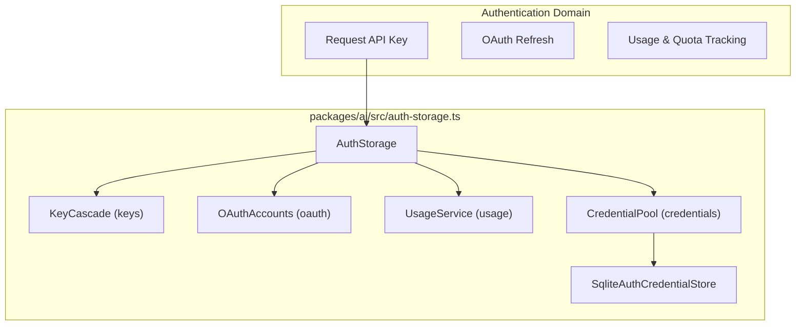
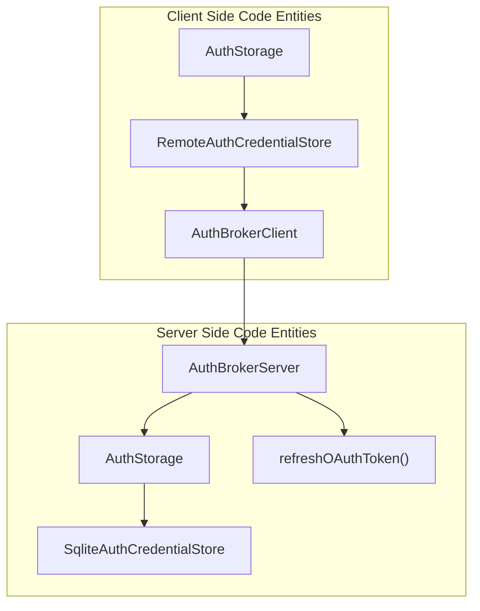
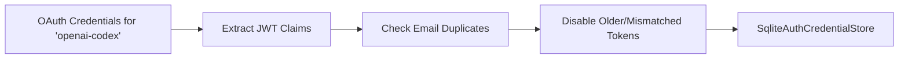
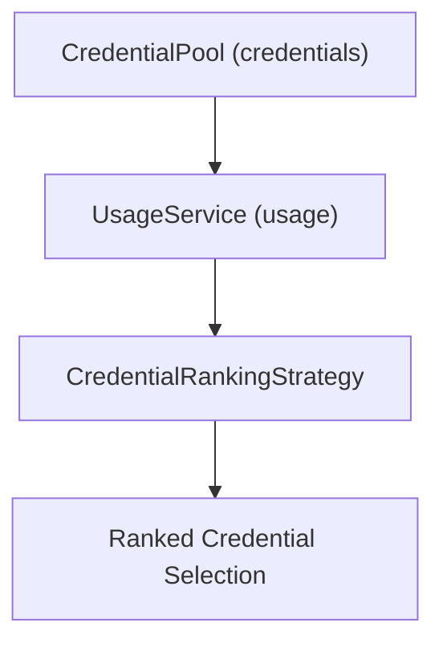
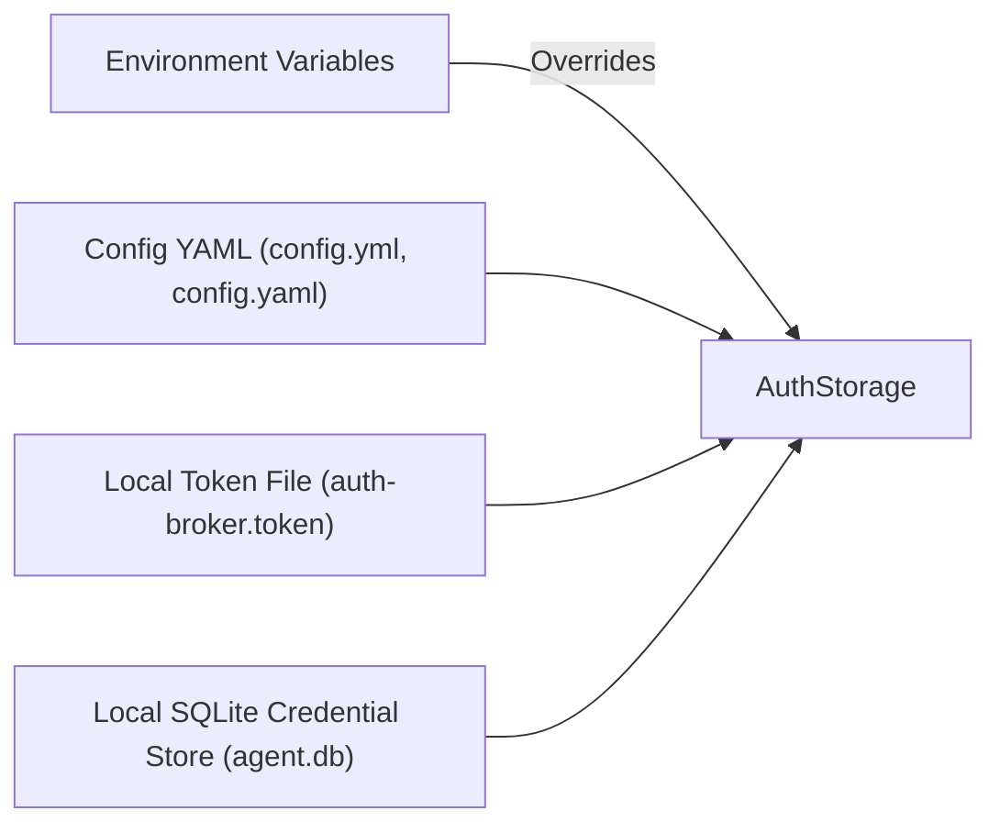

<!-- source: DeepWiki mcp.deepwiki.com · repo can1357/oh-my-pi · page 12.3 Authentication Configuration · fetched 2026-10-30 -->

# Authentication Configuration

<details>
<summary>Relevant source files</summary>

The following files were used as context for generating this wiki page:

- [docs/auth-broker-gateway.md](docs/auth-broker-gateway.md)
- [packages/ai/src/auth-broker/client.ts](packages/ai/src/auth-broker/client.ts)
- [packages/ai/src/auth-broker/discover.ts](packages/ai/src/auth-broker/discover.ts)
- [packages/ai/src/auth-broker/refresher.ts](packages/ai/src/auth-broker/refresher.ts)
- [packages/ai/src/auth-broker/remote-store.ts](packages/ai/src/auth-broker/remote-store.ts)
- [packages/ai/src/auth-broker/server.ts](packages/ai/src/auth-broker/server.ts)
- [packages/ai/src/auth-broker/snapshot-cache.ts](packages/ai/src/auth-broker/snapshot-cache.ts)
- [packages/ai/src/auth-broker/types.ts](packages/ai/src/auth-broker/types.ts)
- [packages/ai/src/auth-broker/wire-schemas.ts](packages/ai/src/auth-broker/wire-schemas.ts)
- [packages/ai/src/auth-gateway/clients.ts](packages/ai/src/auth-gateway/clients.ts)
- [packages/ai/src/auth-gateway/dispatch.ts](packages/ai/src/auth-gateway/dispatch.ts)
- [packages/ai/src/auth-storage.ts](packages/ai/src/auth-storage.ts)
- [packages/ai/src/auth/affinity.ts](packages/ai/src/auth/affinity.ts)
- [packages/ai/src/auth/blocks.ts](packages/ai/src/auth/blocks.ts)
- [packages/ai/src/auth/cascade.ts](packages/ai/src/auth/cascade.ts)
- [packages/ai/src/auth/oauth.ts](packages/ai/src/auth/oauth.ts)
- [packages/ai/src/auth/policy.ts](packages/ai/src/auth/policy.ts)
- [packages/ai/src/auth/pool.ts](packages/ai/src/auth/pool.ts)
- [packages/ai/src/auth/rank.ts](packages/ai/src/auth/rank.ts)
- [packages/ai/src/auth/refresh.ts](packages/ai/src/auth/refresh.ts)
- [packages/ai/src/auth/rotation.ts](packages/ai/src/auth/rotation.ts)
- [packages/ai/src/auth/select.ts](packages/ai/src/auth/select.ts)
- [packages/ai/src/auth/types.ts](packages/ai/src/auth/types.ts)
- [packages/ai/src/utils/sse-debug.ts](packages/ai/src/utils/sse-debug.ts)
- [packages/ai/test/auth-broker-config-discovery.test.ts](packages/ai/test/auth-broker-config-discovery.test.ts)
- [packages/ai/test/auth-broker-oauth-extra-fields.test.ts](packages/ai/test/auth-broker-oauth-extra-fields.test.ts)
- [packages/ai/test/auth-broker-refresh-backoff.test.ts](packages/ai/test/auth-broker-refresh-backoff.test.ts)
- [packages/ai/test/auth-broker-refresher.test.ts](packages/ai/test/auth-broker-refresher.test.ts)
- [packages/ai/test/auth-broker-remote-store.test.ts](packages/ai/test/auth-broker-remote-store.test.ts)
- [packages/ai/test/auth-broker-snapshot-cache.test.ts](packages/ai/test/auth-broker-snapshot-cache.test.ts)
- [packages/ai/test/auth-broker-wire.test.ts](packages/ai/test/auth-broker-wire.test.ts)
- [packages/ai/test/auth-gateway-clients.test.ts](packages/ai/test/auth-gateway-clients.test.ts)
- [packages/ai/test/auth-storage-account-reclaim.test.ts](packages/ai/test/auth-storage-account-reclaim.test.ts)
- [packages/ai/test/auth-storage-block-persistence.test.ts](packages/ai/test/auth-storage-block-persistence.test.ts)
- [packages/ai/test/auth-storage-codex-selection.test.ts](packages/ai/test/auth-storage-codex-selection.test.ts)
- [packages/ai/test/auth-storage-email-dedupe.test.ts](packages/ai/test/auth-storage-email-dedupe.test.ts)
- [packages/ai/test/auth-storage-noop-persistence.test.ts](packages/ai/test/auth-storage-noop-persistence.test.ts)
- [packages/ai/test/auth-storage-oauth-account-select.test.ts](packages/ai/test/auth-storage-oauth-account-select.test.ts)
- [packages/ai/test/auth-storage-oauth-refresh-race.test.ts](packages/ai/test/auth-storage-oauth-refresh-race.test.ts)
- [packages/ai/test/auth-storage-session-restriction.test.ts](packages/ai/test/auth-storage-session-restriction.test.ts)
- [packages/ai/test/raw-sse-sdk-capture.test.ts](packages/ai/test/raw-sse-sdk-capture.test.ts)
- [packages/ai/test/remote-auth-store.test.ts](packages/ai/test/remote-auth-store.test.ts)
- [packages/ai/test/sse-debug.test.ts](packages/ai/test/sse-debug.test.ts)
- [packages/coding-agent/src/cli/auth-gateway-cli.ts](packages/coding-agent/src/cli/auth-gateway-cli.ts)
- [packages/coding-agent/src/config/account-pools.ts](packages/coding-agent/src/config/account-pools.ts)
- [packages/coding-agent/test/advisor-provider-options-parity.test.ts](packages/coding-agent/test/advisor-provider-options-parity.test.ts)
- [packages/coding-agent/test/cli/auth-gateway-catalog.test.ts](packages/coding-agent/test/cli/auth-gateway-catalog.test.ts)
- [packages/coding-agent/test/dry-balance-model-role.test.ts](packages/coding-agent/test/dry-balance-model-role.test.ts)
- [packages/coding-agent/test/event-controller-error-banner.test.ts](packages/coding-agent/test/event-controller-error-banner.test.ts)
- [packages/coding-agent/test/mcp-manager-oauth-refresh.test.ts](packages/coding-agent/test/mcp-manager-oauth-refresh.test.ts)
- [packages/coding-agent/test/sdk-subagent-auth-inheritance.test.ts](packages/coding-agent/test/sdk-subagent-auth-inheritance.test.ts)

</details>


## Purpose and Scope

This page documents the authentication configuration and subsystem in `oh-my-pi`. It covers credential management for AI providers and MCP servers, supporting static API keys, OAuth 2.0 flows, secure persistence via SQLite, automatic token refresh, usage-based credential ranking and rotation, rate-limit block tracking, environment variable fallbacks, and the centralized remote authentication broker.

Key features include:

- API key storage and retrieval.
- OAuth 2.0 authorization flows and transparent token refresh.
- Persistent credential management with SQLite.
- Usage-aware credential ranking.
- Centralized broker for shared credential vaults and refresh handling.
- Environment and config file precedence.
- Support for multiple providers with deduplication and overlay policies.

Sources: [packages/ai/src/auth-storage.ts:1-20](), [packages/ai/src/auth-broker/remote-store.ts:1-25]()

---

## Credential Storage Architecture

At the core of authentication configuration is the `AuthCredentialStore` interface that manages persistent storage of credentials. The principal implementation is `SqliteAuthCredentialStore`, which stores credentials securely in an encrypted SQLite database file (usually `agent.db`) [packages/ai/src/auth-storage.ts:33-34]().

The high-level class orchestrating authentication is `AuthStorage`. This class composes multiple specialized credential modules into namespaces for tailored responsibility [packages/ai/src/auth-storage.ts:4-15]():

- **credentials**: Holds stored credential rows, supports reload and events, broker snapshots are synchronized here.
- **keys**: Implements the provider authentication cascade, resolving keys from several layers: runtime overrides, config, OAuth tokens, login key, environment variables, and stored keys.
- **oauth**: Manages OAuth login flows, per-account access, listing accounts, and token refresh operations.
- **sessions**: Maintains session-specific account pins for tying requests to credential identities.
- **usage**: Tracks usage reports, parses rate-limit headers, and manages usage history.
- **health**: Conducts credential health checks and auth probes for model pools.
- **limits**: Marks usage limits and coordinates credential rotation based on policy.
- **resets**: Saved rate-limit resets.
- **blocks**: Persisted rate-limit blocks (auth-broker server seam).

The local SQLite store (`SqliteAuthCredentialStore`) connects as the persistence backend for these modules.

### AuthStorage Composition and Credential Flow



Sources: [packages/ai/src/auth-storage.ts:1-177]()

---

## Remote Authentication Broker and Gateway

In certain deployment scenarios, especially distributed environments or sandboxed hosts, credentials are centrally managed by an **authentication broker** to improve security and synchronization:

- **Broker Server**: Implemented with `startAuthBroker()` (CLI: `omp auth-broker serve`), this service manages a master credential store, handles OAuth token refresh internally, and prevents refresh tokens from being leaked to clients [docs/auth-broker-gateway.md:3-5]().

- **RemoteAuthCredentialStore**: Acts as a client-side, **read-only mirror** of the broker's snapshot. It enforces that refresh tokens never leave the broker and disallows local mutation (mutating methods throw errors) [packages/ai/src/auth-broker/remote-store.ts:3-8](). All token refreshes run on the broker backend.

- **AuthBrokerClient**: The client communicates with the broker to fetch credential snapshots and usage aggregation data, caching responses for efficiency [packages/ai/src/auth-broker/remote-store.ts:29-37]().

- **AuthGateway**: A forward proxy (`omp auth-gateway serve`) that lets less-trusted clients request provider APIs without seeing raw credentials, resolving credentials via the broker transparently [docs/auth-broker-gateway.md:3-6]().

This remote architecture enables tighter control of credential lifecycle, seamless token rotation, and security guarantees by preventing refresh token exposure in less trusted environments.

### Remote Auth Broker Architecture



Sources: [packages/ai/src/auth-broker/remote-store.ts:1-75](), [packages/ai/test/remote-auth-store.test.ts:28-123](), [docs/auth-broker-gateway.md:1-75](), [packages/coding-agent/src/cli/auth-gateway-cli.ts:1-172]()

---

## Credential Types and Deduplication

`AuthStorage` supports two main credential types:

- **API Key Credential**: Static API keys used directly for authentication [packages/ai/src/auth/types.ts:28-32]().
- **OAuth Credential**: Tokens including access and refresh tokens, expiration timestamps, and account identifiers [packages/ai/src/auth/types.ts:34-37]().

For providers like **OpenAI Codex** (`openai-codex`), special JWT payload extraction logic retrieves:

- `chatgpt_account_id` from the JWT claim: `https://api.openai.com/auth` [packages/ai/test/auth-storage-email-dedupe.test.ts:23-31]().
- User email from the JWT claim: `https://api.openai.com/profile` [packages/ai/test/auth-storage-email-dedupe.test.ts:23-31]().

This information is used to detect duplicate OAuth credentials and merge or disable redundant entries (email deduplication). This prevents multiple tokens with matching email but different account IDs from coexisting, reducing user configuration complexity [packages/ai/test/auth-storage-email-dedupe.test.ts:110-154]().

### Deduplication Logic Overview



Sources: [packages/ai/src/auth-storage.ts:35-49](), [packages/ai/test/auth-storage-email-dedupe.test.ts:90-160]()

---

## OAuth Flows and Token Refresh Mechanism

OAuth token refresh in `oh-my-pi` is managed transparently with robust concurrency and error handling, supporting both local and broker-mediated refresh:

- **OAuthRefresher**: Coordinates token refresh for expired OAuth credentials, efficiently avoiding redundant refreshes with concurrency locks [packages/ai/src/auth-storage.ts:29]().

- **Atomic Credential Update**: The system uses compare-and-swap approaches when disabling outdated credentials to prevent race conditions in shared environments [packages/ai/test/auth-storage-oauth-refresh-race.test.ts:111-155]().

- **Broker-based Refresh**: When an Auth Broker is used, refresh tokens are never exposed client-side; clients request refreshes via the broker's refresh endpoint, receiving updated access tokens marked by a sentinel `REMOTE_REFRESH_SENTINEL` [packages/ai/src/auth-broker/remote-store.ts:19](). This disables local refresh as the broker does it centrally [packages/ai/test/remote-auth-store.test.ts:78-124]().

- **Login Flow**: OAuth login flows are initiated through `AuthStorage.oauth.login()`, supporting per-provider implementations and token persistence to SQLite [packages/ai/src/auth-storage.ts:8]().

### OAuth Refresh Sequence Flow

```mermaid
sequenceDiagram
  participant Client as AuthStorage client
  participant Store as AuthCredentialStore
  participant Broker as AuthBrokerServer (optional)
  participant OAuthLib as refreshOAuthToken()

  Client->>Store: Check OAuth token expiry
  alt Token expired
    opt Broker present
      Client->>Broker: Request refreshed token
      Broker->>OAuthLib: refreshOAuthToken()
      OAuthLib-->>Broker: New token pair
      Broker-->>Client: Updated token (REMOTE_REFRESH_SENTINEL)
      Client->>Store: Update credential with rotated token
    else Local refresh
      Client->>OAuthLib: refreshOAuthToken()
      OAuthLib-->>Client: New token pair
      Client->>Store: Atomic CAS disable + update credential
    end
  else Token valid
    Client->>Store: Use existing token
  end
```

Sources: [packages/ai/src/auth-storage.ts:29-32](), [packages/ai/test/remote-auth-store.test.ts:78-124](), [packages/ai/src/auth/refresh.ts:1-80]()

---

## Usage-Aware Ranking, Caching, and Fallback

`AuthStorage` integrates with a `UsageService` that tracks usage reports issued by providers [packages/ai/src/auth-storage.ts:50](). This data enables ranking credentials based on usage state (quota remaining, exhaustion warnings):

- **Per-Credential Usage Cache**: Each credential caches a recent usage report with a TTL to optimize ranking calls [packages/ai/src/auth-storage.ts:51]().

- **Failure Fallback**: On usage fetch failure, the system falls back to the last cached usage data instead of dropping the credential, enhancing reliability and reducing thrashing.

- **Normalized Usage Fractions**: Usage metrics are normalized to fractions [0..1] for consistent ranking across heterogeneous provider usage formats [packages/ai/test/auth-storage-codex-selection.test.ts:89-112]().

- **Usage Reporting**: Usage data can be ingested from provider headers and persisted to the credential store [packages/ai/src/auth-storage.ts:10]().

### Usage-Aware Credential Selection Flow



Sources: [packages/ai/src/auth-storage.ts:72-74](), [packages/ai/src/auth/usage.ts:150-180](), [packages/ai/test/auth-storage-usage-cache.test.ts:1-13]()

---

## Environment Variable Discovery and Precedence

Authentication configuration discovery is primarily handled by the `discoverAuthStorage` function in `auth-broker/discover.ts` [packages/ai/src/auth-broker/discover.ts:44-53](). It resolves credential configuration in this precedence order:

1. **Environment Variables:** Direct queries of environment variables for broker URLs, tokens, or API keys [packages/ai/src/auth-broker/discover.ts:65-69]().
2. **Configuration YAML Files:** Resolution of `config.yml` or `config.yaml` with support for nested keys or legacy dotted keys (e.g., `auth.broker.url`) [packages/ai/src/auth-broker/discover.ts:83-110]().
3. **Local Token Files:** Reads bearer token files created by `omp auth-broker token` command [packages/ai/src/auth-broker/discover.ts:55-81]().
4. **Local SQLite Store:** Falls back to the local encrypted SQLite store (`agent.db`) that holds persisted credentials [packages/ai/src/auth-broker/discover.ts:11-18]().

This layering allows operators to override credentials dynamically via environment or config, while preserving local or broker-sourced secrets transparently.

### Configuration Precedence Diagram



Sources: [packages/ai/src/auth-broker/discover.ts:1-120]()

---

# End of "Authentication Configuration" section 12.3

---

