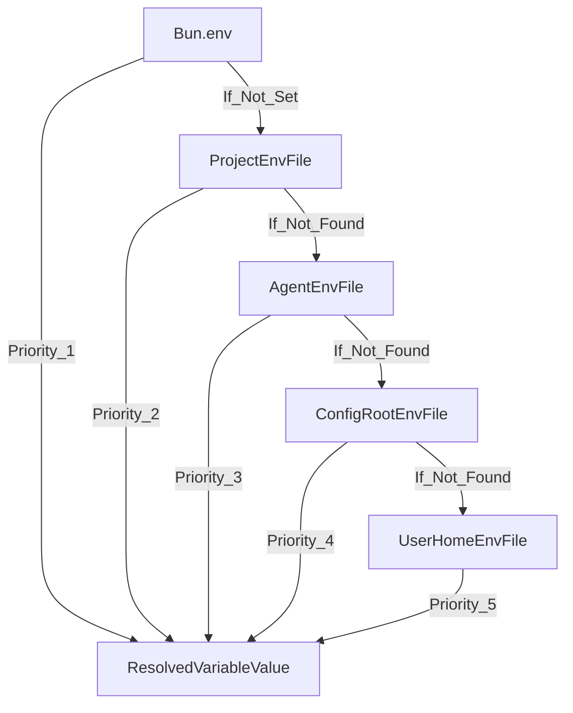
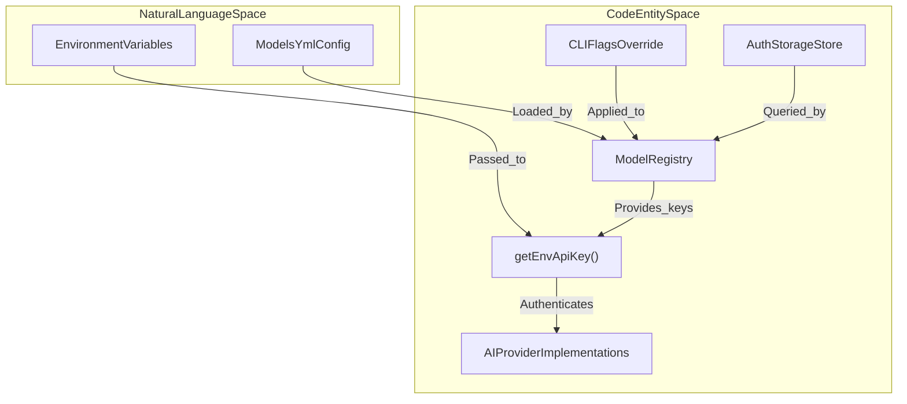
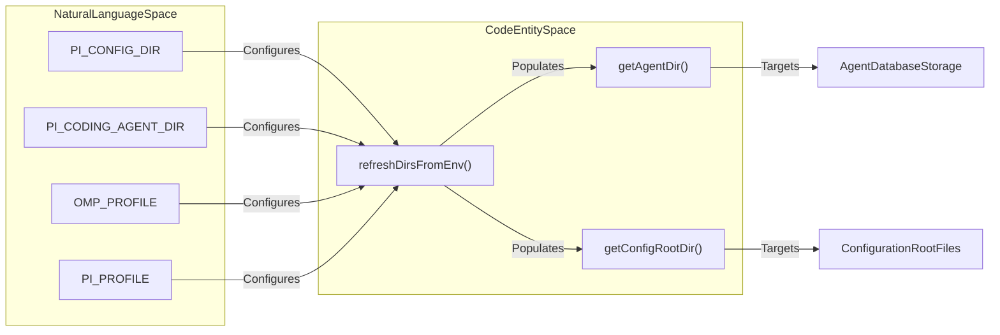
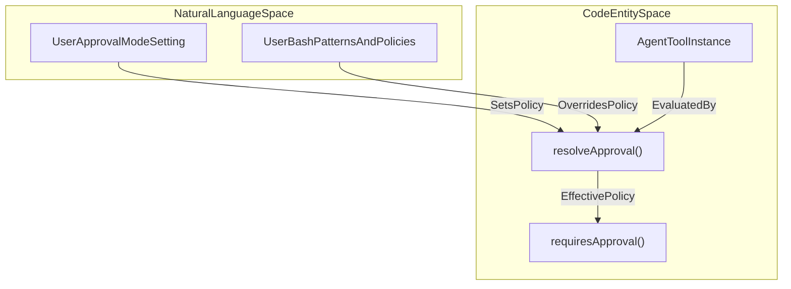
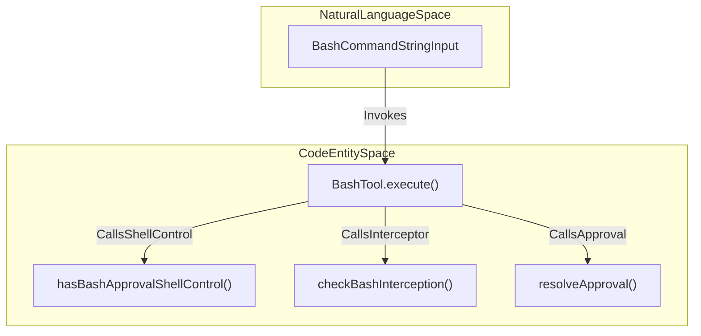

<!-- source: DeepWiki mcp.deepwiki.com · repo can1357/oh-my-pi · page 12.4 Environment Variables and Approval Modes · fetched 2026-10-30 -->

# Environment Variables and Approval Modes

Relevant source files

The following files were used as context for generating this wiki page:

- [AGENTS.md](AGENTS.md)
- [README.md](README.md)
- [docs/environment-variables.md](docs/environment-variables.md)
- [docs/providers.md](docs/providers.md)
- [packages/ai/README.md](packages/ai/README.md)
- [packages/catalog/src/compat/auth-ids.ts](packages/catalog/src/compat/auth-ids.ts)
- [packages/catalog/src/compat/provider-ids.ts](packages/catalog/src/compat/provider-ids.ts)
- [packages/catalog/src/compat/rules/auth/_order.kdl](packages/catalog/src/compat/rules/auth/_order.kdl)
- [packages/coding-agent/README.md](packages/coding-agent/README.md)
- [packages/coding-agent/src/cli.ts](packages/coding-agent/src/cli.ts)
- [packages/coding-agent/src/cli/help-extra.ts](packages/coding-agent/src/cli/help-extra.ts)
- [packages/coding-agent/src/exec/non-interactive-env.ts](packages/coding-agent/src/exec/non-interactive-env.ts)
- [packages/coding-agent/src/tools/computer/worker-entry.ts](packages/coding-agent/src/tools/computer/worker-entry.ts)
- [packages/coding-agent/test/commit-agentic-attribution.test.ts](packages/coding-agent/test/commit-agentic-attribution.test.ts)
- [packages/coding-agent/test/fixtures/computer-worker-bundled-host.ts](packages/coding-agent/test/fixtures/computer-worker-bundled-host.ts)
- [packages/coding-agent/test/non-interactive-env.test.ts](packages/coding-agent/test/non-interactive-env.test.ts)
- [packages/coding-agent/test/worker-selector.test.ts](packages/coding-agent/test/worker-selector.test.ts)
- [packages/natives/scripts/build-bindings.ts](packages/natives/scripts/build-bindings.ts)
- [packages/tui/test/resize-anchor-recovery.test.ts](packages/tui/test/resize-anchor-recovery.test.ts)
- [packages/utils/src/dirs.ts](packages/utils/src/dirs.ts)
- [packages/utils/src/env.ts](packages/utils/src/env.ts)
- [packages/utils/test/dirs.test.ts](packages/utils/test/dirs.test.ts)
- [packages/utils/test/env.test.ts](packages/utils/test/env.test.ts)
- [scripts/install-tests/binary.dockerfile](scripts/install-tests/binary.dockerfile)
- [scripts/install-tests/source.dockerfile](scripts/install-tests/source.dockerfile)
- [scripts/install-tests/tarball.dockerfile](scripts/install-tests/tarball.dockerfile)
- [scripts/install.ps1](scripts/install.ps1)
- [scripts/install.sh](scripts/install.sh)

## Purpose and Scope

This page serves as a comprehensive technical reference for configuring runtime behavior in the `oh-my-pi` coding agent via **environment variables**. It also documents the security and governance mechanisms of **Approval Modes** (`always-ask`, `write`, `yolo`) and **Bash pattern policies**, which control how and when certain agent tools—especially the `bash` tool—require approval before execution.

The information bridges user-facing configuration inputs with their corresponding implementations across the monorepo, primarily in `packages/utils`, `packages/ai`, and `packages/coding-agent`.

Sources: [docs/environment-variables.md:1-10](), [packages/utils/src/env.ts:1-20]()

---

## Variable Resolution Architecture

The coding agent environment variable system is implemented via the `$env` resolution logic in `packages/utils/src/env.ts`. It provides a layered lookup that merges multiple `.env` files with existing runtime process variables for robust and context-sensitive environment resolution.

### Resolution Precedence

The environment variable lookup proceeds through the following layers, for each key:

1. **Process environment (`Bun.env`)**: The environment variables at process start time have the highest precedence [docs/environment-variables.md:15-18]().
2. **Project `.env`**: Environment variables from a `.env` file in the current working directory are loaded if not already set [docs/environment-variables.md:15-19]().
3. **Active agent `.env`**: From the agent data directory—`~/.omp/agent/.env` by default, modifiable by profile or overrides [docs/environment-variables.md:15-20]().
4. **Active config-root `.env`**: Global config environment variables from `~/.omp/.env` [docs/environment-variables.md:15-21]().
5. **User home `.env`**: Lowest precedence, from the user's home directory (e.g., `~/.env`) [docs/environment-variables.md:15-22]().

An important note is that every environment variable beginning with `OMP_` is **mirrored as a `PI_` prefixed variable**, and this mirrored value replaces any `PI_` variable from the same file to maintain backward compatibility and aliasing consistency [docs/environment-variables.md:25-26]().

All environment keys and their values are sanitized and filtered to conform to valid shell variable naming conventions, specifically matching the regex `[A-Za-z_][A-Za-z0-9_]*` [packages/utils/src/env.ts:11-20]().

### Diagram: Environment Variable Resolution Order

Title: "Environment Variable Resolution Architecture"

Sources: [docs/environment-variables.md:11-26](), [packages/utils/src/env.ts:1-50]()

---

## Authentication Resolution Flow for AI Providers

The agent relies on multiple configuration sources to resolve authentication credentials needed by various AI providers. This layered system is managed by the registry components in `packages/coding-agent` and involves:

- **Environment variables** such as `OPENAI_API_KEY`, `ANTHROPIC_API_KEY`, and `GEMINI_API_KEY` [docs/environment-variables.md:31-46]().
- **Persistent credential storage** via `AuthStorage` for OAuth tokens and stored API keys [packages/ai/README.md:38-44]().
- **CLI runtime overrides** like `--api-key` flags [docs/providers.md:51-56]().
- **`models.yml` file entries** which may specify provider keys or special secrets commands [docs/providers.md:51-56]().

These sources are merged to produce an effective set of credentials for each provider. Provider implementations consume these resolved keys through calls such as `getEnvApiKey()` in `packages/ai/src/stream.ts` [docs/environment-variables.md:31-35]().

### Diagram: Authentication Variable Flow to Providers

Title: "Authentication Resolution and Provider Flow"

Sources: [docs/environment-variables.md:31-60](), [packages/ai/src/stream.ts:1-50]()

---

## Core Provider Credential Environment Variables

The following table summarizes prominent environment variables for authenticating with AI model providers. These are primarily sourced by the `pi-ai` package and consumed through the coding agent:

| Variable                      | Provider            | Notes                                                           |
|------------------------------|---------------------|-----------------------------------------------------------------|
| `ANTHROPIC_OAUTH_TOKEN`       | Anthropic           | Overrides `ANTHROPIC_API_KEY` when present [docs/environment-variables.md:41-43]() |
| `ANTHROPIC_API_KEY`           | Anthropic           | Secondary or fallback key [docs/environment-variables.md:41-43]() |
| `OPENAI_API_KEY`              | OpenAI              | Used by OpenAI family and compatible providers [docs/environment-variables.md:44-45]() |
| `GEMINI_API_KEY`              | Google Gemini       | Primary Gemini API key [docs/environment-variables.md:46-47]() |
| `GOOGLE_API_KEY`              | Google Gemini/Image | Fallback key for Gemini image tool [docs/environment-variables.md:46-47]() |
| `HUGGINGFACE_HUB_TOKEN`       | Hugging Face        | Primary Hugging Face token [docs/environment-variables.md:55-57]() |
| `HF_TOKEN`                   | Hugging Face        | Fallback token [docs/environment-variables.md:55-57]() |
| `OLLAMA_CLOUD_API_KEY`        | Ollama Cloud        | Required for hosted Ollama native API access [packages/ai/README.md:81-84]() |
| `VLLM_API_KEY`                | vLLM                | Used for secured vLLM deployments [packages/ai/README.md:81-84]() |

Sources: [docs/environment-variables.md:31-60](), [packages/ai/README.md:47-84]()

---

## Directory and Profile Overrides

Several environment variables influence where the coding agent stores configuration, state, and cache, allowing flexible deployment and profile isolation:

| Variable               | Default Location                | Description                                                 |
|------------------------|--------------------------------|-------------------------------------------------------------|
| `PI_CONFIG_DIR`        | N/A                            | Overrides the global configuration root directory [packages/utils/src/dirs.ts:1-12]() |
| `PI_CODING_AGENT_DIR`  | `~/.omp/agent`                 | Overrides agent directory location, where config and data live [packages/utils/src/dirs.ts:1-12]() |
| `OMP_PROFILE`          | N/A                            | Selects an isolated configuration profile suffix [packages/utils/src/dirs.ts:43-50]() |
| `PI_PROFILE`           | Used as a fallback if no `OMP_PROFILE` | Alias for profile selection [packages/utils/src/dirs.ts:43-50]() |
| `PI_ROOT`              | `/work/pi` (Docker-specific)   | Root of OMP source tree for locating agent workspaces       |

Functions like `getAgentDir()` and `getConfigRootDir()` in `packages/utils/src/dirs.ts` read these values to determine runtime paths for the agent's environment.

### Diagram: Directory Resolution Entity Mapping

Title: "Directory Resolution and Profile Mapping"

Sources: [docs/environment-variables.md:15-23](), [packages/utils/src/dirs.ts:1-60]()

---

## Tool and System Behavior Controls via Environment Variables

The runtime and tools behavior, especially for shell command execution, is heavily influenced by environment variables. Relevant common environment variables include:

- `PI_NO_PTY`: When `1`, disables PTY usage for the bash tool (runs shell commands without PTY)
- `PI_BASH_NO_CI`: When `1`, prevents automatic injection of `CI=true` into child shells
- `PYTHONIOENCODING`: Defaults to `utf-8` on Windows child processes if unset
- `PYTHONUTF8`: Defaults to `1` on Windows child processes if unset
- `LANG` / `LC_ALL`: Defaults to `C.UTF-8` on Windows child processes if unset
- `PAGER`, `GIT_PAGER`, `MANPAGER`: Set to `cat` in non-interactive environment to disable pagers
- `TERM`: Set to `dumb` in non-interactive shells to disable terminal features
- `NO_COLOR`: Set to `1` disables colored output
- `PYTHONUNBUFFERED`: Set to `1` disables Python output buffering when running shell commands
- `CI`: Defaults to `true` when running non-interactively unless opted out explicitly

These environment variables are set or inherited by `packages/coding-agent/src/exec/non-interactive-env.ts` during execution to control subprocess behavior, enabling consistent, scriptable shell interactions.

Sources: [packages/coding-agent/src/exec/non-interactive-env.ts:1-77](), [packages/utils/src/env.ts:35-140]()

---

## Approval Modes and Tier Matrix

The agent enforces **tool execution approvals** to control security and user consent for sensitive or potentially destructive actions. This system revolves around:

- **Approval modes:** global policies that tune the interaction level
- **Tool approval tiers:** metadata annotating tool risk categories
- **Bash pattern rejection or interception overrides**

### Tool Approval Tiers

Each tool declares an approval **tier** which represents the sensitivity or risk level of executing the tool:

| Tier   | Description                                                  |
|--------|--------------------------------------------------------------|
| `read` | Tools that read state or metadata only; no workspace mutation|
| `write`| Tools that write or mutate workspace or session state       |
| `exec` | Tools that execute shell commands or arbitrary external code |

Tools without explicit declarations default to `exec` tier, the most restrictive.

### Approval Modes

The global runtime approval mode is set via the setting `tools.approvalMode`. The modes have the following effect:

| Mode        | Automatically Allows                | Requires Prompt For                 |
|-------------|-----------------------------------|-----------------------------------|
| `always-ask`| `read` tier only                  | `write` and `exec` tiers           |
| `write`     | `read` and `write` tiers          | `exec` tier only                   |
| `yolo`      | All tiers (`read`, `write`, `exec`)| No prompts (prompts are disabled) |

This lets users choose between maximum safety (`always-ask`), a balanced prompt policy (`write`), or full trust/autonomy (`yolo`).

### Approval Resolution Data Flow

The main functions controlling approval evaluation are `resolveApproval` and `requiresApproval` in `packages/coding-agent/src/tools/approval.ts`. They combine:

- The global approval mode
- Tool-declared tier and override policies
- User-configured policy overrides (e.g., in `tools.approval.write = deny`)
- Tool flags/override reasons

These yield a final decision: `allow`, `prompt`, or `deny`. For example, in `yolo` mode, tool overrides are ignored except explicit user denies.

### Diagram: Approval Resolution Data Flow

Title: "Approval Resolution Data Flow"

Sources: [packages/coding-agent/src/tools/approval.ts:1-150](), [packages/coding-agent/test/tools/approval.test.ts:1-85]()

---

## Bash Pattern Policies and Command Evaluation

The `bash` tool features granular control through user-supplied regex patterns for restricting or intercepting dangerous or unapproved commands.

### Command Approval Layers

- The function `hasBashApprovalShellControl()` in `packages/coding-agent/src/tools/bash.ts` detects if a command string contains shell constructs (word expansions, assignments, operators) that require approval at the `exec` tier.
- The interception mechanism `checkBashInterception()` in `packages/coding-agent/src/tools/bash-interceptor.ts` compares command input against user-configured patterns in `bash.interceptorRules` for dynamic blocking or prompting.

These mechanisms feed into the approval resolution chain described above.

### Diagram: Bash Command Approval and Interception Flow

Title: "Bash Command Approval and Interception Flow"

Sources: [packages/coding-agent/src/tools/bash.ts:86-128](), [packages/coding-agent/src/tools/bash-interceptor.ts:1-60](), [packages/coding-agent/src/tools/approval.ts:1-150]()

---

