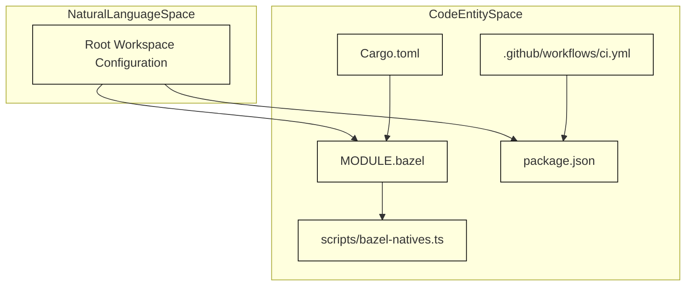
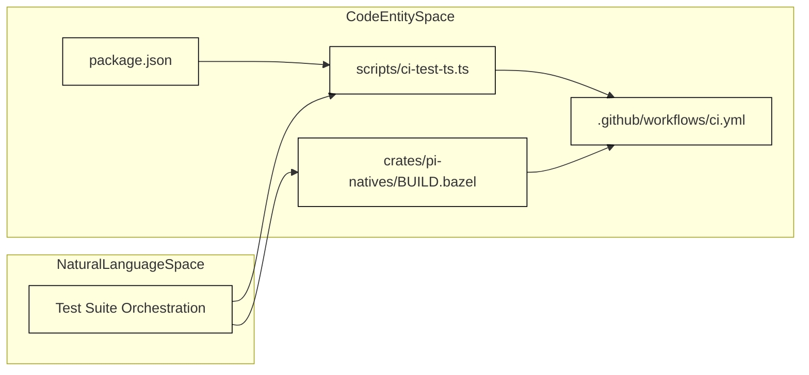

<!-- source: DeepWiki mcp.deepwiki.com · repo can1357/oh-my-pi · page 13 Development Guide · fetched 2026-10-30 -->

# Development Guide

Relevant source files

The following files were used as context for generating this wiki page:

- [.cargo/config.toml](.cargo/config.toml)
- [.github/workflows/ci.yml](.github/workflows/ci.yml)
- [crates/pi-natives/src/spelling.rs](crates/pi-natives/src/spelling.rs)
- [crates/pi-shell/src/git.rs](crates/pi-shell/src/git.rs)
- [crates/pi-shell/src/git/guard.rs](crates/pi-shell/src/git/guard.rs)
- [docs/fs-scan-cache-architecture.md](docs/fs-scan-cache-architecture.md)
- [docs/natives-addon-loader-runtime.md](docs/natives-addon-loader-runtime.md)
- [docs/natives-architecture.md](docs/natives-architecture.md)
- [docs/natives-binding-contract.md](docs/natives-binding-contract.md)
- [docs/natives-build-release-debugging.md](docs/natives-build-release-debugging.md)
- [docs/natives-media-system-utils.md](docs/natives-media-system-utils.md)
- [docs/natives-rust-task-cancellation.md](docs/natives-rust-task-cancellation.md)
- [docs/natives-shell-pty-process.md](docs/natives-shell-pty-process.md)
- [docs/natives-text-search-pipeline.md](docs/natives-text-search-pipeline.md)
- [docs/porting-from-pi-mono.md](docs/porting-from-pi-mono.md)
- [docs/porting-to-natives.md](docs/porting-to-natives.md)
- [docs/user-facing-packages.md](docs/user-facing-packages.md)
- [packages/browser-relay/README.md](packages/browser-relay/README.md)
- [packages/browser-relay/extension/chrome.d.ts](packages/browser-relay/extension/chrome.d.ts)
- [packages/coding-agent/src/cli/browser-relay-cli.ts](packages/coding-agent/src/cli/browser-relay-cli.ts)
- [packages/coding-agent/src/exec/settings.ts](packages/coding-agent/src/exec/settings.ts)
- [packages/natives/scripts/gen-npm-packages.ts](packages/natives/scripts/gen-npm-packages.ts)
- [packages/natives/test/addon-load-verification.test.ts](packages/natives/test/addon-load-verification.test.ts)
- [packages/natives/test/npm-packages.test.ts](packages/natives/test/npm-packages.test.ts)
- [rust-toolchain.toml](rust-toolchain.toml)
- [scripts/bazel-natives.ts](scripts/bazel-natives.ts)
- [scripts/ci-release-notes.ts](scripts/ci-release-notes.ts)
- [scripts/ci-release-publish.test.ts](scripts/ci-release-publish.test.ts)
- [scripts/ci-release-publish.ts](scripts/ci-release-publish.ts)
- [scripts/host-detect.ts](scripts/host-detect.ts)
- [scripts/install-tests/native-version.test.ts](scripts/install-tests/native-version.test.ts)
- [scripts/install-tests/native-version.ts](scripts/install-tests/native-version.ts)
- [scripts/install-tests/run-ci.sh](scripts/install-tests/run-ci.sh)
- [scripts/release.test.ts](scripts/release.test.ts)
- [scripts/release.ts](scripts/release.ts)
- [scripts/setup-npm-trust.ts](scripts/setup-npm-trust.ts)
- [scripts/setup.ts](scripts/setup.ts)

This page serves as a high-level guide for contributors to the `oh-my-pi` codebase. It outlines the monorepo layout, build systems, testing workflows, and diagnostic utilities to help onboard and support active development.

For deep technical details and practical usage, refer to the child pages:
- [Build System and CI](#13.1) — Bun build system, Cargo/Bazel integration, nix toolchains, CI/CD pipeline, release scripts, Kata Containers CI.
- [Testing Infrastructure](#13.2) — Test infra design: unit and integration tests, terminal harnesses, fixtures, issue reproduction, Rust crate tests.
- [Shared Utilities and Diagnostics](#13.3) — Core utilities and diagnostics: dirs, logger, streams, ptree/procmgr, postmortem, file locks, fetch retry, worker clients.

---

## 1. Monorepo Structure and Build System

The repository is configured as a multi-language monorepo using a workspace approach that integrates:

- **TypeScript packages** managed via **Bun** [package.json:7-70]() for fast builds and scripts [package.json:72-110]().
- **Rust crates** built with **Cargo** and optionally with **Bazel** (`MODULE.bazel`, `BUILD.bazel`) for cross-platform hermetic builds using configured toolchains and caching [docs/natives-build-release-debugging.md:5-23]().
- Support for native bindings, multi-arch builds, and optimized release/debug configurations [docs/natives-build-release-debugging.md:36-58]().

The root workspace coordinates Bazel rules and Rust/Cargo integration. Bun scripts and workspace settings in `package.json` under `"workspaces"` control TypeScript package builds and scripts [package.json:7-11]().

### Diagram: Monorepo Build Integration

Sources: [package.json:7-11](), [MODULE.bazel:1-17](), [.github/workflows/ci.yml:83-84](), [docs/natives-build-release-debugging.md:5-24]()

Bun manages TypeScript build/test tasks and hot-reload dev mode via scripts defined in `package.json` [package.json:72-110](). Bazel handles native crate builds with hermetic toolchains and cross-compilation support [docs/natives-build-release-debugging.md:5-23]().

For comprehensive technical details including integration with nix builds, CI/CD pipeline configuration, and Kata Containers based test runs, see [Build System and CI](#13.1).

---

## 2. Testing Infrastructure

The testing framework spans both TypeScript and Rust ecosystems:

- **TypeScript tests** leverage Bun's fast test runner with fixtures and harnesses for unit and integration tests [package.json:85-88]().
- **Rust tests** run via Cargo with Bazel rules supporting parallel and environment-controlled test runs [docs/natives-build-release-debugging.md:5-6]().
- Specialized virtual terminal harnesses simulate interactive command-line interfaces for TUI components.
- Conventions aid reproducible issue reproducers and test fixture management.

### Diagram: Test Runner Pipeline

Sources: [.github/workflows/ci.yml:8-9](), [package.json:85-118](), [crates/pi-natives/BUILD.bazel:1-50]()

The test pipelines include special scripts for selective running, workspace filtering, smoke tests, and native interop tests [package.json:110-120](). They combine TypeScript and Rust coverage seamlessly.

For detailed design of test harnesses, running suites, reuse of fixtures, and Rust test crate usage, see [Testing Infrastructure](#13.2).

---

## 3. Shared Utilities and Diagnostics

The codebase provides a suite of foundational utilities and diagnostics modules that underpin development ergonomics and runtime observability:

- Directory and path utilities abstract platform nuances and workspace structure.
- Logging modules support structured logging, async stream handling, and dynamic logger levels.
- Abortable and cancellation helper utilities simplify concurrent task handling.
- Process tree and process manager (`ptree/procmgr`) enable safe process supervision and cleanup.
- File locking utilities guard against concurrent access issues.
- Fetch-retry logic gracefully handles transient network failures with backoff policies.
- Postmortem crash reporting captures diagnostic data on failures.
- Worker client infrastructure supports task parallelism and remote computation.
- Various debugging and developer tooling modules integrate with runtime diagnostics.

These utilities are primarily located in the `packages/utils/` folder and provide cross-package common dependencies [package.json:28]().

For a comprehensive description of diagnostic tooling, utility modules, and their integration, see [Shared Utilities and Diagnostics](#13.3).

Sources: [package.json:7-69](), [docs/natives-build-release-debugging.md:1-30]()

---

# Summary

This high-level overview introduces key aspects of the `oh-my-pi` development environment:  
- The **monorepo build system** combining Bun, Cargo, and Bazel to deliver multiplatform, multilang workflow [package.json:7-70](), [docs/natives-build-release-debugging.md:5-23]().  
- The **testing infrastructure** facilitating robust cross-language test coverage and interactive harnesses [package.json:85-118](), [docs/natives-build-release-debugging.md:5-6]().  
- The **shared utility modules** enabling consistent diagnostics, concurrency handling, and developer tools [package.json:28]().

For hands-on contributor guidance and deep developer documentation, visit the linked child pages below:

- [Build System and CI](#13.1)  
- [Testing Infrastructure](#13.2)  
- [Shared Utilities and Diagnostics](#13.3)  

---

Sources:  
[package.json:1-138](), [MODULE.bazel:1-17](), [.github/workflows/ci.yml:8-9,83-84](), [crates/pi-natives/BUILD.bazel:1-50](), [docs/natives-build-release-debugging.md:1-24]()

---

