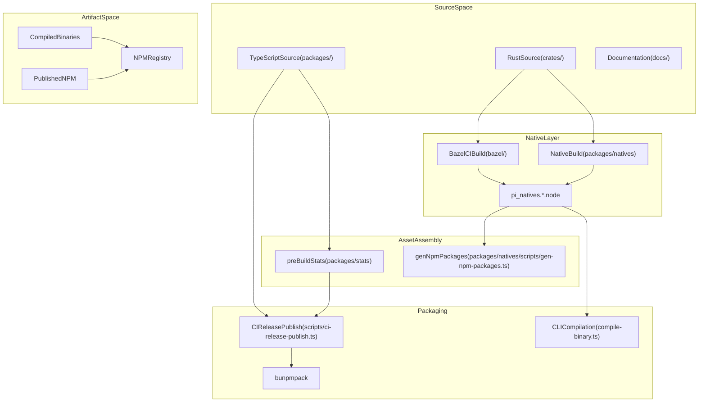
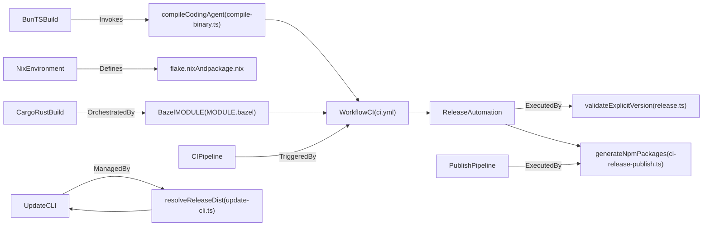
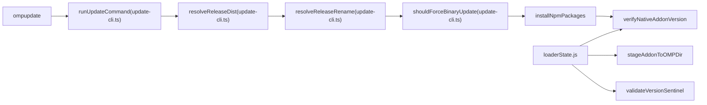

<!-- source: DeepWiki mcp.deepwiki.com · repo can1357/oh-my-pi · page 13.1 Build System and CI · fetched 2026-10-30 -->

# Build System and CI

Relevant source files

The following files were used as context for generating this wiki page:

- [.cargo/config.toml](.cargo/config.toml)
- [.dockerignore](.dockerignore)
- [.github/actions/bazel-cache/action.yml](.github/actions/bazel-cache/action.yml)
- [.github/actions/bun-install/action.yml](.github/actions/bun-install/action.yml)
- [.github/actions/native-artifacts/action.yml](.github/actions/native-artifacts/action.yml)
- [.github/workflows/ci.yml](.github/workflows/ci.yml)
- [.omp/tests/tui.test.ts](.omp/tests/tui.test.ts)
- [.omp/tools/tui.ts](.omp/tools/tui.ts)
- [Dockerfile](Dockerfile)
- [Dockerfile.dockerignore](Dockerfile.dockerignore)
- [Dockerfile.robomp](Dockerfile.robomp)
- [Dockerfile.robomp.dockerignore](Dockerfile.robomp.dockerignore)
- [bazel/toolchains/msvc/sysroot.bzl](bazel/toolchains/msvc/sysroot.bzl)
- [crates/pi-natives/src/spelling.rs](crates/pi-natives/src/spelling.rs)
- [crates/pi-shell/src/git.rs](crates/pi-shell/src/git.rs)
- [crates/pi-shell/src/git/guard.rs](crates/pi-shell/src/git/guard.rs)
- [docs/fs-scan-cache-architecture.md](docs/fs-scan-cache-architecture.md)
- [docs/native-crates.md](docs/native-crates.md)
- [docs/natives-addon-loader-runtime.md](docs/natives-addon-loader-runtime.md)
- [docs/natives-architecture.md](docs/natives-architecture.md)
- [docs/natives-binding-contract.md](docs/natives-binding-contract.md)
- [docs/natives-build-release-debugging.md](docs/natives-build-release-debugging.md)
- [docs/natives-media-system-utils.md](docs/natives-media-system-utils.md)
- [docs/natives-rust-task-cancellation.md](docs/natives-rust-task-cancellation.md)
- [docs/natives-shell-pty-process.md](docs/natives-shell-pty-process.md)
- [docs/natives-text-search-pipeline.md](docs/natives-text-search-pipeline.md)
- [docs/porting-from-pi-mono.md](docs/porting-from-pi-mono.md)
- [docs/porting-to-natives.md](docs/porting-to-natives.md)
- [docs/tui.md](docs/tui.md)
- [docs/user-facing-packages.md](docs/user-facing-packages.md)
- [flake.lock](flake.lock)
- [flake.nix](flake.nix)
- [infra/docs/02-kata-runtime.md](infra/docs/02-kata-runtime.md)
- [infra/docs/03-runner-image.md](infra/docs/03-runner-image.md)
- [infra/docs/04-arc-and-caching.md](infra/docs/04-arc-and-caching.md)
- [infra/docs/README.md](infra/docs/README.md)
- [infra/reload-runner.sh](infra/reload-runner.sh)
- [infra/runner.Dockerfile](infra/runner.Dockerfile)
- [infra/tune-kata-runtime.sh](infra/tune-kata-runtime.sh)
- [nix/dev-shell.nix](nix/dev-shell.nix)
- [packages/browser-relay/README.md](packages/browser-relay/README.md)
- [packages/browser-relay/extension/chrome.d.ts](packages/browser-relay/extension/chrome.d.ts)
- [packages/coding-agent/src/cli/browser-relay-cli.ts](packages/coding-agent/src/cli/browser-relay-cli.ts)
- [packages/coding-agent/src/exec/settings.ts](packages/coding-agent/src/exec/settings.ts)
- [packages/natives/scripts/gen-npm-packages.ts](packages/natives/scripts/gen-npm-packages.ts)
- [packages/natives/test/addon-load-verification.test.ts](packages/natives/test/addon-load-verification.test.ts)
- [packages/natives/test/npm-packages.test.ts](packages/natives/test/npm-packages.test.ts)
- [rust-toolchain.toml](rust-toolchain.toml)
- [scripts/bazel-natives.ts](scripts/bazel-natives.ts)
- [scripts/ci-release-notes.ts](scripts/ci-release-notes.ts)
- [scripts/ci-release-publish.test.ts](scripts/ci-release-publish.test.ts)
- [scripts/ci-release-publish.ts](scripts/ci-release-publish.ts)
- [scripts/ci-test-ts.ts](scripts/ci-test-ts.ts)
- [scripts/host-detect.ts](scripts/host-detect.ts)
- [scripts/install-tests/native-version.test.ts](scripts/install-tests/native-version.test.ts)
- [scripts/install-tests/native-version.ts](scripts/install-tests/native-version.ts)
- [scripts/install-tests/run-ci.sh](scripts/install-tests/run-ci.sh)
- [scripts/release.test.ts](scripts/release.test.ts)
- [scripts/release.ts](scripts/release.ts)
- [scripts/setup-npm-trust.ts](scripts/setup-npm-trust.ts)
- [scripts/setup.ts](scripts/setup.ts)

The build system for `oh-my-pi` is a hybrid monorepo architecture that coordinates a modern TypeScript application layer with high-performance Rust native extensions (`pi-natives`), supporting cross-platform builds and seamless integration of disparate technologies. It employs **Bun** as the primary JavaScript runtime, package manager, and build tool [`packages/coding-agent/src/cli.ts`](), while leveraging **Cargo** and **Bazel** for strict, deterministic compilation of Rust crates `[docs/natives-build-release-debugging.md]()`. The CI/CD pipeline runs largely on ephemeral **Kata Containers** microVMs hosted on private runners (`omp-kata`) `[.github/workflows/ci.yml]()`.

This page details the key components of the build system, tooling configurations, release/publish automation, install scripts, and the self-hosted CI infrastructure.

---

## Build Architecture Overview

The monorepo layout separates multiple language-specific components:

- **TypeScript packages** under `packages/`, built, linked, and packaged via Bun.
- **Rust crates** under `crates/`, compiled via Cargo and orchestrated with Bazel `[docs/natives-build-release-debugging.md]()`.
- **Native platform-specific `.node` binaries** as native addons (`pi-natives`) `[Dockerfile]()`.
- Build system integrations and toolchain declarations in `bazel/` and `nix/`.
- Infrastructure manifests and scripts within `infra/`.

At a high level:

- **Bun** manages the JavaScript workspace: linking packages, transpiling, testing, bundling CLI binaries `[packages/coding-agent/scripts/compile-binary.ts]()`.
- **Cargo** builds individual Rust crates and supports developer workflows `[docs/natives-build-release-debugging.md]()`.
- **Bazel** orchestrates optimized multi-crate Rust builds, hermetic toolchains, content-addressed caching, and cross-platform compilation `[docs/natives-build-release-debugging.md]()`.
- **nix** provides reproducible developer shells and binds together Bazel/Rust/Bun tooling `[flake.nix]()`.
- **infra/** contains Kubernetes manifests and automation managing self-hosted runners using Kata Containers microVMs for secure, isolated native builds `[infra/docs/02-kata-runtime.md]()`.

### Build Pipeline Data Flow

Sources: `[.github/workflows/ci.yml]()`, `[scripts/ci-release-publish.ts]()`, `[scripts/install-tests/run-ci.sh]()`, `[packages/natives/scripts/gen-npm-packages.ts]()`

---

## Bun-Based Build System

The build uses **Bun** extensively as its JavaScript runtime, package manager, and build tool `[packages/coding-agent/src/cli.ts]()`:

- Workspace linking and dependency installation is managed via `bun install` and `bun link` across all `packages/` `[Dockerfile:76-78]()`.
- Bun compiles and tests TypeScript packages with native Bun support `[scripts/ci-test-ts.ts:36-43]()`.
- The primary CLI executable is bundled with Bun’s compiler (`bun build`), driven by `compileCodingAgent` in `[packages/coding-agent/scripts/compile-binary.ts]()` and `[packages/coding-agent/scripts/build-binary.ts]()`.
- Bun lockfiles (`bun.lock`) and configuration (`bunfig.toml`) govern dependency resolution and build caching `[.github/workflows/ci.yml:30-32]()`.
- Smoke testing ensures bundled workers load correctly via `smoke_cli` in `[scripts/install-tests/run-ci.sh:25-37]()`.

Sources: `[packages/coding-agent/src/cli.ts]()`, `[scripts/ci-test-ts.ts:1-50]`, `[Dockerfile:76-78]`, `[.github/workflows/ci.yml:30-32]`

---

## Cargo and Bazel Integration for Rust Crates

Rust components living in `crates/` (e.g., `pi-natives`, `pi-walker`, `pi-voice`, `pi-builtins`) are compiled using:

- **Cargo** for local crate builds and iteration `[docs/natives-build-release-debugging.md:5]()`.
- **Bazel** for hermetic, cache-optimized builds targeting multiple platforms `[docs/natives-build-release-debugging.md:5]()`.

The Bazel integration is defined primarily via `MODULE.bazel` and `MODULE.bazel.lock` `[.github/workflows/ci.yml:13-14]()`. Bazel controls:

- Definition of platform-specific Rust toolchains `[docs/natives-build-release-debugging.md:61-70]()`.
- Multi-target release-grade builds of native addons `pi_natives` via `native_addon` rules `[docs/natives-build-release-debugging.md:59-68]()`.
- Integration of `crate_universe` for third-party Rust crate dependency management `[docs/natives-build-release-debugging.md:5]()`.
- Hermetic cc toolchains and patching to support reproducible builds and cross-compilation `[docs/natives-build-release-debugging.md:5-74]()`.

Sources: `[.github/workflows/ci.yml:12-25]()`, `[docs/natives-build-release-debugging.md:1-76]()`

---

## Nix and bazel/ Toolchains

The `nix/` directory contains:

- `flake.nix` and `package.nix` that specify developer shells and pinned versions of Rust, Bun, Bazel, and other tools `[flake.nix]()`.
- These shells provide reproducible and consistent developer environments that match those used on CI runners.
- Integration with Bazel toolchains ensures consistent tool versions and hermetic builds `[docs/natives-build-release-debugging.md:5]()`.

Developers use `nix develop` to load a shell with the exact configured toolset, reducing environment inconsistencies.

Sources: `[.github/workflows/ci.yml]()`, `[flake.nix]()`

---

## CI/CD Pipeline

The continuous integration pipeline is defined primarily by `[.github/workflows/ci.yml]()`, designed for fast, reliable builds across platforms:

- **Trigger Events:** On push to `main`, pull requests targeting `main` or `omp2`, and manual dispatches `[.github/workflows/ci.yml:3-63]()`.
- **Path Filtering:** Watches changes under `packages/`, `crates/`, `scripts/`, and Bazel-related files for job triggers `[.github/workflows/ci.yml:6-18]()`.
- **Concurrency & Cancellation:** Fine-grained control via `concurrency` groups to cancel redundant jobs, except for release-tagged commits `[.github/workflows/ci.yml:78-80]()`.
- **Jobs Include:**
  - **Lint, Type Checking, & Web Build:** Runs on Ubuntu or `omp-kata` self-hosted runners `[.github/workflows/ci.yml:110-162]()`.
  - **Rust License Compliance:** `cargo-deny` checks `[.github/workflows/ci.yml:21]()`.
  - **Native Compilation:** Uses Bazel within ephemeral Kata microVM pods (`omp-kata`), for isolated and reproducible builds `[.github/workflows/ci.yml]()`.
  - **Testing:** Parallelized Bun test executions, with fine bucketing based on package types and native usage via `[scripts/ci-test-ts.ts]()`.
  - **Release and Publishing:** Jobs triggered via version metadata resolution (`release_metadata`), handling npm publishing and release coordination `[.github/workflows/ci.yml:110-122]()`.

### Self-Hosted Kata Containers Infrastructure

The `infra/` folder contains Kubernetes manifests and scripts to provision, load balance, and scale the `omp-kata` runners, which:

- Use Kata Containers microVM pods for strong isolation during native builds `[infra/docs/02-kata-runtime.md]()`.
- Mount persistent volume claims for Bazel and Cargo remote cache data.
- Are managed via the Actions Runner Controller (ARC) for Kubernetes `[infra/docs/02-kata-runtime.md]()`.
- Ensure native builds run quickly and securely without affecting host stability `[infra/docs/02-kata-runtime.md]()`.

Sources: `[.github/workflows/ci.yml:1-162]()`, `[infra/docs/02-kata-runtime.md]()`

---

## Release and Publish Automation

### Release Script (`scripts/release.ts`)

The release process is orchestrated by `[scripts/release.ts]()`. It supports:

- Explicit semantic version release inputs or version bump keywords like `major`, `minor`, `patch`, or `canary` `[scripts/release.ts:6]()`.
- Rigorous version validation via `validateExplicitVersion` to avoid accidental promotion of prereleases as stable `[scripts/release.ts:37-40]()`.
- Changelog updates for each package, moving unreleased content to a new version heading `[scripts/release.ts]()`.
- Automated git commits, tagging, and pushing to origin `[scripts/release.ts]()`.
- Monitoring of GitHub Actions runs for the current commit via `watchCI` with detailed failure logging and fail-fast logic `[scripts/release.ts:72-161]()`.

Sources: `[scripts/release.ts:1-161]()`

---

### Publish Script (`scripts/ci-release-publish.ts`)

The publishing of packages is done by the script `[scripts/ci-release-publish.ts]()`. Responsibilities include:

- Emitting TypeScript declaration files (`.d.ts`) under `dist/types/` so consumers get stable typings `[scripts/ci-release-publish.ts]()`.
- Rewriting package manifests to map TS source paths to transpiled declaration and JS outputs `[scripts/ci-release-publish.ts]()`.
- Generating native leaf packages per platform (e.g., `pi-natives-linux-x64`) via `generateNpmPackages` `[scripts/ci-release-publish.ts:46]()`, separating native binaries from core packages.
- Leveraging `bun pm pack` for packed tarball generation resolving workspace-local protocols `[scripts/ci-release-publish.ts]()`.
- Running `npm publish` with concurrency control, dependency ordering, and caching for safe and efficient deployment `[scripts/ci-release-publish.ts]()`.
- Handling `canary` and `stable` dist-tags based on version naming conventions via `npmDistTag` `[scripts/ci-release-publish.ts:148-154]()`.
- Managing legal payload files (`LICENSE`, `THIRD-PARTY-NOTICES.txt`) consistently across packages via `stageLegalPayloads` `[scripts/ci-release-publish.ts:111-128]()`.

Sources: `[scripts/ci-release-publish.ts:1-175]()`

---

### Install Scripts (`scripts/install.sh` and `scripts/install.ps1`)

Platform-specific installation scripts simplify user bootstrap:

- **Unix Shell Installer (`scripts/install.sh`)**
  - Supports installing from source (`--source`) or binaries (`--binary`).
  - Detects host OS and CPU architecture, including musl vs glibc detection on Linux.
  - Verifies or installs a minimum Bun version.
  - Clones the repository and pulls Git LFS assets if present.
  - Downloads precompiled binaries matching OS and architecture.

- **Windows PowerShell Installer (`scripts/install.ps1`)**
  - Detects Windows CPU architecture (x64 or arm64) reliably.
  - Attempts to find a bash shell and auto-configure it in agent settings.
  - Checks and enforces the Bun version requirement.

Sources: `[scripts/install-tests/run-ci.sh:1-105]()`, `[scripts/release.ts:1-50]()`

---

## Native Addon Loading and Staging

The native addon is a dynamic library exposing Rust implementations as `.node` files `[docs/natives-build-release-debugging.md]()`:

- The loader code in `packages/natives/native/loader-state.js` handles:
  - Platform and architecture detection at runtime for selecting the correct addon filename variant `[scripts/bazel-natives.ts:81-111]()`.
  - Construction of candidate addon filenames with platform tags `[scripts/bazel-natives.ts:53-63]()`.
  - Validation of version sentinel files ensuring runtime and addon binary versions match `[scripts/bazel-natives.ts:39-43]()`.
  - Windows-specific staging: staging the native addon into a dedicated versioned directory under user `.omp/natives` before loading.

Sources: `[scripts/bazel-natives.ts:1-150]`, `[docs/natives-build-release-debugging.md:1-33]`

---

## Summary of Key Files and Responsibilities

| Component | Responsibility | Source Reference |
|---|---|---|
| `[.github/workflows/ci.yml]()` | Core CI pipeline config, native builds on Kata runners, linting, type checking, and release triggers. | `[.github/workflows/ci.yml:1-162]()` |
| `[scripts/release.ts]()` | Orchestrates version bumps via `validateExplicitVersion`, changelog updates, tagging, and monitoring GitHub runs. | `[scripts/release.ts:1-161]()` |
| `[scripts/ci-release-publish.ts]()` | Packaging and publishing workspace packages and native leaf packages with dependency ordering (`generateNpmPackages`). | `[scripts/ci-release-publish.ts:1-175]()` |
| `[scripts/install-tests/run-ci.sh]()` | Smoke tests local, source, and tarball installs across package topologies and native addons. | `[scripts/install-tests/run-ci.sh:1-105]()` |
| `[packages/coding-agent/scripts/compile-binary.ts]()` | Bundles the primary CLI executable via Bun's compiler (`compileCodingAgent`). | `[packages/coding-agent/scripts/compile-binary.ts:1-97]()` |
| `[bazel/]` and `[nix/]` | Bazel toolchains (`MODULE.bazel`) for multi-platform native builds, and Nix (`flake.nix`) for dev environments. | `[MODULE.bazel]`, `[nix/package.nix]()` |
| `[infra/]` | Kubernetes manifests and scripts managing ephemeral self-hosted runners (`omp-kata`) using Kata Containers VM. | `[infra/docs/02-kata-runtime.md]()` |

---

## Diagram: Natural Language to Code Entities (Build and CI)

Sources: `[.github/workflows/ci.yml]()`, `[scripts/release.ts]()`, `[scripts/ci-release-publish.ts]()`, `[packages/coding-agent/src/cli/update-cli.ts]()`, `[packages/coding-agent/scripts/compile-binary.ts]()`

---

## Diagram: Package Update Flow and Native Addon Management

Sources: `[packages/coding-agent/src/cli/update-cli.ts:1-180]()`, `[packages/coding-agent/test/update-cli.test.ts:1-176]()`

---

