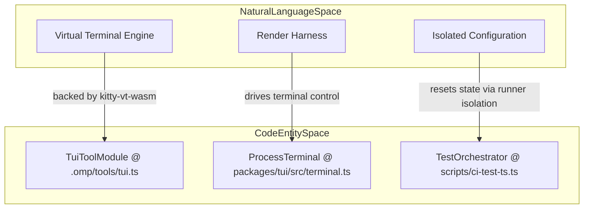
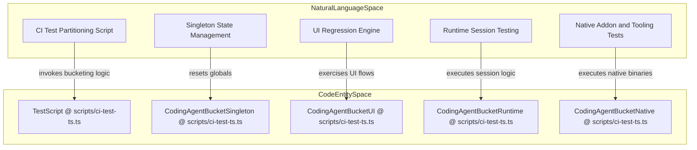

<!-- source: DeepWiki mcp.deepwiki.com · repo can1357/oh-my-pi · page 13.2 Testing Infrastructure · fetched 2026-10-30 -->

# Testing Infrastructure

Relevant source files

The following files were used as context for generating this wiki page:

- [.cargo/config.toml](.cargo/config.toml)
- [.dockerignore](.dockerignore)
- [.github/actions/bazel-cache/action.yml](.github/actions/bazel-cache/action.yml)
- [.github/actions/bun-install/action.yml](.github/actions/bun-install/action.yml)
- [.github/actions/native-artifacts/action.yml](.github/actions/native-artifacts/action.yml)
- [.github/workflows/ci.yml](.github/workflows/ci.yml)
- [.omp/tests/tui.test.ts](.omp/tests/tui.test.ts)
- [.omp/tools/tui.ts](.omp/tools/tui.ts)
- [Dockerfile](Dockerfile)
- [Dockerfile.dockerignore](Dockerfile.dockerignore)
- [Dockerfile.robomp](Dockerfile.robomp)
- [Dockerfile.robomp.dockerignore](Dockerfile.robomp.dockerignore)
- [bazel/toolchains/msvc/sysroot.bzl](bazel/toolchains/msvc/sysroot.bzl)
- [crates/pi-natives/src/spelling.rs](crates/pi-natives/src/spelling.rs)
- [crates/pi-shell/src/git.rs](crates/pi-shell/src/git.rs)
- [crates/pi-shell/src/git/guard.rs](crates/pi-shell/src/git/guard.rs)
- [docs/fs-scan-cache-architecture.md](docs/fs-scan-cache-architecture.md)
- [docs/native-crates.md](docs/native-crates.md)
- [docs/natives-addon-loader-runtime.md](docs/natives-addon-loader-runtime.md)
- [docs/natives-architecture.md](docs/natives-architecture.md)
- [docs/natives-binding-contract.md](docs/natives-binding-contract.md)
- [docs/natives-build-release-debugging.md](docs/natives-build-release-debugging.md)
- [docs/natives-media-system-utils.md](docs/natives-media-system-utils.md)
- [docs/natives-rust-task-cancellation.md](docs/natives-rust-task-cancellation.md)
- [docs/natives-shell-pty-process.md](docs/natives-shell-pty-process.md)
- [docs/natives-text-search-pipeline.md](docs/natives-text-search-pipeline.md)
- [docs/porting-from-pi-mono.md](docs/porting-from-pi-mono.md)
- [docs/porting-to-natives.md](docs/porting-to-natives.md)
- [docs/tui.md](docs/tui.md)
- [docs/user-facing-packages.md](docs/user-facing-packages.md)
- [flake.lock](flake.lock)
- [flake.nix](flake.nix)
- [infra/docs/02-kata-runtime.md](infra/docs/02-kata-runtime.md)
- [infra/docs/03-runner-image.md](infra/docs/03-runner-image.md)
- [infra/docs/04-arc-and-caching.md](infra/docs/04-arc-and-caching.md)
- [infra/docs/README.md](infra/docs/README.md)
- [infra/reload-runner.sh](infra/reload-runner.sh)
- [infra/runner.Dockerfile](infra/runner.Dockerfile)
- [infra/tune-kata-runtime.sh](infra/tune-kata-runtime.sh)
- [nix/dev-shell.nix](nix/dev-shell.nix)
- [packages/browser-relay/README.md](packages/browser-relay/README.md)
- [packages/browser-relay/extension/chrome.d.ts](packages/browser-relay/extension/chrome.d.ts)
- [packages/coding-agent/src/cli/browser-relay-cli.ts](packages/coding-agent/src/cli/browser-relay-cli.ts)
- [packages/coding-agent/src/exec/settings.ts](packages/coding-agent/src/exec/settings.ts)
- [rust-toolchain.toml](rust-toolchain.toml)
- [scripts/ci-test-ts.ts](scripts/ci-test-ts.ts)

The **oh-my-pi** codebase employs a comprehensive and multi-layered testing infrastructure designed to ensure correctness, stability, and performance across its entire stack—from AI-driven workflows and native Rust crates to the terminal-based user interface and integration components. This document details the architecture and implementation of the testing infrastructure, including unit and integration tests, terminal emulation harnesses, issue reproduction conventions, Rust crate testing, and CI partitioning strategies.

---

## Purpose and Scope

This page documents the testing infrastructure supporting the oh-my-pi monorepo. Topics covered include:

- Unit and integration testing approaches across packages and crates
- Virtual terminal harnesses used for TUI testing with a WASM-based kitty core
- Fixtures and isolated state management mechanisms for reliable tests
- Conventions for tests reproducing specific GitHub issues and runtime error edge cases (e.g., retry caps, 413 payload rejections, compaction progress guards)
- Native Rust crate testing and Bazel integration
- Test suite partitioning, chunking, and parallelization strategies in CI via `scripts/ci-test-ts.ts`
- How to invoke and run tests locally and in CI pipelines

Sources: [scripts/ci-test-ts.ts:1-84](), [packages/tui/src/terminal.ts:72-128]()

---

## Test Architecture and Harnesses

The oh-my-pi testing stack operates on multiple planes, with coordination between natural language test specifications, terminal hardware and protocol emulation, and core business logic testing.

### Bun Test Runner for TypeScript

- The bulk of the TypeScript/JavaScript tests run under Bun's native test runner `bun test`.
- Test files named `*.test.ts` are discovered across packages.
- The environment flag `isBunTestRuntime` indicates the test runtime context facilitating conditional logic in tests or modules [packages/tui/src/terminal.ts:1-20]().

### Virtual Terminal Harness

- The Terminal UI (TUI) is tested via `VirtualTerminal`—a wrapper around the real `kitty-vt-wasm` engine, a WebAssembly port of kitty terminal’s VT core [.omp/tools/tui.ts:1-35]().
- It provides accurate rendering semantics, including grapheme-clusters, emoji width, scrollback buffering, and terminal control sequences.
- This enables fidelity in rendering-related test cases such as cursor positioning, ANSI coloration, scrollback consistency, and interaction with terminal multiplexers.

### ProcessTerminal and Render Harness

- `ProcessTerminal` in `packages/tui/src/terminal.ts` simulates a real PTY/terminal process terminal with additional protocol detection (e.g., OSC 11 color appearance queries) [packages/tui/src/terminal.ts:1-88]().
- Tests use this to validate integration between UI components and terminal capabilities.

### Isolated Configuration and Fixtures

- Stateful components expose configuration helpers to initialize clean global state instances to ensure isolation and prevent test bleed-through effects [scripts/ci-test-ts.ts:67-79]().
- Fixture helpers reset environment variables and other process globals for repeatability.

### Natural Language Space to Code Entity Space: Test Harnesses

Sources: [scripts/ci-test-ts.ts:67-79](), [.omp/tools/tui.ts:1-35](), [packages/tui/src/terminal.ts:1-88]()

---

## Test Partitioning and Buckets

To sustain manageable memory use and fast feedback during CI runs, the large TypeScript test suite is partitioned into buckets. The `scripts/ci-test-ts.ts` script orchestrates this partitioning [scripts/ci-test-ts.ts:1-84].

### Partitioning Rationale

- `bun test` can saturate memory and CPU when running too many files in one process.
- Partitioning splits the test files into buckets that target specific subtrees or test categories.
- This approach avoids OOM kills and keeps peak RSS within CI limits.
- The UI/TUI bucket uses a smaller chunk size (5 files) because Bun heap allocations under native ghostty-vt cell operations require bounded heap lifetimes to avoid GC aborts [scripts/ci-test-ts.ts:78-83].
- Singleton and global-state buckets run in a single process to ensure shared state interactions are tested correctly [scripts/ci-test-ts.ts:67-79].

### Test Buckets Overview

| Bucket Name | Description | Contents | Parallelization | Chunk Size |
|-------------|-------------|----------|-----------------|------------|
| **Singleton** | Tests touching global state and settings | Tests under paths like `test/settings`, `test/config`, and those referencing global-state | Single process | Whole bucket, no chunk splitting [scripts/ci-test-ts.ts:79] |
| **UI** | Interactive mode, TUI, editor, theme tests | Files matching interactive mode and UI controller tests | Single process | Chunk size of 5 files [scripts/ci-test-ts.ts:78-83] |
| **Runtime** | Core agent session, RPC, model, extensions | Session-related tests, extension tests, model registry and compaction | Single process | Chunk size 10 [scripts/ci-test-ts.ts:81] |
| **Native** | Native tooling, bash, sqlite, browser integration | Native addons, bash tests, sqlite, web tools, native backend tooling | Single process | Chunk size 10 [scripts/ci-test-ts.ts:82] |

Sources: [scripts/ci-test-ts.ts:1-175]()

### Natural Language Space to Code Entity Space: Test Partitioning

Sources: [scripts/ci-test-ts.ts:1-175]()

---

## Virtual Terminal Harness and TUI Integration Tests

The TUI leverages a high-fidelity virtual terminal backed by WebAssembly engines to emulate a real terminal at byte and grid semantics level [.omp/tools/tui.ts:1-35]().

### Key Features of Virtual Terminal Integration

- **Grapheme Accurate Rendering:** Correct width and combining mark handling as per modern Unicode terminal standards [.omp/tools/tui.ts:125-151]().
- **Scrollback Emulation:** Emulates xterm’s scroll model, including proper history eviction and pane rendering.
- **Input Event Simulation:** Supports emitting input data asynchronously during test runs.

### ConPTY Write Chunking Contract

- `chunkForConPTY` in `packages/tui/src/terminal.ts` splits data into chunks whose encoded UTF-8 byte length does not exceed `MAX_CONPTY_WRITE_CHUNK_BYTES` (16 KiB) [packages/tui/src/terminal.ts:72-128]().
- This prevents Windows ConPTY pseudo-console viewport-tracking lockups on multi-megabyte session resumes or large buffer paints [packages/tui/src/terminal.ts:75-103]().

Sources: [.omp/tools/tui.ts:1-151](), [packages/tui/src/terminal.ts:72-128]()

---

## Issue-Repro and Regression Test Conventions

The test suite includes targeted tests reproducing complex runtime error conditions and GitHub issues, ensuring regressions cannot silently reoccur.

### Key Regression Test Categories

- **Retry Delay Cap (#607):** Validates that when an API rate limit requests an excessive retry delay, the retry loop fails fast if no fallback is available rather than blocking parent subagents.
- **Payload Rejection 413 Handling (#9235):** Ensures that HTTP 413 byte/media rejections do not erroneously trigger token-context compaction loops.
- **Auto-Compaction Progress Guard:** Tests the post-maintenance headroom check preventing infinite compaction thrash loops when a kept turn exceeds threshold limits.
- **Turn Recovery Replay Safety:** Verifies that cancelled usage fallbacks and unsafe assistant outputs are correctly rolled back during model reconciliation.

Sources: [scripts/ci-test-ts.ts:119-152]()

---

## Rust Crate Testing and Bazel Integration

Native performance code lives in Rust crates under `crates/` and is built/tested via Bazel and Cargo.

### Testing Details

- `bazelisk test //crates/...` executes all unit and integration tests across Rust crates, controlled entirely by Bazel's build graph and test runners [infra/runner.Dockerfile:80-90]().
- Clippy runs enforce code style and static analysis over the Rust crates [infra/runner.Dockerfile:106-115]().
- Test failures or lint issues block CI jobs, maintaining code quality.
- Tests run isolated inside ephemeral Kata Containers micro-VM pods in CI, ensuring environment hermeticity and preventing file system state leakage [infra/docs/04-arc-and-caching.md:1-26]().

Sources: [infra/docs/04-arc-and-caching.md:1-26](), [infra/runner.Dockerfile:80-115]()

---

## Running the Test Suites

Developers and CI systems can execute tests using the following commands and patterns:

| Scope | Command | Notes |
|-------|---------|-------|
| **TypeScript Workspace Check** | `bun run ci:check:full` | Full type checking pass on the entire repo |
| **Rust Native Crates** | `bazelisk test //crates/...` | Executes all Rust unit and integration tests |
| **Individual Package Tests** | `bun test` inside package directory | Runs tests scoped to that TS package |
| **Partitioned TS Test Runner** | `bun run scripts/ci-test-ts.ts` | Runs partitioned test buckets with chunked concurrency and failure filtering [scripts/ci-test-ts.ts:1-50] |
| **Verbose Mode** | Add `--full` flag | Show full test output including passing tests in the logs [scripts/ci-test-ts.ts:39-50] |

Sources: [scripts/ci-test-ts.ts:1-50](), [infra/runner.Dockerfile:80-90]()

---

