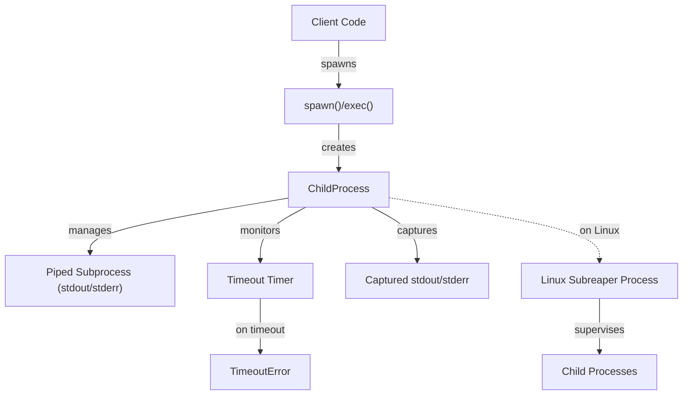
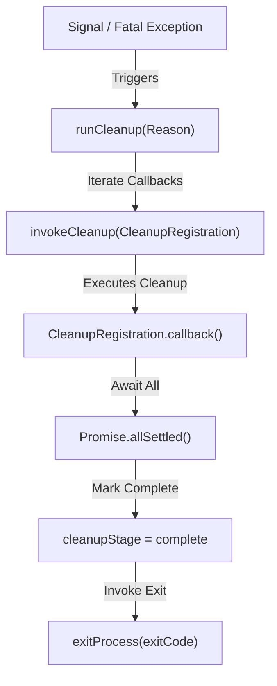
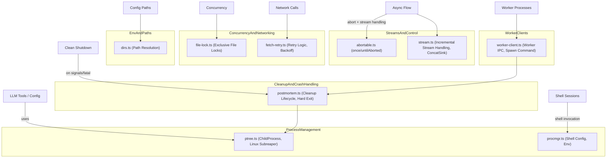

<!-- source: DeepWiki mcp.deepwiki.com · repo can1357/oh-my-pi · page 13.3 Shared Utilities and Diagnostics · fetched 2026-10-30 -->

# Shared Utilities and Diagnostics

Relevant source files

The following files were used as context for generating this wiki page:

- [packages/ai/src/auth-gateway/types.ts](packages/ai/src/auth-gateway/types.ts)
- [packages/ai/src/error/body-error.ts](packages/ai/src/error/body-error.ts)
- [packages/ai/src/error/classes.ts](packages/ai/src/error/classes.ts)
- [packages/ai/src/error/index.ts](packages/ai/src/error/index.ts)
- [packages/ai/src/error/network-cause.ts](packages/ai/src/error/network-cause.ts)
- [packages/ai/src/providers/anthropic-client.ts](packages/ai/src/providers/anthropic-client.ts)
- [packages/ai/src/providers/anthropic-messages-server-schema.ts](packages/ai/src/providers/anthropic-messages-server-schema.ts)
- [packages/ai/src/providers/anthropic-messages-server.ts](packages/ai/src/providers/anthropic-messages-server.ts)
- [packages/ai/src/providers/anthropic-wire.ts](packages/ai/src/providers/anthropic-wire.ts)
- [packages/ai/src/providers/openai-chat-server-schema.ts](packages/ai/src/providers/openai-chat-server-schema.ts)
- [packages/ai/src/providers/openai-chat-server.ts](packages/ai/src/providers/openai-chat-server.ts)
- [packages/ai/src/providers/openai-responses-server-schema.ts](packages/ai/src/providers/openai-responses-server-schema.ts)
- [packages/ai/src/providers/openai-responses-server.ts](packages/ai/src/providers/openai-responses-server.ts)
- [packages/ai/src/utils/openai-http.ts](packages/ai/src/utils/openai-http.ts)
- [packages/ai/test/anthropic-client.test.ts](packages/ai/test/anthropic-client.test.ts)
- [packages/ai/test/anthropic-stream-timeout.test.ts](packages/ai/test/anthropic-stream-timeout.test.ts)
- [packages/ai/test/auth-gateway-anthropic-messages.test.ts](packages/ai/test/auth-gateway-anthropic-messages.test.ts)
- [packages/ai/test/auth-gateway-openai-chat.test.ts](packages/ai/test/auth-gateway-openai-chat.test.ts)
- [packages/ai/test/auth-gateway-openai-responses.test.ts](packages/ai/test/auth-gateway-openai-responses.test.ts)
- [packages/ai/test/error-body-rate-limit.test.ts](packages/ai/test/error-body-rate-limit.test.ts)
- [packages/ai/test/network-cause.test.ts](packages/ai/test/network-cause.test.ts)
- [packages/coding-agent/src/config/resolve-config-value.ts](packages/coding-agent/src/config/resolve-config-value.ts)
- [packages/coding-agent/test/cli-unsettled-command.test.ts](packages/coding-agent/test/cli-unsettled-command.test.ts)
- [packages/coding-agent/test/config-value-fd-inheritance.test.ts](packages/coding-agent/test/config-value-fd-inheritance.test.ts)
- [packages/coding-agent/test/extension-prepared-rebind.test.ts](packages/coding-agent/test/extension-prepared-rebind.test.ts)
- [packages/coding-agent/test/issue-9158-repro.test.ts](packages/coding-agent/test/issue-9158-repro.test.ts)
- [packages/coding-agent/test/status-line-dispose-async-leak.test.ts](packages/coding-agent/test/status-line-dispose-async-leak.test.ts)
- [packages/coding-agent/test/status-line-pr-lookup-timeout.test.ts](packages/coding-agent/test/status-line-pr-lookup-timeout.test.ts)
- [packages/coding-agent/test/storage-exit-lifecycle.test.ts](packages/coding-agent/test/storage-exit-lifecycle.test.ts)
- [packages/collab-web/CHANGELOG.md](packages/collab-web/CHANGELOG.md)
- [packages/tui/test/terminal-disconnect-raw-mode-throw.test.ts](packages/tui/test/terminal-disconnect-raw-mode-throw.test.ts)
- [packages/utils/CHANGELOG.md](packages/utils/CHANGELOG.md)
- [packages/utils/src/abortable.ts](packages/utils/src/abortable.ts)
- [packages/utils/src/postmortem.ts](packages/utils/src/postmortem.ts)
- [packages/utils/src/ptree.ts](packages/utils/src/ptree.ts)
- [packages/utils/src/stream.ts](packages/utils/src/stream.ts)
- [packages/utils/test/fixtures/ptree-dead-root-probe.ts](packages/utils/test/fixtures/ptree-dead-root-probe.ts)
- [packages/utils/test/fixtures/ptree-timeout-probe.ts](packages/utils/test/fixtures/ptree-timeout-probe.ts)
- [packages/utils/test/postmortem-cleanup-error.test.ts](packages/utils/test/postmortem-cleanup-error.test.ts)
- [packages/utils/test/postmortem-epipe.test.ts](packages/utils/test/postmortem-epipe.test.ts)
- [packages/utils/test/ptree-stderr.test.ts](packages/utils/test/ptree-stderr.test.ts)
- [packages/utils/test/ptree-timeout.test.ts](packages/utils/test/ptree-timeout.test.ts)
- [packages/utils/test/stream.test.ts](packages/utils/test/stream.test.ts)

This page documents the foundational core utilities located in `packages/utils` (`@oh-my-pi/pi-utils`), which provide robust primitive services across the entire `oh-my-pi` monorepo. These modules handle process lifecycle management, cross-platform subprocess tree supervision, structured crash reporting, resilient networking, asynchronous stream processing, concurrency controls, directory resolution, and diagnostics [packages/utils/src/index.ts:1-43]().

---

## 1. Process Tree Management and Supervision (`ptree.ts`, `procmgr.ts`)

The `ptree` and `procmgr` modules provide cross-platform child process lifecycle management, output stream draining, shell resolution, process group termination, and signal handling for Bun subprocesses [packages/utils/src/ptree.ts:1-209](), [packages/utils/src/procmgr.ts:1-187]().

### Subprocess Lifecycle (`ChildProcess`)

Subprocesses are wrapped by the `ChildProcess` class [packages/utils/src/ptree.ts:175-207](), which manages stdout and stderr piped streams, stderr tail buffering for diagnostics, and enforces timeout deadlines. It internally buffers stderr chunks and drains output streams to avoid pipe deadlocks.

On Linux platforms, `ptree` can spawn a child subreaper process using an embedded dynamic-linking script (`createLinuxSubreaperScript`) that utilizes `dlopen` to link libc's `prctl` and `waitpid` functions to become a subreaper [packages/utils/src/ptree.ts:29-94](). This design helps ensure orphaned descendant processes are reaped properly when the supervisor exits, avoiding lingering zombie or runaway processes. The subreaper runs the supervised command, relays stdout/stderr back to its parent, waits on child processes, and only exits after all descendants have cleared [packages/utils/src/ptree.ts:29-94]().

#### Exceptions

The `ptree` module defines an error hierarchy for child process termination:
- `Exception`: Abstract base for exit-related errors, contains `exitCode` and stderr tail [packages/utils/src/ptree.ts:103-113]().
- `NonZeroExitError`: Raised for processes that exit with a nonzero exit code [packages/utils/src/ptree.ts:116-125]().
- `AbortError`: Raised when a process is explicitly aborted via a signal or cancellation [packages/utils/src/ptree.ts:128-139]().
- `TimeoutError`: Subclass of `AbortError` representing execution timeout expiry [packages/utils/src/ptree.ts:142-146]().

### Child Process Lifecycle and Timeout Handling Flow

*Figure 1: Natural Language to Code Entity mapping for process supervision, timeouts, and subreaper lifecycle in `ptree.ts`.*

Sources: [packages/utils/src/ptree.ts:1-209](), [packages/utils/src/ptree.ts:29-94]()

---

### Shell Configuration and Resolution (`procmgr.ts`)

The `procmgr` module handles shell environment preparation, argument parsing, and cross-platform shell binary discovery [packages/utils/src/procmgr.ts:1-187]().

Key features include:
- **Shell Args Resolution:** Returns appropriate argument arrays (`-c` vs `/c`, `-NoLogo -Command`, etc.) depending on whether the shell is POSIX, PowerShell, or cmd.exe [packages/utils/src/procmgr.ts:50-89]().
- **Windows Shell Resolution:** Detects Git Bash installations, Scoop-managed git bash, or falls back to `cmd.exe` using environment variables and well-known install paths [packages/utils/src/procmgr.ts:160-184]().
- **Cached Child Shell Environment:** Captures a sanitized child-shell environment for subprocess spawning, filtering out untrusted or unwanted environment variables [packages/utils/src/procmgr.ts:28-55]().
- **ShellConfig Interface:** Bundles shell path, args, environment, and optional prefix for process spawning [packages/utils/src/procmgr.ts:11-16]().

Sources: [packages/utils/src/procmgr.ts:1-187]()

---

## 2. Postmortem Crash Reporting and Lifecycle Cleanup (`postmortem.ts`)

The `postmortem` module provides a comprehensive cleanup and shutdown handler system for the agent process to reliably release resources on exit or fatal signals [packages/utils/src/postmortem.ts:1-121]().

### Cleanup Registration and Execution

- Cleanup callbacks are registered with `postmortem.register()`, each identified by a unique ID and optional `exitOnly` flag [packages/utils/src/postmortem.ts:26-32]().
- The system tracks cleanup runs in passes to prevent double invocation using the `Reason` enumeration (`EXIT`, `SIGINT`, `SIGTERM`, `UNCAUGHT_EXCEPTION`, etc.) [packages/utils/src/postmortem.ts:15-24]().
- On process exit signals or fatal exceptions, `runCleanup()` is invoked sequentially and asynchronously to execute registered callbacks [packages/utils/src/postmortem.ts:136-161]().
- `keepAlive` passes allow manual cleanup sequences without exiting the process, preserving registrations for later real exits [packages/utils/src/postmortem.ts:136-161]().

### Hard Exit with Native Process Exit

To reliably terminate the process even when extensions or instrumentations override `process.exit()`, the code searches for the native exit function underneath any guards via the `NATIVE_PROCESS_EXIT` symbol stamping [packages/utils/src/postmortem.ts:56-78](). `exitProcess()` invokes the native exit with fallbacks (`process.kill` with `SIGKILL`) and flushes buffered logs before exiting [packages/utils/src/postmortem.ts:105-121]().

### Cleanup Execution Lifecycle Diagram

*Figure 2: Natural Language Space to Code Entity Space mapping for the `postmortem` cleanup execution lifecycle.*

Sources: [packages/utils/src/postmortem.ts:1-121]()

---

## 3. Asynchronous Streams and Abort Handling (`abortable.ts`, `stream.ts`)

The utilities package offers lightweight, composable helpers for asynchronous cancellation and streaming data handling:

- `abortable.ts` exports `once(signal)` and `untilAborted(signal, fn)` to inject cancellation into async loops or event sequences [packages/utils/src/abortable.ts]().
- `stream.ts` provides utilities such as `readLines` and `readJsonl` for incremental stream parsing backed by `ConcatSink` [packages/utils/src/stream.ts:19-68]().
- `ConcatSink`: An amortized byte accumulator class that holds the unconsumed tail of a stream in a growing `Buffer`, optimizing chunked append and line/JSONL flushing operations [packages/utils/src/stream.ts:79-158]().

Sources: [packages/utils/src/stream.ts:1-229](), [packages/utils/test/stream.test.ts:1-70]()

---

## 4. File Locking and Concurrency Control (`file-lock.ts`)

To prevent data races and concurrency conflicts on shared resources (e.g., SQLite databases, session artifacts), advisory and OS-backed exclusive file locking is implemented via:
- `tryAcquireFileLock()`: Attempts to obtain an exclusive lock non-blocking.
- `acquireFileLock()`: Acquires the lock, optionally waiting or respecting abort signals.
- `FileLockHandle`: Represents an acquired lock, supporting release and ownership validation.

Sources: [packages/utils/src/index.ts:9]()

---

## 5. Resilient Networking (`fetch-retry.ts`)

Network request reliability is facilitated by `fetch-retry.ts`, which wraps native fetch requests and implements:
- Intelligent retry and fallback detection based on HTTP status codes and provider-specific error response bodies (OpenAI, Anthropic, Gemini) [packages/ai/src/providers/anthropic-client.ts:153-182]().
- Exponential backoff with jitter to avoid request stampeding.
- Merging backoff signals (user account resets combined with HTTP `Retry-After`).

Sources: [packages/utils/src/index.ts:8](), [packages/ai/src/providers/anthropic-client.ts:153-182]()

---

## 6. Directory Management and Environment Paths (`dirs.ts`, `env.ts`)

Cross-platform standardization of important data, config, cache, and runtime directories is exposed by `dirs.ts`:
- `getBaseConfigRoot()`: Profile-independent config root (`~/.omp`) for global config storage.
- `resolveProfileEnv(OMP_PROFILE, PI_PROFILE)`: Resolves the active user profile environment variable with validation.
- `normalizeProfileName()`: Validates and normalizes profile names according to platform restrictions.

Sources: [packages/utils/src/dirs.ts:62-116](), [packages/utils/src/index.ts:5]()

---

## 7. Worker Subprocesses, IPC Resilience, and Protocol Probes

Multipurpose worker subprocess clients exist for external model inference (e.g., ONNX inference subprocesses handling embeddings, speech-to-text, TTS). These clients share a minimal lifecycle scaffold defined in `worker-client.ts` [packages/coding-agent/src/subprocess/worker-client.ts:1-168]():
- Implement a minimal message protocol with worker inbound (`ping`) and outbound (`pong`, `error`, `log`) messages.
- The parent `WorkerHandle` interface enables sending typed messages, subscribing to outbound responses, and controlling termination.

Bun runtime IPC framing issues are isolated via `postmortem` handlers to prevent fatal agent crashes, faulting the worker subsystem to reject inflight requests rather than collapsing the parent session [packages/utils/test/postmortem-epipe.test.ts:28-40]().

Sources: [packages/coding-agent/src/subprocess/worker-client.ts:1-168](), [packages/utils/test/postmortem-epipe.test.ts:1-144]()

---

# Summary Diagram: Shared Utilities Bridging Natural Language Features to Code Entities

*Figure 3: Higher-level natural language features mapped to code utility modules in `packages/utils`.*

Sources: [packages/utils/src/index.ts:1-43](), [packages/utils/src/ptree.ts:1-209](), [packages/utils/src/postmortem.ts:1-121](), [packages/utils/src/procmgr.ts:1-187](), [packages/utils/src/abortable.ts](), [packages/utils/src/stream.ts:1-229](), [packages/utils/src/file-lock.ts](), [packages/utils/src/fetch-retry.ts](), [packages/utils/src/dirs.ts](), [packages/coding-agent/src/subprocess/worker-client.ts:1-168]()

---

# References

- Core utility aggregator and exports: `packages/utils/src/index.ts` [packages/utils/src/index.ts:1-43]()
- Process tree and child process supervision: `ptree.ts` [packages/utils/src/ptree.ts:1-209]()
- Shell environment and resolution logic: `procmgr.ts` [packages/utils/src/procmgr.ts:1-187]()
- Postmortem and cleanup handling: `postmortem.ts` [packages/utils/src/postmortem.ts:1-121]()
- Stream handling utilities: `stream.ts` [packages/utils/src/stream.ts:1-229]()
- Directory path helpers and environment management: `dirs.ts` [packages/utils/src/dirs.ts:62-116]()

---

