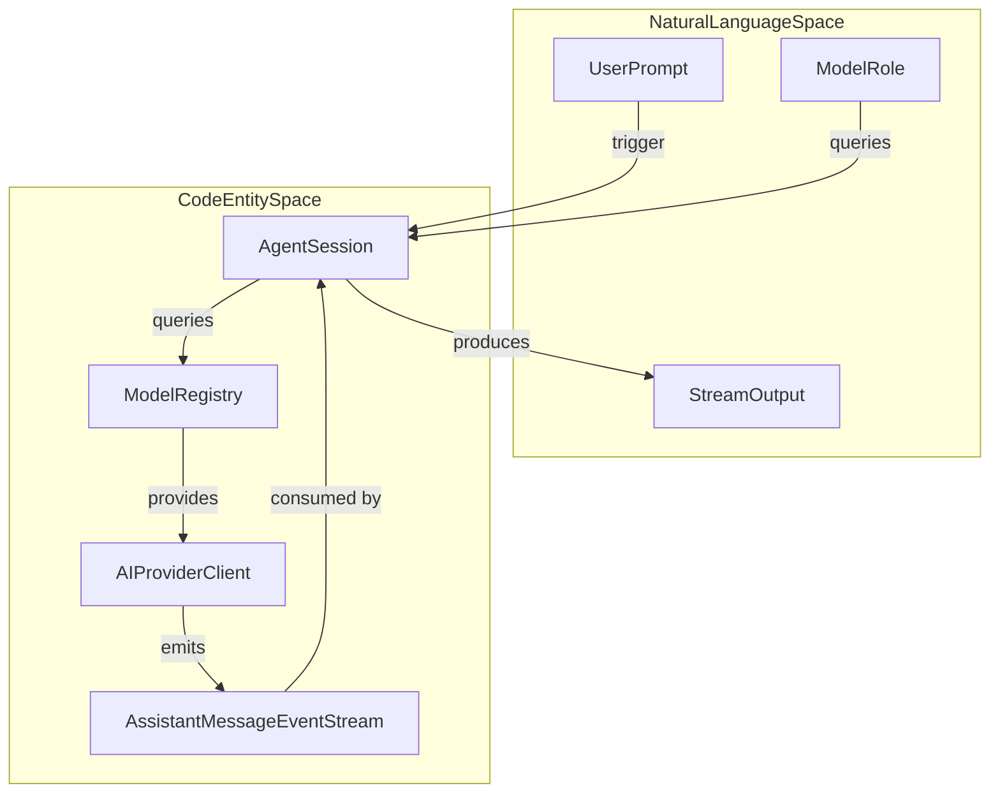
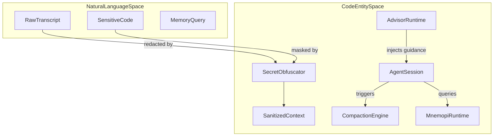

<!-- source: DeepWiki mcp.deepwiki.com · repo can1357/oh-my-pi · page 14 Glossary · fetched 2026-10-30 -->

# Glossary

Relevant source files

The following files were used as context for generating this wiki page:

- [Cargo.lock](Cargo.lock)
- [Cargo.toml](Cargo.toml)
- [bun.lock](bun.lock)
- [docs/task-agent-discovery.md](docs/task-agent-discovery.md)
- [docs/tools/task.md](docs/tools/task.md)
- [packages/agent/CHANGELOG.md](packages/agent/CHANGELOG.md)
- [packages/agent/package.json](packages/agent/package.json)
- [packages/ai/CHANGELOG.md](packages/ai/CHANGELOG.md)
- [packages/ai/package.json](packages/ai/package.json)
- [packages/ai/src/registry/registry.ts](packages/ai/src/registry/registry.ts)
- [packages/catalog/CHANGELOG.md](packages/catalog/CHANGELOG.md)
- [packages/catalog/scripts/generate-models.ts](packages/catalog/scripts/generate-models.ts)
- [packages/catalog/scripts/generated-policies.ts](packages/catalog/scripts/generated-policies.ts)
- [packages/catalog/src/compat/axes.ts](packages/catalog/src/compat/axes.ts)
- [packages/catalog/src/compat/resolve.ts](packages/catalog/src/compat/resolve.ts)
- [packages/catalog/src/compat/rules.json](packages/catalog/src/compat/rules.json)
- [packages/catalog/src/compat/rules/classes/anthropic.kdl](packages/catalog/src/compat/rules/classes/anthropic.kdl)
- [packages/catalog/src/compat/rules/classes/openai.kdl](packages/catalog/src/compat/rules/classes/openai.kdl)
- [packages/catalog/src/model-thinking.ts](packages/catalog/src/model-thinking.ts)
- [packages/catalog/src/models.json](packages/catalog/src/models.json)
- [packages/catalog/src/provider-models/descriptors.ts](packages/catalog/src/provider-models/descriptors.ts)
- [packages/catalog/src/provider-models/openai-compat.ts](packages/catalog/src/provider-models/openai-compat.ts)
- [packages/catalog/src/types.ts](packages/catalog/src/types.ts)
- [packages/catalog/test/generated-policies.test.ts](packages/catalog/test/generated-policies.test.ts)
- [packages/catalog/test/model-thinking.test.ts](packages/catalog/test/model-thinking.test.ts)
- [packages/coding-agent/CHANGELOG.md](packages/coding-agent/CHANGELOG.md)
- [packages/coding-agent/DEVELOPMENT.md](packages/coding-agent/DEVELOPMENT.md)
- [packages/coding-agent/package.json](packages/coding-agent/package.json)
- [packages/coding-agent/src/prompts/tools/task.md](packages/coding-agent/src/prompts/tools/task.md)
- [packages/coding-agent/src/sdk.ts](packages/coding-agent/src/sdk.ts)
- [packages/coding-agent/src/session/agent-session.ts](packages/coding-agent/src/session/agent-session.ts)
- [packages/coding-agent/src/session/session-entries.ts](packages/coding-agent/src/session/session-entries.ts)
- [packages/coding-agent/src/task/executor.ts](packages/coding-agent/src/task/executor.ts)
- [packages/coding-agent/src/task/index.ts](packages/coding-agent/src/task/index.ts)
- [packages/coding-agent/src/task/persisted-revive.ts](packages/coding-agent/src/task/persisted-revive.ts)
- [packages/coding-agent/src/task/structured-subagent.ts](packages/coding-agent/src/task/structured-subagent.ts)
- [packages/coding-agent/src/task/types.ts](packages/coding-agent/src/task/types.ts)
- [packages/coding-agent/src/tools/index.ts](packages/coding-agent/src/tools/index.ts)
- [packages/coding-agent/test/agent-session-prompt-dispatch-race.test.ts](packages/coding-agent/test/agent-session-prompt-dispatch-race.test.ts)
- [packages/coding-agent/test/sdk-workpool-yield-schema.test.ts](packages/coding-agent/test/sdk-workpool-yield-schema.test.ts)
- [packages/coding-agent/test/task/autoload-skills.test.ts](packages/coding-agent/test/task/autoload-skills.test.ts)
- [packages/coding-agent/test/task/executor-async-quiescence.test.ts](packages/coding-agent/test/task/executor-async-quiescence.test.ts)
- [packages/coding-agent/test/task/executor-launch-startup.test.ts](packages/coding-agent/test/task/executor-launch-startup.test.ts)
- [packages/coding-agent/test/task/executor-pass-through.test.ts](packages/coding-agent/test/task/executor-pass-through.test.ts)
- [packages/coding-agent/test/task/executor-prewalk.test.ts](packages/coding-agent/test/task/executor-prewalk.test.ts)
- [packages/coding-agent/test/task/executor-recent-output.test.ts](packages/coding-agent/test/task/executor-recent-output.test.ts)
- [packages/coding-agent/test/task/executor-soft-budget.test.ts](packages/coding-agent/test/task/executor-soft-budget.test.ts)
- [packages/coding-agent/test/task/executor-subagent-reminders.test.ts](packages/coding-agent/test/task/executor-subagent-reminders.test.ts)
- [packages/coding-agent/test/task/executor-wall-clock.test.ts](packages/coding-agent/test/task/executor-wall-clock.test.ts)
- [packages/coding-agent/test/task/executor-yield-loop.test.ts](packages/coding-agent/test/task/executor-yield-loop.test.ts)
- [packages/coding-agent/test/task/persisted-revive.test.ts](packages/coding-agent/test/task/persisted-revive.test.ts)
- [packages/coding-agent/test/task/structured-subagent.test.ts](packages/coding-agent/test/task/structured-subagent.test.ts)
- [packages/coding-agent/test/task/subagent-lsp.test.ts](packages/coding-agent/test/task/subagent-lsp.test.ts)
- [packages/coding-agent/test/task/task-batch.test.ts](packages/coding-agent/test/task/task-batch.test.ts)
- [packages/coding-agent/test/task/task-guards.test.ts](packages/coding-agent/test/task/task-guards.test.ts)
- [packages/coding-agent/test/task/task-schema.test.ts](packages/coding-agent/test/task/task-schema.test.ts)
- [packages/coding-agent/test/task/wire-schema.test.ts](packages/coding-agent/test/task/wire-schema.test.ts)
- [packages/coding-agent/test/tools/index.test.ts](packages/coding-agent/test/tools/index.test.ts)
- [packages/coding-agent/test/tools/schema-validation.test.ts](packages/coding-agent/test/tools/schema-validation.test.ts)
- [packages/natives/package.json](packages/natives/package.json)
- [packages/stats/package.json](packages/stats/package.json)
- [packages/tui/CHANGELOG.md](packages/tui/CHANGELOG.md)
- [packages/tui/package.json](packages/tui/package.json)
- [packages/tui/src/terminal-multiplexer.ts](packages/tui/src/terminal-multiplexer.ts)
- [packages/tui/src/tui.ts](packages/tui/src/tui.ts)
- [packages/tui/test/helpers/terminal-multiplexer.ts](packages/tui/test/helpers/terminal-multiplexer.ts)
- [packages/tui/test/overlay-scroll.test.ts](packages/tui/test/overlay-scroll.test.ts)
- [packages/tui/test/resize-multiplexer-anchor.test.ts](packages/tui/test/resize-multiplexer-anchor.test.ts)
- [packages/tui/test/resize-preserved-clear.test.ts](packages/tui/test/resize-preserved-clear.test.ts)
- [packages/utils/package.json](packages/utils/package.json)

## Purpose and Scope

This page defines codebase-specific terms, jargon, abbreviations, and domain concepts used throughout the **oh-my-pi** (`omp`) project. It serves as a comprehensive technical reference for onboarding engineers to map conceptual terminology to underlying implementations spread across TypeScript and Rust packages.

Sources: `packages/coding-agent/src/session/agent-session.ts:1-176`

---

## Core Architectural Terms

### AgentSession
The **AgentSession** is the primary state container managing the complete lifecycle of an AI coding assistant interaction. It is shared among all execution modes: interactive TUI, print, and RPC modes.

- **Responsibilities**:
  - Manages agent state, conversation history, and tool call orchestration.
  - Handles event subscriptions with automatic session persistence and replay.
  - Controls model selection, thinking levels, and context compaction.
  - Supports session branching, resumption, and manual saving.
  - Runs bash processes on behalf of the agent.
- **Implementation**:  
  Defined in TypeScript at `packages/coding-agent/src/session/agent-session.ts` [packages/coding-agent/src/session/agent-session.ts:1-176]()  
  The class encapsulates state management, compaction, model resolution, and integrates with extensibility hooks.

Sources: `packages/coding-agent/src/session/agent-session.ts:1-176`

### hashline
**hashline** is a file editing mode that uses stable line addressing by hashing each line's content. This approach prevents accidental editing of lines whose content has changed, avoiding merge drift and enabling safer parallel editing.

- **Key features**:
  - Computes a cryptographic hash for each line.
  - Edit operations are anchored to specific hashes, not line numbers.
  - Rejects edits if the current line hash differs from the expected.
- **Implementation**:  
  Implemented primarily in Rust within the `pi-edit` crate, exposed to TypeScript as the core engine for the `edit` tool.  
  Reference: `packages/coding-agent/src/edit/store.ts:1-18`()

Sources: `packages/coding-agent/src/edit/store.ts:1-18`

### compaction
**Compaction** refers to the process of summarizing or pruning conversation history to reduce the token count when approaching model context window limits. This ensures efficient use of the token budget while preserving relevant context.

- **Mechanisms**:
  - Auto- and manual compaction triggers.
  - Native (provider-supported) compaction.
  - Remote compaction fallback.
  - Uses token threshold summary ratio (TTSR) heuristics.
- **Implementation**:  
  Core compaction logic and data structures are in `packages/agent/src/compaction.ts` [packages/agent/src/compaction.ts:1]().  
  Related snapshot compaction ("snapcompact") design is implemented separately.

Sources: `packages/agent/src/compaction.ts:1-40`

### TTSR (Token Threshold Summary Ratio)
**TTSR** is a configurable ratio that determines when conversation context compaction or promotion should trigger automatically, relative to the model's maximum context window.

- Typical usage triggers compaction when token usage exceeds a fraction of the limit.
- Allows for tuned trade-offs between latency and context freshness.
- Implementation details are part of the agent configuration schema, for example in settings DSL [packages/coding-agent/src/config/settings-schema.ts:1-20]().

Sources: `packages/coding-agent/src/config/settings-schema.ts:1-20`

### AssistantMessageEventStream
A unified asynchronous event stream that normalizes AI model output across providers. It streams text deltas, "thinking" blocks, tool call events, and is the foundation for real-time assistant message consumption.

- Supports multiple provider protocols (OpenAI, Anthropic, Google, etc.)
- Provides an event-driven model to the `AgentSession` and UI layers.
- Implementation is located in the AI package at `packages/ai/src/utils/event-stream.ts` [packages/ai/src/utils/event-stream.ts:1-1]().

Sources: `packages/ai/src/utils/event-stream.ts:1-1`

### TranscriptContainer
The **TranscriptContainer** is a core TUI component responsible for rendering the terminal transcript view.

- Manages:
  - Differential rendering of chat history.
  - Overlay layers on top of the transcript.
  - Cursor synchronization and viewport management.
- Interacts with `AppendOnlyContextManager` for session persistence.
- Located at `packages/coding-agent/src/modes/components/transcript-container.ts` [packages/coding-agent/src/modes/components/transcript-container.ts:1-10]().

Sources: `packages/coding-agent/src/modes/components/transcript-container.ts:1-10`

### SecretObfuscator
A secure pipeline component that detects, redacts, and replaces sensitive strings (API keys, credentials) in the conversation context before shared export or session sharing.

- Ensures no secret leaks during HTML exports, session sharing, or logs.
- Restores secrets securely during tool call execution.
- Implemented in `packages/coding-agent/src/secrets/obfuscator.ts` [packages/coding-agent/src/secrets/obfuscator.ts:62-62]().

Sources: `packages/coding-agent/src/secrets/obfuscator.ts:62-62`

### AdvisorRuntime
An autonomous guidance subsystem integrated with `AgentSession` that provides:

- Background monitoring of transcript costs and resource loads.
- Watchdog event generation analyzing session health and advising behaviors.
- Injection of proactive optimization advice, retries, or steering guards.

This subsystem enhances session robustness and user efficiency.

Sources: `packages/coding-agent/src/session/agent-session.ts:99-100`

### TurnRecovery
A robust retry and fallback mechanism for agent turns that:

- Classifies errors as retryable or not (rate limits, transient failures).
- Applies exponential backoff and fallback chain transitions.
- Guards against infinite wait loops (empty stops, thinking-loops).
- Implemented in the session retry/fallback layers [packages/coding-agent/src/sdk.ts:174-175]().

Sources: `packages/coding-agent/src/sdk.ts:174-175`

---

## Protocols & Operational Modes

### ACP (Agent Client Protocol)
ACP is a binary protocol designed to embed and control agent sessions from client editors or IDEs with low latency and strict permission bridging.

- Used for editor integrations and permission-hardened IPC.
- Implementation at `packages/coding-agent/src/modes/acp/acp-agent.ts` [packages/coding-agent/src/modes/acp/acp-agent.ts:1-1]().

Sources: `packages/coding-agent/src/modes/acp/acp-agent.ts:1-1`

### RPC (Remote Procedure Call)
A JSON-based protocol providing headless agent control, including request/response and streaming events.

- Used by IDE extensions, bots (e.g., robomp), and remote scripting.
- Implemented at `packages/coding-agent/src/modes/rpc/rpc-mode.ts` [packages/coding-agent/src/modes/rpc/rpc-mode.ts:1-1]().

Sources: `packages/coding-agent/src/modes/rpc/rpc-mode.ts:1-1`

### MCP (Model Context Protocol)
An open protocol facilitating AI model connections to external tools and data sources via stdio, HTTP, or SSE.

- Supports tool bridging with fine-grained control and OAuth discovery.
- Managed by `MCPManager` for lifecycle and tool bridge integration.
- Located approximately at `packages/coding-agent/src/sdk.ts` [packages/coding-agent/src/sdk.ts:137-137]().

Sources: `packages/coding-agent/src/sdk.ts:137-137`

---

## Native Performance Layer Components

### pi-iso
Rust crate providing cross-platform filesystem isolation, including:

- Worktree clones.
- FUSE overlays.
- APFS snapshot-based isolation.

Enables spawning subagents with sanitized filesystem views to prevent side-effects.

Sources: `packages/coding-agent/src/task/executor.ts:1-20`

### pi-natives
Rust N-API library implementing native text processing, OS bindings, and VCS operations:

- grep, glob, fd, diff and similar tools.
- Git bindings, platform API integrations.
- Shared via N-API to TypeScript runtime.

Sources: `packages/natives/package.json:1-20`

### pi-shell
Rust bindings and internal implementation for embedded shell execution:

- PTY management.
- Job control, process lifecycle.
- Seamless streaming output integration.

Sources: `packages/natives/package.json:1-20`

### pi-edit
Rust crate implementing editing modes integrated with agent tools:

- Hashline mode with stable line hashes for incremental edits.
- Patch and replace textual editing.
- AST-aware edits via tree-sitter.

References the editing logic that enables safe source modification in interactive sessions.

Sources: `packages/coding-agent/src/edit/store.ts:1-18`

---

## Advanced Packages and Tools

### omptype
A high-performance schema validation library designed for fast and compact data validation as a substitute for heavier tools like zod.

Sources: `packages/omptype/package.json:1-10`

### mnemopi
An autonomous memory system with embedding vector stores supporting long-term session memory, recall, and consolidation.

Sources: `packages/mnemopi/package.json:1-10`

### metaharness
Benchmark orchestration and testing harness powered by SQLite and React UI for agent performance evaluation.

Sources: `packages/metaharness/package.json:1-10`

### snapcompact
Snapshot-based structural conversation compaction engine designed for concise, consistent conversation state pruning while preserving replayability.

Sources: `packages/snapcompact/src/snapcompact.ts:1-1`

---

## Internal System URL Scheme: xdev / resolve devices

The system uses a special internal protocol scheme `xd://` for virtual URLs identifying devices, embedded resources, and specialized data nodes such as:

- Browser and browser-relay nodes.
- Embedding stores (mnemopi).
- Image question answering endpoints.

This abstraction enables uniform tooling interfaces for heterogeneous resources.

Sources: `packages/coding-agent/src/internal-urls.ts:1-10`

---

## Natural Language to Code Entity Mapping Diagrams

### AI Model Integration Pipeline

Sources: `packages/coding-agent/src/session/agent-session.ts:1-176`, `packages/coding-agent/src/config/model-registry.ts:1-1`, `packages/ai/src/utils/event-stream.ts:1-1`

---

### Advanced Subsystems and Autonomous Components

Sources: `packages/coding-agent/src/secrets/obfuscator.ts:62-62`, `packages/agent/src/compaction.ts:1-40`, `packages/coding-agent/src/advisor/runtime.ts:1-1`

---

## Comprehensive Glossary Table

| Term | Definition | Code Location / Pointer |
|---|---|---|
| **ACP** | Agent Client Protocol for embedding agent communication in editors with low-latency IPC. | [packages/coding-agent/src/modes/acp/acp-agent.ts:1-1]() |
| **AdvisorRuntime** | Background autonomous guidance, cost tracking, and watchdogs for sessions. | [packages/coding-agent/src/advisor/runtime.ts:1-1]() |
| **AgentSession** | Core class managing agent state, conversation, compaction, and tool orchestration. | [packages/coding-agent/src/session/agent-session.ts:1-176]() |
| **AssistantMessageEventStream** | Unified asynchronous event stream normalizing AI model output events. | [packages/ai/src/utils/event-stream.ts:1-1]() |
| **Compaction** | Conversation summarization/pruning to respect token context limits. | [packages/agent/src/compaction.ts:1]() |
| **hashline** | Stable line addressing edit mode using line content hashes to prevent drift. | [packages/coding-agent/src/edit/store.ts:1-18]() |
| **MCP** | Model Context Protocol enabling AI tool bridging over stdio/HTTP/SSE. | [packages/coding-agent/src/mcp/manager.ts:1-10]() |
| **Metaharness** | Benchmark orchestration and agent performance evaluation framework. | [packages/metaharness/package.json:1-10]() |
| **Mnemopi** | Autonomous session memory system with embedding vectors and recall capabilities. | [packages/mnemopi/package.json:1-10]() |
| **Model Registry** | Configuration registry mapping logical model roles to provider implementations. | [packages/coding-agent/src/config/model-registry.ts:1-1]() |
| **omptype** | Fast and compact schema validation library for structured data. | [packages/omptype/package.json:1-10]() |
| **pi-iso** | Filesystem isolation crate for sandboxed agent subexecutions. | [packages/coding-agent/src/task/executor.ts:1-20]() |
| **pi-natives** | Rust N-API native extensions delivering shell, OS, and text processing capabilities. | [packages/natives/package.json:1-20]() |
| **pi-shell** | Shell execution and PTY management implementation via Rust N-API. | [packages/natives/package.json:1-20]() |
| **pi-edit** | Source code editing modes with hashline validation and AST integration. | [packages/coding-agent/src/edit/store.ts:1-18]() |
| **ProviderInFlightLease** | Synchronization and quota management for concurrent AI requests and credential rotation. | [packages/ai/CHANGELOG.md:7-8]() |
| **RetryFallbackChains** | Error classification, retries with backoff, and provider fallback chaining for robustness. | [packages/coding-agent/src/sdk.ts:174-175]() |
| **RPC** | JSON-based remote procedure call protocol enabling agent control and event streaming. | [packages/coding-agent/src/modes/rpc/rpc-mode.ts:1-1]() |
| **SecretObfuscator** | Security pipeline redacting secrets in shared session exports and logs. | [packages/coding-agent/src/secrets/obfuscator.ts:62-62]() |
| **Snapcompact** | Snapshot-based conversation compaction engine for efficient token budget usage. | [packages/snapcompact/src/snapcompact.ts:1-1]() |
| **TranscriptContainer** | Terminal UI component rendering the interactive transcript and overlays. | [packages/coding-agent/src/modes/components/transcript-container.ts:1-10]() |
| **TTSR** | Token Threshold Summary Ratio controlling auto-compaction thresholds. | [packages/coding-agent/src/config/settings-schema.ts:1-20]() |
| **xdev / resolve devices** | Internal virtual URL scheme `xd://` for device, embedding and resource routing. | [packages/coding-agent/src/internal-urls.ts:1-10]() |

Sources:  
`packages/coding-agent/src/session/agent-session.ts:1-176`  
`packages/coding-agent/src/edit/store.ts:1-18`  
`packages/agent/src/compaction.ts:1-40`  
`packages/coding-agent/src/config/settings-schema.ts:1-20`  
`packages/ai/src/utils/event-stream.ts:1-1`  
`packages/coding-agent/src/modes/components/transcript-container.ts:1-10`  
`packages/coding-agent/src/secrets/obfuscator.ts:62-62`  
`packages/coding-agent/src/advisor/runtime.ts:1-1`  
`packages/coding-agent/src/sdk.ts:174-175`  
`packages/coding-agent/src/modes/acp/acp-agent.ts:1-1`  
`packages/coding-agent/src/modes/rpc/rpc-mode.ts:1-1`  
`packages/coding-agent/src/mcp/manager.ts:1-10`  
`packages/metaharness/package.json:1-10`  
`packages/mnemopi/package.json:1-10`  
`packages/omptype/package.json:1-10`  
`packages/coding-agent/src/task/executor.ts:1-20`  
`packages/natives/package.json:1-20`  
`packages/coding-agent/src/internal-urls.ts:1-10`