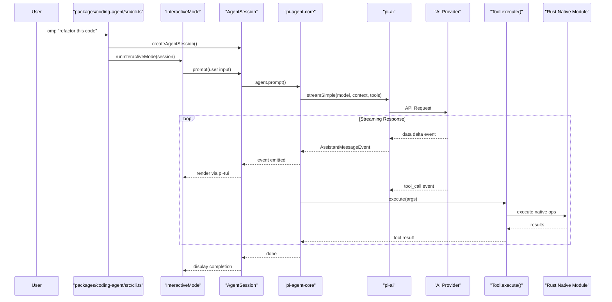
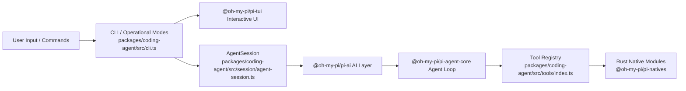

<!-- source: DeepWiki mcp.deepwiki.com · repo can1357/oh-my-pi · page 2 Architecture · fetched 2026-10-30 -->

# Architecture

Relevant source files

The following files were used as context for generating this wiki page:

- [Cargo.lock](Cargo.lock)
- [Cargo.toml](Cargo.toml)
- [bun.lock](bun.lock)
- [docs/task-agent-discovery.md](docs/task-agent-discovery.md)
- [docs/tools/task.md](docs/tools/task.md)
- [packages/agent/package.json](packages/agent/package.json)
- [packages/ai/package.json](packages/ai/package.json)
- [packages/coding-agent/DEVELOPMENT.md](packages/coding-agent/DEVELOPMENT.md)
- [packages/coding-agent/package.json](packages/coding-agent/package.json)
- [packages/coding-agent/src/prompts/tools/task.md](packages/coding-agent/src/prompts/tools/task.md)
- [packages/coding-agent/src/sdk.ts](packages/coding-agent/src/sdk.ts)
- [packages/coding-agent/src/session/agent-session.ts](packages/coding-agent/src/session/agent-session.ts)
- [packages/coding-agent/src/session/session-entries.ts](packages/coding-agent/src/session/session-entries.ts)
- [packages/coding-agent/src/task/executor.ts](packages/coding-agent/src/task/executor.ts)
- [packages/coding-agent/src/task/index.ts](packages/coding-agent/src/task/index.ts)
- [packages/coding-agent/src/task/persisted-revive.ts](packages/coding-agent/src/task/persisted-revive.ts)
- [packages/coding-agent/src/task/structured-subagent.ts](packages/coding-agent/src/task/structured-subagent.ts)
- [packages/coding-agent/src/task/types.ts](packages/coding-agent/src/task/types.ts)
- [packages/coding-agent/src/tools/index.ts](packages/coding-agent/src/tools/index.ts)
- [packages/coding-agent/test/agent-session-prompt-dispatch-race.test.ts](packages/coding-agent/test/agent-session-prompt-dispatch-race.test.ts)
- [packages/coding-agent/test/sdk-workpool-yield-schema.test.ts](packages/coding-agent/test/sdk-workpool-yield-schema.test.ts)
- [packages/coding-agent/test/task/autoload-skills.test.ts](packages/coding-agent/test/task/autoload-skills.test.ts)
- [packages/coding-agent/test/task/executor-async-quiescence.test.ts](packages/coding-agent/test/task/executor-async-quiescence.test.ts)
- [packages/coding-agent/test/task/executor-launch-startup.test.ts](packages/coding-agent/test/task/executor-launch-startup.test.ts)
- [packages/coding-agent/test/task/executor-pass-through.test.ts](packages/coding-agent/test/task/executor-pass-through.test.ts)
- [packages/coding-agent/test/task/executor-prewalk.test.ts](packages/coding-agent/test/task/executor-prewalk.test.ts)
- [packages/coding-agent/test/task/executor-recent-output.test.ts](packages/coding-agent/test/task/executor-recent-output.test.ts)
- [packages/coding-agent/test/task/executor-soft-budget.test.ts](packages/coding-agent/test/task/executor-soft-budget.test.ts)
- [packages/coding-agent/test/task/executor-subagent-reminders.test.ts](packages/coding-agent/test/task/executor-subagent-reminders.test.ts)
- [packages/coding-agent/test/task/executor-wall-clock.test.ts](packages/coding-agent/test/task/executor-wall-clock.test.ts)
- [packages/coding-agent/test/task/executor-yield-loop.test.ts](packages/coding-agent/test/task/executor-yield-loop.test.ts)
- [packages/coding-agent/test/task/persisted-revive.test.ts](packages/coding-agent/test/task/persisted-revive.test.ts)
- [packages/coding-agent/test/task/structured-subagent.test.ts](packages/coding-agent/test/task/structured-subagent.test.ts)
- [packages/coding-agent/test/task/subagent-lsp.test.ts](packages/coding-agent/test/task/subagent-lsp.test.ts)
- [packages/coding-agent/test/task/task-batch.test.ts](packages/coding-agent/test/task/task-batch.test.ts)
- [packages/coding-agent/test/task/task-guards.test.ts](packages/coding-agent/test/task/task-guards.test.ts)
- [packages/coding-agent/test/task/task-schema.test.ts](packages/coding-agent/test/task/task-schema.test.ts)
- [packages/coding-agent/test/task/wire-schema.test.ts](packages/coding-agent/test/task/wire-schema.test.ts)
- [packages/coding-agent/test/tools/index.test.ts](packages/coding-agent/test/tools/index.test.ts)
- [packages/coding-agent/test/tools/schema-validation.test.ts](packages/coding-agent/test/tools/schema-validation.test.ts)
- [packages/natives/package.json](packages/natives/package.json)
- [packages/stats/package.json](packages/stats/package.json)
- [packages/tui/package.json](packages/tui/package.json)
- [packages/utils/package.json](packages/utils/package.json)

**Purpose and Scope**  
This page provides a high-level overview of oh-my-pi’s system architecture. It describes the layered design, explains the monorepo package organization, and summarizes how major components interact to realize the AI-powered terminal assistant for software development tasks. Detailed technical coverage of individual packages, core components, and the agent loop is found in the respective child pages: [Package Structure](#2.1), [Core Components](#2.2), and [Agent Loop (pi-agent package)](#2.3).

---

## Architectural Overview

The oh-my-pi system is structured using a **layered architecture** that promotes modularity, separation of concerns, and extensibility. Each layer builds upon the lower layers, exposing clean interfaces while delegating specialized responsibilities to dedicated packages and subsystems.

### High-Level Layers Diagram

```mermaid
graph TB
  %% Layer 5: UI & Entry Points
  subgraph "Layer 5: User Interface & Entry Points"
    CLI["omp CLI<br/>packages/coding-agent/src/cli.ts"]
    Main["Main entry<br/>parseArgs, runInteractiveMode()"]
    Interactive["Interactive Mode<br/>packages/coding-agent/src/modes/interactive.ts"]
    RPC["RPC Mode<br/>packages/coding-agent/src/modes/rpc/rpc-mode.ts"]
    ACP["ACP Mode<br/>packages/coding-agent/src/modes/acp/"]
    Print["Print Mode<br/>packages/coding-agent/src/modes/print-mode.ts"]
    Collab["Collab Mode<br/>packages/coding-agent/src/modes/collab/"]
    Editor["Editor Component TUI<br/>packages/tui/src/components/editor.ts"]
    Markdown["Markdown Renderer TUI<br/>packages/tui/src/components/markdown.ts"]
    Renderer["Terminal Renderer<br/>packages/tui/src/terminal.ts"]
  end

  %% Layer 4: Agent Session & SDK
  subgraph "Layer 4: Agent Session & SDK"
    SDK["createAgentSession()<br/>packages/coding-agent/src/sdk.ts"]
    Session["AgentSession<br/>packages/coding-agent/src/session/agent-session.ts"]
    SessionOpts["AgentSessionOptions"]
    SessionMgr["SessionManager<br/>packages/coding-agent/src/session/session-manager.ts"]
    FileStorage["Session File Storage<br/>.omp/sessions/*.jsonl"]
    ContextBuilder["buildSessionContext()"]
  end

  %% Layer 3: AI Integration
  subgraph "Layer 3: AI Integration"
    Registry["ModelRegistry<br/>packages/ai/src/registry/index.ts"]
    Catalog["@oh-my-pi/pi-catalog<br/>Model definitions and metadata"]
    DynamicDiscovery["Dynamic Model Discovery<br/>Ollama, LMStudio, vLLM"]
    StreamFn["streamSimple()<br/>packages/ai/src/index.ts"]
    EventStream["AssistantMessageEventStream"]
    Providers["Providers Layer"]
    Anthropic["Anthropic Provider<br/>providers/anthropic-messages.ts"]
    OpenAI["OpenAI Provider<br/>providers/openai-completions.ts"]
    Codex["OpenAI Codex Provider<br/>providers/openai-codex/"]
    Gemini["Google Gemini Provider<br/>providers/google-gemini.ts"]
    Bedrock["Amazon Bedrock Provider<br/>providers/amazon-bedrock.ts"]
    NativeTransport["Native Transport<br/>Auth-Gateway routing"]
  end

  %% Layer 2: Tool Execution
  subgraph "Layer 2: Tool Execution"
    CreateTools["createTools()<br/>packages/coding-agent/src/tools/index.ts"]
    ToolRegistry["Tool Registry"]
    BuiltinTools["Built-in Tools"]
    ReadTool["read.ts"]
    WriteTool["write.ts"]
    EditTool["edit/index.ts"]
    BashTool["bash/index.ts"]
    PythonTool["ipy/kernel.ts"]
    TaskTool["task/index.ts"]
    HubTool["hub.ts"]
    MnemopiTool["memory tool mnemopi"]
    ExtensionTools["Extension & MCP Tools"]
    MCPClient["mcp/client.ts"]
    Extensions["extensions/"]
  end

  %% Layer 1: Native Performance
  subgraph "Layer 1: Native Performance"
    NAPIBridge["@oh-my-pi/pi-natives<br/>packages/natives/native/index.js"]
    LoadNative["loadNativeModule()"]
    RustLib["Rust Implementations<br/>crates/pi-natives/src/lib.rs"]
    Shell["shell.rs brush-core wrapper"]
    AST["ast.rs tree-sitter + ast-grep"]
    Grep["grep.rs grep-searcher"]
    TextProc["text.rs ANSI processing"]
  end

  %% Arrows
  CLI --> Main
  Main --> Interactive
  Main --> RPC
  Main --> ACP
  Main --> Print
  Main --> Collab

  Interactive --> Editor
  Interactive --> Markdown
  Editor --> Renderer

  SDK --> Session
  SessionOpts --> Session
  Session --> SessionMgr
  SessionMgr --> FileStorage
  SessionMgr --> ContextBuilder

  Registry --> Catalog
  Registry --> DynamicDiscovery
  StreamFn --> Registry
  StreamFn --> EventStream
  StreamFn --> Anthropic
  StreamFn --> OpenAI
  StreamFn --> Codex
  StreamFn --> Gemini
  StreamFn --> Bedrock
  StreamFn --> NativeTransport

  CreateTools --> ToolRegistry
  ToolRegistry --> ReadTool
  ToolRegistry --> WriteTool
  ToolRegistry --> EditTool
  ToolRegistry --> BashTool
  ToolRegistry --> PythonTool
  ToolRegistry --> TaskTool
  ToolRegistry --> HubTool
  ToolRegistry --> MnemopiTool
  ToolRegistry --> MCPClient
  ToolRegistry --> Extensions

  NAPIBridge --> LoadNative
  LoadNative --> RustLib
  RustLib --> Shell
  RustLib --> AST
  RustLib --> Grep
  RustLib --> TextProc
```

Sources: [packages/coding-agent/package.json:27-32](), [packages/ai/package.json:37-60](), [packages/natives/package.json:1-10](), [packages/agent/package.json:60-78](), [packages/coding-agent/src/session/agent-session.ts:1-173](), [packages/coding-agent/src/sdk.ts:1-175]()

This layered design ensures:
- **Layer 5: User Interface & Entry Points** provides the CLI executable (`omp`), multiple operational modes (interactive TUI, RPC, ACP, print, collaborative web sessions), and terminal UI components such as multiline editor and markdown renderer [packages/coding-agent/package.json:27-29](), [packages/tui/package.json:61-108]().
- **Layer 4: Agent Session & SDK** manages agent conversation state, session persistence, context building, and session lifecycle management via `AgentSession` and `SessionManager` [packages/coding-agent/src/session/agent-session.ts:1-173](), [packages/coding-agent/src/sdk.ts:1-175]().
- **Layer 3: AI Integration** implements unified AI model abstraction with dynamic discovery and multi-provider support [packages/ai/package.json:37-60]().
- **Layer 2: Tool Execution** defines the tool creation API, registration, and built-in tools for file operations, shell execution, task delegation, memory access, and extension-driven runtime tools [packages/coding-agent/src/tools/index.ts:1-50]().
- **Layer 1: Native Performance** features native Rust libraries accessed via Node N-API bindings [packages/natives/package.json:1-10]().

---

## Package Structure Overview

The project is organized as a monorepo containing multiple TypeScript packages and native Rust crates. Inter-package dependencies flow downward from the top-level coding agent package to core utilities and native bindings.

For detailed information on the monorepo structure, individual packages, their responsibilities, and dependency relationships, see [Package Structure](#2.1).

Sources: [packages/coding-agent/package.json:1-110](), [packages/agent/package.json:37-45](), [packages/ai/package.json:151-157]()

---

## Core Components Overview

The core architectural components coordinate agent execution, model querying, and state persistence. `AgentSession` acts as the central orchestrator across run modes, while `SessionManager` handles file persistence.

For detailed information on key architectural components such as `AgentSession`, SDK layer, Tool Registry, Extension Runner, and `SessionManager`, see [Core Components](#2.2).

Sources: [packages/coding-agent/src/session/agent-session.ts:1-173](), [packages/coding-agent/src/sdk.ts:1-175]()

---

## Agent Loop Overview

The agent execution loop manages turn progression, tool scheduling, event dispatch, and compaction triggers in a transport-agnostic manner.

For detailed information on the transport-agnostic agent core in `packages/agent`, execution plans, tool-call scheduling, steering/interruption, replay policy, and compaction entry points, see [Agent Loop (pi-agent package)](#2.3).

Sources: [packages/agent/package.json:1-78](), [packages/coding-agent/src/session/agent-session.ts:1-14]()

---

## Request Flow Architecture

The following sequence diagram illustrates the flow of a user request from input through agent processing, AI calls, tool execution, and response delivery.

Sources: [packages/coding-agent/package.json:27-31](), [packages/agent/package.json:1-78](), [packages/ai/package.json:2-110](), [packages/natives/package.json:1-10](), [packages/coding-agent/src/sdk.ts:1-10](), [packages/coding-agent/src/session/agent-session.ts:1-14]()

---

## Terminology Bridge: Natural Language vs. Code Entities

Sources: [packages/coding-agent/src/session/agent-session.ts:1-173](), [packages/coding-agent/src/sdk.ts:1-175](), [packages/ai/package.json:2-110](), [packages/agent/package.json:1-78](), [packages/coding-agent/src/tools/index.ts:1-50](), [packages/tui/package.json:61-108](), [packages/natives/package.json:1-10]()

---

## Child Pages

- [Package Structure](#2.1) — Detail the monorepo structure, listing all packages and their responsibilities. Explain dependency relationships.
- [Core Components](#2.2) — Describe the key architectural components: AgentSession, SDK layer, Tool Registry, Extension Runner, SessionManager, and how they coordinate.
- [Agent Loop (pi-agent package)](#2.3) — Document the transport-agnostic agent core in packages/agent: agent-loop.ts, agent.ts, execution plans, tool-call scheduling, steering/interruption, replay policy, and compaction entry points.

---

