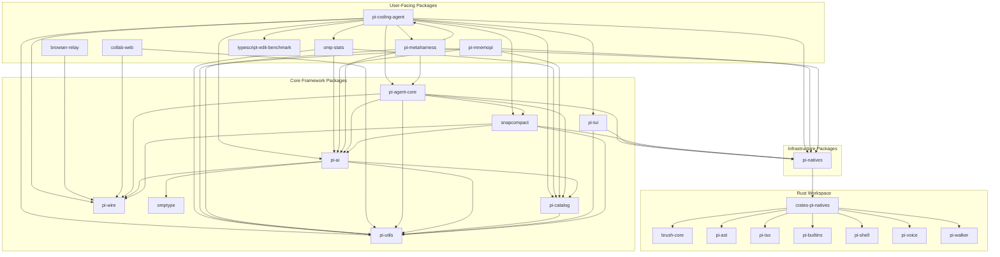
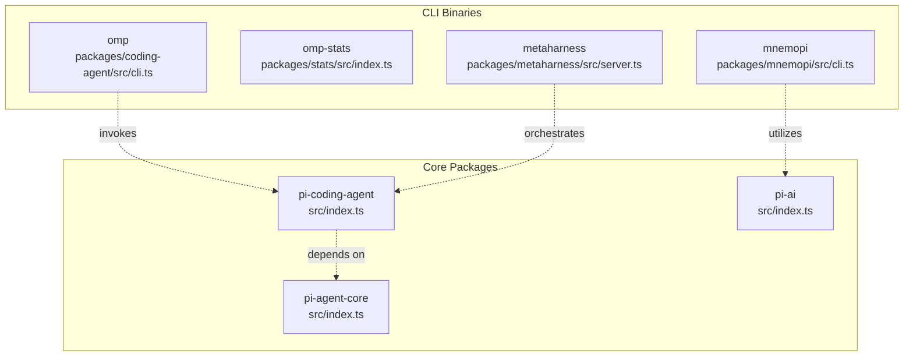
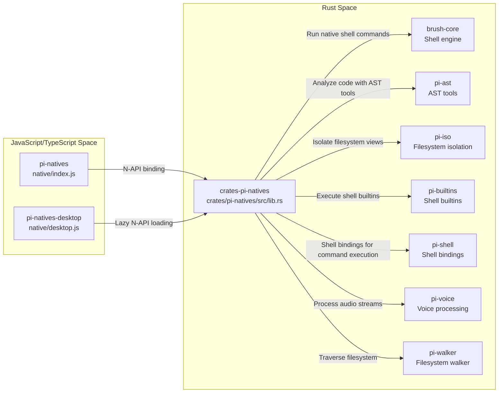

<!-- source: DeepWiki mcp.deepwiki.com · repo can1357/oh-my-pi · page 2.1 Package Structure · fetched 2026-10-30 -->

# Package Structure

<details>
<summary>Relevant source files</summary>

The following files were used as context for generating this wiki page:

- [Cargo.lock](Cargo.lock)
- [Cargo.toml](Cargo.toml)
- [bun.lock](bun.lock)
- [package.json](package.json)
- [packages/agent/package.json](packages/agent/package.json)
- [packages/ai/package.json](packages/ai/package.json)
- [packages/coding-agent/package.json](packages/coding-agent/package.json)
- [packages/natives/package.json](packages/natives/package.json)
- [packages/stats/package.json](packages/stats/package.json)
- [packages/tui/package.json](packages/tui/package.json)
- [packages/utils/package.json](packages/utils/package.json)

</details>


This document describes the monorepo organization of oh-my-pi, detailing the responsibilities of each package, their dependency relationships, and the unified build system. It provides a comprehensive view of the monorepo layout, package roles, and core interaction patterns between key code entities.

---

## Monorepo Organization

The oh-my-pi repository is structured as a monorepo containing multiple TypeScript packages and native Rust crates. TypeScript packages are managed with Bun workspaces, while native Rust crates use Cargo workspaces [Cargo.toml:1-25]().

```
oh-my-pi/
├── packages/              # TypeScript packages (Bun workspace)
│   ├── coding-agent/      # Main CLI and agent implementation
│   ├── agent/             # Core agent abstractions (pi-agent-core)
│   ├── ai/                # Unified AI model integration layer
│   ├── tui/               # Terminal User Interface components
│   ├── natives/           # Native functionality and bindings (N-API)
│   ├── utils/             # Shared TypeScript utility functions
│   ├── stats/             # Observability dashboard (React + CLI)
│   ├── mnemopi/           # Autonomous memory system and embeddings
│   ├── catalog/           # Model and provider registry definitions
│   ├── snapcompact/       # Visual context compaction tooling
│   ├── wire/              # Shared protocol types for RPC and collaboration
│   ├── metaharness/       # Benchmark orchestration and reporting
│   ├── omptype/           # High-performance schema and type utilities
│   ├── browser-relay/     # Browser extension relay for controlling tabs
│   ├── collab-web/        # React client for live session collaboration
│   └── typescript-edit-benchmark/ # Benchmark suite for TypeScript editing
├── crates/                # Rust crates (Cargo workspace)
│   ├── pi-ast/            # AST manipulation and analysis tools
│   ├── pi-builtins/       # Consolidated shell builtins
│   ├── pi-iso/            # Filesystem isolation primitives
│   ├── pi-natives/        # Rust native implementation for N-API bindings
│   ├── pi-shell/          # Shell builtin and execution engine bindings
│   ├── pi-voice/          # Voice processing backends (TTS, STT)
│   ├── pi-walker/         # Filesystem walker utilities
│   └── vendor/brush-core/ # Vendored shell engine library
└── package.json           # Root package and workspace configuration
```

This structure cleanly separates the user-facing CLI, core agent and AI abstractions, UI components, native performance bindings, and supporting infrastructure.

Sources: [packages/coding-agent/package.json:1-16](), [packages/ai/package.json:1-16](), [packages/agent/package.json:1-16](), [packages/tui/package.json:1-16](), [bun.lock:4-211]()

---

## Package Dependency Graph

This diagram visualizes dependency relationships among key packages, illustrating the layered architecture from core frameworks and native layers up to user-facing tools and UI components.



Sources: [packages/coding-agent/package.json:50-98](), [packages/ai/package.json:39-48](), [packages/agent/package.json:36-44](), [packages/tui/package.json:38-44](), [packages/catalog/package.json:60-64](), [bun.lock:23-213](), [packages/mnemopi/package.json:107](), [packages/snapcompact/package.json:39-44](), [packages/collab-web/package.json:63](), [packages/metaharness/package.json:56]()

---

## Core Packages and Their Responsibilities

### `@oh-my-pi/pi-coding-agent`

- **Role:** Main CLI and coding agent logic [packages/coding-agent/package.json:2-4]().
- **Responsibilities:**
  - Implements the main command-line interface entrypoint `omp` in `src/cli.ts` [packages/coding-agent/package.json:27-29]().
  - Manages agent sessions, including lifecycle, conversation state, and command dispatching.
  - Provides core built-in tools including `read`, `bash`, `edit`, and `write` [packages/coding-agent/package.json:2-4]().
  - Maintains internal URL routing for special commands and resource handling.
  - Integrates the auto-research subsystem for autonomous experimentation and commit analysis.
  - Coordinates context compaction calls to the `snapcompact` package.
  - Supports extensions and a multi-agent "swarm" extension system.
- **Key files:** `src/cli.ts`, `src/session.ts`, `src/tools/`, `src/internal-url-router.ts`.

Sources: [packages/coding-agent/package.json:3-32]()

---

### `@oh-my-pi/pi-ai`

- **Role:** Unified AI model integration and provider abstraction [packages/ai/package.json:2-4]().
- **Responsibilities:**
  - Manages connections to various LLM providers like OpenAI, Anthropic, Gemini, Google Vertex/Gemini-CLI, AWS Bedrock, Copilot, Ollama, and others.
  - Handles OAuth flows, credential management, rate-limiting, and usage tracking.
  - Implements streaming APIs (`AssistantMessageEventStream`) for AI responses.
  - Provides dialect and schema normalization to unify provider APIs.
  - Supports prompt caching and retry/fallback strategies.
- **Key files:** `src/providers/`, `src/auth-broker/`, `src/auth-gateway/`, `src/usage/` [packages/ai/package.json:77-104]().

Sources: [packages/ai/package.json:2-4](), [packages/ai/package.json:77-104]()

---

### `@oh-my-pi/pi-agent-core`

- **Role:** Core agent abstractions, state and transport management [packages/agent/package.json:2-5]().
- **Responsibilities:**
  - Provides `Agent` classes managing turn-taking, tool calls, and session state.
  - Defines transport-agnostic operation APIs supporting CLI, RPC, ACP modes.
  - Manages compaction and pruning of conversation transcripts with legacy and streaming algorithms.
  - Supports attachment handling and replay policies for session continuity.
- **Key files:** `src/index.ts`, `src/compaction.ts`, `src/compaction-v2-streaming.ts` [packages/agent/package.json:60-72]().

Sources: [packages/agent/package.json:2-5](), [packages/agent/package.json:60-72]()

---

### `@oh-my-pi/pi-tui`

- **Role:** Terminal User Interface framework [packages/tui/package.json:3-5]().
- **Responsibilities:**
  - Implements component-based TUI architecture with containers, text, markdown, select lists, and input widgets.
  - Features differential rendering to minimize redraw overhead.
  - Provides a multi-line editor with Unicode support, autocomplete, undo/redo.
- **Key files:** `src/index.ts`, `src/components/`, `src/editor/` [packages/tui/package.json:29-106]().

Sources: [packages/tui/package.json:3-5](), [packages/tui/package.json:29-106]()

---

### `@oh-my-pi/pi-natives`

- **Role:** Native Rust bindings and high-performance utilities via N-API [packages/natives/package.json:2-5]().
- **Responsibilities:**
  - Native shell execution using vendored `brush-core`.
  - PTY management, shell builtins, text search tools (`grep`), globbing, syntax highlighting, diffing.
  - Desktop automation and accessibility integration.
  - Native audio backends and WebRTC peers for voice.
- **Key files:** N-API bindings in `native/`, Rust crates in `crates/pi-natives`, `crates/pi-shell`, `crates/pi-builtins`, `crates/vendor/brush-core` [Cargo.toml:1-24](), [packages/natives/package.json:29-95]().

Sources: [Cargo.toml:1-24](), [packages/natives/package.json:2-95]()

---

### `@oh-my-pi/pi-utils`

- **Role:** Shared utility library [packages/utils/package.json:2-4]().
- **Responsibilities:**
  - Utility functions for logging, filesystem, retry strategies, streams, worker clients.
  - Consistent tooling primitives used across the monorepo.
- **Key files:** Various utilities in `src/` [packages/utils/package.json:22-44]().

Sources: [packages/utils/package.json:2-4](), [packages/utils/package.json:22-44]()

---

### `@oh-my-pi/omp-stats`

- **Role:** Local observability dashboard [packages/stats/package.json:2-6]().
- **Responsibilities:**
  - Collects AI usage statistics, local session metrics.
  - React-based dashboard UI and CLI tool `omp-stats` [packages/stats/package.json:30-32]().
- **Key files:** React components and CLI logic in `src/`.

Sources: [packages/stats/package.json:2-32]()

---

### `@oh-my-pi/pi-mnemopi`

- **Role:** Autonomous agent memory system.
- **Responsibilities:**
  - Extracts durable knowledge and embeddings from session transcripts.
  - Uses ONNX runtime and `fastembed` for embedding and similarity search [bun.lock:181-183]().
  - Runs consolidation pipelines for memory maintenance.
  - CLI tool `mnemopi` for memory interaction [bun.lock:171-173]().
- **Key files:** CLI at `src/cli.ts` [bun.lock:171-173]().

Sources: [bun.lock:171-183]()

---

### `@oh-my-pi/pi-catalog`

- **Role:** Model, provider, and capabilities registry.
- **Responsibilities:**
  - Defines AI model metadata including costs, capabilities, compatibility rules.
  - Supports dynamic discovery of local models (Ollama, LMStudio).
  - Maintains JSON/YAML catalog files driving AI behavior and cost accounting.
- **Key files:** Registry and schema files in `src/registry`, `src/models/`.

Sources: [packages/ai/package.json:5-14](), [packages/catalog/package.json:1-30]()

---

### `@oh-my-pi/snapcompact`

- **Role:** Visual context compaction tooling.
- **Responsibilities:**
  - Algorithms and prompt templates for compressing conversation context while preserving semantics.
  - Used by coding agent for efficient prompt management.
- **Key files:** `src/snapcompact.ts`, `src/prompts/`.

Sources: [packages/snapcompact/package.json:39-44]()

---

### `@oh-my-pi/pi-wire`

- **Role:** Shared protocol TypeScript types.
- **Responsibilities:**
  - Message schemas and types for RPC, event streams, collaboration, tool-call communication.
  - Common dependency for clients, servers, and extensions.
- **Key files:** Protocol definitions in `src/`.

Sources: [packages/ai/package.json:39-48]()

---

### `@oh-my-pi/pi-metaharness`

- **Role:** Benchmark orchestration and reporting [bun.lock:135-140]().
- **Responsibilities:**
  - Models experiments, runs, detailed trace data for benchmarking.
  - Uses SQLite for storage, exposes REST/SSE APIs.
  - Integrates with the TypeScript edit benchmark suite.
- **Key files:** Server implementation at `src/server.ts` [bun.lock:139-140]().

Sources: [bun.lock:135-140]()

---

### `@oh-my-pi/browser-relay`

- **Role:** Browser extension relay [bun.lock:56-58]().
- **Responsibilities:**
  - Chrome extension enabling coding agent to programmatically control browser tabs.
  - Works with the browser tool in the coding agent.
- **Key files:** Extension scripts and communication handlers.

Sources: [bun.lock:56-58]()

---

### `@oh-my-pi/collab-web`

- **Role:** React client for live session collaboration [packages/collab-web/package.json:64]().
- **Responsibilities:**
  - Enables encrypted real-time sharing in browsers.
  - Renders guest TUI using React components.
  - Uses `pi-wire` protocol types for communication [packages/collab-web/package.json:64]().
- **Key files:** React components and logic.

Sources: [packages/collab-web/package.json:64]()

---

### `@oh-my-pi/typescript-edit-benchmark`

- **Role:** Benchmark suite for TypeScript editing.
- **Responsibilities:**
  - Automated tests focused on the TypeScript editing subsystem.
- **Key files:** Benchmark scripts under `src/`.

Sources: [packages/typescript-edit-benchmark/package.json:10-40]()

---

## Directory-to-Entity Mapping

### CLI Entry Points and Core Package Exports



This diagram shows main CLI entrypoints and their relationships to core packages. The `omp` CLI is the primary user interface invoking the coding agent core [packages/coding-agent/package.json:27-29](). The `mnemopi` CLI leverages AI functionality for embedding-based memory workflows [bun.lock:171-173](). The `metaharness` server orchestrates benchmarks using the coding agent [bun.lock:135-140]().

Sources: [packages/coding-agent/package.json:27-29](), [packages/ai/package.json:29-30](), [packages/stats/package.json:28-32](), [bun.lock:135-140](), [bun.lock:171-173]()

---

### Native Infrastructure Bridge (JavaScript/TypeScript ⇄ Rust)



This diagram illustrates the relationship between the TypeScript native bindings (`pi-natives` package) and underlying Rust crates providing high-performance implementations [Cargo.toml:1-24](), [packages/natives/package.json:29-95](). The N-API bindings bridge native functionalities into the Node.js runtime environment.

Sources: [Cargo.toml:1-24](), [packages/natives/package.json:29-95]()

---

## Build System and Compilation

oh-my-pi uses a multi-language, multi-toolchain build system integrating TypeScript (via Bun) and Rust (via Cargo) [Cargo.toml:1-25]():

- **TypeScript/JavaScript:**
  - Managed via Bun workspaces for all TS packages in `packages/`.
  - `pi-coding-agent` provides build scripts for bundling CLI, native bindings, and tool views.
  - Shared dependencies within monorepo use local workspace packages via `"catalog:"` specifiers.
  - Scripts support linting, formatting, type-checking, and tests.
- **Rust:**
  - Managed with a Cargo workspace for all native crates in `crates/` [Cargo.toml:1-25]().
  - Custom build profiles optimize performance and debugging [Cargo.toml:50-106]().
  - Native crates build shared libraries exposing Node.js N-API bindings consumed by `pi-natives`.
  - Panic strategy set to "unwind" for recoverable panics inside native components [Cargo.toml:50-68]().
- **Native Bindings:**
  - Uses `@napi-rs/cli` for generating and managing Node.js N-API bindings [packages/natives/package.json:45-47]().
  - Supports deferred loading for desktop-related native modules.
- **Dependency Management:**
  - Optional native dependencies include `@huggingface/transformers`, `sherpa-onnx-node` for ML acceleration [bun.lock:113-116]().
  - OpenTelemetry packages provide telemetry and distributed tracing across components [bun.lock:96-106]().

This build system enables seamless JS/TS and native Rust interoperability, maintaining high performance for critical components.

Sources: [packages/coding-agent/package.json:33-50](), [packages/natives/package.json:29-45](), [Cargo.toml:1-106](), [bun.lock:96-116]()

---

This comprehensive package structure underpins oh-my-pi's modular architecture, enabling an extendable AI-powered terminal assistant with robust native acceleration and rich UI support.

Sources: [packages/coding-agent/package.json:1-98](), [packages/ai/package.json:1-108](), [packages/agent/package.json:1-78](), [packages/tui/package.json:1-69](), [bun.lock:1-211](), [Cargo.toml:1-64](), [packages/natives/package.json:29-50]()

---

