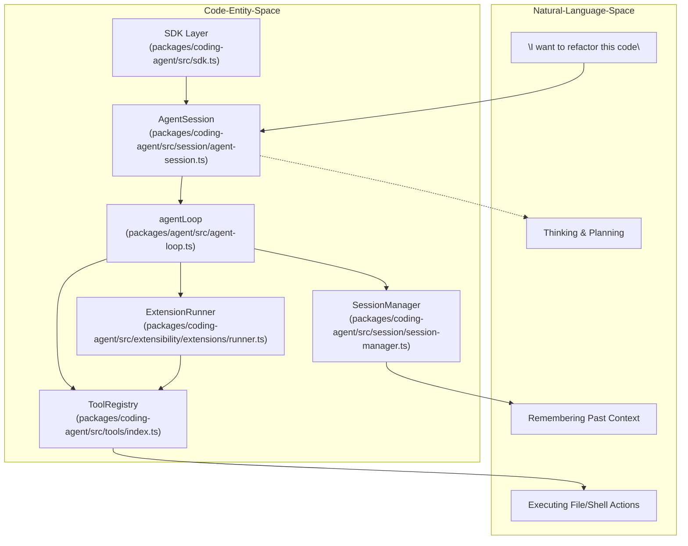
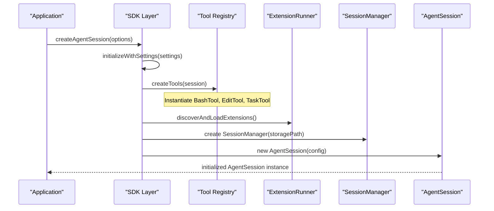
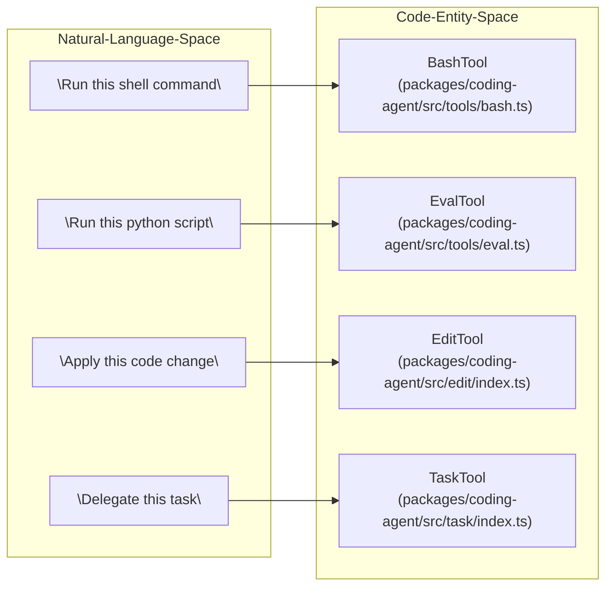

<!-- source: DeepWiki mcp.deepwiki.com · repo can1357/oh-my-pi · page 2.2 Core Components · fetched 2026-10-30 -->

# Core Components

Relevant source files

The following files were used as context for generating this wiki page:

- [docs/task-agent-discovery.md](docs/task-agent-discovery.md)
- [docs/tools/task.md](docs/tools/task.md)
- [packages/ai/test/auth-storage-credential-disabled-event.test.ts](packages/ai/test/auth-storage-credential-disabled-event.test.ts)
- [packages/coding-agent/DEVELOPMENT.md](packages/coding-agent/DEVELOPMENT.md)
- [packages/coding-agent/src/cli/args.ts](packages/coding-agent/src/cli/args.ts)
- [packages/coding-agent/src/cli/extension-flags.ts](packages/coding-agent/src/cli/extension-flags.ts)
- [packages/coding-agent/src/cli/flag-tables.ts](packages/coding-agent/src/cli/flag-tables.ts)
- [packages/coding-agent/src/cli/ssh-cli.ts](packages/coding-agent/src/cli/ssh-cli.ts)
- [packages/coding-agent/src/commands/launch.ts](packages/coding-agent/src/commands/launch.ts)
- [packages/coding-agent/src/commands/ssh.ts](packages/coding-agent/src/commands/ssh.ts)
- [packages/coding-agent/src/main.ts](packages/coding-agent/src/main.ts)
- [packages/coding-agent/src/modes/acp/acp-agent.ts](packages/coding-agent/src/modes/acp/acp-agent.ts)
- [packages/coding-agent/src/modes/acp/acp-event-mapper.ts](packages/coding-agent/src/modes/acp/acp-event-mapper.ts)
- [packages/coding-agent/src/modes/acp/acp-mode.ts](packages/coding-agent/src/modes/acp/acp-mode.ts)
- [packages/coding-agent/src/prompts/system/mcp-xdev-guidance.md](packages/coding-agent/src/prompts/system/mcp-xdev-guidance.md)
- [packages/coding-agent/src/prompts/tools/task.md](packages/coding-agent/src/prompts/tools/task.md)
- [packages/coding-agent/src/sdk.ts](packages/coding-agent/src/sdk.ts)
- [packages/coding-agent/src/session/agent-session.ts](packages/coding-agent/src/session/agent-session.ts)
- [packages/coding-agent/src/session/session-entries.ts](packages/coding-agent/src/session/session-entries.ts)
- [packages/coding-agent/src/session/session-manager.ts](packages/coding-agent/src/session/session-manager.ts)
- [packages/coding-agent/src/session/session-tools.ts](packages/coding-agent/src/session/session-tools.ts)
- [packages/coding-agent/src/ssh/config-writer.ts](packages/coding-agent/src/ssh/config-writer.ts)
- [packages/coding-agent/src/task/executor.ts](packages/coding-agent/src/task/executor.ts)
- [packages/coding-agent/src/task/index.ts](packages/coding-agent/src/task/index.ts)
- [packages/coding-agent/src/task/persisted-revive.ts](packages/coding-agent/src/task/persisted-revive.ts)
- [packages/coding-agent/src/task/prompt-policy.ts](packages/coding-agent/src/task/prompt-policy.ts)
- [packages/coding-agent/src/task/structured-subagent.ts](packages/coding-agent/src/task/structured-subagent.ts)
- [packages/coding-agent/src/task/types.ts](packages/coding-agent/src/task/types.ts)
- [packages/coding-agent/src/tools/context.ts](packages/coding-agent/src/tools/context.ts)
- [packages/coding-agent/src/tools/index.ts](packages/coding-agent/src/tools/index.ts)
- [packages/coding-agent/test/acp-agent.test.ts](packages/coding-agent/test/acp-agent.test.ts)
- [packages/coding-agent/test/acp-event-mapper.test.ts](packages/coding-agent/test/acp-event-mapper.test.ts)
- [packages/coding-agent/test/acp-initialize-conformance.test.ts](packages/coding-agent/test/acp-initialize-conformance.test.ts)
- [packages/coding-agent/test/acp-lazy-startup.test.ts](packages/coding-agent/test/acp-lazy-startup.test.ts)
- [packages/coding-agent/test/acp-mcp-isolation.test.ts](packages/coding-agent/test/acp-mcp-isolation.test.ts)
- [packages/coding-agent/test/acp-session-effects.test.ts](packages/coding-agent/test/acp-session-effects.test.ts)
- [packages/coding-agent/test/agent-session-acp-permission.test.ts](packages/coding-agent/test/agent-session-acp-permission.test.ts)
- [packages/coding-agent/test/agent-session-prompt-abort-race.test.ts](packages/coding-agent/test/agent-session-prompt-abort-race.test.ts)
- [packages/coding-agent/test/agent-session-prompt-dispatch-race.test.ts](packages/coding-agent/test/agent-session-prompt-dispatch-race.test.ts)
- [packages/coding-agent/test/agent-session-tool-rebuild-skip.test.ts](packages/coding-agent/test/agent-session-tool-rebuild-skip.test.ts)
- [packages/coding-agent/test/cli-explicit-extension-isolation.test.ts](packages/coding-agent/test/cli-explicit-extension-isolation.test.ts)
- [packages/coding-agent/test/cli-unknown-flag.test.ts](packages/coding-agent/test/cli-unknown-flag.test.ts)
- [packages/coding-agent/test/extension-flag-dispatch.test.ts](packages/coding-agent/test/extension-flag-dispatch.test.ts)
- [packages/coding-agent/test/extension-flag-initial-message.test.ts](packages/coding-agent/test/extension-flag-initial-message.test.ts)
- [packages/coding-agent/test/fixtures/instructions-mcp.ts](packages/coding-agent/test/fixtures/instructions-mcp.ts)
- [packages/coding-agent/test/fixtures/mcp-refresh-retention-probe.ts](packages/coding-agent/test/fixtures/mcp-refresh-retention-probe.ts)
- [packages/coding-agent/test/flag-tables.test.ts](packages/coding-agent/test/flag-tables.test.ts)
- [packages/coding-agent/test/initial-message.test.ts](packages/coding-agent/test/initial-message.test.ts)
- [packages/coding-agent/test/main-session-resolution-error.test.ts](packages/coding-agent/test/main-session-resolution-error.test.ts)
- [packages/coding-agent/test/mcp-refresh-retention.test.ts](packages/coding-agent/test/mcp-refresh-retention.test.ts)
- [packages/coding-agent/test/prefix-binding-tool-roster.test.ts](packages/coding-agent/test/prefix-binding-tool-roster.test.ts)
- [packages/coding-agent/test/sdk-credential-disabled-bridge.test.ts](packages/coding-agent/test/sdk-credential-disabled-bridge.test.ts)
- [packages/coding-agent/test/sdk-generate-image-tool-gating.test.ts](packages/coding-agent/test/sdk-generate-image-tool-gating.test.ts)
- [packages/coding-agent/test/sdk-mcp-instructions.test.ts](packages/coding-agent/test/sdk-mcp-instructions.test.ts)
- [packages/coding-agent/test/sdk-tool-activation.test.ts](packages/coding-agent/test/sdk-tool-activation.test.ts)
- [packages/coding-agent/test/sdk-workpool-yield-schema.test.ts](packages/coding-agent/test/sdk-workpool-yield-schema.test.ts)
- [packages/coding-agent/test/session-manager/move-to.test.ts](packages/coding-agent/test/session-manager/move-to.test.ts)
- [packages/coding-agent/test/session-manager/title-source-persistence.test.ts](packages/coding-agent/test/session-manager/title-source-persistence.test.ts)
- [packages/coding-agent/test/system-prompt-model.test.ts](packages/coding-agent/test/system-prompt-model.test.ts)
- [packages/coding-agent/test/task/autoload-skills.test.ts](packages/coding-agent/test/task/autoload-skills.test.ts)
- [packages/coding-agent/test/task/executor-async-quiescence.test.ts](packages/coding-agent/test/task/executor-async-quiescence.test.ts)
- [packages/coding-agent/test/task/executor-launch-startup.test.ts](packages/coding-agent/test/task/executor-launch-startup.test.ts)
- [packages/coding-agent/test/task/executor-pass-through.test.ts](packages/coding-agent/test/task/executor-pass-through.test.ts)
- [packages/coding-agent/test/task/executor-prewalk.test.ts](packages/coding-agent/test/task/executor-prewalk.test.ts)
- [packages/coding-agent/test/task/executor-recent-output.test.ts](packages/coding-agent/test/task/executor-recent-output.test.ts)
- [packages/coding-agent/test/task/executor-soft-budget.test.ts](packages/coding-agent/test/task/executor-soft-budget.test.ts)
- [packages/coding-agent/test/task/executor-subagent-reminders.test.ts](packages/coding-agent/test/task/executor-subagent-reminders.test.ts)
- [packages/coding-agent/test/task/executor-wall-clock.test.ts](packages/coding-agent/test/task/executor-wall-clock.test.ts)
- [packages/coding-agent/test/task/executor-yield-loop.test.ts](packages/coding-agent/test/task/executor-yield-loop.test.ts)
- [packages/coding-agent/test/task/persisted-revive.test.ts](packages/coding-agent/test/task/persisted-revive.test.ts)
- [packages/coding-agent/test/task/structured-subagent.test.ts](packages/coding-agent/test/task/structured-subagent.test.ts)
- [packages/coding-agent/test/task/subagent-lsp.test.ts](packages/coding-agent/test/task/subagent-lsp.test.ts)
- [packages/coding-agent/test/task/task-batch.test.ts](packages/coding-agent/test/task/task-batch.test.ts)
- [packages/coding-agent/test/task/task-guards.test.ts](packages/coding-agent/test/task/task-guards.test.ts)
- [packages/coding-agent/test/task/task-schema.test.ts](packages/coding-agent/test/task/task-schema.test.ts)
- [packages/coding-agent/test/task/wire-schema.test.ts](packages/coding-agent/test/task/wire-schema.test.ts)
- [packages/coding-agent/test/tools/approval-mode.test.ts](packages/coding-agent/test/tools/approval-mode.test.ts)
- [packages/coding-agent/test/tools/index.test.ts](packages/coding-agent/test/tools/index.test.ts)
- [packages/coding-agent/test/tools/schema-validation.test.ts](packages/coding-agent/test/tools/schema-validation.test.ts)
- [packages/utils/src/acp/connection.ts](packages/utils/src/acp/connection.ts)
- [packages/utils/src/acp/transport.ts](packages/utils/src/acp/transport.ts)
- [packages/utils/test/acp.test.ts](packages/utils/test/acp.test.ts)

This page describes the key architectural components that form the runtime execution layer of oh-my-pi. These components orchestrate agent sessions, manage tools, execute extensions, and persist conversation state to ensure seamless AI-powered terminal assistant functionality.

---

## Component Architecture

At the core of the runtime are several primary components that coordinate to execute and manage agent sessions. The key pieces are:

- **AgentSession** — the high-level orchestrator managing session state and lifecycle [packages/coding-agent/src/session/agent-session.ts:1-14]().
- **SDK Layer** — the initialization and configuration factory wiring together components [packages/coding-agent/src/sdk.ts:1-15]().
- **Tool Registry** — manages and exposes tools operable by the agent [packages/coding-agent/src/tools/index.ts:1-40]().
- **Extension Runner** — runs third-party extensions with lifecycle hooks [packages/coding-agent/src/sdk.ts:112-125]().
- **SessionManager** — persists session entries and manages conversation state [packages/coding-agent/src/session/session-manager.ts:1-30]().

### Natural Language to Code Entity Mapping: Orchestration

The following diagram maps user intents and system responsibilities ("Natural-Language Space") to specific code entities responsible for implementation ("Code-Entity Space"). This bridge illustrates how user goals translate into concrete software components:

Sources: [packages/coding-agent/src/session/agent-session.ts:1-14](), [packages/coding-agent/src/sdk.ts:1-15](), [packages/coding-agent/src/tools/index.ts:1-40](), [packages/coding-agent/src/session/session-manager.ts:1-30]()

---

## AgentSession: Main Orchestrator

`AgentSession` is the core class encapsulating the lifecycle and state management of an interactive or programmatic agent session. It serves as the primary interface for all interaction with the agent, managing complexity such as persistence, model changes, and tool execution across run modes [packages/coding-agent/src/session/agent-session.ts:1-14]().

### Key Responsibilities

- **Agent State Access and Event Subscription:**  
  Holds a reference to the internal `Agent` instance, exposing access to mutable agent state (`AgentState`) and subscribing to `AgentEvent`s. Automatically persists relevant state changes via `SessionManager`.
- **Model and Thinking Level Management:**  
  Tracks the current AI model and thinking effort level, handling dynamic switching and capability alignment.
- **Context Compaction:**  
  Implements compaction strategies (snapshot compaction and branch summarization) using utilities like `calculatePromptTokens` [packages/coding-agent/src/session/agent-session.ts:49-56]().
- **Bash Command Execution:**  
  Provides session-scoped bash execution integration and output streaming [packages/coding-agent/src/session/agent-session.ts:10-14]().
- **Session Lifecycle Operations:**  
  Coordinates creation, switching, branching, and disposal of sessions with `SessionManager`.

Sources: [packages/coding-agent/src/session/agent-session.ts:1-173]()

---

## SDK Layer: Initialization Factory

The SDK layer (`src/sdk.ts`) acts as the centralized entry point for creating and configuring `AgentSession` instances. It wires internal dependencies including the Tool Registry, Extension Runner, SessionManager, model registries, and settings [packages/coding-agent/src/sdk.ts:1-130]().

### Initialization Flow

Sources: [packages/coding-agent/src/sdk.ts:1-130](), [packages/coding-agent/src/session/session-manager.ts:1-30]()

---

## Tool Registry and Coordination

The Tool Registry manages the catalog of tools executable by the agent during conversations, including built-in tools for filesystem access, shell execution, code edits, and task delegation [packages/coding-agent/src/tools/index.ts:1-80]().

### Natural Language to Code Entity Mapping: Tool Dispatch

Sources: [packages/coding-agent/src/tools/index.ts:1-80](), [packages/coding-agent/src/task/index.ts:1-40]()

---

## Extension Runner and Hook System

The `ExtensionRunner` component manages runtime support for extensions augmenting agent execution lifecycle, handling discovery, loading, and invocation of extension modules and hooks [packages/coding-agent/src/sdk.ts:112-125]().

Sources: [packages/coding-agent/src/sdk.ts:112-125]()

---

## SessionManager: Persistence Layer

`SessionManager` is responsible for persistent recording and retrieval of all session entries, maintaining an append-only JSONL history of conversation turns, tool calls, compactions, and artifacts [packages/coding-agent/src/session/session-manager.ts:1-125]().

Sources: [packages/coding-agent/src/session/session-manager.ts:1-125]()

---

## Coordination Summary

| Phase            | Component           | Description                                                             |
|------------------|---------------------|-------------------------------------------------------------------------|
| Input Reception  | `AgentSession`      | Accepts input, manages session state and branching                       |
| Planning         | `agentLoop`         | Interacts with AI model to generate completions and tool calls          |
| Tool Dispatch    | `ToolRegistry`      | Executes tool calls like shell, eval, edits, and task delegation            |
| Extension Hooks  | `ExtensionRunner`   | Provides lifecycle hook points for runtime extension customization      |
| Persistence      | `SessionManager`    | Records all events and artifacts persistently to JSONL session storage  |
| Streaming Output | `AgentSession`      | Streams messages or results to TUI or RPC clients                        |

Sources: [packages/coding-agent/src/session/agent-session.ts:1-14](), [packages/coding-agent/src/sdk.ts:1-130](), [packages/coding-agent/src/session/session-manager.ts:1-125]()

---

