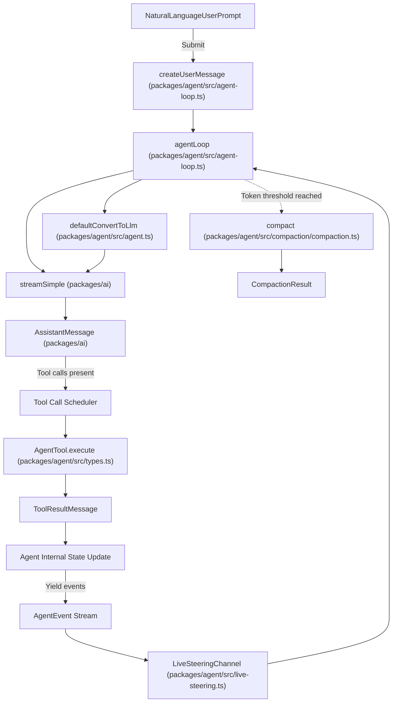

<!-- source: DeepWiki mcp.deepwiki.com · repo can1357/oh-my-pi · page 2.3 Agent Loop (pi-agent package) · fetched 2026-10-30 -->

# Agent Loop (pi-agent package)

<details>
<summary>Relevant source files</summary>

The following files were used as context for generating this wiki page:

- [packages/agent/src/agent-loop.ts](packages/agent/src/agent-loop.ts)
- [packages/agent/src/agent.ts](packages/agent/src/agent.ts)
- [packages/agent/src/compaction/anthropic.ts](packages/agent/src/compaction/anthropic.ts)
- [packages/agent/src/compaction/compaction-v2-streaming.ts](packages/agent/src/compaction/compaction-v2-streaming.ts)
- [packages/agent/src/compaction/compaction.ts](packages/agent/src/compaction/compaction.ts)
- [packages/agent/src/compaction/openai.ts](packages/agent/src/compaction/openai.ts)
- [packages/agent/src/types.ts](packages/agent/src/types.ts)
- [packages/agent/test/agent-loop.test.ts](packages/agent/test/agent-loop.test.ts)
- [packages/agent/test/agent.test.ts](packages/agent/test/agent.test.ts)
- [packages/agent/test/anthropic-native-compaction.test.ts](packages/agent/test/anthropic-native-compaction.test.ts)
- [packages/agent/test/remote-compaction.test.ts](packages/agent/test/remote-compaction.test.ts)
- [packages/ai/test/anthropic-server-compaction.test.ts](packages/ai/test/anthropic-server-compaction.test.ts)
- [packages/coding-agent/src/session/session-context.ts](packages/coding-agent/src/session/session-context.ts)
- [packages/coding-agent/test/compaction.test.ts](packages/coding-agent/test/compaction.test.ts)
- [packages/coding-agent/test/session-manager/build-context.test.ts](packages/coding-agent/test/session-manager/build-context.test.ts)
- [packages/coding-agent/test/session/session-context.test.ts](packages/coding-agent/test/session/session-context.test.ts)

</details>


This page documents the transport-agnostic core agent loop implemented in the `packages/agent` package [packages/agent/src/agent-loop.ts:1-4](). It covers the main control flow for executing assistant turns, managing tool calls, execution plans, steering and interruption mechanisms, enforcement of replay policies, and entry points into the compaction subsystem [packages/agent/src/agent-loop.ts:1-112](). The agent loop represents the central processing engine of the agent, designed to run atop any streaming LLM provider, abstracting away transport and replay details.

Sources: `packages/agent/src/agent-loop.ts:1-4`, `packages/agent/src/agent.ts:1-40`

---

## Purpose and Scope

The agent loop in `packages/agent` is a reusable core execution engine orchestrating interaction between natural language model calls and external tool execution, enriched with advanced runtime features:

- **Transport-Agnostic:** Internally uses `AgentMessage` throughout and converts to `Message[]` only at each LLM call boundary [packages/agent/src/agent-loop.ts:1-4](), abstracting away transport or protocol specifics.
- **Execution Planning:** Manages sequential and conditional invocation of multiple tool calls embedded in assistant responses during a conversation turn.
- **Steering and Interruption:** Supports asynchronous injection of user- or system-driven steering messages via `LiveSteeringChannel` [packages/agent/src/agent-loop.ts:58](), with configurable interruption policies for running tool executions.
- **Replay Policy:** Implements robust filtering, escalation, and replay logic to maintain session consistency, avoid infinite spins, and deal gracefully with partial failures [packages/agent/src/agent.ts:75-80]().
- **Compaction Entry Points:** Hooks to the context compaction subsystem (`packages/agent/src/compaction/compaction.ts`) aid in session transcript maintenance, pruning, and summarization.

**Key source files:**

- `packages/agent/src/agent-loop.ts` — Core async generator function implementing `agentLoop()`, `agentLoopContinue()`, and related utilities.
- `packages/agent/src/agent.ts` — The `Agent` class abstraction offering a simpler, non-transport-abstracted API atop the loop.
- `packages/agent/src/types.ts` — Shared TypeScript types defining agent loop configuration (`AgentLoopConfig`), runtime state, and message shapes.
- `packages/agent/src/compaction/compaction.ts` — Context compaction modules exposing summary messages, file operations extraction, and interfaces for compaction integration.

Sources: `packages/agent/src/agent-loop.ts:1-112`, `packages/agent/src/agent.ts:1-70`, `packages/agent/src/types.ts:1-100`, `packages/agent/src/compaction/compaction.ts:1-60`

---

## Core Agent Loop Implementation

At the heart of the package is the async generator function `agentLoop()` [packages/agent/src/agent-loop.ts:90-105]():

```ts
// Example signature reference
async function* agentLoop(
  messages: AgentMessage[],
  context: AgentContext,
  config: AgentLoopConfig,
  signal?: AbortSignal,
  streamFn = streamSimple
): AsyncIterable<AgentEvent>
```

### Inputs and Data Flow

- **messages:** An array of `AgentMessage` representing the current conversation history including user, assistant, and tool result messages [packages/agent/src/agent-loop.ts:2-5]().
- **context:** An `AgentContext` providing system prompts, available tools, auxiliary state, and dialect configuration [packages/agent/src/agent-loop.ts:87-105]().
- **config:** An `AgentLoopConfig` containing model references, streaming options, message converters, telemetry hooks, API key resolvers, time deadlines, and behavior flags [packages/agent/src/agent-loop.ts:90-105]().
- **signal:** Optional abort signal for graceful cancellation [packages/agent/src/agent-loop.ts:100-112]().
- **streamFn:** Streaming function to perform LLM provider calls; defaults to `streamSimple` [packages/agent/src/agent-loop.ts:17]().

Internally, conversation state is maintained as `AgentMessage[]` [packages/agent/src/agent-loop.ts:1-4](). Before each model call, messages are mapped via `convertToLlm` (or the default implementation) into LLM-compatible `Message[]` [packages/agent/src/agent.ts:75-80](). Assistant responses stream token-by-token, emitting `AssistantMessageEvent` items [packages/agent/src/agent-loop.ts:6-7](). When tool calls are encountered, the loop executes them sequentially, updating session state with `ToolResultMessage` outputs [packages/agent/src/agent-loop.ts:21-25]().

### Important Constants and Utilities

| Constant / Function | Description | Sources |
|----------------|-------------|---------|
| `STREAM_INTERRUPTED_AFTER_CONTENT_STOP_DETAIL` | Marker for errors occurring after assistant content streaming completed | `[packages/agent/src/agent-loop.ts:114-115]()` |
| `ABORTED` (symbol) | Sentinel symbol representing aborted streaming | `[packages/agent/src/agent-loop.ts:117]()` |
| `MAX_PAUSED_TURN_CONTINUATIONS = 8` | Maximum consecutive re-samples on paused turns without tool calls | `[packages/agent/src/agent-loop.ts:125]()` |
| `MAX_DSML_LEAK_NUDGES = 2` | Caps forced corrections of raw DSML markup leak turns | `[packages/agent/src/agent-loop.ts:133]()` |
| `MAX_SOFT_TOOL_ESCALATIONS = 3` | Bounded forced tool choice escalations to avoid infinite loops | `[packages/agent/src/agent-loop.ts:141]()` |
| `hardToolChoiceBlocks(choice, requiredTool)` | Indicates whether a hard tool choice conflicts with a soft tool requirement | `[packages/agent/src/agent-loop.ts:149-155]()` |
| `createToolScopedAbortReason(message, toolCallMsgs, defaultMsg)` | Factory to create typed abort reasons scoped to individual tool calls | `[packages/agent/src/agent-loop.ts:175-181]()` |

Sources: `packages/agent/src/agent-loop.ts:114-181`

---

## The Agent Wrapper Class

The `Agent` class in `packages/agent/src/agent.ts` wraps the core loop for simpler usage without explicit transport abstraction [packages/agent/src/agent.ts:1-40]():

```ts
export class Agent {
  constructor(options?: AgentOptions);
  prompt(text: string | AgentMessage): Promise<AgentMessage[]>;
  steer(msg: AgentMessage | AgentMessage[]): void;
  followUp(messages?: AgentMessage[]): Promise<AgentMessage[]>;
  ...
}
```

### Features

- Maintains internal state: conversation messages, active tools, model configuration, and telemetry [packages/agent/src/agent.ts:50-70]().
- Dynamically resolves API keys per model call via `getApiKey` [packages/agent/src/agent.ts:183-184]().
- Supports `steeringMode` and `followUpMode` flags to control injection behavior of queued steering or follow-up messages [packages/agent/src/agent.ts:133-140]().
- Implements `interruptMode`:
  - `"immediate"` (default): interrupts running tool executions after each call [packages/agent/src/agent.ts:147]().
  - `"wait"`: defers steering interrupts until the entire tool batch completes [packages/agent/src/agent.ts:147]().
- Automatically manages replay of unpaired tool calls on continuation calls to `continue()` [packages/agent/src/agent.ts:155-190]().

Sources: `packages/agent/src/agent.ts:1-212`

---

## Execution Plans and Tool Call Scheduling

Assistant responses may embed multiple tool call blocks which the agent loop interprets as execution plans:

- After each assistant message completion, the loop inspects and collects all `toolCall` blocks [packages/agent/src/agent-loop.ts:1-25]().
- Tools are invoked sequentially in the order the calls appear.
- Each tool's `execute()` method receives the call ID and parsed validated arguments [packages/agent/test/agent-loop.test.ts:60-75]().
- Tools can be marked as interruptible or exclusive, affecting scheduling and concurrent execution [packages/agent/test/agent.test.ts:25-30]().
- If an interrupt occurs, remaining calls in the batch are skipped, producing synthetic skipped tool results with context-aware explanatory text [packages/agent/test/agent.test.ts:70-82]().

Sources: `packages/agent/src/agent-loop.ts:1-100`, `packages/agent/test/agent.test.ts:18-85`

---

## Steering and Interruption Mechanisms

Steering in the agent loop comprises asynchronously injected messages that influence agent behavior or provide real-time corrections [packages/agent/src/types.ts:155-162]().

### Steering Sources and Queue States

| Source | Description | Sources |
|--------|-------------|---------|
| User | Explicit user messages (role `"user"`) | `[packages/agent/src/types.ts:159]()` |
| Agent | Messages authored internally by the agent | `[packages/agent/src/types.ts:159]()` |
| System | Advisory or system-generated steering messages | `[packages/agent/src/types.ts:159]()` |

- **Interrupt Modes:** `immediate` checks for steering after each individual tool execution; `wait` defers the interrupt until the entire tool batch finishes [packages/agent/src/agent.ts:147]().
- **Interruption Effects:** Unexecuted sibling tool calls receive neutral synthetic error messages or skip notices via `createToolScopedAbortReason` [packages/agent/src/agent-loop.ts:167-181]().

Sources: `packages/agent/src/agent-loop.ts:167-181`, `packages/agent/src/types.ts:150-165`

---

## Replay Policy

The agent loop enforces a comprehensive replay policy to maintain session consistency and prevent infinite retries [packages/agent/src/agent.ts:75-80]():

- Filters irrelevant refusal or abort assistant messages before replaying via `defaultConvertToLlm` [packages/agent/src/agent.ts:75-80]().
- Soft tool requirements prevent infinite forced tool-call escalation via capped retries (`MAX_SOFT_TOOL_ESCALATIONS`) [packages/agent/src/agent-loop.ts:139-141]().
- Sanitizes transient internal provider state from messages (e.g., partial JSON tokens).
- Supports continuation via `agentLoopContinue()` which replays the last assistant's tool calls before the next model invocation [packages/agent/src/agent.ts:33]().

Sources: `packages/agent/src/agent.ts:75-80`, `packages/agent/src/agent-loop.ts:139-141`

---

## Compaction Subsystem Entry Points

The agent loop integrates closely with the compaction subsystem (`packages/agent/src/compaction/compaction.ts`) to maintain and prune long conversational histories:

- Monitors token consumption continuously to trigger compaction heuristics before contexts grow too large.
- Invokes compaction strategies (`compact()`, `prepareCompaction()`) to generate summary messages representing omitted content [packages/agent/src/compaction/compaction.ts:147-163]().
- Extracts file operation data from tool call metadata (`extractFileOperations`) to maintain tracking of read and modified files [packages/agent/src/compaction/compaction.ts:117-144]().
- Ensures encrypted reasoning tokens and native provider state metadata pass through compactions intact for fidelity.

Sources: `packages/agent/src/compaction/compaction.ts:1-180`, `packages/agent/test/remote-compaction.test.ts:1-40`

---

## Data Flow: Natural Language Space ↔ Code Entity Space

This diagram bridges natural language concepts with specific code entities within `packages/agent`:

### Title: "Agent Loop Execution and Code Entity Mapping"



Sources: `packages/agent/src/agent-loop.ts:1-100`, `packages/agent/src/agent.ts:75-80`, `packages/agent/src/compaction/compaction.ts:147-163`

---

## Detailed Lifecycle Inside `agentLoop`

The following sequence diagram illustrates turn execution and event emissions:

### Title: "Agent Turn Lifecycle Sequence"

```mermaid
sequenceDiagram
  participant User as "User"
  participant Loop as "agentLoop (agent-loop.ts)"
  participant LLM as "streamSimple (pi-ai)"
  participant Tools as "AgentTool"
  participant Events as "AgentEventStream"

  User->>Loop: "AgentMessage[] input"
  Loop->>Events: "agent_start"
  Loop->>Events: "turn_start"
  Loop->>LLM: "convertToLlm(messages)"
  LLM-->>Loop: "AssistantMessageEvent stream"
  Loop->>Events: "message_start / message_end"
  Loop->>Tools: "execute() for toolCall blocks"
  Tools-->>Loop: "AgentToolResult"
  Loop->>Events: "tool_execution_end"
  Loop->>Events: "turn_end"
  Loop->>User: "Yield final messages"
```

Sources: `packages/agent/src/agent-loop.ts:90-150`, `packages/agent/test/agent-loop.test.ts:80-112`

---

## Summary Table of Key Types

| Type Name | Description | Sources |
|-----------|-------------|---------|
| `AgentMessage` | Extended conversation message type with roles and metadata | `[packages/agent/src/types.ts:1-30]()` |
| `AgentLoopConfig` | Configuration options for agent loop execution | `[packages/agent/src/types.ts:31-70]()` |
| `AgentEvent` | Events emitted asynchronously during loop lifecycle | `[packages/agent/src/types.ts:80-110]()` |
| `SoftToolRequirement` | Soft-enforced tool call requirement with reminders and escalation logic | `[packages/agent/src/types.ts:114-135]()` |
| `ToolChoiceDirective` | Directive for forced or automatic tool choice or soft requirement | `[packages/agent/src/types.ts:141]()` |
| `ToolScopedAbortReason` | Typed reason for turn-wide aborts with tool call specific messages | `[packages/agent/src/agent-loop.ts:167-172]()` |
| `Agent` | Stateful agent abstraction class wrapping the agent loop | `[packages/agent/src/agent.ts:103-210]()` |
| `CompactionResult` | Output structure containing summary, tokens, and metadata from compaction | `[packages/agent/src/compaction/compaction.ts:147-163]()` |

Sources: `packages/agent/src/types.ts:1-160`, `packages/agent/src/compaction/compaction.ts:147-163`

---

## Conclusion

The agent loop in `packages/agent` provides the core orchestration layer for oh-my-pi. By decoupling internal `AgentMessage` representations from transport-specific payloads (`Message[]`), it supports resilient error handling, custom execution plans, dynamic tool scheduling, and seamless compaction integration.

Sources: `packages/agent/src/agent-loop.ts:1-5`, `packages/agent/src/agent.ts:1-10`

---

