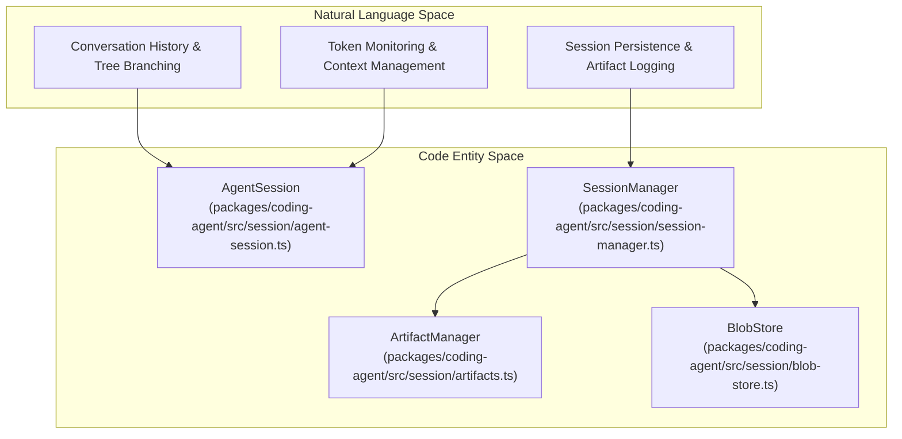
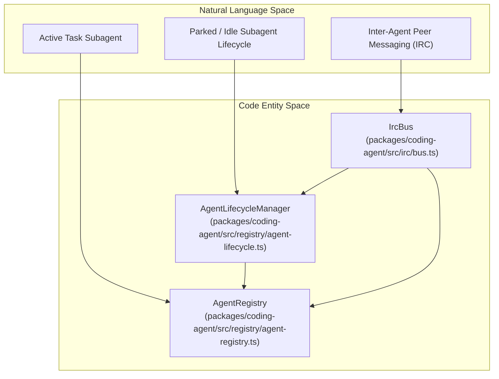

<!-- source: DeepWiki mcp.deepwiki.com · repo can1357/oh-my-pi · page 3 Agent Sessions · fetched 2026-10-30 -->

# Agent Sessions

Relevant source files

The following files were used as context for generating this wiki page:

- [docs/task-agent-discovery.md](docs/task-agent-discovery.md)
- [docs/tools/task.md](docs/tools/task.md)
- [packages/coding-agent/DEVELOPMENT.md](packages/coding-agent/DEVELOPMENT.md)
- [packages/coding-agent/src/cli/args.ts](packages/coding-agent/src/cli/args.ts)
- [packages/coding-agent/src/cli/extension-flags.ts](packages/coding-agent/src/cli/extension-flags.ts)
- [packages/coding-agent/src/cli/flag-tables.ts](packages/coding-agent/src/cli/flag-tables.ts)
- [packages/coding-agent/src/commands/launch.ts](packages/coding-agent/src/commands/launch.ts)
- [packages/coding-agent/src/main.ts](packages/coding-agent/src/main.ts)
- [packages/coding-agent/src/prompts/tools/task.md](packages/coding-agent/src/prompts/tools/task.md)
- [packages/coding-agent/src/sdk.ts](packages/coding-agent/src/sdk.ts)
- [packages/coding-agent/src/session/agent-session.ts](packages/coding-agent/src/session/agent-session.ts)
- [packages/coding-agent/src/session/session-entries.ts](packages/coding-agent/src/session/session-entries.ts)
- [packages/coding-agent/src/session/session-manager.ts](packages/coding-agent/src/session/session-manager.ts)
- [packages/coding-agent/src/task/executor.ts](packages/coding-agent/src/task/executor.ts)
- [packages/coding-agent/src/task/index.ts](packages/coding-agent/src/task/index.ts)
- [packages/coding-agent/src/task/persisted-revive.ts](packages/coding-agent/src/task/persisted-revive.ts)
- [packages/coding-agent/src/task/structured-subagent.ts](packages/coding-agent/src/task/structured-subagent.ts)
- [packages/coding-agent/src/task/types.ts](packages/coding-agent/src/task/types.ts)
- [packages/coding-agent/src/tools/index.ts](packages/coding-agent/src/tools/index.ts)
- [packages/coding-agent/test/acp-mcp-isolation.test.ts](packages/coding-agent/test/acp-mcp-isolation.test.ts)
- [packages/coding-agent/test/acp-session-effects.test.ts](packages/coding-agent/test/acp-session-effects.test.ts)
- [packages/coding-agent/test/agent-session-prompt-dispatch-race.test.ts](packages/coding-agent/test/agent-session-prompt-dispatch-race.test.ts)
- [packages/coding-agent/test/cli-explicit-extension-isolation.test.ts](packages/coding-agent/test/cli-explicit-extension-isolation.test.ts)
- [packages/coding-agent/test/cli-unknown-flag.test.ts](packages/coding-agent/test/cli-unknown-flag.test.ts)
- [packages/coding-agent/test/extension-flag-dispatch.test.ts](packages/coding-agent/test/extension-flag-dispatch.test.ts)
- [packages/coding-agent/test/extension-flag-initial-message.test.ts](packages/coding-agent/test/extension-flag-initial-message.test.ts)
- [packages/coding-agent/test/flag-tables.test.ts](packages/coding-agent/test/flag-tables.test.ts)
- [packages/coding-agent/test/initial-message.test.ts](packages/coding-agent/test/initial-message.test.ts)
- [packages/coding-agent/test/main-session-resolution-error.test.ts](packages/coding-agent/test/main-session-resolution-error.test.ts)
- [packages/coding-agent/test/sdk-workpool-yield-schema.test.ts](packages/coding-agent/test/sdk-workpool-yield-schema.test.ts)
- [packages/coding-agent/test/session-manager/move-to.test.ts](packages/coding-agent/test/session-manager/move-to.test.ts)
- [packages/coding-agent/test/session-manager/title-source-persistence.test.ts](packages/coding-agent/test/session-manager/title-source-persistence.test.ts)
- [packages/coding-agent/test/task/autoload-skills.test.ts](packages/coding-agent/test/task/autoload-skills.test.ts)
- [packages/coding-agent/test/task/executor-async-quiescence.test.ts](packages/coding-agent/test/task/executor-async-quiescence.test.ts)
- [packages/coding-agent/test/task/executor-launch-startup.test.ts](packages/coding-agent/test/task/executor-launch-startup.test.ts)
- [packages/coding-agent/test/task/executor-pass-through.test.ts](packages/coding-agent/test/task/executor-pass-through.test.ts)
- [packages/coding-agent/test/task/executor-prewalk.test.ts](packages/coding-agent/test/task/executor-prewalk.test.ts)
- [packages/coding-agent/test/task/executor-recent-output.test.ts](packages/coding-agent/test/task/executor-recent-output.test.ts)
- [packages/coding-agent/test/task/executor-soft-budget.test.ts](packages/coding-agent/test/task/executor-soft-budget.test.ts)
- [packages/coding-agent/test/task/executor-subagent-reminders.test.ts](packages/coding-agent/test/task/executor-subagent-reminders.test.ts)
- [packages/coding-agent/test/task/executor-wall-clock.test.ts](packages/coding-agent/test/task/executor-wall-clock.test.ts)
- [packages/coding-agent/test/task/executor-yield-loop.test.ts](packages/coding-agent/test/task/executor-yield-loop.test.ts)
- [packages/coding-agent/test/task/persisted-revive.test.ts](packages/coding-agent/test/task/persisted-revive.test.ts)
- [packages/coding-agent/test/task/structured-subagent.test.ts](packages/coding-agent/test/task/structured-subagent.test.ts)
- [packages/coding-agent/test/task/subagent-lsp.test.ts](packages/coding-agent/test/task/subagent-lsp.test.ts)
- [packages/coding-agent/test/task/task-batch.test.ts](packages/coding-agent/test/task/task-batch.test.ts)
- [packages/coding-agent/test/task/task-guards.test.ts](packages/coding-agent/test/task/task-guards.test.ts)
- [packages/coding-agent/test/task/task-schema.test.ts](packages/coding-agent/test/task/task-schema.test.ts)
- [packages/coding-agent/test/task/wire-schema.test.ts](packages/coding-agent/test/task/wire-schema.test.ts)
- [packages/coding-agent/test/tools/index.test.ts](packages/coding-agent/test/tools/index.test.ts)
- [packages/coding-agent/test/tools/schema-validation.test.ts](packages/coding-agent/test/tools/schema-validation.test.ts)

Agent sessions are the core state management abstraction in `oh-my-pi`, encapsulating the full lifecycle of an AI agent interaction [packages/coding-agent/src/session/session-manager.ts](). A session tracks conversation history, manages context windows, handles persistence, and coordinates between the AI model, tool execution, and user interface.

This page provides a high-level overview of agent sessions and their architecture. For detailed information on specific aspects:

- **Session Lifecycle**: Creation, resumption, continuation, branching, and forking. See [Session Lifecycle](#3.1).
- **Session Persistence**: JSONL-based storage format, artifact management, real-time saving, crash recovery, blob store, and session export. See [Session Persistence](#3.2).
- **Context Management and Compaction**: Token threshold monitoring, auto-compaction strategies, remote compaction, context promotion, and overflow recovery. See [Context Management and Compaction](#3.3).
- **System Prompts**: Construction pipeline, context files (`AGENTS.md`, `SYSTEM.md`), skill discovery, rule loading, and templates. See [System Prompts](#3.4).
- **Retry, Fallback and Turn Recovery**: Retryable error classification, backoff, fallback chains, usage-based routing, and replay safety. See [Retry, Fallback and Turn Recovery](#3.5).
- **Advisors and Autonomous Guidance**: `AdvisorRuntime`, session advisors, watchdogs, advise tool, transcript recorder, and emission guards. See [Advisors and Autonomous Guidance](#3.6).
- **Handoff and Message Pipeline**: Session handoff generation, session messages module, steering/interjection prompts, and message normalization. See [Handoff and Message Pipeline](#3.7).

---

## Core Concepts

An agent session represents a stateful conversation between a user and an AI agent, backed by durable storage and process-wide coordination registries. Each session maintains:

- **Conversation History and State**: Managed via structured message trees, supporting branching, alternative deliberations, and preservation of decision points [packages/coding-agent/src/session/session-entries.ts:1-190]().
- **Process-Global Registries**: Live sessions and subagents are tracked via `AgentRegistry` and managed across idle, parked, and active states by `AgentLifecycleManager` [packages/coding-agent/src/registry/agent-registry.ts:1-176](), [packages/coding-agent/src/registry/agent-lifecycle.ts:1-169]().
- **Inter-Agent Messaging**: Process-global communication is handled through `IrcBus`, delivering messages to live recipients or waking parked subagents [packages/coding-agent/src/irc/bus.ts:1-171]().
- **Persistence & Artifacts**: All events are appended to JSONL journals by `SessionManager`, accompanied by blob storage and binary artifact directories [packages/coding-agent/src/session/session-manager.ts:1-210]().

---

## Natural Language Space to Code Entity Space

### Diagram 1: Session Core and Persistence Mapping

This diagram bridges natural language session concepts to their concrete code entities in the `oh-my-pi` codebase.

Sources: packages/coding-agent/src/session/session-manager.ts:1-210; packages/coding-agent/src/session/session-entries.ts:1-190

---

### Diagram 2: Subagent Lifecycle and Inter-Agent Routing

This diagram maps multi-agent concepts and coordination to runtime registry and bus components.

Sources: packages/coding-agent/src/registry/agent-registry.ts:1-176; packages/coding-agent/src/registry/agent-lifecycle.ts:1-169; packages/coding-agent/src/irc/bus.ts:1-171

---

## Session Entry Types

Data inside sessions is stored as append-only structured entries (`SessionEntry`), representing discrete state transitions or historical records [packages/coding-agent/src/session/session-entries.ts:73-190]().

| Entry Type | Interface Name | Description |
| :--- | :--- | :--- |
| **Session Header** | `SessionHeader` | Metadata header containing session ID, cwd, version, and prompt cache keys [packages/coding-agent/src/session/session-entries.ts:37-58]() |
| **Message Entry** | `SessionMessageEntry` | Wraps user, assistant, or tool result messages [packages/coding-agent/src/session/session-entries.ts:80-84]() |
| **Compaction Entry** | `CompactionEntry` | Stores summarized token compaction blocks and metadata [packages/coding-agent/src/session/session-entries.ts:127-151]() |
| **Model Change Entry** | `ModelChangeEntry` | Records active model switches and fallback states [packages/coding-agent/src/session/session-entries.ts:112-120]() |
| **Custom Entry** | `CustomEntry` | Extension-specific state persistence across reloads [packages/coding-agent/src/session/session-entries.ts:185-190]() |

Sources: packages/coding-agent/src/session/session-entries.ts:37-190

---

## Summary of Child Pages

For comprehensive implementation details, consult the child pages:

- **3.1 Session Lifecycle**: Document session creation, resumption, continuation, branching, and forking.
- **3.2 Session Persistence**: Explain JSONL-based session storage, artifacts, real-time saving, crash recovery, blob store, and session export.
- **3.3 Context Management and Compaction**: Describe token threshold monitoring, auto-compaction strategies, remote compaction, context promotion, and overflow recovery.
- **3.4 System Prompts**: Explain system prompt construction, context files, skill discovery, rule loading, templates, and customization.
- **3.5 Retry, Fallback and Turn Recovery**: Document TurnRecovery, retryable error classification, backoff, fallback chains, and replay safety.
- **3.6 Advisors and Autonomous Guidance**: Explain `AdvisorRuntime`, session advisors, watchdogs, advise tool, transcript recorder, and emission guards.
- **3.7 Handoff and Message Pipeline**: Document session handoff generation, session messages module, steering/interjection prompts, and message normalization.

Sources: packages/coding-agent/src/session/session-manager.ts:1-210; packages/coding-agent/src/registry/agent-registry.ts:1-176

---

