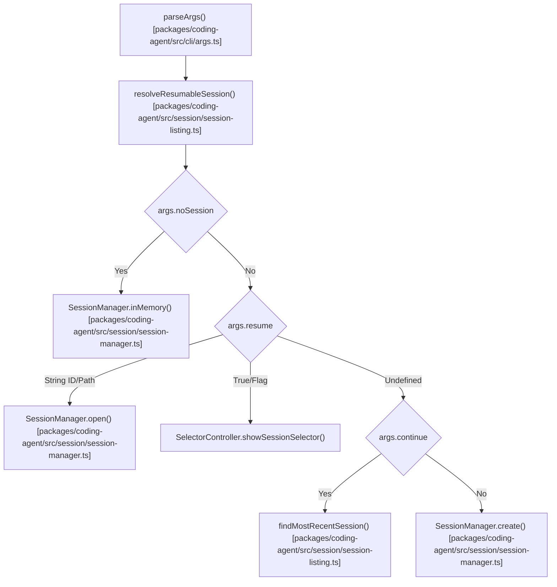
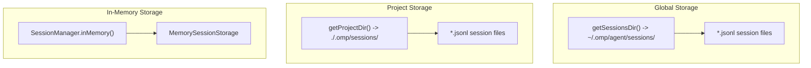
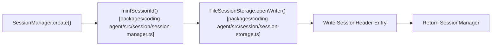
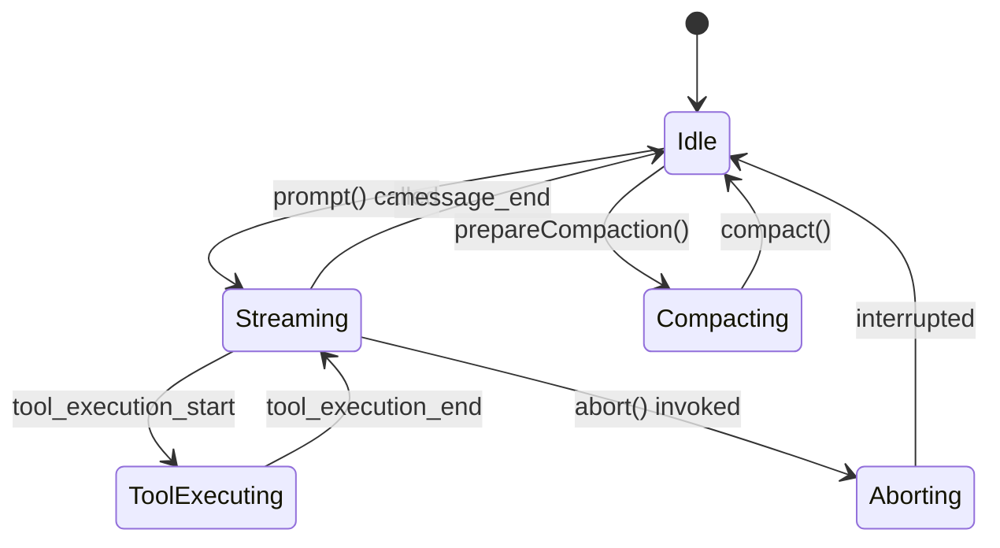

<!-- source: DeepWiki mcp.deepwiki.com · repo can1357/oh-my-pi · page 3.1 Session Lifecycle · fetched 2026-10-30 -->

# Session Lifecycle

<details>
<summary>Relevant source files</summary>

The following files were used as context for generating this wiki page:

- [docs/session.md](docs/session.md)
- [packages/coding-agent/src/cli/args.ts](packages/coding-agent/src/cli/args.ts)
- [packages/coding-agent/src/cli/extension-flags.ts](packages/coding-agent/src/cli/extension-flags.ts)
- [packages/coding-agent/src/cli/flag-tables.ts](packages/coding-agent/src/cli/flag-tables.ts)
- [packages/coding-agent/src/cli/gc-cli.ts](packages/coding-agent/src/cli/gc-cli.ts)
- [packages/coding-agent/src/cli/gc-compress.ts](packages/coding-agent/src/cli/gc-compress.ts)
- [packages/coding-agent/src/cli/gc-settings.ts](packages/coding-agent/src/cli/gc-settings.ts)
- [packages/coding-agent/src/commands/gc.ts](packages/coding-agent/src/commands/gc.ts)
- [packages/coding-agent/src/commands/launch.ts](packages/coding-agent/src/commands/launch.ts)
- [packages/coding-agent/src/main.ts](packages/coding-agent/src/main.ts)
- [packages/coding-agent/src/session/indexed-session-storage.ts](packages/coding-agent/src/session/indexed-session-storage.ts)
- [packages/coding-agent/src/session/session-listing.ts](packages/coding-agent/src/session/session-listing.ts)
- [packages/coding-agent/src/session/session-manager.ts](packages/coding-agent/src/session/session-manager.ts)
- [packages/coding-agent/src/session/session-storage.ts](packages/coding-agent/src/session/session-storage.ts)
- [packages/coding-agent/test/acp-mcp-isolation.test.ts](packages/coding-agent/test/acp-mcp-isolation.test.ts)
- [packages/coding-agent/test/acp-session-effects.test.ts](packages/coding-agent/test/acp-session-effects.test.ts)
- [packages/coding-agent/test/cli-explicit-extension-isolation.test.ts](packages/coding-agent/test/cli-explicit-extension-isolation.test.ts)
- [packages/coding-agent/test/cli-unknown-flag.test.ts](packages/coding-agent/test/cli-unknown-flag.test.ts)
- [packages/coding-agent/test/extension-flag-dispatch.test.ts](packages/coding-agent/test/extension-flag-dispatch.test.ts)
- [packages/coding-agent/test/extension-flag-initial-message.test.ts](packages/coding-agent/test/extension-flag-initial-message.test.ts)
- [packages/coding-agent/test/flag-tables.test.ts](packages/coding-agent/test/flag-tables.test.ts)
- [packages/coding-agent/test/gc-cli.test.ts](packages/coding-agent/test/gc-cli.test.ts)
- [packages/coding-agent/test/initial-message.test.ts](packages/coding-agent/test/initial-message.test.ts)
- [packages/coding-agent/test/main-session-resolution-error.test.ts](packages/coding-agent/test/main-session-resolution-error.test.ts)
- [packages/coding-agent/test/session-manager-atomic-rewrite-race.test.ts](packages/coding-agent/test/session-manager-atomic-rewrite-race.test.ts)
- [packages/coding-agent/test/session-manager/move-to.test.ts](packages/coding-agent/test/session-manager/move-to.test.ts)
- [packages/coding-agent/test/session-manager/title-source-persistence.test.ts](packages/coding-agent/test/session-manager/title-source-persistence.test.ts)
- [packages/coding-agent/test/session-storage.test.ts](packages/coding-agent/test/session-storage.test.ts)
- [packages/coding-agent/test/session/publish-lock-os-gate.test.ts](packages/coding-agent/test/session/publish-lock-os-gate.test.ts)
- [packages/coding-agent/test/session/session-status.test.ts](packages/coding-agent/test/session/session-status.test.ts)
- [packages/stats/src/embedded-client.ts](packages/stats/src/embedded-client.ts)
- [packages/stats/src/live.ts](packages/stats/src/live.ts)
- [packages/stats/src/rollup.ts](packages/stats/src/rollup.ts)
- [packages/stats/test/live-external-writes.test.ts](packages/stats/test/live-external-writes.test.ts)

</details>


## Purpose and Scope

This page documents the lifecycle operations for agent sessions in `oh-my-pi`, including creation, resumption, continuation, branching, forking, and interactive switching. It explains how sessions are initialized, located on disk or in memory, transitioned, and managed during runtime through the core classes `AgentSession` and `SessionManager`.

For complementary details on session file persistence, see [Session Persistence (3.2)](). For context token management and compaction strategies, see [Context Management and Compaction (3.3)]().

Sources:  
[packages/coding-agent/src/session/session-manager.ts:1-200](),  
[packages/coding-agent/src/main.ts:100-125]()

---

## Session Operations Overview

The `oh-my-pi` agent supports multiple session lifecycle operations, orchestrated mainly by `SessionManager` and `AgentSession`. Each serves specific user workflows:

| Operation      | Description                                  | CLI Flag / Command     | Key Code Entity                                    |
|----------------|----------------------------------------------|-----------------------|---------------------------------------------------|
| **Create**     | Start a brand-new empty session              | (default)             | `SessionManager.create()`<br>[packages/coding-agent/src/session/session-manager.ts:285-300]()             |
| **Open**       | Load an existing session by path or ID      | `--resume <id|path>`  | `SessionManager.open()`<br>[packages/coding-agent/src/session/session-manager.ts:316-335]()               |
| **Continue**   | Resume most recent session automatically     | `--continue` / `-c`   | `findMostRecentSession()`<br>[packages/coding-agent/src/session/session-listing.ts:60-90]()               |
| **Branch**     | Create a new conversation branch from a message | `/branch` slash command | `AgentSession.branch()`<br>[packages/coding-agent/src/session/session-manager.ts:1-50]()                 |
| **Fork**       | Duplicate a full session file to a new location | (automatic or `/fork`) | `SessionManager.forkFrom()`<br>[packages/coding-agent/src/session/session-manager.ts:340-362]()           |
| **In-Memory**  | Ephemeral session with no persistence       | `--no-session`        | `SessionManager.inMemory()`<br>[packages/coding-agent/src/session/session-manager.ts:275-280]()           |

Sources:  
[packages/coding-agent/src/session/session-manager.ts:275-362](),  
[packages/coding-agent/src/session/session-listing.ts:60-90]()

---

## Session Resolution Flow

The CLI entrypoint (`[packages/coding-agent/src/main.ts]`) parses arguments via `parseArgs` in `[packages/coding-agent/src/cli/args.ts]()` and invokes session resolution mechanisms.

Title: "Session Resolution Flow (Natural Language to Code Space)"


Sources:  
[packages/coding-agent/src/main.ts:100-125](),  
[packages/coding-agent/src/cli/args.ts:26-121](),  
[packages/coding-agent/src/session/session-manager.ts:275-362](),  
[packages/coding-agent/src/session/session-listing.ts:60-90]()

---

## Session Storage Locations

Sessions are stored persistently using `FileSessionStorage` or volatilized via `MemorySessionStorage`:



Sources:  
[packages/coding-agent/src/session/session-manager.ts:1-20](),  
[packages/coding-agent/src/session/session-storage.ts:114-118]()

---

## Session Creation and Headers

New session files are initialized by writing a JSONL-based header entry (`SessionHeader`) with essential metadata.

Title: "Session Creation Data Flow"


- `mintSessionId()` allocates a unique ID via `Bun.randomUUIDv7()` [packages/coding-agent/src/session/session-manager.ts:139-141]().
- The header entry defines the protocol version (`CURRENT_SESSION_VERSION`), session ID, working directory (`cwd`), and metadata [docs/session.md:73-87]().

Sources:  
[packages/coding-agent/src/session/session-manager.ts:139-141](),  
[packages/coding-agent/src/session/session-storage.ts:114-118](),  
[docs/session.md:73-87]()

---

## Branching and Forking

- **Branching**: Managed via `AgentSession.branch()` [packages/coding-agent/src/session/agent-session.ts:386-438](), writing a `branch_summary` entry representing a semantic fork point without full file duplication.
- **Forking**: `SessionManager.forkFrom()` duplicates the underlying `.jsonl` session file and its corresponding artifact directory via `copySessionArtifacts()` [packages/coding-agent/src/session/session-manager.ts:173-205,340-362]().

Title: "Branching and Forking Code Architecture"
```mermaid
flowchart TD
    Session["AgentSession / SessionManager"] -->|branch()| BranchEntry["Write branch_summary entry"]
    Session -->|forkFrom()| CopyFile["Duplicate JSONl Session File"]
    CopyFile --> CopyArt["copySessionArtifacts() [packages/coding-agent/src/session/session-manager.ts]"]
```

Sources:  
[packages/coding-agent/src/session/session-manager.ts:173-205,340-362]()

---

## Runtime State Transitions

At runtime, `AgentSession` manages an active state machine driven by streaming LLM events and tool executions.

Title: "AgentSession Runtime State Machine"


Sources:  
[packages/coding-agent/src/session/session-manager.ts:1-50]()

---

# End of Session Lifecycle (3.1)

---

