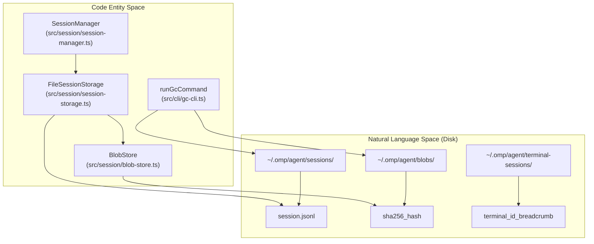
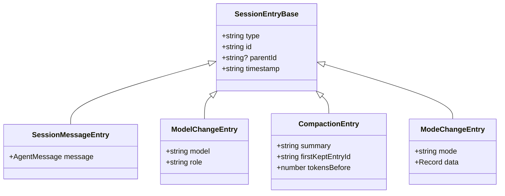
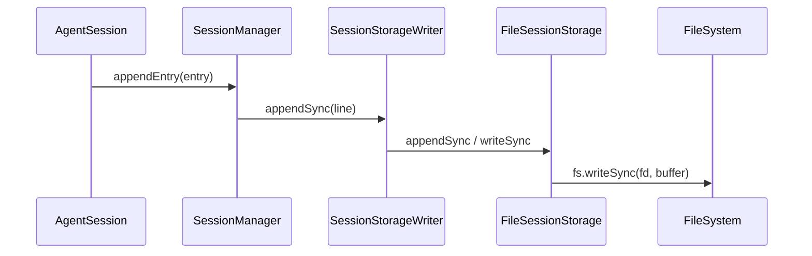
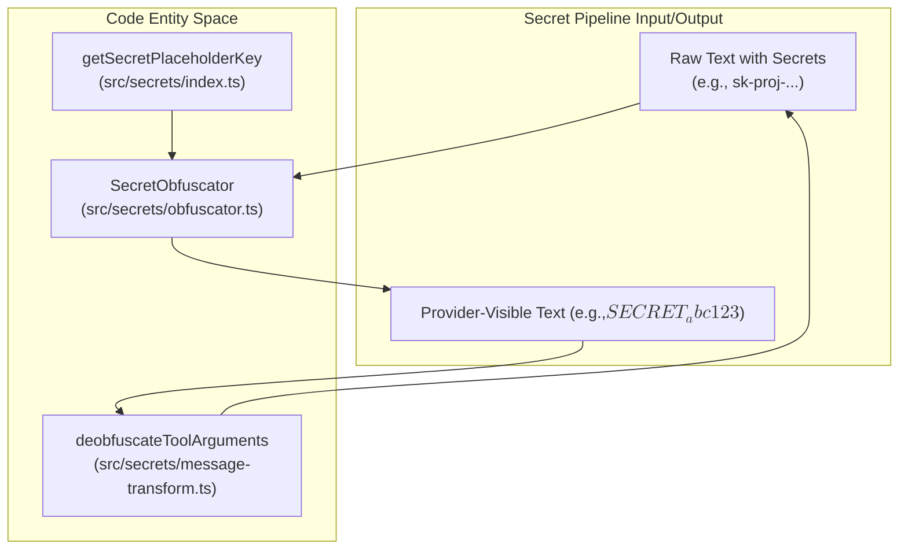

<!-- source: DeepWiki mcp.deepwiki.com · repo can1357/oh-my-pi · page 3.2 Session Persistence · fetched 2026-10-30 -->

# Session Persistence

<details>
<summary>Relevant source files</summary>

The following files were used as context for generating this wiki page:

- [docs/secrets.md](docs/secrets.md)
- [docs/session.md](docs/session.md)
- [packages/agent/test/normalize-tools-prune.test.ts](packages/agent/test/normalize-tools-prune.test.ts)
- [packages/coding-agent/bench/secrets-history.bench.ts](packages/coding-agent/bench/secrets-history.bench.ts)
- [packages/coding-agent/src/cli/gc-cli.ts](packages/coding-agent/src/cli/gc-cli.ts)
- [packages/coding-agent/src/cli/gc-compress.ts](packages/coding-agent/src/cli/gc-compress.ts)
- [packages/coding-agent/src/cli/gc-settings.ts](packages/coding-agent/src/cli/gc-settings.ts)
- [packages/coding-agent/src/commands/gc.ts](packages/coding-agent/src/commands/gc.ts)
- [packages/coding-agent/src/compress/protocol.ts](packages/coding-agent/src/compress/protocol.ts)
- [packages/coding-agent/src/compress/session.ts](packages/coding-agent/src/compress/session.ts)
- [packages/coding-agent/src/export/share.ts](packages/coding-agent/src/export/share.ts)
- [packages/coding-agent/src/prompts/tools/yield-data-error-conflict.md](packages/coding-agent/src/prompts/tools/yield-data-error-conflict.md)
- [packages/coding-agent/src/secrets/index.ts](packages/coding-agent/src/secrets/index.ts)
- [packages/coding-agent/src/secrets/message-transform.ts](packages/coding-agent/src/secrets/message-transform.ts)
- [packages/coding-agent/src/secrets/obfuscator.ts](packages/coding-agent/src/secrets/obfuscator.ts)
- [packages/coding-agent/src/secrets/patterns.ts](packages/coding-agent/src/secrets/patterns.ts)
- [packages/coding-agent/src/secrets/placeholder-scan.ts](packages/coding-agent/src/secrets/placeholder-scan.ts)
- [packages/coding-agent/src/secrets/placeholder.ts](packages/coding-agent/src/secrets/placeholder.ts)
- [packages/coding-agent/src/secrets/registry-revision.ts](packages/coding-agent/src/secrets/registry-revision.ts)
- [packages/coding-agent/src/session/blob-store.ts](packages/coding-agent/src/session/blob-store.ts)
- [packages/coding-agent/src/session/indexed-session-storage.ts](packages/coding-agent/src/session/indexed-session-storage.ts)
- [packages/coding-agent/src/session/session-listing.ts](packages/coding-agent/src/session/session-listing.ts)
- [packages/coding-agent/src/session/session-loader.ts](packages/coding-agent/src/session/session-loader.ts)
- [packages/coding-agent/src/session/session-persistence.ts](packages/coding-agent/src/session/session-persistence.ts)
- [packages/coding-agent/src/session/session-storage-errors.ts](packages/coding-agent/src/session/session-storage-errors.ts)
- [packages/coding-agent/src/session/session-storage.ts](packages/coding-agent/src/session/session-storage.ts)
- [packages/coding-agent/src/task/yield-assembly.ts](packages/coding-agent/src/task/yield-assembly.ts)
- [packages/coding-agent/src/tools/output-schema-validator.ts](packages/coding-agent/src/tools/output-schema-validator.ts)
- [packages/coding-agent/src/tools/yield.ts](packages/coding-agent/src/tools/yield.ts)
- [packages/coding-agent/test/agent-session-openai-responses-replay.test.ts](packages/coding-agent/test/agent-session-openai-responses-replay.test.ts)
- [packages/coding-agent/test/gc-cli.test.ts](packages/coding-agent/test/gc-cli.test.ts)
- [packages/coding-agent/test/sdk-session-isolation.test.ts](packages/coding-agent/test/sdk-session-isolation.test.ts)
- [packages/coding-agent/test/secrets-fast-paths.test.ts](packages/coding-agent/test/secrets-fast-paths.test.ts)
- [packages/coding-agent/test/secrets-obfuscator.test.ts](packages/coding-agent/test/secrets-obfuscator.test.ts)
- [packages/coding-agent/test/secrets-prefilter.test.ts](packages/coding-agent/test/secrets-prefilter.test.ts)
- [packages/coding-agent/test/session-loader-stream.test.ts](packages/coding-agent/test/session-loader-stream.test.ts)
- [packages/coding-agent/test/session-manager-atomic-rewrite-race.test.ts](packages/coding-agent/test/session-manager-atomic-rewrite-race.test.ts)
- [packages/coding-agent/test/session-manager/signature-persistence.test.ts](packages/coding-agent/test/session-manager/signature-persistence.test.ts)
- [packages/coding-agent/test/session-manager/snapcompact-archive-persistence.test.ts](packages/coding-agent/test/session-manager/snapcompact-archive-persistence.test.ts)
- [packages/coding-agent/test/session-persistence-images.test.ts](packages/coding-agent/test/session-persistence-images.test.ts)
- [packages/coding-agent/test/session-persistence-reasoning-dedup.test.ts](packages/coding-agent/test/session-persistence-reasoning-dedup.test.ts)
- [packages/coding-agent/test/session-read-only-hydration.test.ts](packages/coding-agent/test/session-read-only-hydration.test.ts)
- [packages/coding-agent/test/session-storage.test.ts](packages/coding-agent/test/session-storage.test.ts)
- [packages/coding-agent/test/session/blob-store.test.ts](packages/coding-agent/test/session/blob-store.test.ts)
- [packages/coding-agent/test/session/peek-session-init.test.ts](packages/coding-agent/test/session/peek-session-init.test.ts)
- [packages/coding-agent/test/session/publish-lock-os-gate.test.ts](packages/coding-agent/test/session/publish-lock-os-gate.test.ts)
- [packages/coding-agent/test/session/session-loader-enotdir.test.ts](packages/coding-agent/test/session/session-loader-enotdir.test.ts)
- [packages/coding-agent/test/session/session-status.test.ts](packages/coding-agent/test/session/session-status.test.ts)
- [packages/coding-agent/test/share.test.ts](packages/coding-agent/test/share.test.ts)
- [packages/coding-agent/test/task/executor-deferred-cleanup.test.ts](packages/coding-agent/test/task/executor-deferred-cleanup.test.ts)
- [packages/coding-agent/test/task/executor-structured-sidecar.test.ts](packages/coding-agent/test/task/executor-structured-sidecar.test.ts)
- [packages/coding-agent/test/task/executor-warnings.test.ts](packages/coding-agent/test/task/executor-warnings.test.ts)
- [packages/coding-agent/test/tools/browser-schema.test.ts](packages/coding-agent/test/tools/browser-schema.test.ts)
- [packages/coding-agent/test/tools/grep-snapshot-tags.test.ts](packages/coding-agent/test/tools/grep-snapshot-tags.test.ts)
- [packages/coding-agent/test/tools/output-schema-validator.test.ts](packages/coding-agent/test/tools/output-schema-validator.test.ts)
- [packages/coding-agent/test/tools/provider-schema-compatibility.test.ts](packages/coding-agent/test/tools/provider-schema-compatibility.test.ts)
- [packages/coding-agent/test/tools/yield.test.ts](packages/coding-agent/test/tools/yield.test.ts)
- [packages/stats/src/embedded-client.ts](packages/stats/src/embedded-client.ts)
- [packages/stats/src/live.ts](packages/stats/src/live.ts)
- [packages/stats/src/rollup.ts](packages/stats/src/rollup.ts)
- [packages/stats/test/live-external-writes.test.ts](packages/stats/test/live-external-writes.test.ts)
- [packages/tui/src/tools/task-yield-assembly.ts](packages/tui/src/tools/task-yield-assembly.ts)

</details>


## Purpose and Scope

Session persistence in *oh-my-pi* provides a robust, durable system for saving, restoring, and managing conversation history, assistant turns, and metadata for the AI-powered coding agent. The persistence subsystem records all interactions—including user and assistant messages, model changes, branching points, tool outputs, and execution states—enabling live sessions to be resumed, explored, branched, or exported reliably.

The core storage format is an append-only newline-delimited JSON (JSONL) log, augmented by a content-addressed blob store for large binaries and auxiliary SQLite metadata bases. This infrastructure supports real-time saving, crash recovery, secret obfuscation, and garbage collection.

This page covers:
- JSONL session storage format, header structure, and versioning
- Entry taxonomy and conversation tree semantics (`id`, `parentId`)
- Real-time persistence and crash recovery guarantees via `FileSessionStorage`
- Content-addressed blob store externalization (`BlobStore`)
- Secret obfuscation and safety pipelines (`SecretObfuscator`)
- Maintenance and garbage collection via `runGcCommand`

---

## Storage Architecture and File Layout

Sessions and their auxiliary state are organized on disk under the agent directory structure (`~/.omp/agent/` by default). The persistence subsystem coordinates between high-level orchestration classes and low-level file storage handlers.



**Sources:**  
`docs/session.md:37-62()`  
`packages/coding-agent/src/session/session-storage.ts:1-169()`  
`packages/coding-agent/src/cli/gc-cli.ts:1-100()`

---

## JSONL Session Format and Versioning

Session files are stored in newline-delimited JSON (JSONL), where each line is an independent JSON object representing an atomic event or metadata record. 

### Header and Fixed-Width Title Slot

- **Session Header:** The logical first entry of every valid session file is a session header record (`type: "session"`) containing the schema version, session UUID, creation timestamp, and working directory [docs/session.md:67-87]().
- **Title Slot:** Current files physically begin with a fixed-width title slot (e.g., 256 bytes) followed by the header, allowing in-place title updates via synchronous file writes without rewriting the entire transcript [docs/session.md:63-65]().

```jsonl
{"type":"session","version":3,"id":"019c625b-b900-7000-8000-000000000001","timestamp":"2026-02-16T10:20:30.000Z","cwd":"/work/pi"}
{"type":"message","id":"8-char-id","parentId":null,"timestamp":"2026-02-16T10:20:30.000Z","message":{"role":"user","content":"Hello"}}
```

**Sources:**  
`docs/session.md:63-99()`  
`packages/coding-agent/src/session/session-loader.ts:163-179()`

---

## Entry Taxonomy and Conversation Trees

Non-header entries inherit from `SessionEntryBase` [docs/session.md:99-112]() and form a directed tree via `parentId` links:



- **Branching and Forking:** Because every entry references its parent explicitly by `parentId`, sessions support branching threads and parallel conversation explorations without mutating history [docs/session.md:67-69]().

**Sources:**  
`docs/session.md:100-135()`  
`packages/coding-agent/src/session/session-entries.ts:1-50()`

---

## Real-Time Saving, Synchronization, and Crash Recovery

Session writing is handled by `FileSessionStorage` and its associated writer interface, optimizing for minimal latency and strict crash durability [packages/coding-agent/src/session/session-storage.ts:65-94]().



- **Immediate Visibility:** Appends are written synchronously using `appendSync`, ensuring that each line reaches the OS file descriptor before the call returns, without requiring asynchronous microtask drains [packages/coding-agent/test/session-storage.test.ts:109-122]().
- **Crash Recovery:** Because entries are newline-terminated and written atomically per line, process crashes or abrupt terminations leave at most a partial trailing line. Parsers use lenient JSONL scanning (`parseJsonlLenient`) to discard malformed trailing records during load, ensuring previous complete turns remain fully intact [packages/coding-agent/src/session/session-loader.ts:163-179]().

**Sources:**  
`packages/coding-agent/src/session/session-storage.ts:65-94()`  
`packages/coding-agent/test/session-storage.test.ts:109-122()`  
`packages/coding-agent/src/session/session-loader.ts:163-179()`

---

## Blob Store and Artifact Management

To maintain compact session JSONL files, large payloads such as binary images or extensive tool outputs are externalized.

- **BlobStore:** Content-addressed binary store keyed by SHA-256 hashes under `~/.omp/agent/blobs/<sha256>`. Large content in messages is replaced with `blob:sha256:<hash>` references during persistence and resolved lazily on session load [docs/session.md:49-53]() [packages/coding-agent/src/session/blob-store.ts:1-22]().
- **Deduplication:** Identical binary payloads share the same content-addressed storage entry across different sessions.

**Sources:**  
`docs/session.md:49-62()`  
`packages/coding-agent/src/session/blob-store.ts:1-22()`

---

## Secret Obfuscation Pipeline

To prevent sensitive tokens (API keys, credentials, private keys) from reaching LLM providers or persisting unmasked in plain text, *oh-my-pi* applies a rigorous secret obfuscation and deobfuscation pipeline managed by `SecretObfuscator` [packages/coding-agent/src/secrets/obfuscator.ts:141-180]() and `getSecretPlaceholderKey` [packages/coding-agent/src/secrets/index.ts:23-53]().



- **Per-Install Key:** A cryptographic key stored securely under XDG state (`secret-placeholder.key`) salts placeholder generation, ensuring cross-session stability while making dictionary reversal infeasible for model outputs [packages/coding-agent/src/secrets/index.ts:23-53]().
- **Bidirectional Restoration:** When models echo placeholders back into tool arguments (e.g., file editing commands), `deobfuscateToolArguments` restores the exact original byte sequence before execution [packages/coding-agent/test/secrets-obfuscator.test.ts:80-95]().

**Sources:**  
`packages/coding-agent/src/secrets/obfuscator.ts:141-180()`  
`packages/coding-agent/src/secrets/index.ts:23-53()`  
`packages/coding-agent/test/secrets-obfuscator.test.ts:80-95()`

---

## Garbage Collection and Maintenance

Over time, stale sessions, unreferenced blobs, and temporary staging files accumulate. The garbage collection CLI (`omp gc`) handles maintenance operations [packages/coding-agent/src/cli/gc-cli.ts:1-100]() via `runGcCommand` [packages/coding-agent/test/gc-cli.test.ts:130-182]().

- **Blob Sweep:** Prunes unreferenced content-addressed blobs from `~/.omp/agent/blobs/` whose SHA-256 hashes no longer appear in any active session file [packages/coding-agent/src/cli/gc-cli.ts:100-110]().
- **Stale Pointer Cleanup:** Removes dangling custom-session markers, expired terminal breadcrumbs, and abandoned staging temporary files (`.tmp`) left behind by killed or crashed writers [packages/coding-agent/src/cli/gc-cli.ts:115-156]().

**Sources:**  
`packages/coding-agent/src/cli/gc-cli.ts:79-190()`  
`packages/coding-agent/test/gc-cli.test.ts:130-182()`

---

