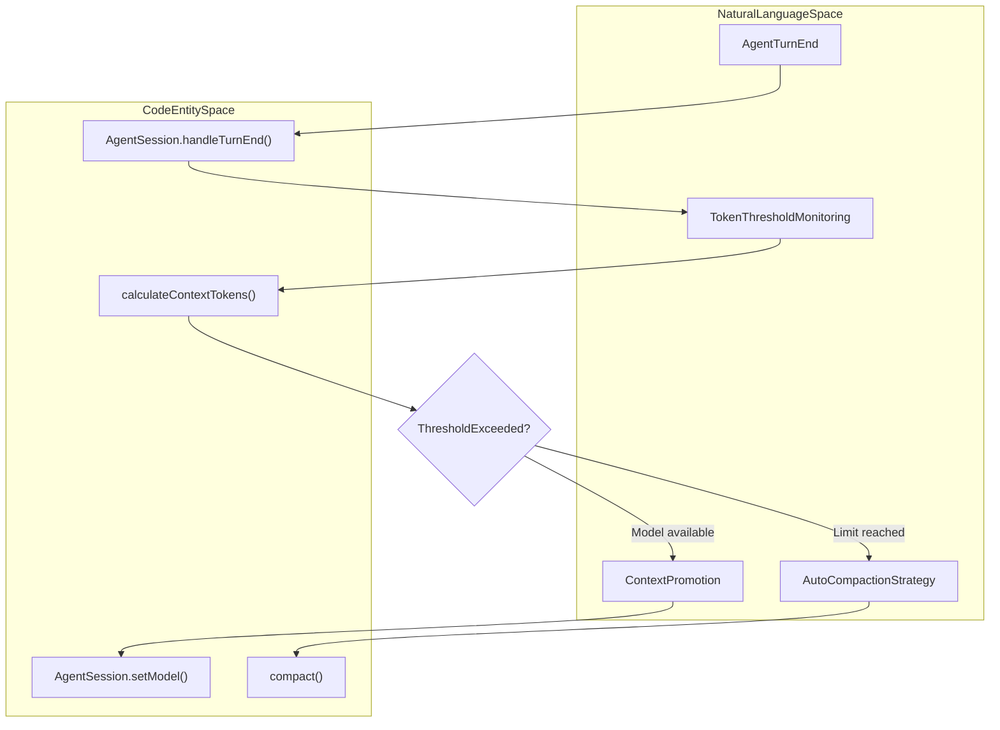
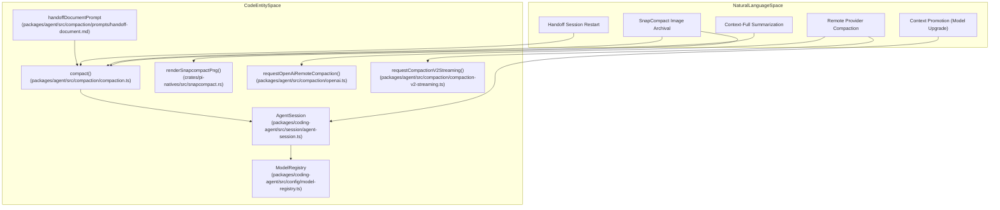

<!-- source: DeepWiki mcp.deepwiki.com · repo can1357/oh-my-pi · page 3.3 Context Management and Compaction · fetched 2026-10-30 -->

# Context Management and Compaction

<details>
<summary>Relevant source files</summary>

The following files were used as context for generating this wiki page:

- [docs/compaction.md](docs/compaction.md)
- [packages/agent/src/compaction/anthropic.ts](packages/agent/src/compaction/anthropic.ts)
- [packages/agent/src/compaction/compaction-v2-streaming.ts](packages/agent/src/compaction/compaction-v2-streaming.ts)
- [packages/agent/src/compaction/compaction.ts](packages/agent/src/compaction/compaction.ts)
- [packages/agent/src/compaction/openai.ts](packages/agent/src/compaction/openai.ts)
- [packages/agent/test/anthropic-native-compaction.test.ts](packages/agent/test/anthropic-native-compaction.test.ts)
- [packages/agent/test/remote-compaction.test.ts](packages/agent/test/remote-compaction.test.ts)
- [packages/agent/test/snapcompact-frames.test.ts](packages/agent/test/snapcompact-frames.test.ts)
- [packages/ai/test/anthropic-server-compaction.test.ts](packages/ai/test/anthropic-server-compaction.test.ts)
- [packages/catalog/src/compat/image-tokenization.ts](packages/catalog/src/compat/image-tokenization.ts)
- [packages/catalog/src/compat/rules/classes/deepseek.kdl](packages/catalog/src/compat/rules/classes/deepseek.kdl)
- [packages/catalog/src/compat/rules/providers/cursor.kdl](packages/catalog/src/compat/rules/providers/cursor.kdl)
- [packages/catalog/test/cursor-pricing.test.ts](packages/catalog/test/cursor-pricing.test.ts)
- [packages/catalog/test/image-tokenization.test.ts](packages/catalog/test/image-tokenization.test.ts)
- [packages/coding-agent/src/advisor/settings.ts](packages/coding-agent/src/advisor/settings.ts)
- [packages/coding-agent/src/prompts/system/image-attachment.md](packages/coding-agent/src/prompts/system/image-attachment.md)
- [packages/coding-agent/src/prompts/system/snapcompact-read-note.md](packages/coding-agent/src/prompts/system/snapcompact-read-note.md)
- [packages/coding-agent/src/session/agent-session-types.ts](packages/coding-agent/src/session/agent-session-types.ts)
- [packages/coding-agent/src/session/session-context.ts](packages/coding-agent/src/session/session-context.ts)
- [packages/coding-agent/src/session/session-provider-boundary.ts](packages/coding-agent/src/session/session-provider-boundary.ts)
- [packages/coding-agent/src/session/shake-types.ts](packages/coding-agent/src/session/shake-types.ts)
- [packages/coding-agent/src/session/snapcompact-inline.ts](packages/coding-agent/src/session/snapcompact-inline.ts)
- [packages/coding-agent/test/advisor-advise-terminal.test.ts](packages/coding-agent/test/advisor-advise-terminal.test.ts)
- [packages/coding-agent/test/advisor-tool-call-loop-guard.test.ts](packages/coding-agent/test/advisor-tool-call-loop-guard.test.ts)
- [packages/coding-agent/test/agent-session-advisor-suppression.test.ts](packages/coding-agent/test/agent-session-advisor-suppression.test.ts)
- [packages/coding-agent/test/agent-session-advisor-terminal-unwind.test.ts](packages/coding-agent/test/agent-session-advisor-terminal-unwind.test.ts)
- [packages/coding-agent/test/agent-session-auto-compaction-queue.test.ts](packages/coding-agent/test/agent-session-auto-compaction-queue.test.ts)
- [packages/coding-agent/test/agent-session-message-pipeline.test.ts](packages/coding-agent/test/agent-session-message-pipeline.test.ts)
- [packages/coding-agent/test/agent-session-snapcompact-budget.test.ts](packages/coding-agent/test/agent-session-snapcompact-budget.test.ts)
- [packages/coding-agent/test/agent-session-snapcompact-trigger-room.test.ts](packages/coding-agent/test/agent-session-snapcompact-trigger-room.test.ts)
- [packages/coding-agent/test/compaction.test.ts](packages/coding-agent/test/compaction.test.ts)
- [packages/coding-agent/test/image-paste-source-path.test.ts](packages/coding-agent/test/image-paste-source-path.test.ts)
- [packages/coding-agent/test/issue-12247-abandoned-tool-call-rebuild.test.ts](packages/coding-agent/test/issue-12247-abandoned-tool-call-rebuild.test.ts)
- [packages/coding-agent/test/session-manager/build-context.test.ts](packages/coding-agent/test/session-manager/build-context.test.ts)
- [packages/coding-agent/test/session/session-context.test.ts](packages/coding-agent/test/session/session-context.test.ts)
- [packages/coding-agent/test/shake.test.ts](packages/coding-agent/test/shake.test.ts)
- [packages/coding-agent/test/snapcompact-inline.test.ts](packages/coding-agent/test/snapcompact-inline.test.ts)
- [packages/snapcompact/CHANGELOG.md](packages/snapcompact/CHANGELOG.md)
- [packages/snapcompact/README.md](packages/snapcompact/README.md)
- [packages/snapcompact/src/prompts/snapcompact-summary.md](packages/snapcompact/src/prompts/snapcompact-summary.md)
- [packages/snapcompact/src/snapcompact.ts](packages/snapcompact/src/snapcompact.ts)
- [packages/snapcompact/test/snapcompact.test.ts](packages/snapcompact/test/snapcompact.test.ts)
- [packages/tui/src/chat/messages.ts](packages/tui/src/chat/messages.ts)
- [packages/tui/src/prompt/image-source.ts](packages/tui/src/prompt/image-source.ts)
- [packages/tui/src/prompt/video.ts](packages/tui/src/prompt/video.ts)
- [packages/tui/test/box-border.test.ts](packages/tui/test/box-border.test.ts)

</details>


## Purpose and Scope

This page documents the session context management subsystem of `oh-my-pi`, designed to keep conversation state within provider token limits during long development sessions. It details token threshold calculations, automatic context promotion, local and remote compaction strategies (`context-full`, `handoff`, `shake`, `snapcompact`), remote compaction pipelines (`openai.ts`), and overflow recovery safeguards.

Sources:  
- [packages/agent/src/compaction/compaction.ts:1-180]()  
- [packages/coding-agent/src/session/session-context.ts:1-110]()  
- [docs/compaction.md:1-120]()

---

## Overview and Compaction Lifecycle

Context management is executed primarily within the `AgentSession` class and orchestrated via session maintenance subsystems [packages/coding-agent/src/session/session-maintenance.ts:1-47](). After each assistant turn concludes, token usage is calculated from usage metadata embedded in messages. When calculated token usage exceeds the configured threshold, the session either promotes to a larger context model or triggers one of several compaction strategies to reduce context size and maintain continuity.

Compaction and context maintenance can be triggered in multiple ways (as outlined in [docs/compaction.md:66-78]()):
1. **Manual context compaction**: `/compact [instructions]` calls `AgentSession.compact(...)`.
2. **Automatic overflow recovery**: triggered after an assistant error matching context overflow.
3. **Automatic incomplete-output recovery**: triggered when an assistant message ends with `stopReason === "length"`, subject to output-cap and retry constraints (`INCOMPLETE_RECOVERY_MAX_RETRIES`) [packages/coding-agent/src/session/session-maintenance.ts:146-155]().
4. **Automatic threshold maintenance**: runs after a successful turn when context exceeds the resolved threshold.
5. **Mid-turn threshold maintenance**: runs before the next provider request when a tool-loop turn crosses the threshold and `compaction.midTurnEnabled !== false`.
6. **Idle maintenance**: invoked via `runIdleCompaction()`.

Title: "Lifecycle and Execution Flow of Context Compaction"


Sources:  
- [packages/agent/src/compaction/compaction.ts:145-180]()  
- [packages/coding-agent/src/session/session-context.ts:109-160]()  
- [docs/compaction.md:66-120]()

---

## Token Tracking and Thresholds

### Context Token Calculation

A dedicated function computes how many tokens are considered part of the active context:

```ts
function calculateContextTokens(usage: Usage): number;
```

This sums token counts from fields:

- `input` (prompt tokens)
- `output` (response tokens)
- `cacheRead`
- `cacheWrite`

The sum represents the effective context tokens occupying the model's context window. Alternatively, provider context occupancy reports (`contextTokens`) take precedence when available [packages/coding-agent/test/compaction.test.ts:182-195]().

| Metric                    | Computation                                | Code Location                                            |
|---------------------------|--------------------------------------------|---------------------------------------------------------|
| Context Tokens            | `input + output + cacheRead + cacheWrite`  | `calculateContextTokens()` [packages/coding-agent/test/compaction.test.ts:182-190]() |
| Prompt Tokens (approx.)    | `input + cacheRead + cacheWrite`            | Same as above                                           |
| Reserve Tokens            | Configured static reserve (default 16384)   | `resolveBudgetReserveTokens()` [packages/agent/src/compaction/compaction.ts:161-180]() |

Sources:
- [packages/agent/src/compaction/compaction.ts:1-180]()
- [packages/coding-agent/test/compaction.test.ts:182-200]()

### Threshold Configuration

Compaction behavior is governed via the `CompactionSettings` interface [packages/agent/src/compaction/compaction.ts:161-180](), with key fields:

| Setting                   | Default       | Description                                                                                      |
|---------------------------|---------------|------------------------------------------------------------------------------------------------|
| `enabled`                 | `true`        | Enables automatic compaction triggers                                                          |
| `strategy`                | `"context-full"` | Compaction strategy: `"context-full"`, `"handoff"`, `"shake"`, `"snapcompact"`, or `"off"`     |
| `thresholdPercent`        | `-1` (disabled) | Compaction trigger threshold as % of context window, e.g., 90 (i.e., 90% usage)                 |
| `thresholdTokens`         | `undefined`   | Absolute token count trigger, overrides `thresholdPercent` if set                              |
| `midTurnEnabled`          | `true`        | Allow compaction during mid-turn intensive tool activity                                       |
| `baseWindowTokens`        | `undefined`   | Stands in for context window when calculating percentage/reserve thresholds                    |

Sources:  
- [packages/agent/src/compaction/compaction.ts:161-220]()  
- [docs/compaction.md:1-50]()

---

## Context Promotion and Overflow Recovery

### Context Promotion to Larger Models

Before initiating costly compaction, `AgentSession` attempts to **promote** the session to a model with a larger context window, if such models are registered and compatible. The upgrade is performed seamlessly by restarting the user turn with the upgraded model, preserving session continuity without data loss.

Sources:
- [packages/coding-agent/src/session/session-context.ts:134-152]()
- [docs/compaction.md:113-130]()

### Overflow and Truncated Output Detection

The system detects context overflow and truncation through response metadata and error messages:

- Error messages matching regex patterns (e.g., `/exceeds.*context.*window/i` or `/prompt.*too.*long/i`) signal context limit problems.
- HTTP 413 responses (`413 request body exceeds the configured payload limit`) indicate server rejection due to message size [packages/coding-agent/test/agent-session-payload-rejection-413.test.ts:19-25]().
- Stop reasons labeled `"length"` in assistant messages indicate truncated output.
- Upon overflow detection, the failing assistant error message is removed from active agent state, and context promotion or compaction is invoked [docs/compaction.md:113-130]().

Sources:  
- [packages/agent/src/compaction/openai.ts:1-25]()  
- [packages/coding-agent/test/agent-session-payload-rejection-413.test.ts:1-60]()  
- [docs/compaction.md:113-130]()

---

## Compaction Strategies

Several compaction strategies are implemented, selected based on configuration and session characteristics.

### 1. Context-Full (Summarization Compaction)

The `"context-full"` strategy compacts history by summarizing older conversation turns into a condensed natural language summary.

The `compact()` function performs:
- Selecting a cut-off entry id to partition conversation.
- Collecting messages to summarize.
- Invoking the LLM to produce a natural language summary with prompts.
- Returning a `CompactionEntry` with the summary and metadata.

Sources:  
- [packages/agent/src/compaction/compaction.ts:145-180]()  
- [docs/compaction.md:1-50]()

### 2. SnapCompact (Visual Archival Compression)

The `"snapcompact"` strategy archives conversation history as dense bitmap PNG images rendered in pixel fonts [packages/snapcompact/src/snapcompact.ts:1-55]():

- Text conversation is rendered to images with glyphs respecting provider-specific sizing and coverage (Anthropic `11on16-bw`, Google `8on22-bw`, OpenAI `8on22-bw`).
- Uses native Rust rendering via `renderSnapcompactPng()` in `crates/pi-natives/src/snapcompact.rs`.
- Archival frames are stored in `preserveData` of `CompactionEntry` and reattached during context reconstruction (`buildSessionContext`) [packages/coding-agent/src/session/session-context.ts:50-107]().

Sources:  
- [packages/snapcompact/src/snapcompact.ts:1-55]()  
- [packages/coding-agent/src/session/session-context.ts:50-107]()

### 3. Handoff (Session Export and Restart)

The `"handoff"` strategy produces a standalone handoff document prompt representing the entire session state using the `handoffDocumentPrompt` template [packages/agent/src/compaction/compaction.ts:81-90](), saved into a `CompactionEntry`.

Sources:  
- [packages/agent/src/compaction/compaction.ts:81-90]()  
- [docs/compaction.md:1-50]()

### 4. Remote Compaction (OpenAI V1 / V2)

Remote compaction offloads summarization to provider endpoints:
- **OpenAI V1 API (`/responses/compact`)**: submits native streaming response full history for summarization and encrypted reasoning preservation [packages/agent/src/compaction/openai.ts:9-15]().
- **OpenAI V2 Streaming API**: appends compaction triggers within streaming calls and retains user messages in `preserveData` [packages/agent/src/compaction/openai.ts:4-8]().
- Helper functions `requestOpenAiRemoteCompaction()` and `requestCompactionV2Streaming()` encapsulate remote fetches with timeouts (`REMOTE_COMPACTION_TIMEOUT_MS = 300_000`) [packages/agent/src/compaction/openai.ts:75-82]().

Sources:  
- [packages/agent/src/compaction/openai.ts:1-85]()  
- [packages/agent/src/compaction/compaction-v2-streaming.ts:40-70]()

---

## Data Flow and Key Code Entities

This diagram bridges natural language concepts of session context compaction and the corresponding code entities:

Title: "Mapping Compaction Concepts to Code Entities"


Sources:  
- [packages/agent/src/compaction/compaction.ts:1-190]()  
- [packages/agent/src/compaction/openai.ts:1-80]()  
- [packages/snapcompact/src/snapcompact.ts:1-55]()  
- [packages/coding-agent/src/session/session-context.ts:40-107]()

### Key Code Entities and Their Roles

| Entity                              | Location                                                   | Responsibility                                                                            |
|-----------------------------------|-----------------------------------------------------------|-------------------------------------------------------------------------------------------|
| `AgentSession`                    | `packages/coding-agent/src/session/agent-session.ts`       | Central session manager; handles token monitoring, promotion, compaction, retries         |
| `compact()`                      | `packages/agent/src/compaction/compaction.ts`              | Implements local compaction strategies (context-full, shake, handoff, snapcompact)        |
| `renderSnapcompactPng()`         | `crates/pi-natives/src/snapcompact.rs`                      | Native renderer: converts conversation text into archival bitmap images                    |
| `requestOpenAiRemoteCompaction()`| `packages/agent/src/compaction/openai.ts`                   | Requests remote compaction from OpenAI V1 summarization endpoint                          |
| `requestCompactionV2Streaming()` | `packages/agent/src/compaction/compaction-v2-streaming.ts` | Handles OpenAI V2 streaming compaction API with trigger/invoke events                     |
| `ModelRegistry`                  | `packages/coding-agent/src/config/model-registry.ts`       | Maintains model capabilities, compatibility, and available context window promotions      |

Sources:  
- [packages/agent/src/compaction/compaction.ts:1-180]()  
- [packages/agent/src/compaction/openai.ts:1-85]()  
- [packages/snapcompact/src/snapcompact.ts:1-55]()

---

## Summary

The `oh-my-pi` context management subsystem enables reliable long-duration sessions by:
- Precisely monitoring conversational context token usage after each turn.
- Automatically promoting to larger context window models where possible, reducing the need for summarization.
- Utilizing multiple configurable compaction strategies (`context-full`, `handoff`, `shake`, `snapcompact`) tailored for user needs and session state.
- Supporting remote compaction endpoints for scalable provider-side summarization.
- Detecting context overflow and truncated output to trigger graceful recovery workflows.
- Preserving full session history with visual archival (`snapcompact`) for efficient vision-model ingestion.

Sources:  
- [packages/agent/src/compaction/compaction.ts:1-180]()  
- [packages/snapcompact/src/snapcompact.ts:1-55]()  
- [docs/compaction.md:1-120]()

---

