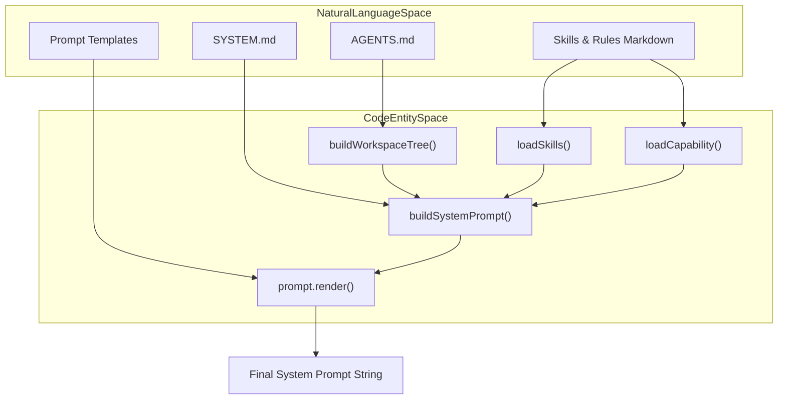
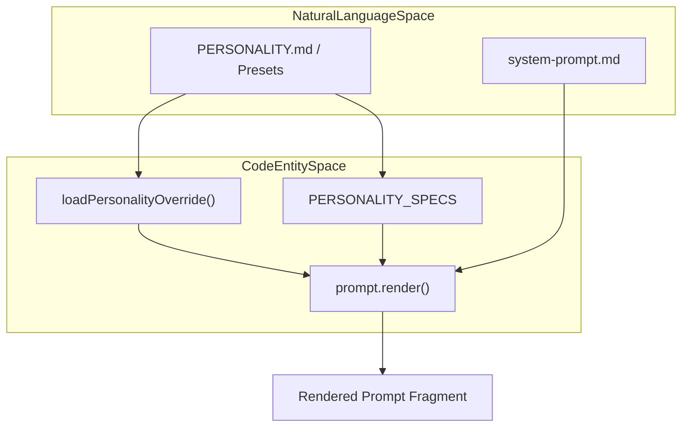

<!-- source: DeepWiki mcp.deepwiki.com · repo can1357/oh-my-pi · page 3.4 System Prompts · fetched 2026-10-30 -->

# System Prompts

Relevant source files

The following files were used as context for generating this wiki page:

- [docs/skills.md](docs/skills.md)
- [packages/ai/test/bedrock-tool-choice.test.ts](packages/ai/test/bedrock-tool-choice.test.ts)
- [packages/coding-agent/src/advisor/index.ts](packages/coding-agent/src/advisor/index.ts)
- [packages/coding-agent/src/advisor/watchdog.ts](packages/coding-agent/src/advisor/watchdog.ts)
- [packages/coding-agent/src/capability/skill.ts](packages/coding-agent/src/capability/skill.ts)
- [packages/coding-agent/src/config/prompt-templates.ts](packages/coding-agent/src/config/prompt-templates.ts)
- [packages/coding-agent/src/discovery/agent-plugin-format.ts](packages/coding-agent/src/discovery/agent-plugin-format.ts)
- [packages/coding-agent/src/discovery/agent-plugins.ts](packages/coding-agent/src/discovery/agent-plugins.ts)
- [packages/coding-agent/src/discovery/agents-md.ts](packages/coding-agent/src/discovery/agents-md.ts)
- [packages/coding-agent/src/discovery/agents.ts](packages/coding-agent/src/discovery/agents.ts)
- [packages/coding-agent/src/discovery/claude-md.ts](packages/coding-agent/src/discovery/claude-md.ts)
- [packages/coding-agent/src/discovery/contained-path.ts](packages/coding-agent/src/discovery/contained-path.ts)
- [packages/coding-agent/src/extensibility/skills.ts](packages/coding-agent/src/extensibility/skills.ts)
- [packages/coding-agent/src/mcp/transports/header-policy.ts](packages/coding-agent/src/mcp/transports/header-policy.ts)
- [packages/coding-agent/src/prompts/advisor/active-repo-watchdog.md](packages/coding-agent/src/prompts/advisor/active-repo-watchdog.md)
- [packages/coding-agent/src/prompts/system/active-repo-context.md](packages/coding-agent/src/prompts/system/active-repo-context.md)
- [packages/coding-agent/src/prompts/system/custom-system-prompt.md](packages/coding-agent/src/prompts/system/custom-system-prompt.md)
- [packages/coding-agent/src/prompts/system/project-prompt.md](packages/coding-agent/src/prompts/system/project-prompt.md)
- [packages/coding-agent/src/prompts/system/subagent-system-prompt.md](packages/coding-agent/src/prompts/system/subagent-system-prompt.md)
- [packages/coding-agent/src/prompts/system/subagent-yield-reminder.md](packages/coding-agent/src/prompts/system/subagent-yield-reminder.md)
- [packages/coding-agent/src/prompts/system/system-prompt.md](packages/coding-agent/src/prompts/system/system-prompt.md)
- [packages/coding-agent/src/system-prompt.ts](packages/coding-agent/src/system-prompt.ts)
- [packages/coding-agent/src/task/discovery.ts](packages/coding-agent/src/task/discovery.ts)
- [packages/coding-agent/src/tools/jtd-utils.ts](packages/coding-agent/src/tools/jtd-utils.ts)
- [packages/coding-agent/src/utils/active-repo-context.ts](packages/coding-agent/src/utils/active-repo-context.ts)
- [packages/coding-agent/src/utils/command-args.ts](packages/coding-agent/src/utils/command-args.ts)
- [packages/coding-agent/src/utils/open.ts](packages/coding-agent/src/utils/open.ts)
- [packages/coding-agent/src/utils/prompt-path.ts](packages/coding-agent/src/utils/prompt-path.ts)
- [packages/coding-agent/test/advisor-watchdog.test.ts](packages/coding-agent/test/advisor-watchdog.test.ts)
- [packages/coding-agent/test/discovery/agent-plugins.test.ts](packages/coding-agent/test/discovery/agent-plugins.test.ts)
- [packages/coding-agent/test/discovery/agents-monorepo-skills.test.ts](packages/coding-agent/test/discovery/agents-monorepo-skills.test.ts)
- [packages/coding-agent/test/discovery/claude-md.test.ts](packages/coding-agent/test/discovery/claude-md.test.ts)
- [packages/coding-agent/test/fixtures/mcp-idle-wait-probe.ts](packages/coding-agent/test/fixtures/mcp-idle-wait-probe.ts)
- [packages/coding-agent/test/git-active-context.test.ts](packages/coding-agent/test/git-active-context.test.ts)
- [packages/coding-agent/test/issue-851-repro.test.ts](packages/coding-agent/test/issue-851-repro.test.ts)
- [packages/coding-agent/test/mcp-long-wait.test.ts](packages/coding-agent/test/mcp-long-wait.test.ts)
- [packages/coding-agent/test/model-registry-default-config.test.ts](packages/coding-agent/test/model-registry-default-config.test.ts)
- [packages/coding-agent/test/prompt-templates.test.ts](packages/coding-agent/test/prompt-templates.test.ts)
- [packages/coding-agent/test/skill-prompt-message.test.ts](packages/coding-agent/test/skill-prompt-message.test.ts)
- [packages/coding-agent/test/skill-protocol-customdirs.test.ts](packages/coding-agent/test/skill-protocol-customdirs.test.ts)
- [packages/coding-agent/test/skills.test.ts](packages/coding-agent/test/skills.test.ts)
- [packages/coding-agent/test/system-prompt-dedup.test.ts](packages/coding-agent/test/system-prompt-dedup.test.ts)
- [packages/coding-agent/test/system-prompt-inventory.test.ts](packages/coding-agent/test/system-prompt-inventory.test.ts)
- [packages/coding-agent/test/task/discovery.test.ts](packages/coding-agent/test/task/discovery.test.ts)
- [packages/coding-agent/test/tools/windows-drive-alias.test.ts](packages/coding-agent/test/tools/windows-drive-alias.test.ts)
- [packages/coding-agent/test/utils/open.test.ts](packages/coding-agent/test/utils/open.test.ts)

## Purpose and Scope

System prompts define the operational context, identity, behavioral constraints, and tool inventory for the AI agent. They are dynamically constructed at session initialization by parsing project-level context files (`AGENTS.md`, `SYSTEM.md`), discovering modular skills and rules, applying personality overrides, and rendering everything through Handlebars-based templates into a unified prompt string.

Sources: [packages/coding-agent/src/system-prompt.ts:1-41](), [packages/coding-agent/src/prompts/system/system-prompt.md:1-120]()

---

## System Prompt Construction Pipeline

The orchestration of system prompt generation is managed primarily by `buildSystemPrompt()` in `packages/coding-agent/src/system-prompt.ts`. This function integrates multiple inputs to construct the final prompt:

1. **Workspace Discovery:** It uses `buildWorkspaceTree()` to recursively locate and parse context files like `AGENTS.md`, providing hierarchical project-level agent instructions.
2. **Context File Loading:** It discovers `SYSTEM.md` and other session-global context files using `findConfigFile()`.
3. **Skill and Rule Aggregation:** Skills are loaded dynamically via `loadSkills()`, and rules (including always-apply governance rules) are loaded through the `loadCapability()` mechanism.
4. **Personality and Prompt Template Rendering:** Personality overrides are loaded via `loadPersonalityOverride()`. The system prompt templates in Handlebars format (e.g., `system-prompt.md`) are rendered with all the aggregated data.
5. **Tool Inventory Assembly:** Using `renderToolInventory()` from `@oh-my-pi/pi-ai/dialect`, tools and device capabilities are injected into the prompt.
6. **Normalization and Deduplication:** The text blocks undergo normalization and deduplication to prevent repetitive instructions bloating the prompt context.

### Diagram: Natural Language to Code Entity Mapping (Pipeline)

Sources: [packages/coding-agent/src/system-prompt.ts:1-90](), [packages/coding-agent/src/utils/active-repo-context.ts:1-10](), [packages/coding-agent/src/workspace-tree.ts:29-107]()

---

## Context Files and Workspace Discovery

Two primary context files contribute canonical project-level instructions and structure:

- **`AGENTS.md` Files:** These markdown agent description files are recursively discovered within the project workspace under constraints (`AGENTS_MD_LIMIT` is `200` by default). They contribute detailed, hierarchical natural language guidance defining agent roles, sub-agents, and task responsibilities. The function `buildWorkspaceTree()` constructs a nested tree of these files, aiding contextual awareness.
- **`SYSTEM.md` Files:** These provide centralized, session-wide configuration and rules. Using `findConfigFile()`, a single nearest `SYSTEM.md` is located per session based on the current working directory, avoiding user home directory pollution.

Sources: [packages/coding-agent/src/system-prompt.ts:11-26](), [packages/coding-agent/src/workspace-tree.ts:29-40]()

---

## Skill Discovery and Rule Loading

Skills and rules represent modular capabilities and governance applied dynamically at prompt construction.

| Aspect | Loader Function | Source Pattern / Location |
|:---|:---|:---|
| **Skills** | `loadSkills()` [packages/coding-agent/src/extensibility/skills.ts:137-141]() | Discovered in configured skill directories, exposed via `skill://` URIs. |
| **Rules & Always-Apply** | `loadCapability("rule")` [packages/coding-agent/src/system-prompt.ts:17]() | Read from extension roots, `.clinerules`, `.cursorrules`, `.omp/rules/` folders. |

- **Skills:** They encapsulate functionality expressed as declarative metadata and documents which the agent can invoke. Skills expose tool APIs or knowledge fragments filtered into the system prompt to inform agent decisions.
- **Rules:** These are domain-specific policies often containing instructions or prohibitions. Always-apply rules are universally included instructions during prompt construction.

Sources: [packages/coding-agent/src/system-prompt.ts:11-27](), [packages/coding-agent/src/extensibility/skills.ts:1-126]()

---

## Prompt Templates and Personality Overrides

### Prompt Templates

The system uses Handlebars-based markdown template files for composing the final system prompt. Templates reside primarily under `packages/coding-agent/src/prompts/system/`:

- `system-prompt.md`: The default system prompt instruction template defining core agent behavior [packages/coding-agent/src/prompts/system/system-prompt.md:1-120]().
- `custom-system-prompt.md`: A template wrapper applied when a literal `SYSTEM.md` override is used [packages/coding-agent/src/system-prompt.ts:25]().
- `project-prompt.md`: Generates the project context footer including workspace tree, rules, and files [packages/coding-agent/src/system-prompt.ts:29]().

### Personality Overrides

Three personality presets are bundled: `default`, `friendly`, and `pragmatic` [packages/coding-agent/src/system-prompt.ts:95-99]().

User customization of personality is supported via a `PERSONALITY.md` file located in the active agent directory (`~/.omp/agent/PERSONALITY.md` by default). The function `loadPersonalityOverride()` reads this file asynchronously [packages/coding-agent/src/system-prompt.ts:109-124]().

### Diagram: Natural Language to Code Entity Mapping (Templates & Personality)

Sources: [packages/coding-agent/src/system-prompt.ts:91-124](), [packages/coding-agent/src/prompts/system/system-prompt.md:1-35]()

---

## Deduplication and Normalization Logic

To maintain prompt efficiency and token budget, the system applies canonicalization and deduplication logic:

- `normalizePromptBlock(content: string): string` [packages/coding-agent/src/system-prompt.ts:132-134]() trims whitespace and applies post-render formatting to a single prompt block.
- `splitComparablePromptBlocks(content: string | null | undefined): string[]` [packages/coding-agent/src/system-prompt.ts:136-156]() splits a markdown string into paragraph blocks by blank lines, carefully preserving fenced code block integrity.
- Rule deduplication filters out any always-apply rules that are verbatim contained in other prompt content.

Sources: [packages/coding-agent/src/system-prompt.ts:129-156]()

---

## Internal URL Namespaces and Tool Inventory Integration

The system prompt includes references to internal URI schemes that tightly link natural language instructions to code artifacts and runtime resources:

- `skill://<name>`: References to loaded skills to enable explicit tool call qualification.
- `rule://<name>`: Namespaced domain-specific governance policies.
- `agent://<id>`: References to sub-agents and their output artifacts.

Tool inventory is injected in the prompt using `renderToolInventory()` from `@oh-my-pi/pi-ai/dialect` [packages/coding-agent/src/system-prompt.ts:9](), which formats the set of available tools and their metadata.

Sources: [packages/coding-agent/src/system-prompt.ts:7-23](), [packages/coding-agent/src/prompts/system/system-prompt.md:53-70]()

---

## Customization and Overrides

The prompt construction process supports multiple layers of customization:

- **Explicit CLI Flags:** `--system-prompt-template` and `--system-prompt` allow users to specify custom templates or literal text overrides.
- **Project vs User Config:** The closest project-level `SYSTEM.md` or `SYSTEM_TEMPLATE.md` overrides user-level files.
- **`PERSONALITY.md` Overrides:** The user may provide a full personality block override affecting agent style and demeanor.
- **Inline Tool Descriptors and XDev Docs:** Flags and configs toggle inlining tool metadata or mounting extended developer tools documentation.

Sources: [packages/coding-agent/src/system-prompt.ts:50-90]()

---

## Appendix: Key Functions and Files

| Function / Entity | File Path | Line Range | Description |
|:---|:---|:---|:---|
| `buildSystemPrompt` | `packages/coding-agent/src/system-prompt.ts` | 1-90 | Core orchestrator for system prompt assembly. |
| `buildWorkspaceTree()` | `packages/coding-agent/src/workspace-tree.ts` | 29-107 | Recursively discovers and parses `AGENTS.md`. |
| `loadSkills()` | `packages/coding-agent/src/extensibility/skills.ts` | 137-141 | Loads modular skill capabilities. |
| `loadPersonalityOverride()` | `packages/coding-agent/src/system-prompt.ts` | 107-124 | Loads user-level personality override. |
| `renderToolInventory()` | `@oh-my-pi/pi-ai/dialect` | - | Produces tool metadata blocks for prompts. |
| `normalizePromptBlock()` | `packages/coding-agent/src/system-prompt.ts` | 132-134 | Cleans and formats prompt blocks. |
| `splitComparablePromptBlocks()` | `packages/coding-agent/src/system-prompt.ts` | 136-156 | Splits prompt text into comparable paragraphs safely. |

Sources: [packages/coding-agent/src/system-prompt.ts:1-156](), [packages/coding-agent/src/workspace-tree.ts:29-107](), [packages/coding-agent/src/extensibility/skills.ts:1-126]()

---

