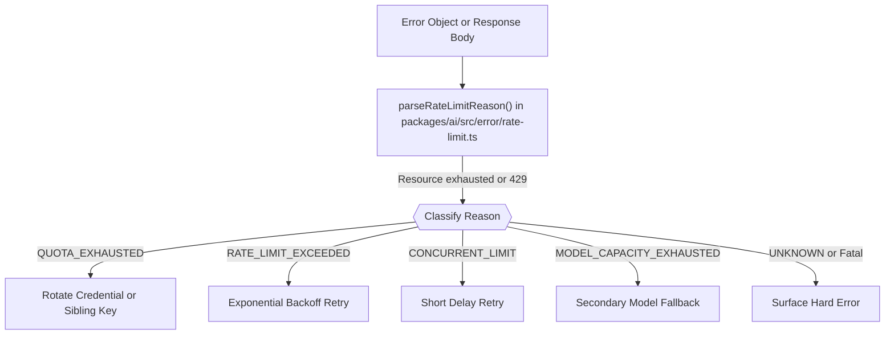
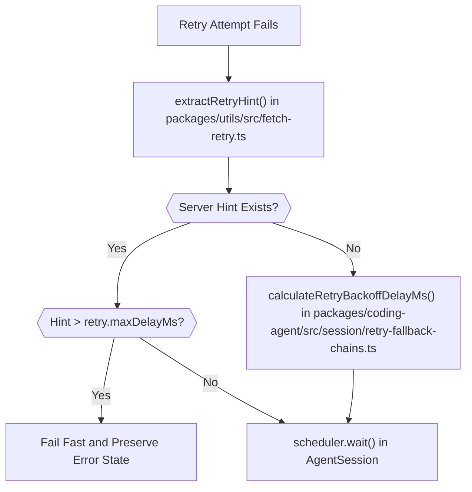
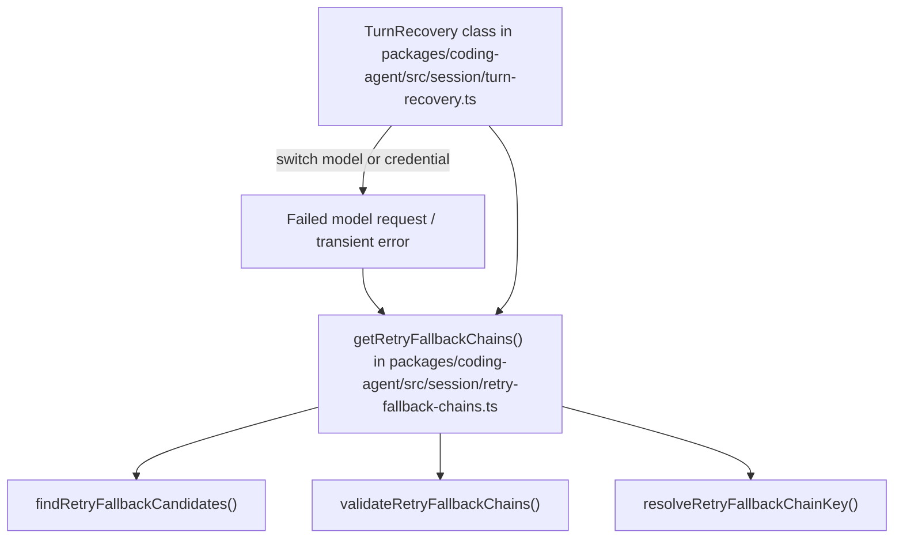
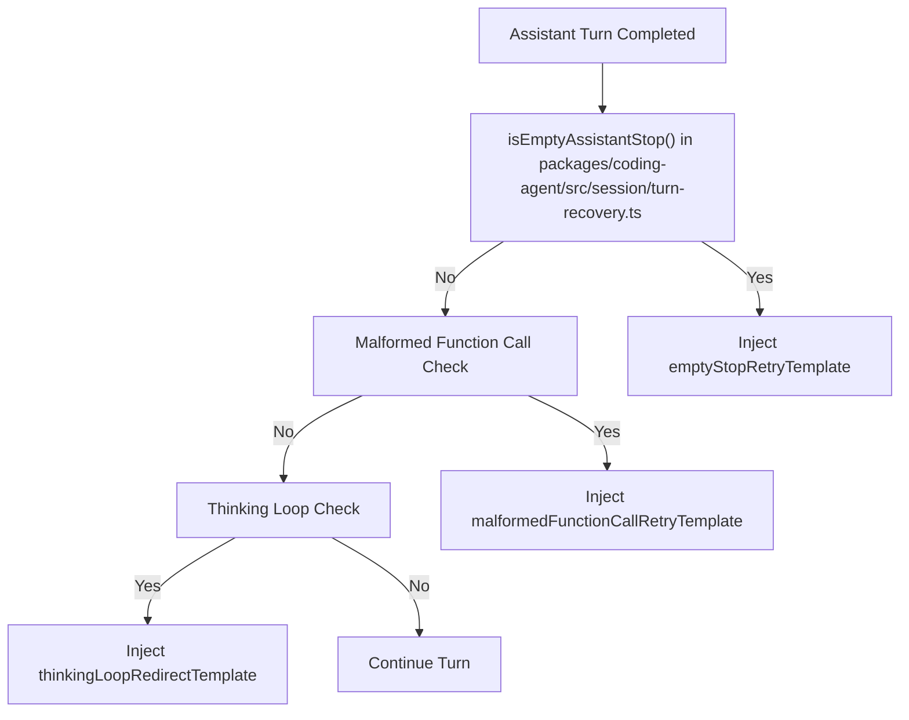
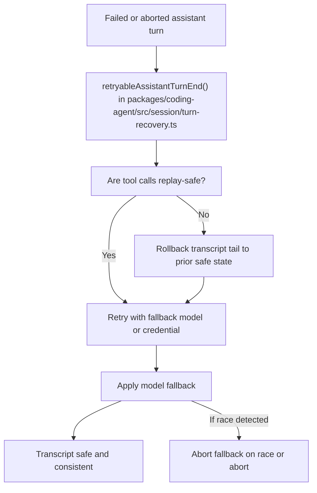
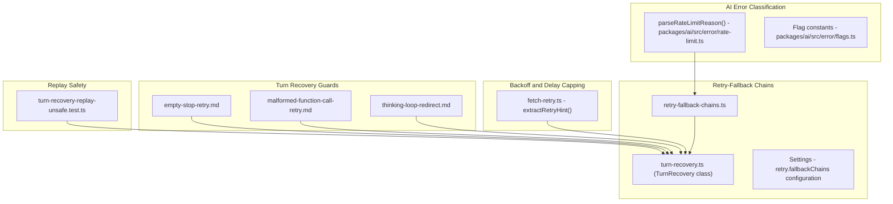

<!-- source: DeepWiki mcp.deepwiki.com · repo can1357/oh-my-pi · page 3.5 Retry, Fallback and Turn Recovery · fetched 2026-10-30 -->

# Retry, Fallback and Turn Recovery

Relevant source files

The following files were used as context for generating this wiki page:

- [docs/ai-schema-normalize.md](docs/ai-schema-normalize.md)
- [docs/non-compaction-retry-policy.md](docs/non-compaction-retry-policy.md)
- [docs/session-tree-plan.md](docs/session-tree-plan.md)
- [packages/ai/src/auth-retry.ts](packages/ai/src/auth-retry.ts)
- [packages/ai/src/error/auth-classify.ts](packages/ai/src/error/auth-classify.ts)
- [packages/ai/src/error/flags.ts](packages/ai/src/error/flags.ts)
- [packages/ai/src/error/rate-limit.ts](packages/ai/src/error/rate-limit.ts)
- [packages/ai/src/error/retryable.ts](packages/ai/src/error/retryable.ts)
- [packages/ai/test/anthropic-cache-control-rejection.test.ts](packages/ai/test/anthropic-cache-control-rejection.test.ts)
- [packages/ai/test/auth-retry.test.ts](packages/ai/test/auth-retry.test.ts)
- [packages/ai/test/auth-storage-force-refresh-rotate.test.ts](packages/ai/test/auth-storage-force-refresh-rotate.test.ts)
- [packages/ai/test/error-id.test.ts](packages/ai/test/error-id.test.ts)
- [packages/ai/test/openai-responses-stream-retry.test.ts](packages/ai/test/openai-responses-stream-retry.test.ts)
- [packages/ai/test/overflow-utils.test.ts](packages/ai/test/overflow-utils.test.ts)
- [packages/ai/test/rate-limit-utils.test.ts](packages/ai/test/rate-limit-utils.test.ts)
- [packages/ai/test/stream-auth-retry.test.ts](packages/ai/test/stream-auth-retry.test.ts)
- [packages/coding-agent/src/config/api-key-resolver.ts](packages/coding-agent/src/config/api-key-resolver.ts)
- [packages/coding-agent/src/config/model-resolver.ts](packages/coding-agent/src/config/model-resolver.ts)
- [packages/coding-agent/src/session/compaction-methods.ts](packages/coding-agent/src/session/compaction-methods.ts)
- [packages/coding-agent/src/session/retry-fallback-chains.ts](packages/coding-agent/src/session/retry-fallback-chains.ts)
- [packages/coding-agent/src/session/session-maintenance.ts](packages/coding-agent/src/session/session-maintenance.ts)
- [packages/coding-agent/src/session/turn-recovery.ts](packages/coding-agent/src/session/turn-recovery.ts)
- [packages/coding-agent/test/agent-session-payload-rejection-413.test.ts](packages/coding-agent/test/agent-session-payload-rejection-413.test.ts)
- [packages/coding-agent/test/agent-session-retry-cap.test.ts](packages/coding-agent/test/agent-session-retry-cap.test.ts)
- [packages/coding-agent/test/agent-session-retry-fallback.test.ts](packages/coding-agent/test/agent-session-retry-fallback.test.ts)
- [packages/coding-agent/test/auth-storage-rotation.test.ts](packages/coding-agent/test/auth-storage-rotation.test.ts)
- [packages/coding-agent/test/compaction-speculation.test.ts](packages/coding-agent/test/compaction-speculation.test.ts)
- [packages/coding-agent/test/issue-2750-subagent-runtime-fallback.test.ts](packages/coding-agent/test/issue-2750-subagent-runtime-fallback.test.ts)
- [packages/coding-agent/test/issue-985-subagent-auth-fallback.test.ts](packages/coding-agent/test/issue-985-subagent-auth-fallback.test.ts)
- [packages/coding-agent/test/model-resolver.test.ts](packages/coding-agent/test/model-resolver.test.ts)
- [packages/coding-agent/test/retry-fallback.test.ts](packages/coding-agent/test/retry-fallback.test.ts)
- [packages/coding-agent/test/sdk-model-selection.test.ts](packages/coding-agent/test/sdk-model-selection.test.ts)
- [packages/coding-agent/test/task/coordination-advisory.test.ts](packages/coding-agent/test/task/coordination-advisory.test.ts)
- [packages/coding-agent/test/task/spawn-advisory.test.ts](packages/coding-agent/test/task/spawn-advisory.test.ts)
- [packages/coding-agent/test/turn-recovery-replay-unsafe.test.ts](packages/coding-agent/test/turn-recovery-replay-unsafe.test.ts)
- [packages/utils/src/fetch-retry.ts](packages/utils/src/fetch-retry.ts)
- [packages/utils/test/fetch-retry.test.ts](packages/utils/test/fetch-retry.test.ts)

## Purpose and Scope
This document details the turn recovery, retry orchestration, error classification, fallback routing, and guard mechanisms implemented in `oh-my-pi`. This subsystem ensures resilience against transient API errors, model capacity exhaustion, rate limits (`429`), malformed function calls, internal reasoning loops, and empty stops. It operates across multiple layers, integrating lower-level transport retry utilities, AI error interpretation ([packages/ai/src/error/rate-limit.ts]()), and high-level agent session control and recovery loops ([packages/coding-agent/src/session/turn-recovery.ts]()).

---

## 1. Retryable Error Classification
When an LLM call fails, the system classifies errors to determine retry eligibility and fallback routing. The classifier discriminates among several classes:

- **Rate limits** (e.g., `429 Too Many Requests`)
- **Quota exhaustion**
- **Transient server errors**
- **Concurrency caps**
- **Model capacity exhaustion**

The core classification logic is implemented in `parseRateLimitReason`, located in [packages/ai/src/error/rate-limit.ts](), alongside error flag definitions in [packages/ai/src/error/flags.ts](). These functions analyze error messages and structured gRPC status details to categorize failures into error kinds such as `QUOTA_EXHAUSTED`, `RATE_LIMIT_EXCEEDED`, `CONCURRENT_LIMIT`, and `MODEL_CAPACITY_EXHAUSTED`.

*Diagram 1: Error classification routing from natural language failure messages to internal handling lanes in `packages/ai/src/error/rate-limit.ts`.*

Sources:  
`packages/ai/src/error/rate-limit.ts` [packages/ai/src/error/rate-limit.ts:1-16](), [packages/ai/src/error/rate-limit.ts:8-15]()  
`packages/ai/src/error/flags.ts` [packages/ai/src/error/flags.ts:20-56]()  
`packages/ai/test/rate-limit-utils.test.ts` [packages/ai/test/rate-limit-utils.test.ts:44-147]()

---

## 2. Exponential Backoff and Delay Caps
The retry strategy includes exponential backoff with jitter to prevent rapid-fire retries and respect provider limits. When an upstream server provides a retry hint (via HTTP headers or error messages), the system extracts this using `extractRetryHint` ([packages/utils/src/fetch-retry.ts]()) and `calculateRateLimitBackoffMs` ([packages/ai/src/error/rate-limit.ts]()).

A key robustness feature is a configurable **retry delay cap** (`retry.maxDelayMs`) enforced in the agent session [packages/coding-agent/test/agent-session-retry-cap.test.ts](). If a server suggests waiting longer than this cap and there is no fallback credential or model to switch to, the system immediately bails on retrying to avoid hanging or extremely long sleeps. This prevents scenarios like Anthropic's reported 3+ hour `retry-after` delays from blocking indefinitely (GitHub issue #607).

*Diagram 2: Backoff delay calculation and retry delay cap enforcement.*

Sources:  
`packages/utils/src/fetch-retry.ts` [packages/utils/src/fetch-retry.ts:1-137]()  
`packages/coding-agent/test/agent-session-retry-cap.test.ts` [packages/coding-agent/test/agent-session-retry-cap.test.ts:126-170]()

---

## 3. Retry-Fallback Chains and Usage-Based Routing
When a model or credential repeatedly fails or is rate-limited, `oh-my-pi` employs **retry-fallback chains** to navigate a configured list of fallback candidates, switching models or credentials to achieve continuity and resilience ([packages/coding-agent/src/session/retry-fallback-chains.ts]()).

### Key Concepts
- **Retry Fallback Chains:** Mapping from primary model or credential selectors to ordered fallback candidates.
- **Usage Health Tracking:** Tracks usage and error history, suppressing faulty keys or models temporarily.
- **Live Fallback Resolution:** Dynamically selects fallback candidates based on current session state and health.

### Implementation Details
- The module `retry-fallback-chains.ts` exports:
  - `findRetryFallbackCandidates()` — Enumerates safe fallback candidates considering usage health and settings.
  - `validateRetryFallbackChains()` — Ensures chains are consistent and free of cycles.
  - `resolveRetryFallbackChainKey()` — Picks the current fallback key for decision routing.
  
- The `TurnRecovery` class ([packages/coding-agent/src/session/turn-recovery.ts]()) uses these mechanisms to:
  - Reset provider session state on model or credential switches.
  - Safely reattempt the request with the fallback.
  - Emit lifecycle events `auto_retry_start` and `auto_retry_end`.

*Diagram 3: Retry-fallback chains mapping natural fallback requirements to code execution in `retry-fallback-chains.ts` and `turn-recovery.ts`.*

Sources:  
`packages/coding-agent/src/session/retry-fallback-chains.ts` [packages/coding-agent/src/session/retry-fallback-chains.ts:1-60]()  
`packages/coding-agent/src/session/turn-recovery.ts` [packages/coding-agent/src/session/turn-recovery.ts:1-75]()  
`packages/coding-agent/test/agent-session-retry-fallback.test.ts` [packages/coding-agent/test/agent-session-retry-fallback.test.ts:52-105]()

---

## 4. Empty-Stop, Malformed Function Call, and Thinking-Loop Guards
Beyond transport-layer retry logic, the `TurnRecovery` subsystem inspects assistant message outputs to detect problematic turn endings that merit automated retry with special prompts:

### 4.1 Empty-Stop Guard
- Detects assistant turns that end with `stopReason === "stop"` but produce empty or whitespace-only output, indicating the model did not generate meaningful response.
- If detected, injects a retry prompt (`emptyStopRetryTemplate`) to solicit a non-empty turn ([packages/coding-agent/src/session/turn-recovery.ts]()).

### 4.2 Malformed Function Call Guard
- Detects malformed or unparseable function/tool call outputs, which may be caused by structured output schema violations.
- Limits retry attempts by `MALFORMED_FUNCTION_CALL_MAX_RETRIES` to avoid infinite loops.
- Uses the `malformedFunctionCallRetryTemplate` for recovery guidance ([packages/coding-agent/src/session/turn-recovery.ts]()).

### 4.3 Thinking Loop Guard
- Detects repeated near-identical reasoning segments flagged by the AI error classifier as `ThinkingLoop`.
- Applies a recovery prompt redirect (`thinkingLoopRedirectTemplate`) to break circular reasoning.
- Controlled by a configurable guard feature (`cfgModelLoopGuardEnabled`) ([packages/coding-agent/src/session/turn-recovery.ts]()).

*Diagram 4: Guards against empty output, malformed calls, and thinking loops during recovery.*

Sources:  
`packages/coding-agent/src/session/turn-recovery.ts` [packages/coding-agent/src/session/turn-recovery.ts:34-110]()  
`packages/coding-agent/test/agent-session-empty-stop-guard.test.ts` [packages/coding-agent/test/agent-session-empty-stop-guard.test.ts:56-115]()

---

## 5. Replay Safety and Transcript Rollbacks
Retries involving fallback models or credentials face challenges with **replay safety**:

- Failed assistant turns may include tool calls producing side effects. Replaying them blindly risks duplication or session corruption.
- `TurnRecovery` inspects trailing `toolResult` messages using utility functions like `retryableAssistantTurnEnd` and `abortedToolCallTail` to detect replay safety ([packages/coding-agent/src/session/turn-recovery.ts]()).
- If unsafe, it rolls back transcript tail messages (discarding partial tool results and failed assistant turns) before retrying.
- During fallback application, replay safety also manages race conditions: fallback retries can be aborted if session state changes asynchronously.
- This rollback and race recovery protects session consistency and correctness, avoiding off-by-one transcript errors ([packages/coding-agent/test/turn-recovery-replay-unsafe.test.ts]()).

*Diagram 5: Replay safety logic and fallback rollback coordination.*

Sources:  
`packages/coding-agent/test/turn-recovery-replay-unsafe.test.ts` [packages/coding-agent/test/turn-recovery-replay-unsafe.test.ts:138-185]()  
`packages/coding-agent/src/session/turn-recovery.ts` [packages/coding-agent/src/session/turn-recovery.ts:135-158]()

---

## References to Key Code Entities

Sources: Multiple files across `packages/ai`, `packages/coding-agent/src/session`, and test suites cited above.

---

