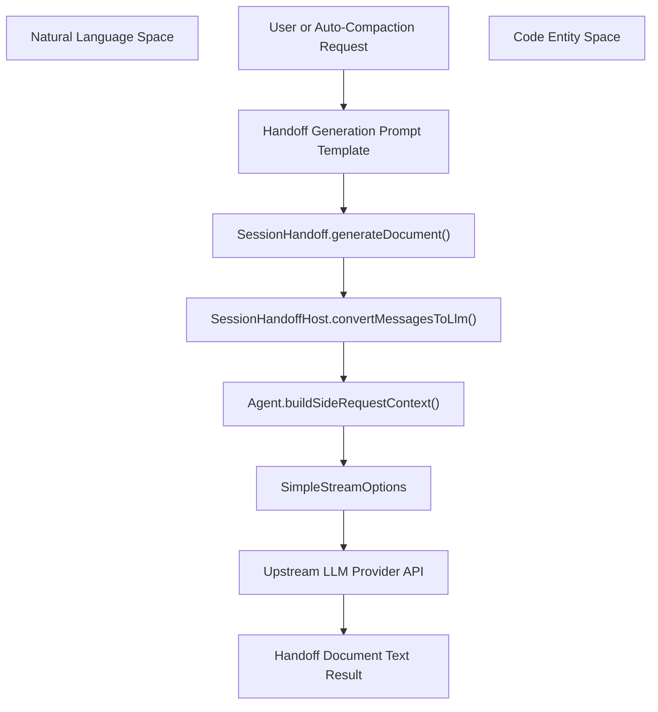
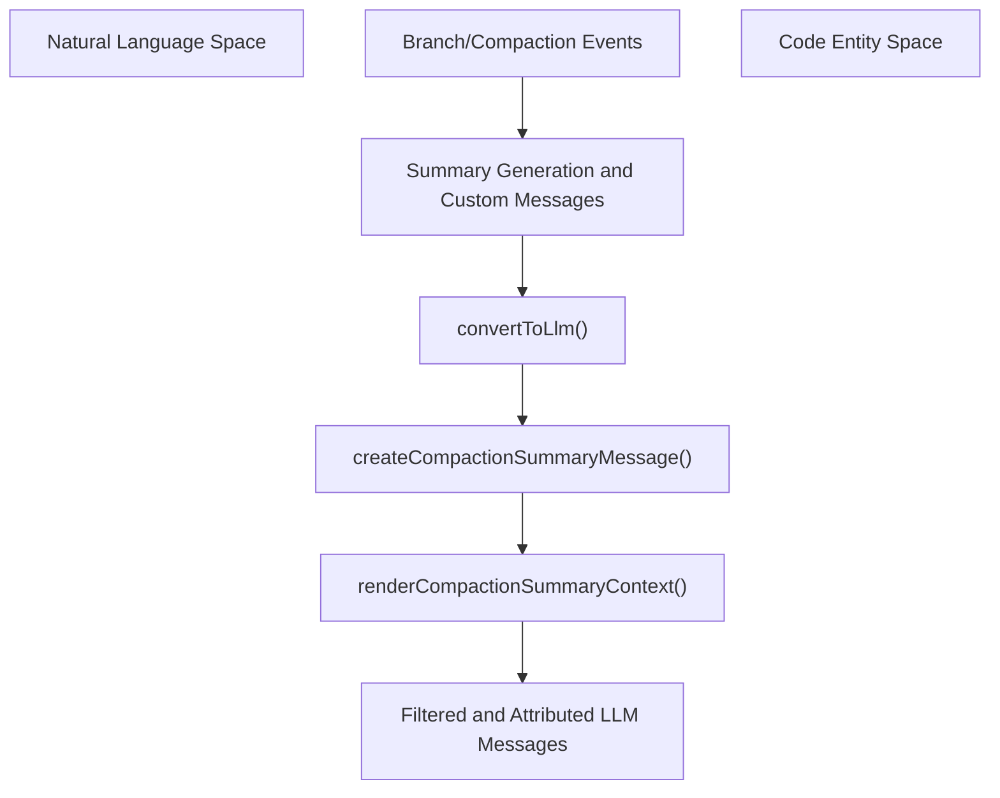
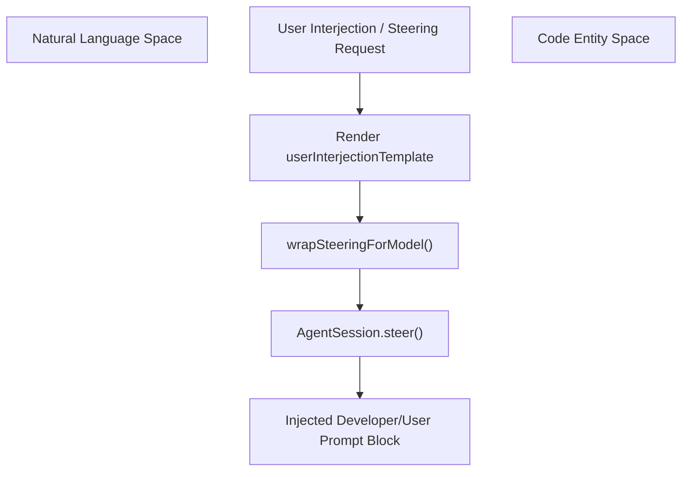
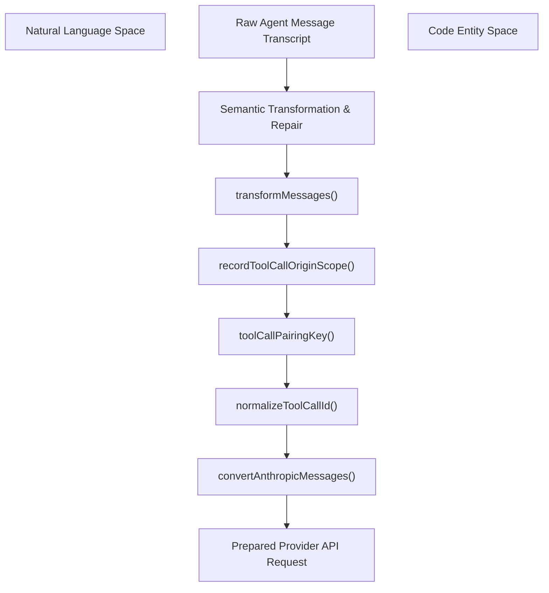

<!-- source: DeepWiki mcp.deepwiki.com · repo can1357/oh-my-pi · page 3.7 Handoff and Message Pipeline · fetched 2026-10-30 -->

# Handoff and Message Pipeline

Relevant source files

The following files were used as context for generating this wiki page:

- [docs/handoff-generation-pipeline.md](docs/handoff-generation-pipeline.md)
- [packages/agent/src/compaction/messages.ts](packages/agent/src/compaction/messages.ts)
- [packages/agent/src/replay-policy.ts](packages/agent/src/replay-policy.ts)
- [packages/agent/test/handoff.test.ts](packages/agent/test/handoff.test.ts)
- [packages/ai/src/dialect/demotion.ts](packages/ai/src/dialect/demotion.ts)
- [packages/ai/src/providers/transform-messages.ts](packages/ai/src/providers/transform-messages.ts)
- [packages/ai/test/anthropic-abandoned-tooluse-replay.test.ts](packages/ai/test/anthropic-abandoned-tooluse-replay.test.ts)
- [packages/ai/test/anthropic-prefill.test.ts](packages/ai/test/anthropic-prefill.test.ts)
- [packages/ai/test/anthropic-prior-turn-thinking.test.ts](packages/ai/test/anthropic-prior-turn-thinking.test.ts)
- [packages/ai/test/bedrock-tool-name-replay.test.ts](packages/ai/test/bedrock-tool-name-replay.test.ts)
- [packages/ai/test/cline-pass-transport.test.ts](packages/ai/test/cline-pass-transport.test.ts)
- [packages/ai/test/deepinfra-reasoning-contract.test.ts](packages/ai/test/deepinfra-reasoning-contract.test.ts)
- [packages/ai/test/duplicate-tool-results.test.ts](packages/ai/test/duplicate-tool-results.test.ts)
- [packages/ai/test/issue-1203-repro.test.ts](packages/ai/test/issue-1203-repro.test.ts)
- [packages/ai/test/issue-2996-repro.test.ts](packages/ai/test/issue-2996-repro.test.ts)
- [packages/ai/test/openai-completions-litellm-thinking-blocks.test.ts](packages/ai/test/openai-completions-litellm-thinking-blocks.test.ts)
- [packages/ai/test/same-model-reasoning-carry.test.ts](packages/ai/test/same-model-reasoning-carry.test.ts)
- [packages/ai/test/transform-messages-malformed-tool-calls.test.ts](packages/ai/test/transform-messages-malformed-tool-calls.test.ts)
- [packages/ai/test/transform-messages-thinking-dialect.test.ts](packages/ai/test/transform-messages-thinking-dialect.test.ts)
- [packages/catalog/src/compat/rules/providers/tool-call-names.kdl](packages/catalog/src/compat/rules/providers/tool-call-names.kdl)
- [packages/coding-agent/src/prompts/steering/user-interjection.md](packages/coding-agent/src/prompts/steering/user-interjection.md)
- [packages/coding-agent/src/session/date-cwd-reminder.ts](packages/coding-agent/src/session/date-cwd-reminder.ts)
- [packages/coding-agent/src/session/messages.ts](packages/coding-agent/src/session/messages.ts)
- [packages/coding-agent/test/date-cwd-reminder.test.ts](packages/coding-agent/test/date-cwd-reminder.test.ts)
- [packages/coding-agent/test/session-messages.test.ts](packages/coding-agent/test/session-messages.test.ts)
- [packages/coding-agent/test/session/empty-error-turn.test.ts](packages/coding-agent/test/session/empty-error-turn.test.ts)
- [packages/coding-agent/test/session/messages.test.ts](packages/coding-agent/test/session/messages.test.ts)
- [packages/coding-agent/test/session/skill-title-input.test.ts](packages/coding-agent/test/session/skill-title-input.test.ts)

The Handoff and Message Pipeline sub-system orchestrates the generation and management of session handoffs, the conversion and extension of session message types, the injection of steering and interjection prompts, and the rigorous normalization and transformation of message data prior to dispatch to upstream AI providers. This layer ensures preservation of conversational context, compatibility across heterogeneous provider APIs, and enables modular extension integration and context compaction.

---

## 1. Session Handoff Generation

### Purpose and Overview

Session handoff generation creates a distilled textual summary of the current conversation context when the context nears token limits or upon request for session continuation. This summary, known as a *handoff document*, is generated as an isolated, cacheable LLM-side request that does not alter live session history until explicitly committed as a compaction entry.

The handoff process uses the `SessionHandoff` class, which operates on a provided `SessionHandoffHost` abstraction to access the agent's state, session settings, and registered models `[packages/coding-agent/src/session/session-handoff.ts:40-67]()`.

### Data Flow and Implementation

- The handoff initiation triggers `SessionHandoff.generateDocument()` `[packages/coding-agent/src/session/session-handoff.ts:95-98]()`.  
- This internally calls `SessionHandoffHost.convertMessagesToLlm()` to convert conversation messages to LLM-compatible format `[packages/coding-agent/src/session/session-handoff.ts:153-153]()`.  
- The handoff prompt is composed and sent via `Agent.buildSideRequestContext()` and a streaming API request configured with a *side session ID* `[packages/coding-agent/src/session/session-handoff.ts:157-164]()`.  
- The side session ID is structured as `${cacheSessionId}:side:${Snowflake.next()}`, enabling cache reuse but isolating handoff state from the main interaction to avoid polluting append-only provider histories `[packages/coding-agent/src/session/session-handoff.ts:163-165]()`.  
- The resulting compacted handoff text can be committed as an in-place compaction by the session host, adding a `compactionSummary` message referencing archived snapshot frames `[packages/coding-agent/test/agent-session-handoff.test.ts:149-171]()`.

### Class and Function Highlights

- **`SessionHandoff`** - Core class that coordinates handoff prompt construction, side session context assembly, streaming request dispatch, and result capture `[packages/coding-agent/src/session/session-handoff.ts:61-166]()`.
- **`SessionHandoffHost`** - Interface used by `SessionHandoff` to convert messages, access model and settings state, and commit compactions `[packages/coding-agent/src/session/session-handoff.ts:40-58]()`.

Diagram bridging Natural Language Space to Code Entity Space for handoff generation:

Sources: [packages/coding-agent/src/session/session-handoff.ts:40-166](), [packages/coding-agent/test/agent-session-handoff.test.ts:149-170]()

---

## 2. Session Messages Module

### Purpose and Overview

The session messages module extends the base `AgentMessage` types with coding-agent-specific message types and transformations `[packages/coding-agent/src/session/messages.ts:1-7]()`. It facilitates mapping complex conversation structures—such as compaction summaries, skill prompts, and custom extension outputs—into LLM-compatible formats for provider communication. It also handles cleaning, attribution, and specialized message conversion for multi-modal content.

### Message Types and Transformers

- **Custom Messages**: Including `CustomMessage`, `HookMessage`, `FileMentionMessage`, and extension-driven messages `[packages/coding-agent/src/session/messages.ts:7-18]()`.  
- **Compaction and Branch Summaries**: Special messages representing conversation summaries for context compaction and branch navigation `[packages/agent/src/compaction/messages.ts:43-76]()`.  
- **Skill Prompts**: Legacy and enhanced skill execution instructions embedded in prompts `[packages/coding-agent/src/session/messages.ts:19-32]()`.  

A key function is `convertToLlm()` which produces a provider-compatible message array `[packages/agent/src/compaction/messages.ts:88-88]()`. It preserves frames such as `snapcompact` serialized snapshots for use by multimodal-capable providers, ensuring companion image blocks travel alongside text summaries `[packages/coding-agent/test/session-messages.test.ts:23-52]()`.

### Key Functions

- `sanitizeAssistantForReparentedHistory(message: AssistantMessage)`: Strips replay-bound fields (e.g., provider payloads, redacted thinking blocks) when reparenting assistant turns under different user messages `[packages/coding-agent/src/session/messages.ts:97-113]()`.  
- `dedupeEphemeralReply(text: string)`: Collapses repeated lines and imposes length bounds on ephemeral side-channel assistant replies `[packages/coding-agent/src/session/messages.ts:119-144]()`.  
- `buildReplanTitleContext(messages: AgentMessage[])`: Extracts recent user/assistant context turns for generating conversation titles and summaries `[packages/coding-agent/src/session/messages.ts:153-179]()`.  

### Module Interactions

Sources: [packages/coding-agent/src/session/messages.ts:1-179](), [packages/agent/src/compaction/messages.ts:49-123](), [packages/coding-agent/test/session-messages.test.ts:21-61]()

---

## 3. Steering and Interjection Prompts

### Purpose and Overview

During active agent execution—particularly inside multi-turn tool loops—supervisory user interjections and steering instructions can be injected as prompts to reorient or softly correct the agent’s behavior without severing the ongoing prompt context chain.

### Implementation Detail

- Interjection prompts derive from an external text template located in `user-interjection.md` `[packages/coding-agent/src/session/messages.ts:58-58]()`.  
- These prompts are wrapped and formatted with `wrapSteeringForModel()` to comply with provider constraints and to be injected seamlessly into conversation histories `[packages/coding-agent/test/session-messages.test.ts:9-10]()`.  
- The `AgentSession.steer()` method applies the prepared interjection prompt as an injected or appended developer/user message block `[packages/coding-agent/src/session/agent-session.ts]()`.

Sources: [packages/coding-agent/src/session/messages.ts:57-58](), [packages/coding-agent/src/prompts/steering/user-interjection.md:1-1]()

---

## 4. Message Normalization and Provider Dispatch

### Purpose and Overview

Before messages are dispatched to the AI provider, the message pipeline applies a rigorous transformation and normalization step through the `transformMessages()` function `[packages/ai/src/providers/transform-messages.ts:8-8]()`. This step ensures compatibility with diverse API protocols (OpenAI, Anthropic, Google Gemini, etc.), resolves tool-call ID scoping ambiguities, suppresses duplicate or malformed messages (such as empty-name tool calls from models like GLM-5.2), and preserves extended reasoning signatures where applicable.

### Core Normalization Processes

- **Tool-Call ID Scoping and Pairing**  
  - Messages bearing tool calls and their results may carry composite IDs (`call_id|item_id`) `[packages/ai/src/providers/transform-messages.ts:41-48]()`.  
  - `recordToolCallOriginScope()` inspects message history to classify tool-call ID origin scopes, distinguishing between Responses-family and opaque composite calls `[packages/ai/src/providers/transform-messages.ts:107-119]()`.  
  - `toolCallPairingKey()` canonicalizes tool-call IDs for paired tool call-result lookup while preserving collision safety `[packages/ai/src/providers/transform-messages.ts:151-152]()`.  
  - `normalizeToolCallId()` enforces the strictest strict replay provider length and character constraints (`^[a-zA-Z0-9_-]+$` capped at 64 characters) `[packages/ai/src/providers/transform-messages.ts:41-44]().`

- **Duplicate Tool Results Suppression**  
  - Avoids emitting multiple synthetic tool results for tool calls with error or aborted stop reasons when a real tool result message already exists `[packages/ai/test/duplicate-tool-results.test.ts:81-143]()`.

- **Malformed Tool Call Dropping**  
  - Drops tool calls with empty or whitespace-only names/IDs and their matching tool results to prevent API 400 rejection loops `[packages/ai/test/transform-messages-malformed-tool-calls.test.ts:90-130]()`.

- **Thinking Block Signature Handling**  
  - Preserves cryptographic signatures on latest assistant-turn "thinking" blocks for reasons like Anthropic’s all-or-none signature enforcement on chain-of-thought blocks `[packages/ai/test/anthropic-prior-turn-thinking.test.ts:112-185]()`.  
  - Strips or demotes signatures on older turns to prevent replay errors.

### Data Flow and Implementation

Diagram bridging Natural Language Space to Code Entity Space for message normalization:

### Key Functions and Utilities

- **`transformMessages(messages: Message[], model: Model): Message[]`** - Transforms message arrays with careful repair, deduplication, normalization, and payload adaptations per provider dialect `[packages/ai/src/providers/transform-messages.ts:8-8]()`.  
- **`recordToolCallOriginScope(...)`** - Scans assistant messages to build sets of known tool-call ID prefixes and opaque composite IDs `[packages/ai/src/providers/transform-messages.ts:107-119]()`.  
- **`toolCallPairingKey(id: string, originScope: ToolCallOriginScope): string`** - Derives a canonical pairing key for correlating tool-result messages to tool-calls under strict load-bearing invariants `[packages/ai/src/providers/transform-messages.ts:151-152]()`.  
- **`normalizeToolCallId(id: string, maxLength)`** - Normalizes characters and applies string length ceilings for strict providers `[packages/ai/src/providers/transform-messages.ts:41-44]()`.

Sources: [packages/ai/src/providers/transform-messages.ts:1-152](), [packages/ai/test/duplicate-tool-results.test.ts:81-143](), [packages/ai/test/anthropic-prior-turn-thinking.test.ts:112-185](), [packages/ai/test/transform-messages-malformed-tool-calls.test.ts:90-130]()

---

# Extended Data Flow: Message Transformation Prior to Provider Dispatch

```mermaid
flowchart LR
    RawMessages["RawSessionMessagesArray"] --> TransformInvoke["transformMessages()"]
    TransformInvoke --> CollectScope["recordToolCallOriginScope()"]
    CollectScope --> PairKeyGen["toolCallPairingKey()"]
    PairKeyGen --> Deduplication["deduplicateToolCallIds()"]
    Deduplication --> ThinkingSigPreserve["PreserveThinkingSignatures"]
    ThinkingSigPreserve --> NormalizedMessages["NormalizedMessagesArray"]
    NormalizedMessages --> ProviderAPI["DispatchToProviderAPI"]
```

Sources: [packages/ai/src/providers/transform-messages.ts:1-152]()

---

