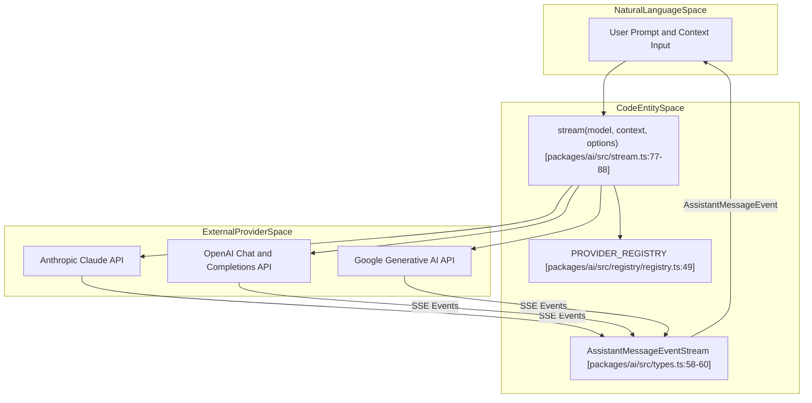
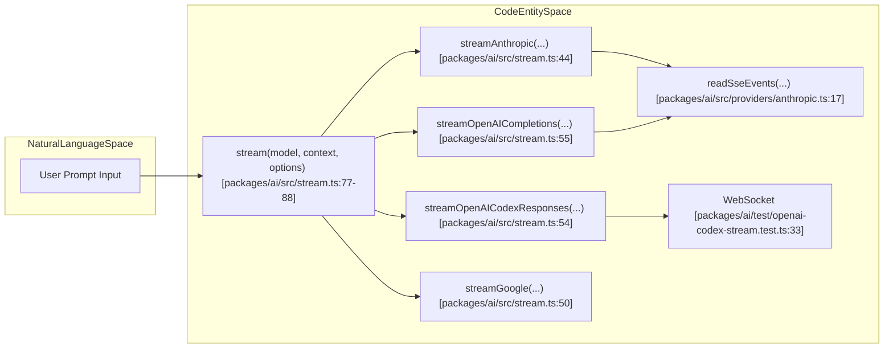

<!-- source: DeepWiki mcp.deepwiki.com · repo can1357/oh-my-pi · page 4 AI Model Integration · fetched 2026-10-30 -->

# AI Model Integration

Relevant source files

The following files were used as context for generating this wiki page:

- [docs/models.md](docs/models.md)
- [packages/ai/src/providers/anthropic.ts](packages/ai/src/providers/anthropic.ts)
- [packages/ai/src/providers/azure-openai-responses.ts](packages/ai/src/providers/azure-openai-responses.ts)
- [packages/ai/src/providers/claude-code-fingerprint.ts](packages/ai/src/providers/claude-code-fingerprint.ts)
- [packages/ai/src/providers/google-vertex.ts](packages/ai/src/providers/google-vertex.ts)
- [packages/ai/src/providers/google.ts](packages/ai/src/providers/google.ts)
- [packages/ai/src/providers/openai-codex-responses.ts](packages/ai/src/providers/openai-codex-responses.ts)
- [packages/ai/src/providers/openai-completions.ts](packages/ai/src/providers/openai-completions.ts)
- [packages/ai/src/providers/openai-responses.ts](packages/ai/src/providers/openai-responses.ts)
- [packages/ai/src/providers/openai-shared.ts](packages/ai/src/providers/openai-shared.ts)
- [packages/ai/src/stream.ts](packages/ai/src/stream.ts)
- [packages/ai/src/types.ts](packages/ai/src/types.ts)
- [packages/ai/src/usage/claude-api.ts](packages/ai/src/usage/claude-api.ts)
- [packages/ai/src/usage/claude.ts](packages/ai/src/usage/claude.ts)
- [packages/ai/src/utils/anthropic-auth.ts](packages/ai/src/utils/anthropic-auth.ts)
- [packages/ai/test/anthropic-alignment.test.ts](packages/ai/test/anthropic-alignment.test.ts)
- [packages/ai/test/anthropic-oauth.test.ts](packages/ai/test/anthropic-oauth.test.ts)
- [packages/ai/test/anthropic-stream-envelope.test.ts](packages/ai/test/anthropic-stream-envelope.test.ts)
- [packages/ai/test/apply-patch-freeform.test.ts](packages/ai/test/apply-patch-freeform.test.ts)
- [packages/ai/test/auth-storage-usage-cache.test.ts](packages/ai/test/auth-storage-usage-cache.test.ts)
- [packages/ai/test/azure-openai-responses-stream.test.ts](packages/ai/test/azure-openai-responses-stream.test.ts)
- [packages/ai/test/bedrock-on-payload.test.ts](packages/ai/test/bedrock-on-payload.test.ts)
- [packages/ai/test/claude-usage-endpoint.test.ts](packages/ai/test/claude-usage-endpoint.test.ts)
- [packages/ai/test/claude-usage-headers.test.ts](packages/ai/test/claude-usage-headers.test.ts)
- [packages/ai/test/openai-codex-stream.test.ts](packages/ai/test/openai-codex-stream.test.ts)
- [packages/ai/test/openai-responses-stream-terminal.test.ts](packages/ai/test/openai-responses-stream-terminal.test.ts)
- [packages/ai/test/transform-messages-dedup.test.ts](packages/ai/test/transform-messages-dedup.test.ts)
- [packages/catalog/src/compat/rules/auth/llama.cpp.kdl](packages/catalog/src/compat/rules/auth/llama.cpp.kdl)
- [packages/coding-agent/src/config/custom-models.ts](packages/coding-agent/src/config/custom-models.ts)
- [packages/coding-agent/src/config/model-discovery.ts](packages/coding-agent/src/config/model-discovery.ts)
- [packages/coding-agent/src/config/model-patch.ts](packages/coding-agent/src/config/model-patch.ts)
- [packages/coding-agent/src/config/model-registry.ts](packages/coding-agent/src/config/model-registry.ts)
- [packages/coding-agent/src/config/models-config-schema-bundle.ts](packages/coding-agent/src/config/models-config-schema-bundle.ts)
- [packages/coding-agent/src/config/models-config.ts](packages/coding-agent/src/config/models-config.ts)
- [packages/coding-agent/src/mcp/timeout.ts](packages/coding-agent/src/mcp/timeout.ts)
- [packages/coding-agent/test/config/model-registry.test.ts](packages/coding-agent/test/config/model-registry.test.ts)
- [packages/coding-agent/test/config/models-config-validation.test.ts](packages/coding-agent/test/config/models-config-validation.test.ts)
- [packages/coding-agent/test/headless-persistence-shutdown.test.ts](packages/coding-agent/test/headless-persistence-shutdown.test.ts)
- [packages/coding-agent/test/main-headless-timing.test.ts](packages/coding-agent/test/main-headless-timing.test.ts)
- [packages/coding-agent/test/mcp-timeout.test.ts](packages/coding-agent/test/mcp-timeout.test.ts)
- [packages/coding-agent/test/model-discovery.test.ts](packages/coding-agent/test/model-discovery.test.ts)
- [packages/coding-agent/test/model-registry-runtime-provider.test.ts](packages/coding-agent/test/model-registry-runtime-provider.test.ts)
- [packages/coding-agent/test/model-registry.test.ts](packages/coding-agent/test/model-registry.test.ts)
- [packages/coding-agent/test/xiaomi-tp-discovery-merge.test.ts](packages/coding-agent/test/xiaomi-tp-discovery-merge.test.ts)

The `@oh-my-pi/pi-ai` package forms the AI abstraction layer for the oh-my-pi coding agent, providing unified integration over 50+ diverse large language models (LLMs) from commercial cloud and local runtime providers [packages/ai/src/stream.ts:1-160](). This layer exposes a consistent streaming interface for initiating requests, handling streaming response events, and managing provider-specific behaviors such as authentication, prompt shaping, and schema normalization [packages/ai/src/stream.ts:39-55]().

Its primary goal is to abstract away heterogeneous API implementations, offering a common model discovery, selection, and streaming event processing framework for the entire agent ecosystem [packages/ai/src/stream.ts:77-88]().

---

## Architecture Overview

At the core lies the exported `stream()` function (`packages/ai/src/stream.ts`), which acts as a dispatcher routing requests based on the resolved model’s metadata to dedicated streaming implementations for each backend provider [packages/ai/src/stream.ts:77-88](). These provider implementations encapsulate specific protocol handling, such as REST calls, Server-Sent Events (SSE), or WebSocket streams, and also unify error handling, authorization headers, and message transformation.

This layered design separates concerns clearly:
- Natural language input and context pass into `stream()`.
- `stream()` uses a provider registry to select the correct implementation.
- Provider implementations perform request shaping, send to external APIs or local runtimes, and produce streaming event outputs.
- The streaming output is a normalized `AssistantMessageEventStream` that emits rich incremental events consumed downstream.

Diagram Title: Bridging Natural Language Space to Dispatch Code Entities

Sources: [packages/ai/src/stream.ts:44-88](), [packages/ai/src/types.ts:58-60](), [packages/ai/src/registry/registry.ts:49]()

---

## 4.1 Model Registry and Discovery

Model discovery provides a typed registry defining all models’ metadata including providers, API types, capabilities (like context window size, input modalities), reasoning features, cost models, and compatibility flags. This registry combines built-in static definitions and runtime-discovered local providers such as Ollama, LMStudio, vLLM, LiteLLM [packages/coding-agent/src/config/model-registry.ts:31-36]().

The dynamic discovery process queries installed or running local LLM providers, updating the catalog cache for faster startup and runtime provider switching. Custom user configuration via `models.yml` supports overrides and additions [docs/models.md:1-35](). 

For exhaustive details on discovery, caching, and model registry design, see [Model Registry and Discovery](#4.1).

Sources: [packages/coding-agent/src/config/model-registry.ts:28-52](), [docs/models.md:1-35]()

---

## 4.2 Provider Implementations

This layer hosts per-provider streaming implementations as standalone functions receiving fully resolved model objects, chat contexts, and options [packages/ai/src/stream.ts:39-55](). The dispatcher in `stream()` routes each request to the appropriate handler by consulting the provider registry and model metadata [packages/ai/src/stream.ts:58-79]().

Supported providers include OpenAI (Completions and Responses APIs), Anthropic Claude, Google Generative AI, Gemini CLI, Vertex AI, Amazon Bedrock, Azure OpenAI, Cursor, Devin, GitLab Duo, Ollama, and others [packages/ai/src/stream.ts:26-57](). Each provider supports various protocols like REST with SSE, WebSocket streaming, and local IPC.

Diagram Title: Natural Language Routing to Provider Code Entities

Refer to [Provider Implementations](#4.2) for comprehensive provider coverage, including protocol nuances, supported features, and examples.

Sources: [packages/ai/src/stream.ts:44-57](), [packages/ai/src/providers/anthropic.ts:17](), [packages/ai/test/openai-codex-stream.test.ts:33](), [packages/ai/src/providers/openai-codex-responses.ts:19]()

---

## 4.3 Streaming and Events

Provider responses arrive as event streams encapsulated by the `AssistantMessageEventStream` class [packages/ai/src/types.ts:58-61](). This abstraction harmonizes diverse streaming event formats into a unified interface emitting incremental tokens, partial text deltas, reasoning blocks, tool invocations, and lifecycle signals [packages/ai/src/providers/anthropic.ts:83](), [packages/ai/src/providers/openai-completions.ts:41]().

The streaming infrastructure implements first-event timeout detection, idle timeout iterators, and replay-safe retry logic guarding against empty or malformed completions [packages/ai/src/providers/anthropic.ts:82-86]().

For architecture and examples, see [Streaming and Events](#4.3).

Sources: [packages/ai/src/types.ts:58-61](), [packages/ai/src/providers/anthropic.ts:16-86](), [packages/ai/src/providers/openai-completions.ts:41]()

---

## 4.4 Message Transformation and Schema Normalization

Different AI backends vary in message formats and schema requirements. This integration layer preprocesses the message stream to normalize system and user prompt formats, normalize tool call IDs, adapt messages to strict JSON schema modes, coerce argument types, and apply vision guard tokens [packages/ai/src/providers/anthropic.ts:22-149](), [packages/ai/src/providers/openai-completions.ts:52-59]().

See [Message Transformation and Schema Normalization](#4.4) for detailed pipelines and design rationale.

Sources: [packages/ai/src/providers/anthropic.ts:22-149](), [packages/ai/src/providers/openai-completions.ts:52-59]()

---

## 4.5 Thinking and Reasoning

The AI model abstraction supports embedded extended reasoning capabilities controlled via configurable effort levels (e.g., minimal, low, medium, high, xhigh, max) [packages/ai/src/providers/openai-codex-responses.ts:159](). These effort levels map to provider-specific wire parameters, enabling deeper or faster reasoning depending on user or system preferences [packages/ai/src/providers/anthropic.ts:6](). 

For configuration options and fallback details, see [Thinking and Reasoning](#4.5).

Sources: [packages/ai/src/providers/anthropic.ts:6](), [packages/ai/src/providers/openai-completions.ts:79-88](), [packages/ai/src/providers/openai-codex-responses.ts:159]()

---

## 4.6 Prompt Caching and Compatibility Rules

To optimize latency and cost, the integration layer manages prompt caching across providers where supported [packages/ai/src/providers/anthropic.ts:38](). It implements cache retention policies (`none`, `short`, `long`) and affinity keys that leverage model identity and session context to maximize hit rates [packages/ai/src/providers/anthropic.ts:67](). Compatibility rules are expressed as a KDL-driven engine within the catalog package [docs/models.md:15]().

See [Prompt Caching and Compatibility Rules](#4.6) for detailed descriptions.

Sources: [packages/ai/src/providers/anthropic.ts:38-67](), [docs/models.md:15]()

---

## 4.7 Authentication, Credentials and Usage Tracking

Authentication is handled comprehensively via `AuthStorage` and credential store abstractions managing API keys, token lifecycles, OAuth flows, and refresh mechanisms [packages/coding-agent/src/config/model-registry.ts:3-10](). Credential ranking and blocking policies mitigate faults and authorize optimal credentials per provider and model [packages/ai/src/auth-retry.ts:20]().

For full details on credential management, token refresh, and usage accounting, see [Authentication, Credentials and Usage Tracking](#4.7).

Sources: [packages/coding-agent/src/config/model-registry.ts:3-10](), [packages/ai/src/auth-retry.ts:20]()

---

## Child Pages for Detail

- [Model Registry and Discovery](#4.1)  
- [Provider Implementations](#4.2)  
- [Streaming and Events](#4.3)  
- [Message Transformation and Schema Normalization](#4.4)  
- [Thinking and Reasoning](#4.5)  
- [Prompt Caching and Compatibility Rules](#4.6)  
- [Authentication, Credentials and Usage Tracking](#4.7)

Sources: [packages/ai/src/stream.ts:1-160](), [packages/ai/src/types.ts:58-61](), [docs/models.md:1-35]()

---

