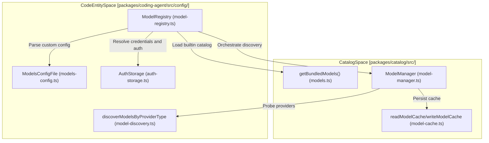
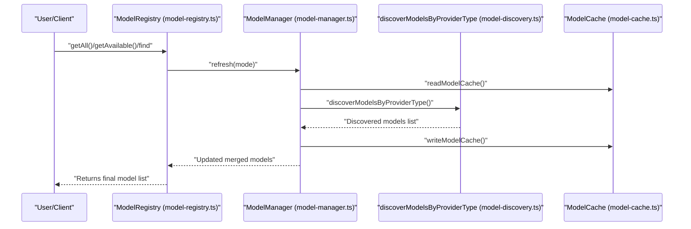
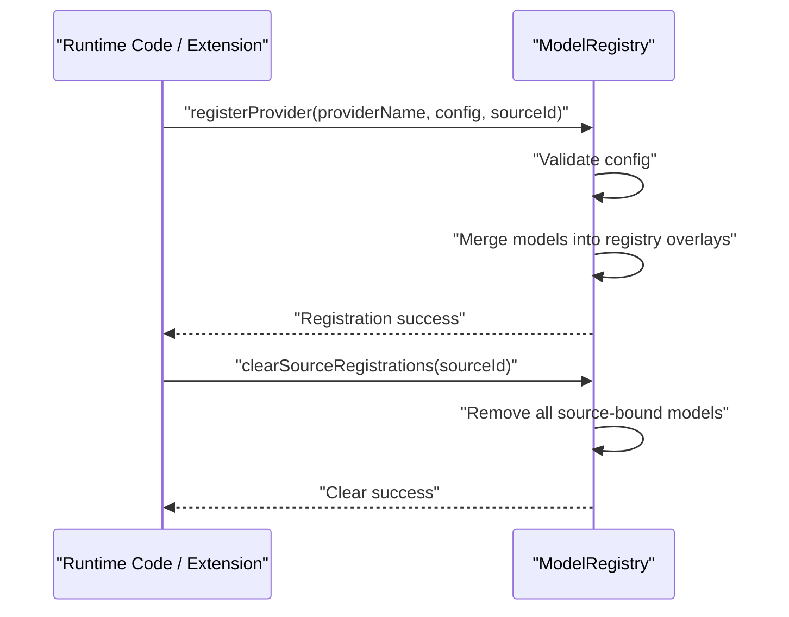
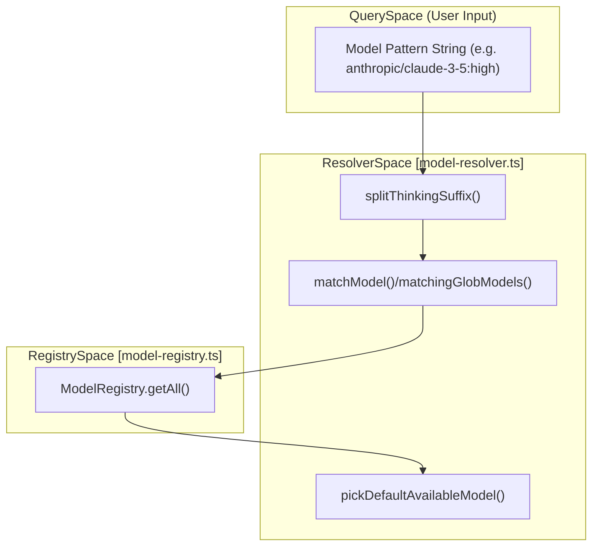

<!-- source: DeepWiki mcp.deepwiki.com · repo can1357/oh-my-pi · page 4.1 Model Registry and Discovery · fetched 2026-10-30 -->

# Model Registry and Discovery

<details>
<summary>Relevant source files</summary>

The following files were used as context for generating this wiki page:

- [docs/models.md](docs/models.md)
- [docs/provider-quirks.md](docs/provider-quirks.md)
- [packages/ai/src/providers/vision-guard.ts](packages/ai/src/providers/vision-guard.ts)
- [packages/ai/test/bedrock-on-payload.test.ts](packages/ai/test/bedrock-on-payload.test.ts)
- [packages/ai/test/issue-967-vision-guard.test.ts](packages/ai/test/issue-967-vision-guard.test.ts)
- [packages/ai/test/model-cache.test.ts](packages/ai/test/model-cache.test.ts)
- [packages/ai/test/openai-completions-compat.test.ts](packages/ai/test/openai-completions-compat.test.ts)
- [packages/ai/test/openai-completions-tool-result-images.test.ts](packages/ai/test/openai-completions-tool-result-images.test.ts)
- [packages/catalog/src/compat/openai.ts](packages/catalog/src/compat/openai.ts)
- [packages/catalog/src/compat/rules/auth/llama.cpp.kdl](packages/catalog/src/compat/rules/auth/llama.cpp.kdl)
- [packages/catalog/src/compat/rules/providers/cloudflare-ai-gateway.kdl](packages/catalog/src/compat/rules/providers/cloudflare-ai-gateway.kdl)
- [packages/catalog/src/compat/rules/providers/devin.kdl](packages/catalog/src/compat/rules/providers/devin.kdl)
- [packages/catalog/src/compat/rules/providers/kilo.kdl](packages/catalog/src/compat/rules/providers/kilo.kdl)
- [packages/catalog/src/compat/rules/providers/opencode-go.kdl](packages/catalog/src/compat/rules/providers/opencode-go.kdl)
- [packages/catalog/src/compat/rules/providers/opencode-zen.kdl](packages/catalog/src/compat/rules/providers/opencode-zen.kdl)
- [packages/catalog/src/compat/rules/providers/vercel-ai-gateway.kdl](packages/catalog/src/compat/rules/providers/vercel-ai-gateway.kdl)
- [packages/catalog/src/compat/rules/providers/zenmux.kdl](packages/catalog/src/compat/rules/providers/zenmux.kdl)
- [packages/catalog/src/discovery/cursor.ts](packages/catalog/src/discovery/cursor.ts)
- [packages/catalog/src/discovery/devin.ts](packages/catalog/src/discovery/devin.ts)
- [packages/catalog/src/discovery/protobuf.ts](packages/catalog/src/discovery/protobuf.ts)
- [packages/catalog/src/model-cache.ts](packages/catalog/src/model-cache.ts)
- [packages/catalog/src/model-manager.ts](packages/catalog/src/model-manager.ts)
- [packages/catalog/src/provider-models/cache-provider-id.ts](packages/catalog/src/provider-models/cache-provider-id.ts)
- [packages/catalog/test/build.test.ts](packages/catalog/test/build.test.ts)
- [packages/catalog/test/cursor-discovery.test.ts](packages/catalog/test/cursor-discovery.test.ts)
- [packages/catalog/test/devin-discovery.test.ts](packages/catalog/test/devin-discovery.test.ts)
- [packages/catalog/test/issue-1617-repro.test.ts](packages/catalog/test/issue-1617-repro.test.ts)
- [packages/catalog/test/litellm-provider.test.ts](packages/catalog/test/litellm-provider.test.ts)
- [packages/catalog/test/opencode-provider.test.ts](packages/catalog/test/opencode-provider.test.ts)
- [packages/catalog/test/protobuf.test.ts](packages/catalog/test/protobuf.test.ts)
- [packages/catalog/test/provider-cache-id.test.ts](packages/catalog/test/provider-cache-id.test.ts)
- [packages/coding-agent/src/config/custom-models.ts](packages/coding-agent/src/config/custom-models.ts)
- [packages/coding-agent/src/config/model-discovery.ts](packages/coding-agent/src/config/model-discovery.ts)
- [packages/coding-agent/src/config/model-patch.ts](packages/coding-agent/src/config/model-patch.ts)
- [packages/coding-agent/src/config/model-registry.ts](packages/coding-agent/src/config/model-registry.ts)
- [packages/coding-agent/src/config/models-config-schema-bundle.ts](packages/coding-agent/src/config/models-config-schema-bundle.ts)
- [packages/coding-agent/src/config/models-config.ts](packages/coding-agent/src/config/models-config.ts)
- [packages/coding-agent/src/mcp/timeout.ts](packages/coding-agent/src/mcp/timeout.ts)
- [packages/coding-agent/src/session/bash-runner.ts](packages/coding-agent/src/session/bash-runner.ts)
- [packages/coding-agent/test/agent-session-bash-session-ownership.test.ts](packages/coding-agent/test/agent-session-bash-session-ownership.test.ts)
- [packages/coding-agent/test/bash-session-state.test.ts](packages/coding-agent/test/bash-session-state.test.ts)
- [packages/coding-agent/test/config/model-registry.test.ts](packages/coding-agent/test/config/model-registry.test.ts)
- [packages/coding-agent/test/config/models-config-validation.test.ts](packages/coding-agent/test/config/models-config-validation.test.ts)
- [packages/coding-agent/test/headless-persistence-shutdown.test.ts](packages/coding-agent/test/headless-persistence-shutdown.test.ts)
- [packages/coding-agent/test/main-headless-timing.test.ts](packages/coding-agent/test/main-headless-timing.test.ts)
- [packages/coding-agent/test/mcp-timeout.test.ts](packages/coding-agent/test/mcp-timeout.test.ts)
- [packages/coding-agent/test/model-discovery.test.ts](packages/coding-agent/test/model-discovery.test.ts)
- [packages/coding-agent/test/model-registry-runtime-provider.test.ts](packages/coding-agent/test/model-registry-runtime-provider.test.ts)
- [packages/coding-agent/test/model-registry.test.ts](packages/coding-agent/test/model-registry.test.ts)
- [packages/coding-agent/test/models-cli-image-support.test.ts](packages/coding-agent/test/models-cli-image-support.test.ts)
- [packages/coding-agent/test/provider-default-selection.test.ts](packages/coding-agent/test/provider-default-selection.test.ts)
- [packages/coding-agent/test/task/task-preflight.test.ts](packages/coding-agent/test/task/task-preflight.test.ts)
- [packages/coding-agent/test/xiaomi-tp-discovery-merge.test.ts](packages/coding-agent/test/xiaomi-tp-discovery-merge.test.ts)

</details>


## Purpose and Scope
The `ModelRegistry` system in oh-my-pi manages all AI model metadata and lifecycle aspects, enabling dynamic discovery and management of models from both built-in catalogs and runtime providers. It supports local and remote inference backends such as Ollama, LM Studio, vLLM, and LiteLLM, integrates user customizations via `models.yml`, and interoperates with authentication systems to control credential-sensitive model visibility and access.

This page explains the internal implementation of `ModelRegistry`, the built-in bundled models, dynamic discovery mechanisms, support for custom configuration, runtime provider registration, caching strategies, and describes its close integration with the `@oh-my-pi/pi-catalog` package that encapsulates the authoritative model catalog and management utilities.

Sources:  
[packages/coding-agent/src/config/model-registry.ts:1-178](),  
[packages/catalog/src/model-manager.ts:32-61](),  
[docs/models.md:1-147]()

---

## ModelRegistry Architecture

The core class `ModelRegistry` orchestrates the loading, refreshing, querying, and merging of models from multiple sources:

- **Bundled Catalog:** Uses a static snapshot of built-in models loaded via `getBundledModels()` from `@oh-my-pi/pi-catalog` [packages/coding-agent/src/config/model-registry.ts:36](). These include detailed metadata such as API types, reasoning capabilities, input modalities, costs, and compatibility flags.

- **Custom Configuration Overlay:** User-defined configuration files like `models.yml` are parsed by `ModelsConfigFile` [packages/coding-agent/src/config/models-config.ts]() and merged into the catalog [packages/coding-agent/src/config/model-registry.ts:134](). These can add new models or override existing entries including provider base URLs, API keys, headers, and model capabilities.

- **Dynamic Discovery:** At runtime, models can be discovered dynamically by probing various providers’ endpoints [packages/coding-agent/src/config/model-discovery.ts:1](). The discovery logic supports different provider types and protocols, abstracted via `ModelManager` instances [packages/coding-agent/src/config/model-registry.ts:31]() and discovery functions.

- **Authentication Integration:** Registered models and providers consult `AuthStorage` for API keys and OAuth tokens, allowing runtime filtering based on available credentials and controlling authorization headers [packages/coding-agent/src/config/model-registry.ts:55]().

- **Caching:** Discovered models are cached locally in a SQLite database with TTL and retry policies via `readModelCache()` and `writeModelCache()` to improve startup time and resilience to network outages [packages/coding-agent/src/config/model-registry.ts:29]().

- **Runtime Provider Registration:** Supports adding providers and models dynamically through code at runtime, enhancing flexibility for extensions and ephemeral environments [packages/coding-agent/test/model-registry-runtime-provider.test.ts:164]().

- **Capabilities and Compatibility:** After merging all sources, the registry computes capabilities and reasoning fulfillment based on compatibility layers and effective patches [packages/catalog/src/build.ts:49]().

### Key Classes and Functions

| Entity                           | Role                                                        | Defined In                                              |
|---------------------------------|-------------------------------------------------------------|---------------------------------------------------------|
| `ModelRegistry`                 | Main registry managing models, discovery, merging, and cache | `packages/coding-agent/src/config/model-registry.ts`    |
| `getBundledModels()`            | Returns static catalog of built-in models                   | `@oh-my-pi/pi-catalog/models.ts`                         |
| `ModelsConfigFile`              | Parses and validates `models.yml` for custom configs       | `packages/coding-agent/src/config/models-config.ts`     |
| `ModelManager`                  | Handles runtime discovery per provider                      | `packages/catalog/src/model-manager.ts`                  |
| `readModelCache()` / `writeModelCache()` | Manages persisted cache storage                      | `packages/catalog/src/model-cache.ts`                     |
| `discoverModelsByProviderType()`| Probe various providers for their exposed models           | `packages/coding-agent/src/config/model-discovery.ts`    |
| `AuthStorage`                   | Handles credential storage and retrieval                    | `packages/coding-agent/src/session/auth-storage.ts`      |

### Diagram: ModelRegistry Code Entity Architecture


Sources:  
[packages/coding-agent/src/config/model-registry.ts:24-60](),  
[packages/catalog/src/model-manager.ts:88-90](),  
[packages/catalog/src/model-cache.ts:1-20]()

---

## Model Loading and Merging Workflow

The `ModelRegistry` resolves the available model universe through multiple sequential steps:

1. **Load Bundled Models:** The static catalog snapshot from `getBundledModels()` loads metadata for supported models, including their API protocols, input types, costs, reasoning features, and compatibility flags [packages/coding-agent/src/config/model-registry.ts:36]().

2. **Load Custom User Config:** The user’s `models.yml` file is loaded using the `ModelsConfigFile` parser. It allows defining custom models, provider-level overrides (like authentication, baseUrl, headers), and patches modifying existing model properties or compatibility flags [packages/coding-agent/src/config/models-config.ts:134]().

3. **Runtime Dynamic Discovery:** For enabled providers supporting discovery (e.g., Ollama, LM Studio, vLLM, LiteLLM), the registry dispatches `ModelManager.refresh()` which asynchronously probes their endpoints and retrieves live model lists and metadata [packages/coding-agent/src/config/model-registry.ts:31]().

4. **Merge Discovery Results:** Newly discovered models are merged with the existing catalog and custom overlays using `mergeDiscoveredModel()` and `applyModelPatch()` [packages/coding-agent/src/config/model-patch.ts:88](). This preserves canonical model identity and applies provider or user-issued patches.

5. **Cache Persistence:** The fully merged model set is cached locally in SQLite (`models.db`), employing TTL policies to avoid stale discovery results and retry stale or failed probes with exponential back-offs [packages/catalog/src/model-cache.ts:1]().

6. **Capabilities Recalculation:** After all merges, the registry recalculates inferred capabilities such as reasoning support and computer control flags based on combined properties and compatibility rules [packages/catalog/src/build.ts:49]().

### Diagram: Natural Language to Code Entity Discovery Sequence


Sources:  
[packages/coding-agent/src/config/model-registry.ts:105-115](),  
[packages/catalog/src/model-manager.ts:95-103](),  
[packages/catalog/src/model-cache.ts:1-20]()

---

## Built-in and Dynamic Discovery Providers

### Built-in Catalog Models

- Provided by the frozen catalog snapshot in `@oh-my-pi/pi-catalog` obtained via `getBundledModels()` [packages/coding-agent/src/config/model-registry.ts:36]().
- Includes models from providers such as OpenAI, Anthropic, DeepSeek, and many others.
- Models include rich metadata specifying API types (`openai-completions`, `openai-responses`, `anthropic-messages`, etc.), input modalities (text, image), reasoning support and effort levels, costs, and detailed compatibility [docs/models.md:135-148]().

### Dynamic Runtime Discovery Providers

These providers expose their available models dynamically, and are probed at runtime by the `ModelRegistry`:

- **Ollama:** Uses environment variables such as `OLLAMA_BASE_URL`, `OLLAMA_HOST`, and `OLLAMA_CONTEXT_LENGTH` to determine the endpoint (default `http://127.0.0.1:11434`) [packages/coding-agent/src/config/model-discovery.ts:152](). Queries `/api/tags` for available model names and `/api/show` for capabilities.
  
- **LM Studio & llama.cpp:** Implement discovery via OpenAI-compatible APIs, fetching model metadata at `/v1/models` endpoints. Special discovery functions provide compatibility normalization for their proprietary deployment environments [packages/coding-agent/src/config/model-discovery.ts:79]().
  
- **LiteLLM:** Supports OpenAI-compatible discovery protocol using normalized base URLs [packages/coding-agent/src/config/model-discovery.ts:87](). Models are fetched and enriched with LiteLLM-specific properties.

- **vLLM:** Similar dynamic discovery with dedicated runtime logic.

The runtime discovery selectively respects authentication state and provider enablement, allowing the user’s credential context to filter what models become visible [packages/coding-agent/test/model-registry-runtime-provider.test.ts:131]().

Sources:  
[packages/coding-agent/src/config/model-discovery.ts:70-120](),  
[packages/catalog/src/provider-models/openai-compat.ts:18-23](),  
[packages/coding-agent/src/config/model-registry.ts:31-48]()

---

## Custom `models.yml` Configuration Support

The `models.yml` file located by default under `$HOME/.omp/agent/models.yml` enables users to customize the model registry configuration [docs/models.md:22]():

- **Providers Section:** Users specify providers with fields like `baseUrl`, `apiKey`, `api` type, extra HTTP `headers`, `authHeader` controls, OAuth configurations, and discovery options [docs/models.md:50-62]().
  
- **Model Overrides:** Custom modifications or additions to built-in models or new user-defined models can be specified, covering fields like `id`, `name`, `reasoning`, `input` types, `cost`, context window sizes, and compatibility flags [docs/models.md:63-95]().
  
- **Model Patches:** Fine-grained patches apply to specific models to modify behaviors dynamically at runtime, layered on top of built-in and discovered definitions [packages/coding-agent/src/config/model-patch.ts:92]().
  
- **Dynamic Secrets:** Supports command-backed API keys or headers by using the `!` prefix to run external commands on key lookup, resolved via `resolveConfigValue()` [packages/coding-agent/src/config/model-registry.ts:72]().

Example snippet:

```yaml
providers:
  openai:
    apiKey: "!op read op://dev/openai/api-key"
    baseUrl: "https://api.openai.com/v1"
    api: "openai-completions"
    models:
      - id: "gpt-4o"
        reasoning: true
        input: ["text", "image"]
        cost:
          input: 0.03
          output: 0.06
        contextWindow: 128000
        maxTokens: 8192
```

Sources:  
[docs/models.md:1-147](),  
[packages/coding-agent/src/config/custom-models.ts:50-120](),  
[packages/coding-agent/src/config/model-patch.ts:80-100](),  
[packages/coding-agent/src/config/model-registry.ts:50-60]()

---

## Runtime Provider Registration

`ModelRegistry` allows programmatic dynamic registration of providers at runtime via the method:

```ts
registerProvider(providerName: string, config: ProviderConfigInput, sourceId: string): void
```

- The `config` must include `baseUrl`, `api` type, and defined `models` list with full model metadata [packages/coding-agent/test/model-registry-runtime-provider.test.ts:146]().

- Registration can be associated with a `sourceId` (e.g., `"ext://runtime"` for dynamically added providers) so all models from that source can be unregistered or refreshed as a group [packages/coding-agent/test/model-registry-runtime-provider.test.ts:27]().

- This enables adding or overriding available models on-the-fly without restarting or editing config files [packages/coding-agent/test/model-registry-runtime-provider.test.ts:164]().

- Providers are validated before registration, and failure prevents partial state mutations [packages/coding-agent/test/model-registry-runtime-provider.test.ts:143]().

- Registered providers are merged layer-wise into the baseline and discovered catalogs, updating model search and iteration results.

Main related methods include:

- `clearSourceRegistrations(sourceId)` — removes all models associated with a dynamic source.

- `unregisterProvider(providerName)` — unregisters a named provider and associated models.

### Runtime Provider Registration Flow Diagram



Sources:  
[packages/coding-agent/src/config/model-registry.ts:120-150](),  
[packages/coding-agent/test/model-registry-runtime-provider.test.ts:6-130]()

---

## Model Selection, Resolution, and Thinking Roles

The `ModelRegistry` provides models to other components, but model resolution logic is centralized in `model-resolver.ts`:

- Supports selection by exact `provider/id` matches, optionally suffixed by thinking effort modifiers (e.g. `:low`, `:auto`) [packages/coding-agent/src/config/model-resolver.ts:1]().

- Fuzzy matching via glob patterns is supported for convenience [packages/coding-agent/src/config/model-resolver.ts:133]().

- Provider and model availability is filtered by credential presence and enablement flags [packages/coding-agent/src/config/model-resolver.ts:88]().

- Thinking effort levels (minimal, low, medium, high, xhigh) are clamped per model capability and provider policies [packages/coding-agent/src/config/model-resolver.ts:34]().

- This layered approach ensures robust fallback to available, enabled models.

### Resolution Pipeline Diagram


Sources:  
[packages/coding-agent/src/config/model-resolver.ts:1-120](),  
[packages/coding-agent/src/config/model-roles.ts:41-47]()

---

## Caching and Persistence

Caching discovered models accelerates startup and improves robustness:

- **In-Memory Cache:** The registry caches models indexed by provider and overlay source to optimize runtime lookups.

- **SQLite Persistent Cache:** Discovery results are stored in a local SQLite DB file (`models.db`) using `readModelCache()` and `writeModelCache()` from `@oh-my-pi/pi-catalog/model-cache` [packages/coding-agent/test/model-discovery.test.ts:33]().

- **TTL and Retry Logic:** Cached records have TTLs; authoritative providers use longer TTLs to reduce repeated queries while non-authoritative or network-failure scenarios trigger retries with exponential backoff [packages/coding-agent/src/config/model-provider-discovery.ts:107]().

- **Consistency:** Cache merges integrate with provider overlays and user customizations to ensure the effective set of models reflects all sources and latest discovery data [packages/coding-agent/src/config/model-patch.ts:88]().

Sources:  
[packages/catalog/src/model-cache.ts:1-20](),  
[packages/catalog/src/model-manager.ts:9-11]()

---

# End of 4.1 "Model Registry and Discovery"

---

