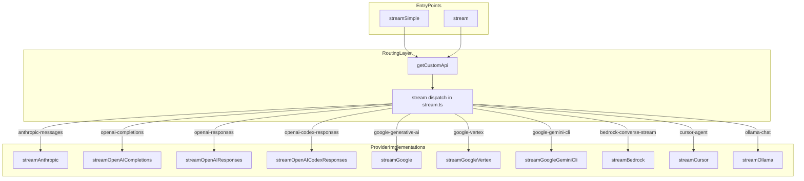
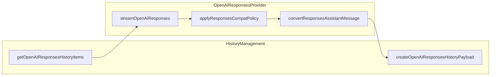
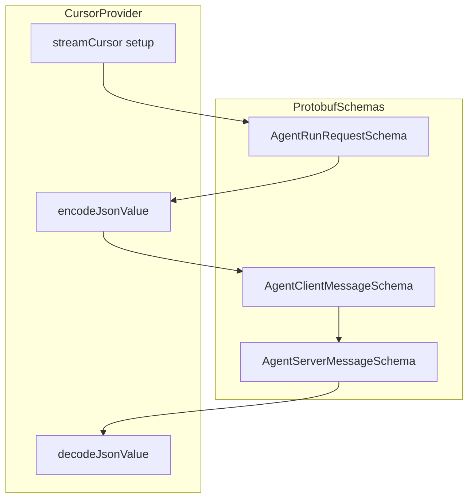
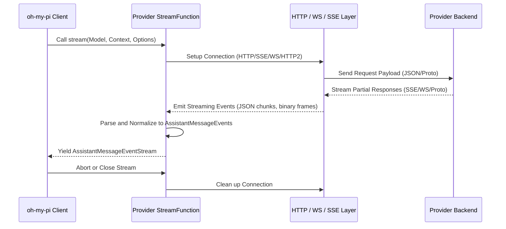

<!-- source: DeepWiki mcp.deepwiki.com · repo can1357/oh-my-pi · page 4.2 Provider Implementations · fetched 2026-10-30 -->

# Provider Implementations

Relevant source files

The following files were used as context for generating this wiki page:

- [packages/agent/src/tokenizer.ts](packages/agent/src/tokenizer.ts)
- [packages/agent/test/compaction-cut-point.test.ts](packages/agent/test/compaction-cut-point.test.ts)
- [packages/agent/test/tokenizer.test.ts](packages/agent/test/tokenizer.test.ts)
- [packages/ai/src/providers/amazon-bedrock.ts](packages/ai/src/providers/amazon-bedrock.ts)
- [packages/ai/src/providers/anthropic.ts](packages/ai/src/providers/anthropic.ts)
- [packages/ai/src/providers/azure-openai-responses.ts](packages/ai/src/providers/azure-openai-responses.ts)
- [packages/ai/src/providers/claude-code-fingerprint.ts](packages/ai/src/providers/claude-code-fingerprint.ts)
- [packages/ai/src/providers/connect-error-detail.ts](packages/ai/src/providers/connect-error-detail.ts)
- [packages/ai/src/providers/connect-frame.ts](packages/ai/src/providers/connect-frame.ts)
- [packages/ai/src/providers/cursor-pi-args.ts](packages/ai/src/providers/cursor-pi-args.ts)
- [packages/ai/src/providers/cursor.ts](packages/ai/src/providers/cursor.ts)
- [packages/ai/src/providers/cursor/exec-modern.ts](packages/ai/src/providers/cursor/exec-modern.ts)
- [packages/ai/src/providers/cursor/interaction-query.ts](packages/ai/src/providers/cursor/interaction-query.ts)
- [packages/ai/src/providers/google-gemini-cli.ts](packages/ai/src/providers/google-gemini-cli.ts)
- [packages/ai/src/providers/google-shared.ts](packages/ai/src/providers/google-shared.ts)
- [packages/ai/src/providers/google-vertex.ts](packages/ai/src/providers/google-vertex.ts)
- [packages/ai/src/providers/google.ts](packages/ai/src/providers/google.ts)
- [packages/ai/src/providers/ollama.ts](packages/ai/src/providers/ollama.ts)
- [packages/ai/src/providers/openai-codex-responses.ts](packages/ai/src/providers/openai-codex-responses.ts)
- [packages/ai/src/providers/openai-completions.ts](packages/ai/src/providers/openai-completions.ts)
- [packages/ai/src/providers/openai-responses.ts](packages/ai/src/providers/openai-responses.ts)
- [packages/ai/src/providers/openai-shared.ts](packages/ai/src/providers/openai-shared.ts)
- [packages/ai/src/stream.ts](packages/ai/src/stream.ts)
- [packages/ai/src/types.ts](packages/ai/src/types.ts)
- [packages/ai/src/usage/claude-api.ts](packages/ai/src/usage/claude-api.ts)
- [packages/ai/src/usage/claude.ts](packages/ai/src/usage/claude.ts)
- [packages/ai/src/utils/anthropic-auth.ts](packages/ai/src/utils/anthropic-auth.ts)
- [packages/ai/src/utils/block-symbols.ts](packages/ai/src/utils/block-symbols.ts)
- [packages/ai/test/anthropic-alignment.test.ts](packages/ai/test/anthropic-alignment.test.ts)
- [packages/ai/test/anthropic-oauth.test.ts](packages/ai/test/anthropic-oauth.test.ts)
- [packages/ai/test/anthropic-stream-envelope.test.ts](packages/ai/test/anthropic-stream-envelope.test.ts)
- [packages/ai/test/apply-patch-freeform.test.ts](packages/ai/test/apply-patch-freeform.test.ts)
- [packages/ai/test/auth-storage-usage-cache.test.ts](packages/ai/test/auth-storage-usage-cache.test.ts)
- [packages/ai/test/azure-openai-responses-stream.test.ts](packages/ai/test/azure-openai-responses-stream.test.ts)
- [packages/ai/test/bedrock-inference-profile.test.ts](packages/ai/test/bedrock-inference-profile.test.ts)
- [packages/ai/test/bedrock-prompt-cache.test.ts](packages/ai/test/bedrock-prompt-cache.test.ts)
- [packages/ai/test/bedrock-system-prompt.test.ts](packages/ai/test/bedrock-system-prompt.test.ts)
- [packages/ai/test/claude-usage-endpoint.test.ts](packages/ai/test/claude-usage-endpoint.test.ts)
- [packages/ai/test/claude-usage-headers.test.ts](packages/ai/test/claude-usage-headers.test.ts)
- [packages/ai/test/connect-error-detail.test.ts](packages/ai/test/connect-error-detail.test.ts)
- [packages/ai/test/connect-frame.test.ts](packages/ai/test/connect-frame.test.ts)
- [packages/ai/test/cursor-edit-tool-call.test.ts](packages/ai/test/cursor-edit-tool-call.test.ts)
- [packages/ai/test/cursor-exec-handlers.test.ts](packages/ai/test/cursor-exec-handlers.test.ts)
- [packages/ai/test/cursor-exec-modern.test.ts](packages/ai/test/cursor-exec-modern.test.ts)
- [packages/ai/test/cursor-interaction-query.test.ts](packages/ai/test/cursor-interaction-query.test.ts)
- [packages/ai/test/cursor-on-payload.test.ts](packages/ai/test/cursor-on-payload.test.ts)
- [packages/ai/test/cursor-pi-args.test.ts](packages/ai/test/cursor-pi-args.test.ts)
- [packages/ai/test/cursor-streaming-args.test.ts](packages/ai/test/cursor-streaming-args.test.ts)
- [packages/ai/test/cursor-terminal-error.test.ts](packages/ai/test/cursor-terminal-error.test.ts)
- [packages/ai/test/cursor-todo-bridge.test.ts](packages/ai/test/cursor-todo-bridge.test.ts)
- [packages/ai/test/google-empty-response-retry.test.ts](packages/ai/test/google-empty-response-retry.test.ts)
- [packages/ai/test/google-gemini-cli-alignment.test.ts](packages/ai/test/google-gemini-cli-alignment.test.ts)
- [packages/ai/test/ollama-thinking-disable.test.ts](packages/ai/test/ollama-thinking-disable.test.ts)
- [packages/ai/test/openai-codex-stream.test.ts](packages/ai/test/openai-codex-stream.test.ts)
- [packages/ai/test/openai-completions-on-payload.test.ts](packages/ai/test/openai-completions-on-payload.test.ts)
- [packages/ai/test/openai-responses-stream-terminal.test.ts](packages/ai/test/openai-responses-stream-terminal.test.ts)
- [packages/ai/test/transform-messages-dedup.test.ts](packages/ai/test/transform-messages-dedup.test.ts)
- [packages/catalog/src/discovery/antigravity.ts](packages/catalog/src/discovery/antigravity.ts)
- [packages/catalog/src/wire/gemini-headers.ts](packages/catalog/src/wire/gemini-headers.ts)
- [packages/coding-agent/src/cursor.ts](packages/coding-agent/src/cursor.ts)
- [packages/coding-agent/test/cursor-exec.test.ts](packages/coding-agent/test/cursor-exec.test.ts)
- [packages/coding-agent/test/cursor-todo-persistence.test.ts](packages/coding-agent/test/cursor-todo-persistence.test.ts)
- [packages/coding-agent/test/usage-row-turn-time.test.ts](packages/coding-agent/test/usage-row-turn-time.test.ts)

This page documents the individual provider implementations in the `@oh-my-pi/pi-ai` package. Each provider implements a streaming function that communicates with a specific LLM API, normalizing responses into a unified event stream format.

For information about model discovery and provider configuration, see [Model Registry and Discovery](4.1). For details on the streaming event architecture, see [Streaming and Events](4.3).

## Overview

Provider implementations are responsible for:

1. **Request Translation** — Converting unified `Context` [packages/ai/src/types.ts:63-100]() and options into provider-specific API payloads.
2. **Transport Management** — Handling HTTP (REST), Server-Sent Events (SSE), WebSocket connections, or HTTP/2 with protobuf as applicable [packages/ai/src/providers/openai-codex-responses.ts:159-188]().
3. **Response Normalization** — Transforming provider-specific responses into `AssistantMessageEventStream` events [packages/ai/src/stream.ts:33-160]().
4. **Error Handling** — Mapping provider errors to unified error states with retry logic, including rate-limiting and transient failure handling.
5. **Feature Support** — Implementing provider-specific features like adaptive thinking/reasoning options, prompt caching, tool call integration, signature preservation, and protocol extensions.

Each provider exposes a `StreamFunction` such as `streamAnthropic` [packages/ai/src/stream.ts:43](), `streamOpenAICompletions` [packages/ai/src/stream.ts:54](), etc., accepting a `Model`, `Context`, and provider-specific options, returning an asynchronous stream of assistant message events.

Sources: [packages/ai/src/stream.ts:33-160](), [packages/ai/src/types.ts:63-100]()

---

## Provider Architecture

### Provider Registration and Dispatch

The main entrypoint for streaming is the `stream()` function in `packages/ai/src/stream.ts`. It dispatches requests based on the `api` field of the `Model` object, selecting the appropriate provider-specific streaming function. Heavy or optional dependencies (e.g., AWS utilities, Google auth libraries) are loaded lazily via a `register-builtins` module to optimize CLI startup performance.

The `stream()` function also orchestrates API key retrieval (`getEnvApiKey`), provider-specific token refreshing (e.g., for Google Vertex via `getVertexAccessToken`), and determines whether endpoint URLs qualify for optimizations like leaked thinking content healing exemptions. This ensures robust request setup and dispatch.

Sources: [packages/ai/src/stream.ts:21-129]()

---

### Common Provider Pattern

All providers follow a three-phase streaming pattern:

- **Setup Phase**: Resolve credentials and construct provider-specific request payloads. This often includes message transformation, tool call normalization, effort-level mapping, and header construction.
- **Streaming Phase**: Establish a network connection using HTTP(S), SSE, WebSocket, or HTTP/2. Parse incremental response data into internal message states while yielding normalized event streams.
- **Completion Phase**: Finalize usage accounting, detect stop reasons (completion, tool invocation, errors), and clean up resources.

Providers also implement retry strategies, error classification, and compatibility transformations where applicable (e.g., strict schema validation for tool calls).

Sources: [packages/ai/src/stream.ts:70-80](), [packages/ai/test/anthropic-alignment.test.ts:176-184]()

---

## OpenAI-Compatible Providers

The oh-my-pi codebase supports multiple OpenAI-family APIs and compatible derivatives with distinct protocols.

---

### OpenAI Completions API

- **Entry Point:** `streamOpenAICompletions` [packages/ai/src/providers/openai-completions.ts:1-120]()
- **API Key:** Standard OpenAI keys or compatible proxies.
- **Transport:** HTTPS with Server-Sent Events (SSE).
- **Features:**
  - Uses `StreamMarkupHealing` to correct malformed function-tool JSON streams.
  - Implements reasoning effort fallbacks for unsupported effort levels.
  - Enforces strict JSON schema for tool calls with opt-out support.
  - Supports tool calls integrated into chat completions.
  - Uses message transformation utilities for prompt building and response parsing.

Sources: [packages/ai/src/providers/openai-completions.ts:1-188](), [packages/ai/src/types.ts:75-75]()

---

### OpenAI Responses API

- **Entry Point:** `streamOpenAIResponses` [packages/ai/src/providers/openai-responses.ts:1-177]()
- **Capabilities:**
  - Supports stateful turn chaining with `previous_response_id`.
  - Enhanced prompt caching via session and prompt cache keys.
  - Supports detailed reasoning and tool call handling.
  - Adheres to catalog-defined compatibility policies.
  - Uses rich history replay pipelines (`getOpenAIResponsesHistoryItems` and `createOpenAIResponsesHistoryPayload`).
  - Handles progressive stream parsing and connection retry.

Sources: [packages/ai/src/providers/openai-responses.ts:11-24](), [packages/ai/src/types.ts:76-76]()

---

### OpenAI Codex Responses (ChatGPT Plus/Pro)

- **Entry Point:** `streamOpenAICodexResponses` [packages/ai/src/providers/openai-codex-responses.ts:1-167]()
- **Highlights:**
  - Supports OAuth token authentication and advanced token scoping.
  - Dual transport mode: WebSocket or SSE selected at runtime (`getOpenAICodexTransportDetails`).
  - Request bodies can be compressed using zstd and decoded accordingly.
  - Complex SSE parsing with streaming chunk types and usage reporting.
  - Tool call and reasoning handling with request body transformations.
  - Integrated with codex-specific reasoning control and compatibility.

Sources: [packages/ai/src/providers/openai-codex-responses.ts:1-168](), [packages/ai/src/providers/openai-codex/request-transformer.ts:10-90](), [packages/ai/test/openai-codex-stream.test.ts:1-168]()

---

## Anthropic Provider

- **Entry Point:** `streamAnthropic` [packages/ai/src/providers/anthropic.ts:1-200]()
- **Key Features:**
  - Interleaved thinking output handling for models like Claude.
  - Builds adaptive effort levels mapped from oh-my-pi's unified Effort enum.
  - Supports a rich set of beta feature headers with deduplication.
  - Manages negotiation of base URLs, including official URLs and signing proxy URLs.
  - Uses SSE for streaming with incremental JSON parsing and message construction.
  - Comprehensive error handling classifies retries, throttling, and fatal errors.
  - Supports tool call normalization including argument parsing and replay through `parseToolCallArguments`.
  - Thought blocks and reasoning are detected and output as structured events.
  - Implements fast mode fallbacks and compliance with Foundry endpoints.

Sources: [packages/ai/src/providers/anthropic.ts:1-201](), [packages/ai/src/utils/block-symbols.ts:60-76]()

---

## Google Providers

The codebase includes several Google-related providers with specialized API shapes and protocols.

---

### Google Gemini CLI / Antigravity

- **Entry Point:** `streamGoogleGeminiCli` [packages/ai/src/providers/google-gemini-cli.ts:1-65]()
- **Transport:** HTTPS with SSE streaming.
- **Features:**
  - Uses specialized headers (`getGeminiCliHeaders`) with version and user-agent fingerprinting.
  - Implements leak-detection for embedded JSON "planning" objects and suppresses these in the visible stream via functions like `isPlanningLeakPrefix` and `consumePlanningBuffer`.
  - Enforces strict JSON schema compliance for tool calls.
  - Supports forced tool directives documented in inlined markdown.
  - Reasoning content is managed with custom thinking level enums.
  - Tools and messages are converted into Gemini content arrays for API requests.
  - Uses idle iteration with timeouts for robust streaming.

Sources: [packages/ai/src/providers/google-gemini-cli.ts:1-206]()

---

### Google Vertex AI and Google Generative AI

- **Entry Points:** `streamGoogleVertex`, `streamGoogle` [packages/ai/src/providers/google-shared.ts:1-100]()
- **Capabilities:**
  - Stream JSON chunks over SSE with chunked "parts" of text, tool calls, reasoning metadata.
  - Use Google-specific `thinking` levels controlling internal model reasoning parameters.
  - Support cached content tokens identified by opaque resource names.
  - Perform token-level cost mapping and rich usage telemetry.
  - Maintain reasoning continuity via encrypted thought signatures in stream parts.
  - Authentication includes bearer token refresh using `getVertexAccessToken`.
  - Share utilities for message normalization and tool call extraction.

Sources: [packages/ai/src/providers/google-shared.ts:1-100](), [packages/ai/src/stream.ts:79-91]()

---

## Cursor Provider

- **Entry Point:** `streamCursor` [packages/ai/src/providers/cursor.ts:1-231]()
- **Protocol:** HTTP/2 Connect multiplexed streaming using protobuf-encoded messages.
- **Key Points:**
  - Defines protobuf schemas for various message types using `@oh-my-pi/pi-catalog/discovery/protobuf`.
  - Handles a rich conversation state model with full sync and message acknowledgments.
  - Supports execution handlers for native operations like shells and tool-like functions.
  - Encodes tool call arguments and normalizes tool call IDs.
  - Parses server messages into discrete stream events for agent consumption.
  - Includes layered streaming envelope and block index markers for incremental parsing.
  - Caches protobuf encoding/decoding for performance.

Sources: [packages/ai/src/providers/cursor.ts:14-184](), [packages/ai/src/providers/cursor.ts:224-225]()

---

## Amazon Bedrock

- **Entry Point:** `streamBedrock` [packages/ai/src/providers/amazon-bedrock.ts:1-143]()
- **Protocol:** HTTPS with Amazon's proprietary `application/vnd.amazon.eventstream` binary frame event stream.
- **Signature:** AWS SigV4 signing manually implemented; no AWS SDK dependencies.
- **Features:**
  - Credentials resolved through environment and profiles with caching.
  - Handles guardrail configuration for request validation and telemetry.
  - Supports adaptive reasoning effort and token budgeting consistent with Claude models on Bedrock.
  - Parses binary event stream frames and maps in-stream exceptions to HTTP status codes for retry logic.
  - Supports interleaved thinking blocks with configurable verbosity.
  - Enforces reserved headers and signature integrity.
  
Sources: [packages/ai/src/providers/amazon-bedrock.ts:1-143]()

---

## Protocol and Transport Summary

| Provider              | Transport / Protocol         | Streaming Protocol        | Key Features                                      |
|-----------------------|-----------------------------|--------------------------|--------------------------------------------------|
| **Anthropic**         | HTTPS                      | SSE                      | Adaptive effort, beta headers, prompt caching    |
| **OpenAI Completions**| HTTPS                      | SSE                      | Markup healing, strict tool schema validation    |
| **OpenAI Responses**  | HTTPS                      | SSE                      | Stateful turn chaining, prompt caching            |
| **OpenAI Codex**      | WebSocket / HTTPS          | WebSocket / SSE          | OAuth support, zstd compression, multi-transport |
| **Google Gemini CLI** | HTTPS                      | SSE                      | Planning leak redaction, strict tool call schemas|
| **Google Vertex AI**  | HTTPS                      | SSE                      | Thinking levels, cached content, rich reasoning  |
| **Cursor**            | HTTP/2                     | Connect multiplexed stream| Protobuf streaming, tool and shell execution     |
| **Amazon Bedrock**    | HTTPS                      | Binary Event Stream (SSE)| SigV4 signing, guardrails, interleaved thinking  |
| **Ollama**            | HTTPS                      | SSE                      | Local model chat execution                        |

Sources: [packages/ai/src/stream.ts:33-60](), [packages/ai/src/providers/anthropic.ts:1-201](), [packages/ai/src/providers/openai-completions.ts:1-120]()

---

## Natural Language to Code Entity Association

```mermaid
graph TD
    subgraph "Provider Natural Language Space"
        NL_Anthropic["Anthropic (Claude)"]
        NL_OpenAI_Comp["OpenAI Completions"]
        NL_OpenAI_Resp["OpenAI Responses API"]
        NL_OpenAI_Codex["OpenAI Codex Responses"]
        NL_Google_Gemini["Google Gemini CLI"]
        NL_Google_Vertex["Google Vertex AI"]
        NL_Cursor["Cursor Agent"]
        NL_Bedrock["Amazon Bedrock"]
        NL_Ollama["Ollama Local Chat"]
    end

    subgraph "Code Implementation Space"
        Impl_Anthropic["streamAnthropic - packages/ai/src/providers/anthropic.ts"]
        Impl_OpenAI_Completions["streamOpenAICompletions - packages/ai/src/providers/openai-completions.ts"]
        Impl_OpenAI_Responses["streamOpenAIResponses - packages/ai/src/providers/openai-responses.ts"]
        Impl_OpenAI_Codex["streamOpenAICodexResponses - packages/ai/src/providers/openai-codex-responses.ts"]
        Impl_Google_Gemini["streamGoogleGeminiCli - packages/ai/src/providers/google-gemini-cli.ts"]
        Impl_Google_Vertex["streamGoogleVertex - packages/ai/src/providers/google-vertex.ts"]
        Impl_Cursor["streamCursor - packages/ai/src/providers/cursor.ts"]
        Impl_Bedrock["streamBedrock - packages/ai/src/providers/amazon-bedrock.ts"]
        Impl_Ollama["streamOllama - packages/ai/src/providers/ollama.ts"]
    end

    NL_Anthropic --> Impl_Anthropic
    NL_OpenAI_Comp --> Impl_OpenAI_Completions
    NL_OpenAI_Resp --> Impl_OpenAI_Responses
    NL_OpenAI_Codex --> Impl_OpenAI_Codex
    NL_Google_Gemini --> Impl_Google_Gemini
    NL_Google_Vertex --> Impl_Google_Vertex
    NL_Cursor --> Impl_Cursor
    NL_Bedrock --> Impl_Bedrock
    NL_Ollama --> Impl_Ollama
```

Sources: Aggregated from all cited source files.

---

## Streaming Protocols and Data Flow Details

Sources: [packages/ai/src/stream.ts:1-160](), [packages/ai/src/providers/openai-codex-responses.ts:134-168](), [packages/ai/src/providers/amazon-bedrock.ts:1-54]()

---

