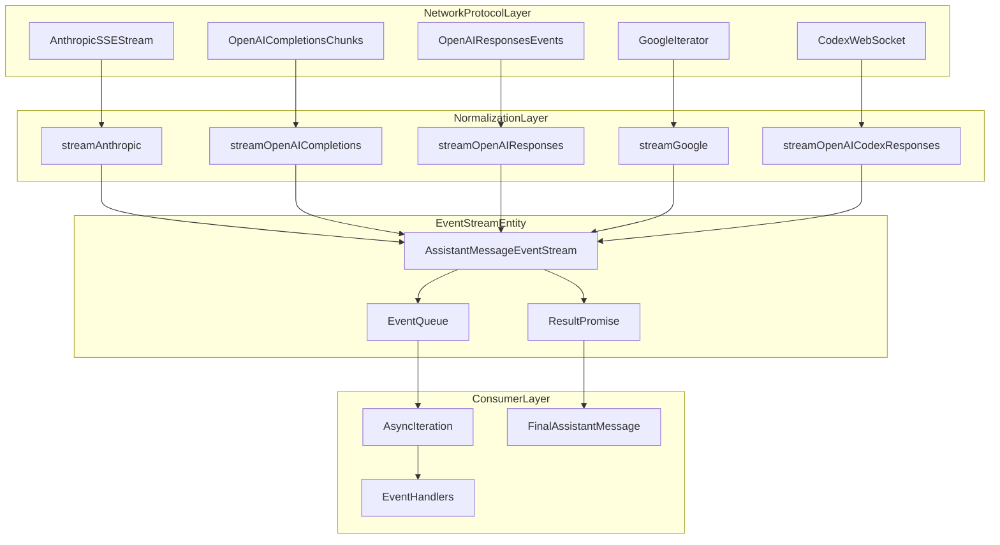
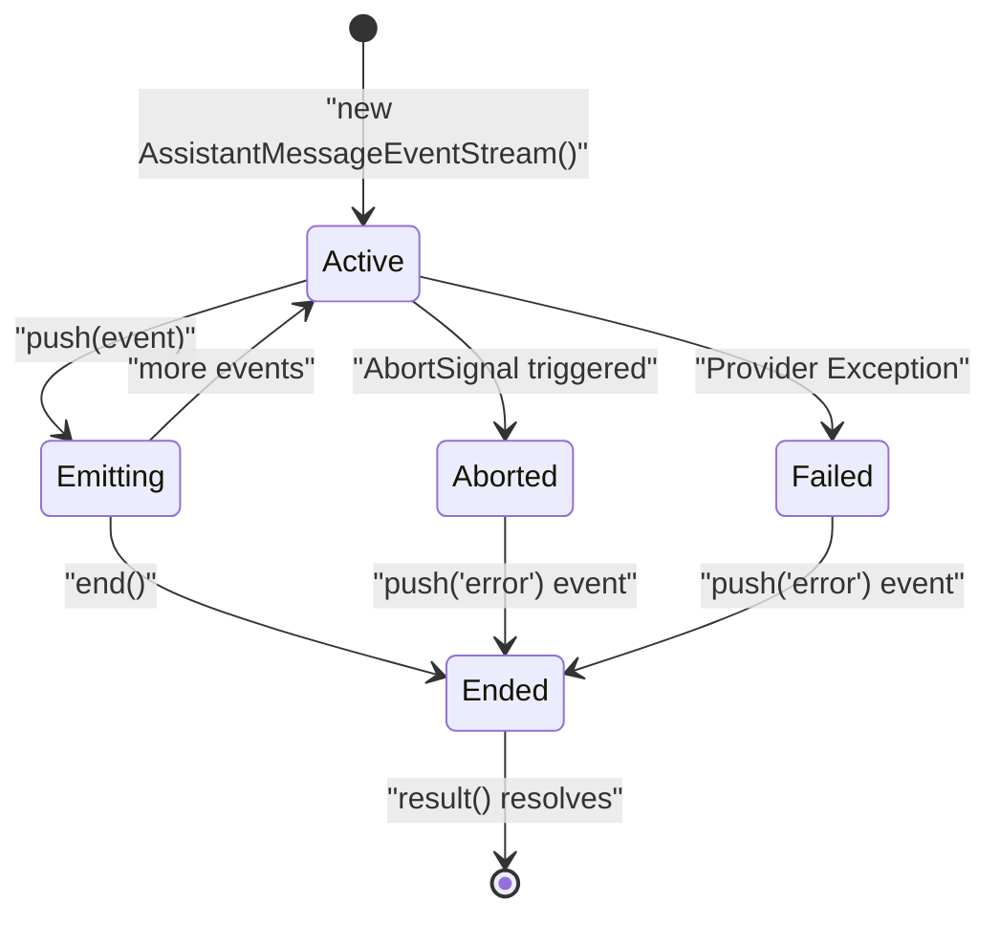
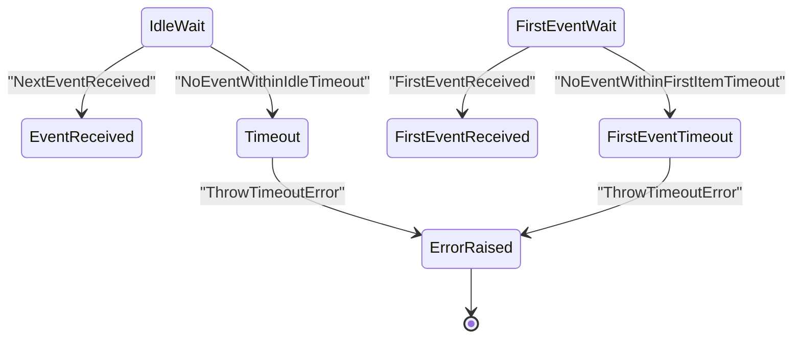
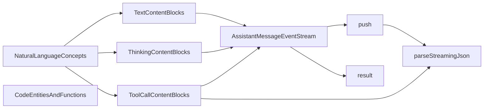

<!-- source: DeepWiki mcp.deepwiki.com · repo can1357/oh-my-pi · page 4.3 Streaming and Events · fetched 2026-10-30 -->

# Streaming and Events

<details>
<summary>Relevant source files</summary>

The following files were used as context for generating this wiki page:

- [packages/agent/src/prompts/dsml-tool-call-leak.md](packages/agent/src/prompts/dsml-tool-call-leak.md)
- [packages/ai/src/dialect/anthropic.ts](packages/ai/src/dialect/anthropic.ts)
- [packages/ai/src/dialect/coercion.ts](packages/ai/src/dialect/coercion.ts)
- [packages/ai/src/dialect/deepseek.ts](packages/ai/src/dialect/deepseek.ts)
- [packages/ai/src/dialect/gemini.ts](packages/ai/src/dialect/gemini.ts)
- [packages/ai/src/dialect/gemma.ts](packages/ai/src/dialect/gemma.ts)
- [packages/ai/src/dialect/glm.ts](packages/ai/src/dialect/glm.ts)
- [packages/ai/src/dialect/harmony.ts](packages/ai/src/dialect/harmony.ts)
- [packages/ai/src/dialect/hermes.ts](packages/ai/src/dialect/hermes.ts)
- [packages/ai/src/dialect/index.ts](packages/ai/src/dialect/index.ts)
- [packages/ai/src/dialect/kimi.ts](packages/ai/src/dialect/kimi.ts)
- [packages/ai/src/dialect/minimax.ts](packages/ai/src/dialect/minimax.ts)
- [packages/ai/src/dialect/owned-stream.ts](packages/ai/src/dialect/owned-stream.ts)
- [packages/ai/src/dialect/qwen-xml.ts](packages/ai/src/dialect/qwen-xml.ts)
- [packages/ai/src/dialect/qwen3.ts](packages/ai/src/dialect/qwen3.ts)
- [packages/ai/src/dialect/terminator-wait.ts](packages/ai/src/dialect/terminator-wait.ts)
- [packages/ai/src/dialect/thinking.ts](packages/ai/src/dialect/thinking.ts)
- [packages/ai/src/dialect/types.ts](packages/ai/src/dialect/types.ts)
- [packages/ai/src/error/body-error.ts](packages/ai/src/error/body-error.ts)
- [packages/ai/src/error/classes.ts](packages/ai/src/error/classes.ts)
- [packages/ai/src/error/index.ts](packages/ai/src/error/index.ts)
- [packages/ai/src/error/network-cause.ts](packages/ai/src/error/network-cause.ts)
- [packages/ai/src/providers/anthropic-client.ts](packages/ai/src/providers/anthropic-client.ts)
- [packages/ai/src/providers/anthropic.ts](packages/ai/src/providers/anthropic.ts)
- [packages/ai/src/providers/azure-openai-responses.ts](packages/ai/src/providers/azure-openai-responses.ts)
- [packages/ai/src/providers/claude-code-fingerprint.ts](packages/ai/src/providers/claude-code-fingerprint.ts)
- [packages/ai/src/providers/google-vertex.ts](packages/ai/src/providers/google-vertex.ts)
- [packages/ai/src/providers/google.ts](packages/ai/src/providers/google.ts)
- [packages/ai/src/providers/openai-codex-responses.ts](packages/ai/src/providers/openai-codex-responses.ts)
- [packages/ai/src/providers/openai-completions.ts](packages/ai/src/providers/openai-completions.ts)
- [packages/ai/src/providers/openai-responses.ts](packages/ai/src/providers/openai-responses.ts)
- [packages/ai/src/providers/openai-shared.ts](packages/ai/src/providers/openai-shared.ts)
- [packages/ai/src/stream.ts](packages/ai/src/stream.ts)
- [packages/ai/src/types.ts](packages/ai/src/types.ts)
- [packages/ai/src/usage/claude-api.ts](packages/ai/src/usage/claude-api.ts)
- [packages/ai/src/usage/claude.ts](packages/ai/src/usage/claude.ts)
- [packages/ai/src/utils/abort.ts](packages/ai/src/utils/abort.ts)
- [packages/ai/src/utils/anthropic-auth.ts](packages/ai/src/utils/anthropic-auth.ts)
- [packages/ai/src/utils/dsml-leak.ts](packages/ai/src/utils/dsml-leak.ts)
- [packages/ai/src/utils/openai-http.ts](packages/ai/src/utils/openai-http.ts)
- [packages/ai/src/utils/retry-after.ts](packages/ai/src/utils/retry-after.ts)
- [packages/ai/src/utils/stream-markup-healing.ts](packages/ai/src/utils/stream-markup-healing.ts)
- [packages/ai/test/anthropic-alignment.test.ts](packages/ai/test/anthropic-alignment.test.ts)
- [packages/ai/test/anthropic-client.test.ts](packages/ai/test/anthropic-client.test.ts)
- [packages/ai/test/anthropic-oauth.test.ts](packages/ai/test/anthropic-oauth.test.ts)
- [packages/ai/test/anthropic-stream-envelope.test.ts](packages/ai/test/anthropic-stream-envelope.test.ts)
- [packages/ai/test/anthropic-stream-timeout.test.ts](packages/ai/test/anthropic-stream-timeout.test.ts)
- [packages/ai/test/anthropic-thinking-immutability.test.ts](packages/ai/test/anthropic-thinking-immutability.test.ts)
- [packages/ai/test/apply-patch-freeform.test.ts](packages/ai/test/apply-patch-freeform.test.ts)
- [packages/ai/test/auth-storage-usage-cache.test.ts](packages/ai/test/auth-storage-usage-cache.test.ts)
- [packages/ai/test/azure-openai-responses-stream.test.ts](packages/ai/test/azure-openai-responses-stream.test.ts)
- [packages/ai/test/claude-usage-endpoint.test.ts](packages/ai/test/claude-usage-endpoint.test.ts)
- [packages/ai/test/claude-usage-headers.test.ts](packages/ai/test/claude-usage-headers.test.ts)
- [packages/ai/test/deepseek-reasoning-content.test.ts](packages/ai/test/deepseek-reasoning-content.test.ts)
- [packages/ai/test/dialect-thinking.test.ts](packages/ai/test/dialect-thinking.test.ts)
- [packages/ai/test/error-body-rate-limit.test.ts](packages/ai/test/error-body-rate-limit.test.ts)
- [packages/ai/test/inband-tools.test.ts](packages/ai/test/inband-tools.test.ts)
- [packages/ai/test/issue-1207-repro.test.ts](packages/ai/test/issue-1207-repro.test.ts)
- [packages/ai/test/network-cause.test.ts](packages/ai/test/network-cause.test.ts)
- [packages/ai/test/openai-codex-stream.test.ts](packages/ai/test/openai-codex-stream.test.ts)
- [packages/ai/test/openai-responses-stream-terminal.test.ts](packages/ai/test/openai-responses-stream-terminal.test.ts)
- [packages/ai/test/owned-stream-native-toolcall.test.ts](packages/ai/test/owned-stream-native-toolcall.test.ts)
- [packages/ai/test/stream-markup-healing.test.ts](packages/ai/test/stream-markup-healing.test.ts)
- [packages/ai/test/tool-examples.test.ts](packages/ai/test/tool-examples.test.ts)
- [packages/ai/test/transform-messages-dedup.test.ts](packages/ai/test/transform-messages-dedup.test.ts)
- [packages/utils/src/abortable.ts](packages/utils/src/abortable.ts)
- [packages/utils/src/stream.ts](packages/utils/src/stream.ts)
- [packages/utils/test/stream.test.ts](packages/utils/test/stream.test.ts)

</details>


This document details the `AssistantMessageEventStream` architecture within the `@oh-my-pi/pi-ai` package, focusing on how streaming AI responses from various providers are normalized into a unified event-driven system. It covers event types (text, thinking, tool calls), the use of idle iterators, handling of first-event timeouts, and the processing pipeline for streaming responses [packages/ai/src/types.ts:58-62]().

---

## Purpose and Architecture

The streaming layer unifies and normalizes AI assistant response streams from heterogeneous providers, converting provider-specific events and protocols into a consistent `AssistantMessageEventStream` interface [packages/ai/src/utils/event-stream.ts:18-182](). This abstraction enables components such as the terminal UI (TUI), agents, tools, and transcript containers to consume AI output incrementally in a provider-agnostic way.

### Assistant Message Event Stream Architecture



Sources:  
[packages/ai/src/providers/anthropic.ts:26-61](),  
[packages/ai/src/providers/openai-completions.ts:20-36](),  
[packages/ai/src/providers/openai-responses.ts:13-24](),  
[packages/ai/src/providers/openai-codex-responses.ts:30-49](),  
[packages/ai/src/types.ts:58-62]()

---

## AssistantMessageEventStream Implementation

The `AssistantMessageEventStream` class, defined in `packages/ai/src/utils/event-stream.ts`, is both an event emitter and an async iterable that manages the lifecycle of a single AI assistant response turn [packages/ai/src/utils/event-stream.ts:18-182](). It buffers incremental events emitted by provider adapters and exposes them asynchronously to consumers.

### State Machine of AssistantMessageEventStream



#### Key characteristics:

- **Active**: Accepting new events via `push()` [packages/ai/src/utils/event-stream.ts:18-182]().
- **Emitting**: Temporarily emitting events to consumer; new events can be pushed concurrently [packages/ai/src/utils/event-stream.ts:18-182]().
- **Aborted** or **Failed**: Stream terminated early due to abort or error; pushes an `error` event [packages/ai/src/utils/event-stream.ts:18-182]().
- **Ended**: The stream is fully completed; `result()` promise resolves with the final assistant message [packages/ai/src/utils/event-stream.ts:18-182]().

#### Important Methods:

- `push(event: AssistantMessageEvent): void` — Inject partial or terminal events [packages/ai/src/utils/event-stream.ts:18-182]().
- `end(result?: AssistantMessage): void` — Mark the stream as ended and optionally supply the final assembled message [packages/ai/src/utils/event-stream.ts:18-182]().
- `result(): Promise<AssistantMessage>` — Promise resolving to the final message after stream ends or rejects on failure [packages/ai/src/utils/event-stream.ts:18-182]().
- Implements `[Symbol.asyncIterator]()` to allow consumption via `for await...of` loops [packages/ai/src/utils/event-stream.ts:18-182]().

Sources:  
[packages/ai/src/utils/event-stream.ts:18-182](),  
[packages/ai/src/types.ts:58-62]()

---

## Event Types and Content Blocks

Streaming AI responses are broken down into discrete event types representing stages and content segments of the final assistant message. Each event contains a content block identifier (`contentIndex`) enabling interleaving of multiple blocks in the stream [packages/ai/src/types.ts:58-62]().

| Event Type          | Description                                                                                   |
|---------------------|-----------------------------------------------------------------------------------------------|
| `start`             | Stream initialization; delivers initial assistant message state [packages/ai/src/types.ts:58-62](). |
| `text_start`        | New text content block begins at the specified index [packages/ai/src/types.ts:58-62]().        |
| `text_delta`        | Partial addition of text fragment to the current block [packages/ai/src/types.ts:58-62]().      |
| `text_end`          | Current text content block completes [packages/ai/src/types.ts:58-62]().                        |
| `thinking_start`    | "Thinking" or reasoning segment begins; incremental logical or internal notes [packages/ai/src/types.ts:58-62](). |
| `thinking_delta`    | Additional thinking content appended to the current block [packages/ai/src/types.ts:58-62]().   |
| `thinking_end`      | Completion of the thinking segment [packages/ai/src/types.ts:58-62]().                          |
| `toolcall_start`    | A tool call invocation begins; JSON argument data streams in [packages/ai/src/types.ts:58-62](). |
| `toolcall_delta`    | Partial JSON string data received for tool call arguments [packages/ai/src/types.ts:58-62]().   |
| `toolcall_end`      | Tool call arguments fully received and parsed [packages/ai/src/types.ts:58-62]().                |
| `done`              | Stream completes successfully; final assistant message available [packages/ai/src/types.ts:58-62](). |
| `error`             | Unrecoverable error occurred; `errorMessage` contains details [packages/ai/src/types.ts:58-62](). |

Sources:  
[packages/ai/src/types.ts:58-62]()

---

## Idle Iterator and Watchdog Timeouts

Because streaming AI responses may stall due to network issues or provider delays, the system uses idle iterator watchdogs to detect and abort stalled streams gracefully [packages/ai/utils/src/stream.ts:1-100]().

### Timeout Parameters

These timeouts are configurable via environment variables and function options, layered as follows:

| Timeout Type              | Env Variables                                            | Default             |
|---------------------------|----------------------------------------------------------|---------------------|
| Idle Timeout              | `PI_STREAM_IDLE_TIMEOUT_MS` (generic)                    | 300,000 ms (5 minutes) |
| OpenAI-specific Idle Timeout | `PI_OPENAI_STREAM_IDLE_TIMEOUT_MS` (overrides generic)  | 300,000 ms (5 minutes) |
| First Event Timeout       | `PI_STREAM_FIRST_EVENT_TIMEOUT_MS`                        | 300,000 ms (5 minutes) |
| OpenAI-specific First Event Timeout | `PI_OPENAI_STREAM_FIRST_EVENT_TIMEOUT_MS` (overrides generic) | 300,000 ms (5 minutes) |

### Key Functions to Access Timeouts

- `getStreamIdleTimeoutMs(fallbackMs?: number): number | undefined` — Returns idle timeout for generic streams [packages/ai/src/utils/idle-iterator.ts:100-102]().
- `getOpenAIStreamIdleTimeoutMs(fallbackMs?: number): number | undefined` — Returns idle timeout specifically for OpenAI family [packages/ai/src/utils/idle-iterator.ts:104-106]().
- `getStreamFirstEventTimeoutMs(idleTimeoutMs?: number, fallbackMs?: number): number | undefined` — Returns first event timeout with idle timeout as a floor for generic streams [packages/ai/src/utils/idle-iterator.ts:108-110]().
- `getOpenAIStreamFirstEventTimeoutMs(idleTimeoutMs?: number, fallbackMs?: number): number | undefined` — Same for OpenAI family streams [packages/ai/src/utils/idle-iterator.ts:112-114]().

### Idle Timeout Lifecycle Diagram



Sources:  
[packages/ai/src/utils/idle-iterator.ts:1-146](),  
[packages/ai/src/providers/anthropic.ts:87](),  
[packages/ai/src/providers/openai-completions.ts:48](),  
[packages/ai/src/providers/openai-responses.ts:38](),  
[packages/ai/src/providers/openai-codex-responses.ts:72](),  
[packages/ai/src/providers/azure-openai-responses.ts:21-22]()

---

## Processing Streaming Responses

Each AI provider implements a streaming function that initiates a request, parses provider-specific data, normalizes message fragments into `AssistantMessageEvent` objects, and pushes them into an `AssistantMessageEventStream` [packages/ai/src/providers/anthropic.ts:83]().

### Provider-Specific Streaming Functions

| Provider                | Streaming Function                          | Returns                         | Location                                     |
|-------------------------|--------------------------------------------|--------------------------------|----------------------------------------------|
| Anthropic Messages API  | `streamAnthropic()`                         | `AssistantMessageEventStream` | `packages/ai/src/providers/anthropic.ts`    |
| OpenAI Completions       | `streamOpenAICompletions()`                 | `AssistantMessageEventStream` | `packages/ai/src/providers/openai-completions.ts` |
| OpenAI Responses         | `streamOpenAIResponses()`                    | `AssistantMessageEventStream` | `packages/ai/src/providers/openai-responses.ts`  |
| OpenAI Codex (WebSocket) | `streamOpenAICodexResponses()`               | `AssistantMessageEventStream` | `packages/ai/src/providers/openai-codex-responses.ts` |
| Google Generative AI      | `streamGoogle()`                            | `AssistantMessageEventStream` | `packages/ai/src/providers/google.ts`       |

Sources:  
[packages/ai/src/providers/anthropic.ts:83](),  
[packages/ai/src/providers/openai-completions.ts:41](),  
[packages/ai/src/providers/openai-responses.ts:33](),  
[packages/ai/src/providers/openai-codex-responses.ts:64](),  
[packages/ai/src/stream.ts:50-57]()

---

## Event Types: Natural Language to Code Entity Mapping



Sources:  
[packages/ai/src/providers/anthropic.ts:83](),  
[packages/ai/src/providers/openai-completions.ts:41](),  
[packages/ai/src/providers/openai-responses.ts:33]()

---

## Consuming Event Streams

Consumers iterate over the event stream asynchronously, responding to events to update UI and internal state [packages/ai/src/types.ts:58-62]().

```typescript
const stream = streamAnthropic(model, context, options);

for await (const event of stream) {
  switch(event.type) {
    case "text_delta":
      process.stdout.write(event.delta.text);
      break;
    case "thinking_delta":
      break;
    case "toolcall_end":
      break;
    case "done":
      const finalMessage = event.message;
      break;
    case "error":
      break;
  }
}
```

Sources:  
[packages/ai/src/types.ts:58-62]()

---

## References

- `AssistantMessageEventStream` class: [packages/ai/src/utils/event-stream.ts:18-182]()
- Idle iterator utilities and timeouts: [packages/ai/src/utils/idle-iterator.ts:1-146]()
- Provider streaming implementations:
  - Anthropic: [packages/ai/src/providers/anthropic.ts:83]()
  - OpenAI Completions: [packages/ai/src/providers/openai-completions.ts:41]()
  - OpenAI Responses: [packages/ai/src/providers/openai-responses.ts:33]()
  - OpenAI Codex Responses: [packages/ai/src/providers/openai-codex-responses.ts:64]()
  - Google GenAI: [packages/ai/src/stream.ts:50-57]()

Sources:  
[packages/ai/src/utils/event-stream.ts:1-194](),  
[packages/ai/src/utils/idle-iterator.ts:1-146](),  
[packages/ai/src/providers/anthropic.ts:83](),  
[packages/ai/src/providers/openai-completions.ts:41](),  
[packages/ai/src/providers/openai-responses.ts:33](),  
[packages/ai/src/providers/openai-codex-responses.ts:64](),  
[packages/ai/src/stream.ts:50-57](),  
[packages/ai/src/types.ts:58-62]()

---

