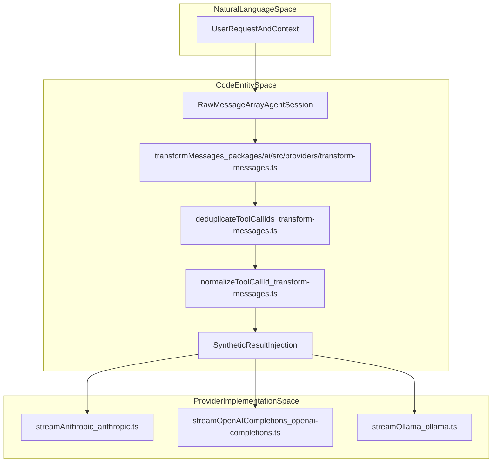
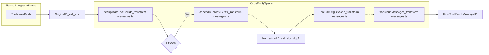
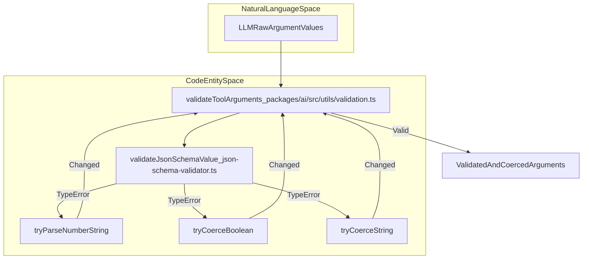
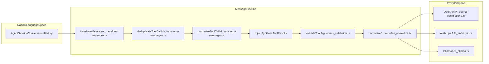

<!-- source: DeepWiki mcp.deepwiki.com · repo can1357/oh-my-pi · page 4.4 Message Transformation and Schema Normalization · fetched 2026-10-30 -->

# Message Transformation and Schema Normalization

Relevant source files

The following files were used as context for generating this wiki page:

- [docs/handoff-generation-pipeline.md](docs/handoff-generation-pipeline.md)
- [packages/agent/src/tool-arguments.ts](packages/agent/src/tool-arguments.ts)
- [packages/agent/test/handoff.test.ts](packages/agent/test/handoff.test.ts)
- [packages/ai/src/dialect/demotion.ts](packages/ai/src/dialect/demotion.ts)
- [packages/ai/src/providers/transform-messages.ts](packages/ai/src/providers/transform-messages.ts)
- [packages/ai/src/utils/schema/CONSTRAINTS.md](packages/ai/src/utils/schema/CONSTRAINTS.md)
- [packages/ai/src/utils/schema/adapt.ts](packages/ai/src/utils/schema/adapt.ts)
- [packages/ai/src/utils/schema/allowlist.ts](packages/ai/src/utils/schema/allowlist.ts)
- [packages/ai/src/utils/schema/compatibility.ts](packages/ai/src/utils/schema/compatibility.ts)
- [packages/ai/src/utils/schema/dereference.ts](packages/ai/src/utils/schema/dereference.ts)
- [packages/ai/src/utils/schema/draft.ts](packages/ai/src/utils/schema/draft.ts)
- [packages/ai/src/utils/schema/equality.ts](packages/ai/src/utils/schema/equality.ts)
- [packages/ai/src/utils/schema/fields.ts](packages/ai/src/utils/schema/fields.ts)
- [packages/ai/src/utils/schema/index.ts](packages/ai/src/utils/schema/index.ts)
- [packages/ai/src/utils/schema/json-schema-validator.ts](packages/ai/src/utils/schema/json-schema-validator.ts)
- [packages/ai/src/utils/schema/meta-validator.ts](packages/ai/src/utils/schema/meta-validator.ts)
- [packages/ai/src/utils/schema/normalize.ts](packages/ai/src/utils/schema/normalize.ts)
- [packages/ai/src/utils/schema/stamps.ts](packages/ai/src/utils/schema/stamps.ts)
- [packages/ai/src/utils/schema/strict-tool-validation.ts](packages/ai/src/utils/schema/strict-tool-validation.ts)
- [packages/ai/src/utils/schema/wire.ts](packages/ai/src/utils/schema/wire.ts)
- [packages/ai/src/utils/validation.ts](packages/ai/src/utils/validation.ts)
- [packages/ai/test/anthropic-abandoned-tooluse-replay.test.ts](packages/ai/test/anthropic-abandoned-tooluse-replay.test.ts)
- [packages/ai/test/anthropic-prefill.test.ts](packages/ai/test/anthropic-prefill.test.ts)
- [packages/ai/test/anthropic-prior-turn-thinking.test.ts](packages/ai/test/anthropic-prior-turn-thinking.test.ts)
- [packages/ai/test/bedrock-tool-name-replay.test.ts](packages/ai/test/bedrock-tool-name-replay.test.ts)
- [packages/ai/test/cursor-mcp-tool-catalog.test.ts](packages/ai/test/cursor-mcp-tool-catalog.test.ts)
- [packages/ai/test/duplicate-tool-results.test.ts](packages/ai/test/duplicate-tool-results.test.ts)
- [packages/ai/test/eval-language-whitespace.test.ts](packages/ai/test/eval-language-whitespace.test.ts)
- [packages/ai/test/google-tool-schema.test.ts](packages/ai/test/google-tool-schema.test.ts)
- [packages/ai/test/openai-codex.test.ts](packages/ai/test/openai-codex.test.ts)
- [packages/ai/test/openai-completions-xai-root-union.test.ts](packages/ai/test/openai-completions-xai-root-union.test.ts)
- [packages/ai/test/openai-responses-tool-quarantine.test.ts](packages/ai/test/openai-responses-tool-quarantine.test.ts)
- [packages/ai/test/openai-tool-strict-mode.test.ts](packages/ai/test/openai-tool-strict-mode.test.ts)
- [packages/ai/test/schema-compatibility.test.ts](packages/ai/test/schema-compatibility.test.ts)
- [packages/ai/test/schema-dereference.test.ts](packages/ai/test/schema-dereference.test.ts)
- [packages/ai/test/schema-immutability.test.ts](packages/ai/test/schema-immutability.test.ts)
- [packages/ai/test/schema-normalization.test.ts](packages/ai/test/schema-normalization.test.ts)
- [packages/ai/test/schema-strict-mode.test.ts](packages/ai/test/schema-strict-mode.test.ts)
- [packages/ai/test/schema-wire.test.ts](packages/ai/test/schema-wire.test.ts)
- [packages/ai/test/todo-op-whitespace.test.ts](packages/ai/test/todo-op-whitespace.test.ts)
- [packages/ai/test/tool-argument-coercion.test.ts](packages/ai/test/tool-argument-coercion.test.ts)
- [packages/ai/test/transform-messages-malformed-tool-calls.test.ts](packages/ai/test/transform-messages-malformed-tool-calls.test.ts)
- [packages/ai/test/transform-messages-thinking-dialect.test.ts](packages/ai/test/transform-messages-thinking-dialect.test.ts)
- [packages/catalog/src/compat/rules/providers/tool-call-names.kdl](packages/catalog/src/compat/rules/providers/tool-call-names.kdl)
- [packages/coding-agent/src/eval/js/tool-bridge.ts](packages/coding-agent/src/eval/js/tool-bridge.ts)
- [packages/coding-agent/src/task/eval-tools.ts](packages/coding-agent/src/task/eval-tools.ts)
- [packages/coding-agent/src/utils/tool-schema.ts](packages/coding-agent/src/utils/tool-schema.ts)
- [packages/coding-agent/test/core/js-tool-bridge.test.ts](packages/coding-agent/test/core/js-tool-bridge.test.ts)
- [packages/coding-agent/test/event-controller-cursor-todo.test.ts](packages/coding-agent/test/event-controller-cursor-todo.test.ts)
- [packages/coding-agent/test/event-controller-mixed-assistant-render.test.ts](packages/coding-agent/test/event-controller-mixed-assistant-render.test.ts)
- [packages/coding-agent/test/mcp-tool-args.test.ts](packages/coding-agent/test/mcp-tool-args.test.ts)
- [packages/omptype/src/from-json-schema.ts](packages/omptype/src/from-json-schema.ts)
- [packages/omptype/src/index.ts](packages/omptype/src/index.ts)
- [packages/omptype/src/local-ref.ts](packages/omptype/src/local-ref.ts)
- [packages/omptype/test/from-json-schema.test.ts](packages/omptype/test/from-json-schema.test.ts)

This page provides a detailed technical description of the message transformation and JSON schema normalization layers in oh-my-pi’s AI coding assistant (`packages/ai`). This core subsystem ensures robust, consistent, and provider-compliant message processing, including:

- Transformation and deduplication of tool call IDs  
- Canonical pairing of tool calls and results (especially for composite IDs)  
- Injection of synthetic tool results to cover missing responses  
- JSON Schema normalization and strict-mode enforcement per provider quirks  
- Tool argument validation and conservative coercion of LLM outputs  
- Vision guard to handle multimodal messages with image content  
- Guards against aborted or errored tool calls duplicating results  
- Secrets redaction in system prompts for safe dispatch  

This is a critical bridge between the internal `AgentSession` conversation representation and the sometimes strict and varying LLM provider wire protocols, ensuring interoperability while preserving message semantics and tooling compatibility.

---

## Message Transformation Pipeline

### Overview

The message transformation pipeline processes raw chat messages prior to sending them to the backend LLM provider. It normalizes tool call IDs, deduplicates duplicates, injects synthetic tool results for calls lacking responses, filters invalid tool calls, redacts secrets, and adapts messages based on the model’s API requirements.

### Data Flow and Core Functions

- **Entry Point:** `transformMessages(messages: readonly Message[], model: Model): Message[]`  
  This function produces the normalized message array, ready for provider dispatch [packages/ai/src/providers/transform-messages.ts:1-153]().

- Internally coordinates:
  - `deduplicateToolCallIds()`: Detects and renames duplicate tool call IDs with `_dupN` suffixes to prevent collisions [packages/ai/src/providers/transform-messages.ts:1-153]().  
  - `normalizeToolCallId()`: Performs provider-specific normalization of tool call IDs such as truncation and allowed character validation [packages/ai/src/providers/transform-messages.ts:30-45]().  
  - Injects synthetic “No result provided” toolResult messages when a tool call lacks an associated result block [packages/ai/src/providers/transform-messages.ts:1-153]().  
  - Filters out malformed tool calls carrying empty or whitespace-only names or IDs, preventing provider validation errors [packages/ai/src/providers/transform-messages.ts:1-153]().  
  - Applies secret redaction over system prompt content and context to avoid token leaks [packages/ai/src/providers/transform-messages.ts:1-153]().

### Diagram: Message Transformation Data Flow

Sources: [packages/ai/src/providers/transform-messages.ts:1-153]()

---

## Tool Call ID Normalization

### Problem Context

Tool call IDs are identifiers the assistant issues for calls to external tools. They must be unique per turn and conform to provider requirements to ensure correct tool result pairing and avoid collisions or invalid field errors.

### Origin Scoping and Composite ID Handling

- Tool call IDs come from heterogeneous origins:
  - *Responses-family APIs* (OpenAI “Responses”, Codex, Azure) produce **composite IDs** like `call_id|item_id`.
  - Other providers produce **opaque composite IDs** containing pipes `|` that must not be split.

- The code tracks these via the `ToolCallOriginScope` interface, maintaining two sets:
  - `responsesComponents`: prefix segments of call IDs that are known from Responses-family APIs.
  - `opaqueCompositeCallIds`: full IDs from non-Responses APIs that must not be split or canonicalized [packages/ai/src/providers/transform-messages.ts:93-96]().

- The function `recordToolCallOriginScope()` collects tool call IDs from assistant messages into these sets [packages/ai/src/providers/transform-messages.ts:107-119]().

- The canonical key for pairing a tool call and its results uses `toolCallPairingKey(id, originScope)`:
  - If the `id` contains a pipe and comes from a Responses-family API, it uses the prefix (before the pipe) as the key.
  - If it is an opaque composite call id, it uses the full ID.
  - Otherwise, it uses the ID as-is.  
  This prevents collapsing distinct tool calls with similar prefixes or result extensions [packages/ai/src/providers/transform-messages.ts:151-152]().

### Deduplication and Suffixing

- If duplicate tool call IDs are detected in a turn, they are renamed with a `_dupN` suffix appended to each segment independently to maintain uniqueness without exceeding length or invalidating provider expectations [packages/ai/src/providers/transform-messages.ts:39-44]().

### Diagram: Tool Call ID Normalization & Deduplication

Sources: [packages/ai/src/providers/transform-messages.ts:30-152](), [packages/ai/test/duplicate-tool-results.test.ts:81-143]()

---

## Schema Normalization and Argument Coercion

### Overview

Tool argument validation validates tool call arguments against declared JSON Schema or ArkType tool schemas. Since LLM outputs often have minor type mismatches (strings for numbers, textual booleans), the system applies safe, conservative coercion to parse and repair these, preventing constant validation failure.

### Argument Coercion Pipeline

- `validateToolArguments(tool: Tool, call: ToolCall)` runs the validation and coercion pipeline [packages/ai/src/utils/validation.ts:1-193]().

- Coercion steps include:
  - **Parse numeric strings** like `"300"` → `300` when a numeric type is expected [packages/ai/src/utils/validation.ts:79-99]().  
  - **Coerce boolean-like forms:** `"yes"`, `"true"`, `1` → `true`; `"no"`, `"false"`, `0` → `false` [packages/ai/src/utils/validation.ts:101-130]().  
  - **Coerce booleans to numbers** when required [packages/ai/src/utils/validation.ts:132-140]().  
  - **Stringify JSON containers** (objects/arrays) as JSON string if schema expects string [packages/ai/src/utils/validation.ts:142-170]().  
  - Avoid lossy coercions except when safe or explicitly allowed.

- The pipeline re-validates after each coercion step to ensure correctness. It respects union types (`anyOf`, `oneOf`) carefully to avoid deleting keys inside sub-branches [packages/ai/src/utils/schema/json-schema-validator.ts:76-108]().

### Diagram: Argument Coercion Pipeline

Sources: [packages/ai/src/utils/validation.ts:1-193](), [packages/ai/src/utils/schema/json-schema-validator.ts:76-108]()

---

## Provider-Specific JSON Schema Normalization and Strict Mode

### Goal

Different AI backends have variant requirements and restrictions on the JSON Schema they accept for tool parameters. This module performs provider-specific normalization and strict mode transformation to produce schemas accepted by the target API.

### Core Normalization Features

- Core normalizers like `normalizeSchemaForCCA`, `normalizeSchemaForGoogle`, and `sanitizeSchemaForStrictMode` reside in the schema normalization utilities [packages/ai/src/utils/schema/normalize.ts:1-65]().

- Main transformations include:
  - Coercing boolean subschemas to object form or dropping them where unsupported [packages/ai/src/utils/schema/normalize.ts:1-197]().  
  - Removing unsupported keywords such as `not`, `unevaluatedProperties`, and other fields causing validation errors [packages/ai/src/utils/schema/CONSTRAINTS.md:1-96]().  
  - Upgrading Draft-07 schemas to JSON Schema 2020-12 [packages/ai/src/utils/schema/normalize.ts:1-197]().  
  - Renaming snake_case keys to camelCase (e.g., `additional_properties` → `additionalProperties`) [packages/ai/src/utils/schema/normalize.ts:86-91]().  
  - Converting `nullable: true` to explicit union with `"null"` for strict mode compatibility [packages/ai/test/schema-normalization.test.ts:76-86]().  

Sources: [packages/ai/src/utils/schema/normalize.ts:1-65](), [packages/ai/src/utils/schema/CONSTRAINTS.md:1-96](), [packages/ai/test/schema-normalization.test.ts:76-86]()

---

## Vision Guard and Aborted Tool Call Handling

- **Vision Guard:** Separates text and image blocks in multimodal messages (`partitionVisionContent()`), replacing images with placeholders for providers lacking vision support or strict schemas [packages/ai/src/providers/vision-guard.ts]() (referenced via [packages/ai/src/providers/ollama.ts]()).
- **Tool Call Status & Duplication Prevention:** Tracks tool execution state using `ToolCallStatus` (`Resolved = 1`, `Aborted = 2`) to ensure that aborted or errored tool calls do not emit duplicate result blocks [packages/ai/src/providers/transform-messages.ts:23-28]().

Sources: [packages/ai/src/providers/transform-messages.ts:23-28](), [packages/ai/src/providers/ollama.ts]()

---

## Summary Diagram: Natural Language to Code Entity Space

Sources: [packages/ai/src/providers/transform-messages.ts:1-153](), [packages/ai/src/utils/validation.ts:1-193](), [packages/ai/src/utils/schema/normalize.ts:1-65]()

---

