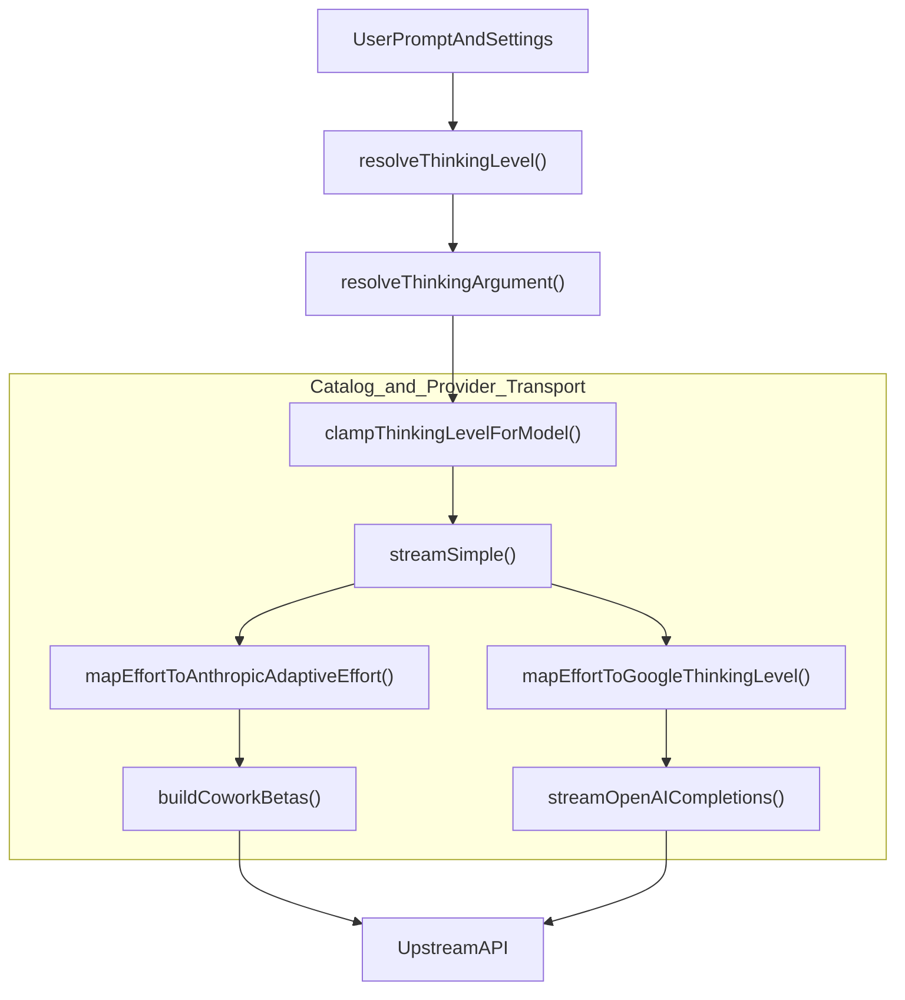
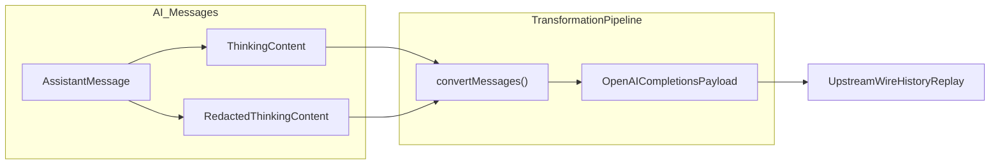

<!-- source: DeepWiki mcp.deepwiki.com · repo can1357/oh-my-pi · page 4.5 Thinking and Reasoning · fetched 2026-10-30 -->

# Thinking and Reasoning

Relevant source files

The following files were used as context for generating this wiki page:

- [.omp/skills/system-prompts/small-models.md](.omp/skills/system-prompts/small-models.md)
- [packages/agent/CHANGELOG.md](packages/agent/CHANGELOG.md)
- [packages/agent/src/prompts/dsml-tool-call-leak.md](packages/agent/src/prompts/dsml-tool-call-leak.md)
- [packages/ai/CHANGELOG.md](packages/ai/CHANGELOG.md)
- [packages/ai/src/dialect/anthropic.ts](packages/ai/src/dialect/anthropic.ts)
- [packages/ai/src/dialect/coercion.ts](packages/ai/src/dialect/coercion.ts)
- [packages/ai/src/dialect/deepseek.ts](packages/ai/src/dialect/deepseek.ts)
- [packages/ai/src/dialect/gemini.ts](packages/ai/src/dialect/gemini.ts)
- [packages/ai/src/dialect/gemma.ts](packages/ai/src/dialect/gemma.ts)
- [packages/ai/src/dialect/glm.ts](packages/ai/src/dialect/glm.ts)
- [packages/ai/src/dialect/harmony.ts](packages/ai/src/dialect/harmony.ts)
- [packages/ai/src/dialect/hermes.ts](packages/ai/src/dialect/hermes.ts)
- [packages/ai/src/dialect/index.ts](packages/ai/src/dialect/index.ts)
- [packages/ai/src/dialect/kimi.ts](packages/ai/src/dialect/kimi.ts)
- [packages/ai/src/dialect/minimax.ts](packages/ai/src/dialect/minimax.ts)
- [packages/ai/src/dialect/owned-stream.ts](packages/ai/src/dialect/owned-stream.ts)
- [packages/ai/src/dialect/qwen-xml.ts](packages/ai/src/dialect/qwen-xml.ts)
- [packages/ai/src/dialect/qwen3.ts](packages/ai/src/dialect/qwen3.ts)
- [packages/ai/src/dialect/terminator-wait.ts](packages/ai/src/dialect/terminator-wait.ts)
- [packages/ai/src/dialect/thinking.ts](packages/ai/src/dialect/thinking.ts)
- [packages/ai/src/dialect/types.ts](packages/ai/src/dialect/types.ts)
- [packages/ai/src/registry/registry.ts](packages/ai/src/registry/registry.ts)
- [packages/ai/src/utils/abort.ts](packages/ai/src/utils/abort.ts)
- [packages/ai/src/utils/dsml-leak.ts](packages/ai/src/utils/dsml-leak.ts)
- [packages/ai/src/utils/retry-after.ts](packages/ai/src/utils/retry-after.ts)
- [packages/ai/src/utils/stream-markup-healing.ts](packages/ai/src/utils/stream-markup-healing.ts)
- [packages/ai/test/anthropic-thinking-immutability.test.ts](packages/ai/test/anthropic-thinking-immutability.test.ts)
- [packages/ai/test/deepseek-reasoning-content.test.ts](packages/ai/test/deepseek-reasoning-content.test.ts)
- [packages/ai/test/dialect-thinking.test.ts](packages/ai/test/dialect-thinking.test.ts)
- [packages/ai/test/inband-tools.test.ts](packages/ai/test/inband-tools.test.ts)
- [packages/ai/test/issue-1207-repro.test.ts](packages/ai/test/issue-1207-repro.test.ts)
- [packages/ai/test/owned-stream-native-toolcall.test.ts](packages/ai/test/owned-stream-native-toolcall.test.ts)
- [packages/ai/test/stream-markup-healing.test.ts](packages/ai/test/stream-markup-healing.test.ts)
- [packages/ai/test/tool-examples.test.ts](packages/ai/test/tool-examples.test.ts)
- [packages/catalog/CHANGELOG.md](packages/catalog/CHANGELOG.md)
- [packages/catalog/scripts/generate-models.ts](packages/catalog/scripts/generate-models.ts)
- [packages/catalog/scripts/generated-policies.ts](packages/catalog/scripts/generated-policies.ts)
- [packages/catalog/src/compat/axes.ts](packages/catalog/src/compat/axes.ts)
- [packages/catalog/src/compat/resolve.ts](packages/catalog/src/compat/resolve.ts)
- [packages/catalog/src/compat/rules.json](packages/catalog/src/compat/rules.json)
- [packages/catalog/src/compat/rules/classes/anthropic.kdl](packages/catalog/src/compat/rules/classes/anthropic.kdl)
- [packages/catalog/src/compat/rules/classes/openai.kdl](packages/catalog/src/compat/rules/classes/openai.kdl)
- [packages/catalog/src/model-thinking.ts](packages/catalog/src/model-thinking.ts)
- [packages/catalog/src/models.json](packages/catalog/src/models.json)
- [packages/catalog/src/provider-models/descriptors.ts](packages/catalog/src/provider-models/descriptors.ts)
- [packages/catalog/src/provider-models/openai-compat.ts](packages/catalog/src/provider-models/openai-compat.ts)
- [packages/catalog/src/types.ts](packages/catalog/src/types.ts)
- [packages/catalog/test/generated-policies.test.ts](packages/catalog/test/generated-policies.test.ts)
- [packages/catalog/test/model-thinking.test.ts](packages/catalog/test/model-thinking.test.ts)
- [packages/coding-agent/CHANGELOG.md](packages/coding-agent/CHANGELOG.md)
- [packages/coding-agent/src/auto-thinking/classifier.ts](packages/coding-agent/src/auto-thinking/classifier.ts)
- [packages/coding-agent/src/commit/model-selection.ts](packages/coding-agent/src/commit/model-selection.ts)
- [packages/coding-agent/src/prompts/system/speech-rewrite.md](packages/coding-agent/src/prompts/system/speech-rewrite.md)
- [packages/coding-agent/src/prompts/system/title-marker-instruction.md](packages/coding-agent/src/prompts/system/title-marker-instruction.md)
- [packages/coding-agent/src/prompts/system/title-system.md](packages/coding-agent/src/prompts/system/title-system.md)
- [packages/coding-agent/src/session/session-stats.ts](packages/coding-agent/src/session/session-stats.ts)
- [packages/coding-agent/src/session/unexpected-stop-classifier.ts](packages/coding-agent/src/session/unexpected-stop-classifier.ts)
- [packages/coding-agent/src/tiny/message-preproc.ts](packages/coding-agent/src/tiny/message-preproc.ts)
- [packages/coding-agent/src/tiny/online-candidates.ts](packages/coding-agent/src/tiny/online-candidates.ts)
- [packages/coding-agent/src/tiny/text.ts](packages/coding-agent/src/tiny/text.ts)
- [packages/coding-agent/src/utils/commit-message-generator.ts](packages/coding-agent/src/utils/commit-message-generator.ts)
- [packages/coding-agent/src/utils/title-generator.ts](packages/coding-agent/src/utils/title-generator.ts)
- [packages/coding-agent/test/agent-session-stats.test.ts](packages/coding-agent/test/agent-session-stats.test.ts)
- [packages/coding-agent/test/agent-session-unexpected-stop-guard.test.ts](packages/coding-agent/test/agent-session-unexpected-stop-guard.test.ts)
- [packages/coding-agent/test/auto-thinking-classifier.test.ts](packages/coding-agent/test/auto-thinking-classifier.test.ts)
- [packages/coding-agent/test/modes/components/history-search.test.ts](packages/coding-agent/test/modes/components/history-search.test.ts)
- [packages/coding-agent/test/online-tiny-candidates.test.ts](packages/coding-agent/test/online-tiny-candidates.test.ts)
- [packages/coding-agent/test/role-thinking-helper-propagation.test.ts](packages/coding-agent/test/role-thinking-helper-propagation.test.ts)
- [packages/coding-agent/test/session-manager/usage-statistics.test.ts](packages/coding-agent/test/session-manager/usage-statistics.test.ts)
- [packages/coding-agent/test/terminal-title-state.test.ts](packages/coding-agent/test/terminal-title-state.test.ts)
- [packages/coding-agent/test/tiny-text.test.ts](packages/coding-agent/test/tiny-text.test.ts)
- [packages/coding-agent/test/title-generator.test.ts](packages/coding-agent/test/title-generator.test.ts)
- [packages/coding-agent/test/tts/speech-enhancer.test.ts](packages/coding-agent/test/tts/speech-enhancer.test.ts)
- [packages/coding-agent/test/unexpected-stop-classifier.test.ts](packages/coding-agent/test/unexpected-stop-classifier.test.ts)
- [packages/tui/CHANGELOG.md](packages/tui/CHANGELOG.md)
- [packages/tui/src/terminal-multiplexer.ts](packages/tui/src/terminal-multiplexer.ts)
- [packages/tui/src/tui.ts](packages/tui/src/tui.ts)
- [packages/tui/test/helpers/terminal-multiplexer.ts](packages/tui/test/helpers/terminal-multiplexer.ts)
- [packages/tui/test/overlay-scroll.test.ts](packages/tui/test/overlay-scroll.test.ts)
- [packages/tui/test/resize-multiplexer-anchor.test.ts](packages/tui/test/resize-multiplexer-anchor.test.ts)
- [packages/tui/test/resize-preserved-clear.test.ts](packages/tui/test/resize-preserved-clear.test.ts)

## Purpose and Scope

This document details the **extended reasoning** system—often referred to as **thinking** or **chain-of-thought reasoning**—implemented within the `oh-my-pi` AI layer and coding agent [packages/catalog/src/types.ts:126-132](). Extended reasoning enables large language models (LLMs) to internally perform intermediate reasoning steps before generating final outputs, enhancing the correctness and sophistication of responses in complex software development workflows.

Key purposes:
- Provide a **unified interface** to heterogeneous provider reasoning styles and APIs.
- Leverage **catalog-driven model-thinking configurations** for reasoning metadata.
- Support **multiple reasoning effort levels** and **budget vs. effort modes**.
- Include an **auto-thinking classifier** that dynamically triggers reasoning.
- Preserve **signatures and cryptographic integrity** of reasoning content during conversation.

Sources: [packages/catalog/src/types.ts:126-132]()

---

## Overview and Effort Levels

Extended reasoning involves the model producing intermediate "thinking" content as it arrives at an answer, typically encapsulated in special markup. This thinking output is distinct from the user-facing final content.

Different AI providers expose control channels to tweak the *intensity* or *depth* of reasoning. The `oh-my-pi` system normalizes these via a common `Effort` abstraction:

| Effort Level | Description |
|--------------|---------------------------------------------------------|
| `minimal` | Minimal reasoning, low latency, lowest computational use. |
| `low` | Basic, shallow reasoning for trivial logic. |
| `medium` | Balanced reasoning for typical tasks. |
| `high` | Deep reasoning suited for complex debugging/design. |
| `xhigh` | Extra depth reasoning, e.g., for very large contexts. |
| `max` | Maximum supported reasoning depth. |

Models explicitly declare their supported reasoning effort levels in their metadata to assist the agent in clamping and adapting effort parameters [packages/catalog/src/model-thinking.ts:23-28]().

Sources: [packages/catalog/src/effort.ts:1-18](), [packages/catalog/src/types.ts:126-132](), [packages/catalog/src/model-thinking.ts:23-28]()

---

## Model-Thinking Config in the Catalog

The agent loads baked `ThinkingConfig` metadata for each model from the catalog [packages/catalog/src/types.ts:135-176](). This config encodes how a model supports reasoning and the precise semantics for effort/budget modes.

Familiar fields in the model’s thinking config include:

| Field | Description |
|-------------------|-------------------------------------------------------------------------------------------------------|
| `mode` | Canonical thinking transport mode. Possible values: `effort`, `budget`, `google-level`, `anthropic-adaptive`, `anthropic-budget-effort` [packages/catalog/src/types.ts:127-132](). |
| `efforts` | Ordered readonly list of supported reasoning effort levels (`Effort[]`) [packages/catalog/src/model-thinking.ts:23-28](). |
| `defaultLevel` | Optional default selected effort level [packages/catalog/src/types.ts:144-145](). |
| `effortMap` | Partial map of canonical efforts to provider-specific wire-string values [packages/catalog/src/types.ts:147-151](). |
| `effortRouting` | Overrides for wire model IDs per effort level (used for collapsed effort-tier variants) [packages/catalog/src/types.ts:160-167](). |
| `effortBudgets` | Upstream token budgets per effort level (used for `budget` mode) [packages/catalog/src/types.ts:169-175](). |
| `requiresEffort` | If true, reasoning *must* be enabled upstream (cannot be disabled). |
| `prefixBinding` | Enables binding of reasoning content signature to preceding conversation prefix (signature preservation). |

At runtime, helpers in `packages/catalog/src/model-thinking.ts` access this baked config efficiently without reparsing:
- `getSupportedEfforts(model)`: Returns the effort levels the model supports, or empty for non-reasoning models [packages/catalog/src/model-thinking.ts:23-28]().
- `clampThinkingLevelForModel(model, requested)`: Clamps a requested effort to the nearest supported level [packages/catalog/src/model-thinking.ts:35-65]().
- `resolveWireModelId(model, effort)`: Resolves the exact upstream wire model ID to use at a given effort [packages/catalog/src/model-thinking.ts:147-149]().
- `mapEffortToGoogleThinkingLevel(effort, model)`: Converts an `Effort` to Google’s thinkingLevel enum [packages/catalog/src/model-thinking.ts:97-118]().
- `mapEffortToAnthropicAdaptiveEffort(model, effort)`: Converts to Anthropic adaptive effort strings [packages/catalog/src/model-thinking.ts:131-140]().

Sources: [packages/catalog/src/types.ts:135-176](), [packages/catalog/src/model-thinking.ts:1-184]()

---

## Budget vs. Effort Modes

Different AI providers expose reasoning configuration with distinct paradigms:

| Mode | Description | Usage Example |
|---------------------------|---------------------------------------------------------------------------------------------------|------------------------------------------------------------------------------------------------------------------------------|
| `effort` | Qualitative effort tiers (e.g., OpenAI’s `reasoning_effort`, Anthropic beta headers). | Most prevalent. Agent sends values like `low`, `medium`, `high` that provider maps internally. |
| `budget` | Specifies explicit token budgets controlling reasoning compute, via fields like `thinkingBudget`.| The agent uses the model’s baked `effortBudgets` to convert efforts into token budgets. |
| `google-level` | Fixed enumeration recognized by Google APIs. | Agent converts canonical efforts to Google enums using `mapEffortToGoogleThinkingLevel()` [packages/catalog/src/model-thinking.ts:97-118](). |
| `anthropic-adaptive` | Adaptive effort values for Anthropic’s evolving beta effort system. | Uses `mapEffortToAnthropicAdaptiveEffort()` for mapping; supplements with beta header controls [packages/catalog/src/model-thinking.ts:131-140](). |
| `anthropic-budget-effort` | Hybrid mode mixing budget and effort for Anthropic providers. | Used selectively, allowing fine-grained control over behavior in recent Anthropic models. |

Sources: [packages/catalog/src/types.ts:127-132](), [packages/catalog/src/model-thinking.ts:97-118]()

---

## Auto-Thinking Classifier

`oh-my-pi` implements an **auto-thinking classifier** in `packages/coding-agent/src/auto-thinking/classifier.ts`. This component analyzes incoming user inputs and session context to judge whether reasoning should be enabled. It reduces the need for explicit user flags by dynamically:
- Detecting complexity or logic chains in prompts.
- Estimating coding task scope and reasoning demand.
- Selecting an appropriate reasoning effort level to apply.

Sources: [packages/coding-agent/src/auto-thinking/classifier.ts:1-60]()

---

## Implementation and Data Flow

The reasoning control flow moves through several stages:
1. **User/Session input** requests a reasoning effort level or auto mode.
2. The agent’s thinking logic computes the concrete effort to use, possibly invoking the auto-thinking classifier.
3. Effort is clamped by the model’s supported efforts metadata [packages/catalog/src/model-thinking.ts:35-65]().
4. The clamped effort is translated to provider-specific API parameters via mode-specific mappings [packages/catalog/src/model-thinking.ts:97-140]().
5. The reasoning metadata is included in upstream requests, controlling the model's internal chain-of-thought.

### Thinking Resolution Data Flow

Sources: [packages/catalog/src/model-thinking.ts:23-140]()

---

## Signature Preservation and Transport

Preserving the **cryptographic and protocol signatures** of reasoning content is essential to maintain conversation integrity in stateful or secure upstream providers.
- The `prefixBinding` field in `ThinkingConfig` enables signature binding of reasoning content to the conversation prefix.
- **Anthropic** providers require special beta headers such as `interleaved-thinking-2025-05-14` and `redact-thinking-2026-02-12` to support redacted reasoning and signature tracking.
- **OpenAI Completions** (and compatible APIs) use `reasoningContentField` (e.g., `reasoning_content`) to encapsulate thinking.

### Message Transformation and History Replay Pipeline

Sources: [packages/catalog/src/types.ts:135-176]()

---

