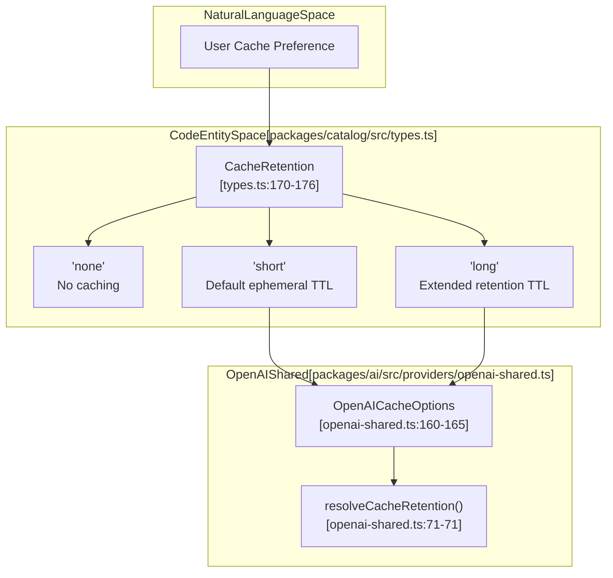
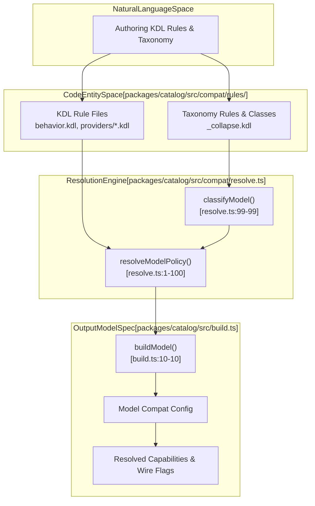

<!-- source: DeepWiki mcp.deepwiki.com · repo can1357/oh-my-pi · page 4.6 Prompt Caching and Compatibility Rules · fetched 2026-10-30 -->

# Prompt Caching and Compatibility Rules

Relevant source files

The following files were used as context for generating this wiki page:

- [packages/agent/CHANGELOG.md](packages/agent/CHANGELOG.md)
- [packages/ai/CHANGELOG.md](packages/ai/CHANGELOG.md)
- [packages/ai/src/providers/openai-codex/request-transformer.ts](packages/ai/src/providers/openai-codex/request-transformer.ts)
- [packages/ai/src/registry/oauth/cursor.ts](packages/ai/src/registry/oauth/cursor.ts)
- [packages/ai/src/registry/registry.ts](packages/ai/src/registry/registry.ts)
- [packages/ai/src/usage/charm-hyper.ts](packages/ai/src/usage/charm-hyper.ts)
- [packages/ai/src/usage/cursor.ts](packages/ai/src/usage/cursor.ts)
- [packages/ai/src/usage/google-antigravity.ts](packages/ai/src/usage/google-antigravity.ts)
- [packages/ai/test/anthropic-fable-request-shaping.test.ts](packages/ai/test/anthropic-fable-request-shaping.test.ts)
- [packages/ai/test/auth-storage-antigravity-selection.test.ts](packages/ai/test/auth-storage-antigravity-selection.test.ts)
- [packages/ai/test/charm-hyper-usage.test.ts](packages/ai/test/charm-hyper-usage.test.ts)
- [packages/ai/test/cursor-login.test.ts](packages/ai/test/cursor-login.test.ts)
- [packages/ai/test/cursor-usage.test.ts](packages/ai/test/cursor-usage.test.ts)
- [packages/ai/test/google-antigravity-usage.test.ts](packages/ai/test/google-antigravity-usage.test.ts)
- [packages/ai/test/openai-codex-responses-lite.test.ts](packages/ai/test/openai-codex-responses-lite.test.ts)
- [packages/catalog/CHANGELOG.md](packages/catalog/CHANGELOG.md)
- [packages/catalog/scripts/compat-compiler/compile-behavior.ts](packages/catalog/scripts/compat-compiler/compile-behavior.ts)
- [packages/catalog/scripts/compat-compiler/compile-cascade.ts](packages/catalog/scripts/compat-compiler/compile-cascade.ts)
- [packages/catalog/scripts/compat-compiler/compile-providers.ts](packages/catalog/scripts/compat-compiler/compile-providers.ts)
- [packages/catalog/scripts/generate-models.ts](packages/catalog/scripts/generate-models.ts)
- [packages/catalog/scripts/generated-policies.ts](packages/catalog/scripts/generated-policies.ts)
- [packages/catalog/src/build.ts](packages/catalog/src/build.ts)
- [packages/catalog/src/compat/axes.ts](packages/catalog/src/compat/axes.ts)
- [packages/catalog/src/compat/behavior.ts](packages/catalog/src/compat/behavior.ts)
- [packages/catalog/src/compat/resolve.ts](packages/catalog/src/compat/resolve.ts)
- [packages/catalog/src/compat/rules.json](packages/catalog/src/compat/rules.json)
- [packages/catalog/src/compat/rules/README.md](packages/catalog/src/compat/rules/README.md)
- [packages/catalog/src/compat/rules/classes/anthropic.kdl](packages/catalog/src/compat/rules/classes/anthropic.kdl)
- [packages/catalog/src/compat/rules/classes/minimax.kdl](packages/catalog/src/compat/rules/classes/minimax.kdl)
- [packages/catalog/src/compat/rules/classes/openai.kdl](packages/catalog/src/compat/rules/classes/openai.kdl)
- [packages/catalog/src/compat/rules/providers/charm-hyper.kdl](packages/catalog/src/compat/rules/providers/charm-hyper.kdl)
- [packages/catalog/src/compat/rules/providers/openai-codex.kdl](packages/catalog/src/compat/rules/providers/openai-codex.kdl)
- [packages/catalog/src/compat/rules/providers/openai.kdl](packages/catalog/src/compat/rules/providers/openai.kdl)
- [packages/catalog/src/compat/types.ts](packages/catalog/src/compat/types.ts)
- [packages/catalog/src/discovery/codex.ts](packages/catalog/src/discovery/codex.ts)
- [packages/catalog/src/model-thinking.ts](packages/catalog/src/model-thinking.ts)
- [packages/catalog/src/models.json](packages/catalog/src/models.json)
- [packages/catalog/src/provider-models/descriptors.ts](packages/catalog/src/provider-models/descriptors.ts)
- [packages/catalog/src/provider-models/openai-compat.ts](packages/catalog/src/provider-models/openai-compat.ts)
- [packages/catalog/src/types.ts](packages/catalog/src/types.ts)
- [packages/catalog/src/wire/charm-hyper.ts](packages/catalog/src/wire/charm-hyper.ts)
- [packages/catalog/src/wire/codex.ts](packages/catalog/src/wire/codex.ts)
- [packages/catalog/src/wire/cursor.ts](packages/catalog/src/wire/cursor.ts)
- [packages/catalog/test/charm-hyper-provider.test.ts](packages/catalog/test/charm-hyper-provider.test.ts)
- [packages/catalog/test/codex-discovery.test.ts](packages/catalog/test/codex-discovery.test.ts)
- [packages/catalog/test/codex-wire.test.ts](packages/catalog/test/codex-wire.test.ts)
- [packages/catalog/test/compat-compile.test.ts](packages/catalog/test/compat-compile.test.ts)
- [packages/catalog/test/compat-conformance.test.ts](packages/catalog/test/compat-conformance.test.ts)
- [packages/catalog/test/generated-policies.test.ts](packages/catalog/test/generated-policies.test.ts)
- [packages/catalog/test/model-thinking.test.ts](packages/catalog/test/model-thinking.test.ts)
- [packages/catalog/test/openai-daybreak.test.ts](packages/catalog/test/openai-daybreak.test.ts)
- [packages/coding-agent/CHANGELOG.md](packages/coding-agent/CHANGELOG.md)
- [packages/coding-agent/test/status-line-usage.test.ts](packages/coding-agent/test/status-line-usage.test.ts)
- [packages/tui/CHANGELOG.md](packages/tui/CHANGELOG.md)
- [packages/tui/src/terminal-multiplexer.ts](packages/tui/src/terminal-multiplexer.ts)
- [packages/tui/src/tui.ts](packages/tui/src/tui.ts)
- [packages/tui/test/helpers/terminal-multiplexer.ts](packages/tui/test/helpers/terminal-multiplexer.ts)
- [packages/tui/test/overlay-scroll.test.ts](packages/tui/test/overlay-scroll.test.ts)
- [packages/tui/test/resize-multiplexer-anchor.test.ts](packages/tui/test/resize-multiplexer-anchor.test.ts)
- [packages/tui/test/resize-preserved-clear.test.ts](packages/tui/test/resize-preserved-clear.test.ts)

This document details the prompt caching architecture across supported AI providers and the KDL-driven compatibility rules engine in `pi-catalog` that governs per-model behavior, capability negotiation, and request adaptation.

---

## Overview

Prompt caching allows AI providers to reuse previously processed instruction and context segments across multiple interaction turns, reducing latency and token costs. Alongside caching mechanisms, interacting with diverse model families requires handling feature variations, wire protocols, and schema differences. The `pi-catalog` package uses a KDL-driven rules engine and taxonomy system to resolve model capabilities at build and runtime.

**Key Concepts:**

- **CacheRetention**: Unified abstraction (`"none"`, `"short"`, `"long"`). [packages/catalog/src/types.ts:170-176]()
- **Cache Breakpoints**: Strategic markers placed on tools, system prompts, and message blocks to define cache boundaries.
- **Compatibility Engine**: KDL-based rules parser and resolver that builds model specs and runtime policies. [packages/catalog/src/compat/resolve.ts:1-100]()
- **Model Identity & Taxonomy**: Classification of model class, family, and revision for feature mapping. [packages/catalog/src/compat/taxonomy.ts:10-15]()

Sources: [packages/catalog/src/types.ts:170-176](), [packages/catalog/src/compat/resolve.ts:1-100](), [packages/catalog/src/compat/taxonomy.ts:10-15]()

---

## Prompt Caching Mechanisms Across Providers

### CacheRetention Abstraction

The `CacheRetention` type defines prompt cache persistence tiers in a provider-agnostic manner:

- `"none"`: No caching.
- `"short"`: Default ephemeral TTL (time-to-live).
- `"long"`: Extended retention TTL for longer reuse (such as OpenAI's 12-hour prompt caching for GPT-5.6+ on the Responses API, mapping to `prompt_cache_options.ttl: "12h"`). [packages/ai/CHANGELOG.md:20-21]()

This abstraction standardizes signaling cache preferences across diverse providers, supporting coherent cost and state management.

Title: CacheRetentionMappingLogic

Sources: [packages/catalog/src/types.ts:170-176](), [packages/ai/src/providers/openai-shared.ts:71-71](), [packages/ai/src/providers/openai-shared.ts:160-165](), [packages/ai/CHANGELOG.md:20-21]()

---

### Cache Affinity, Persistence, and Retention Rules

- **Anthropic**  
  Uses ephemeral cache-control with beta headers such as `prompt-caching-scope-2026-01-05` and `extended-cache-ttl-2025-04-11` to control cache boundary placement and retention duration. Cache breakpoints mark tool calls and system prompt boundaries. [packages/catalog/src/provider-models/openai-compat.ts:119-120]()
  This pattern enables server-assisted prompt cache invalidation and reuse at large context windows with reasoning/effort instructions.  
  [packages/ai/src/providers/anthropic.ts:166-178]()

- **OpenAI Responses & Codex**  
  These providers leverage prompt cache keys normalized from session and conversation IDs (`getOpenAIPromptCacheKey`) and support stateful turn chaining through the `previous_response_id` field that ties context to prior completions. Logged-in OpenAI Codex also declares the `prompt-cache-persistent` catalog axis (`isPromptCachePersistent`) for endpoints whose prompt caches never expire. [packages/catalog/CHANGELOG.md:26-27](), [packages/ai/src/providers/openai-shared.ts:160-165](), [packages/ai/src/providers/openai-responses.ts:121-121]()

- **Muse Code**  
  Enabled sibling subagent prompt-cache sharing for Muse Code's Spark 1.3, Wonder 1.0, and Wonder Full 1.0 variants while keeping their conversations separate. [packages/coding-agent/CHANGELOG.md:50-51]()

Sources: [packages/catalog/src/types.ts:170-176](), [packages/ai/src/providers/anthropic.ts:166-178](), [packages/ai/src/providers/openai-responses.ts:121-121](), [packages/ai/src/providers/openai-shared.ts:160-165](), [packages/catalog/src/provider-models/openai-compat.ts:119-120](), [packages/catalog/CHANGELOG.md:26-27](), [packages/coding-agent/CHANGELOG.md:50-51]()

---

## KDL-Driven Compatibility Axes and Rules Engine

`pi-catalog` uses KDL rule files under `packages/catalog/src/compat/rules/` to specify provider defaults, class-level behaviors, and overrides for model capability. These rules are compiled into authoritative model specifications that govern runtime behavior including prompt caching, reasoning support, parameter mappings, and wire protocol details.

### Components and Data Flow

Title: KDLCompatibilityRulesEngineArchitecture

- The **KDL Rule Files** declare fine-grained behavioral attributes for providers, classes, and runtime conditions. For example, `packages/catalog/src/compat/rules/runtime/behavior.kdl` defines general provider behaviors [packages/catalog/src/compat/rules/runtime/behavior.kdl:3-139](), while `packages/catalog/src/compat/rules/providers/devin.kdl` specifies Devin-specific rules.
- The **Compatibility Engine** (`resolveModelPolicy`) interprets these rules together with model identity classification (class, family, revision) to produce a canonical model spec. [packages/catalog/src/compat/resolve.ts:1-100]()
- The `buildModel` function then materializes the full `Model` object, incorporating the resolved compatibility configuration. [packages/catalog/src/build.ts:10-10]()
- The resulting **Model Compat Config** encodes all resolved flags impacting prompt construction, caching logic, capability toggles, and wire protocol adaptations.

Sources: [packages/catalog/src/compat/rules/runtime/behavior.kdl:3-139](), [packages/catalog/src/compat/rules/providers/devin.kdl](), [packages/catalog/src/compat/resolve.ts:1-100](), [packages/catalog/src/build.ts:10-10](), [packages/catalog/src/compat/taxonomy.ts:10-15]()

---

### Compatibility Axes Described

Model configuration includes a `compat` block controlling multiple axes relevant to prompt caching, reasoning, and protocol:

| Capability                                   | Description                                                          | Example Flags / Fields                              |
|----------------------------------------------|----------------------------------------------------------------------|----------------------------------------------------|
| `supportsDeveloperRole`                       | Supports developer role prompts.                                    | Used for role-scoped personas.                      |
| `supportsStrictMode`                          | Supports strict response pairing and grammar checks.                | Enables error fallback strategies.                  |
| `supportsPromptCacheBreakpoints`              | Honors prompt cache breakpoints around tools & system prompts.      | Critical for Anthropic server-side caching.         |
| `reasoningContentField`                       | Field name carrying reasoning content in wire protocol.             | `"reasoning_content"` for Anthropic-compatible models. |
| `supportsReasoningEffort`                     | Supports user-controllable reasoning/effort tiers.                  | Enables thinking effort level controls.            |
| `thinkingFormat`                              | Wire reasoning format; e.g., `"openai"`, `"chat-template"`.         | Switches schema shapes accordingly.                 |
| `isOpenRouterHost`                            | Acts as OpenRouter-compatible host, influencing wire adjustments.    | Alters token counts, param translation.             |
| `wireModelIdMode`                            | Normalizes model id format for routing variants.                     | `"raw"`, `"namespace"`, etc.                         |
| `responsesCacheRetention`                    | Specifies cache retention policy for Responses API.                 | `30m` for 30 minutes. [packages/catalog/src/compat/axes.ts:112-112]() |
| `promptCacheBreakpointTtl`                   | TTL for prompt cache breakpoints.                                   | `30m` for 30 minutes. [packages/catalog/src/compat/axes.ts:138-138]() |
| `promptCacheSessionHeader`                   | Custom session header for prompt caching.                           | `x-grok-conv-id`. [packages/catalog/src/compat/axes.ts:139-139]() |
| `prompt-cache-persistent`                    | Indicates endpoints whose prompt caches never expire.                 | OpenAI Codex integration. [packages/catalog/CHANGELOG.md:26-27]() |

These flags originate from KDL rules per provider class and individual model overrides. For example, Anthropic models set `supportsPromptCacheBreakpoints=true`, enabling cache control via tools and system prompt marks, while OpenAI models enable strict mode and reasoning content pairing.

Sources: [packages/catalog/src/compat/types.ts:10-23](), [packages/catalog/src/compat/rules/runtime/behavior.kdl](), [packages/catalog/src/compat/axes.ts:112-112](), [packages/catalog/src/compat/axes.ts:138-138](), [packages/catalog/src/compat/axes.ts:139-139](), [packages/catalog/CHANGELOG.md:26-27]()

---

## Summary Matrix of Provider Caching and Compatibility

| Provider / Family  | Prompt Caching Mechanism        | Compatibility Rule Source                              | Key Transport Flags / Features                |
|-------------------|-------------------------------|-------------------------------------------------------|-----------------------------------------------|
| **Anthropic**     | Ephemeral TTL blocks            | `auth/anthropic.kdl`, `classes/anthropic.kdl`        | `supportsPromptCacheBreakpoints`, reasoning_effort mappings |
| **OpenAI / Codex**| Session-based cache keys + `previous_response_id` | `auth/openai.kdl`, `classes/openai.kdl`               | `supportsStrictMode`, `reasoningContentField`, `prompt-cache-persistent` |
| **Google Gemini** | Provider-managed cache          | `auth/google.kdl`, `classes/gemini.kdl`               | `thinkingFormat`, `supportsReasoningParams`     |
| **Muse Code**     | Sibling subagent prompt-cache sharing | `providers/muse-code.kdl`, `taxonomy/meta.kdl`        | `thinking-unverified`                         |
| **Custom / Gateway** | Configurable via model spec    | `auth/` and `providers/` KDL files                     | `isOpenRouterHost`, `wireModelIdMode`, `responsesCacheRetention`, `promptCacheBreakpointTtl`, `promptCacheSessionHeader` |

Sources: [packages/catalog/src/compat/rules/runtime/behavior.kdl](), [packages/ai/src/providers/anthropic.ts:166-178](), [packages/ai/src/providers/openai-responses.ts:121-121](), [packages/catalog/src/compat/rules/providers/muse-code.kdl](), [packages/catalog/src/compat/rules/taxonomy/meta.kdl](), [packages/catalog/CHANGELOG.md:26-27]()

---

# References

- `CacheRetention` type and usage: [packages/catalog/src/types.ts:170-176]()
- Anthropic prompt caching and beta headers: [packages/ai/src/providers/anthropic.ts:166-178](), [packages/catalog/src/provider-models/openai-compat.ts:119-120]()
- OpenAI prompt cache keys and session linkage: [packages/ai/src/providers/openai-shared.ts:160-165](), [packages/ai/src/providers/openai-responses.ts:121-121]()
- KDL rules and compatibility engine: [packages/catalog/src/compat/rules/runtime/behavior.kdl](), [packages/catalog/src/compat/resolve.ts:1-100](), [packages/catalog/src/compat/taxonomy.ts:10-15]()
- Model building and compatibility application: [packages/catalog/src/build.ts:10-10]()
- Compatibility axes definitions: [packages/catalog/src/compat/axes.ts:112-112](), [packages/catalog/src/compat/axes.ts:138-138](), [packages/catalog/src/compat/axes.ts:139-139]()
- Changelog entries for caching and compatibility: [packages/coding-agent/CHANGELOG.md:50-51](), [packages/ai/CHANGELOG.md:20-21](), [packages/catalog/CHANGELOG.md:26-27]()

This concludes section 4.6 on Prompt Caching and Compatibility Rules.

---

