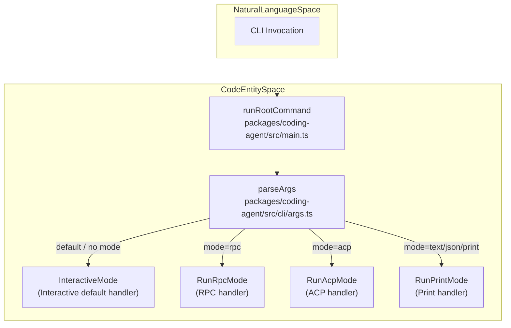
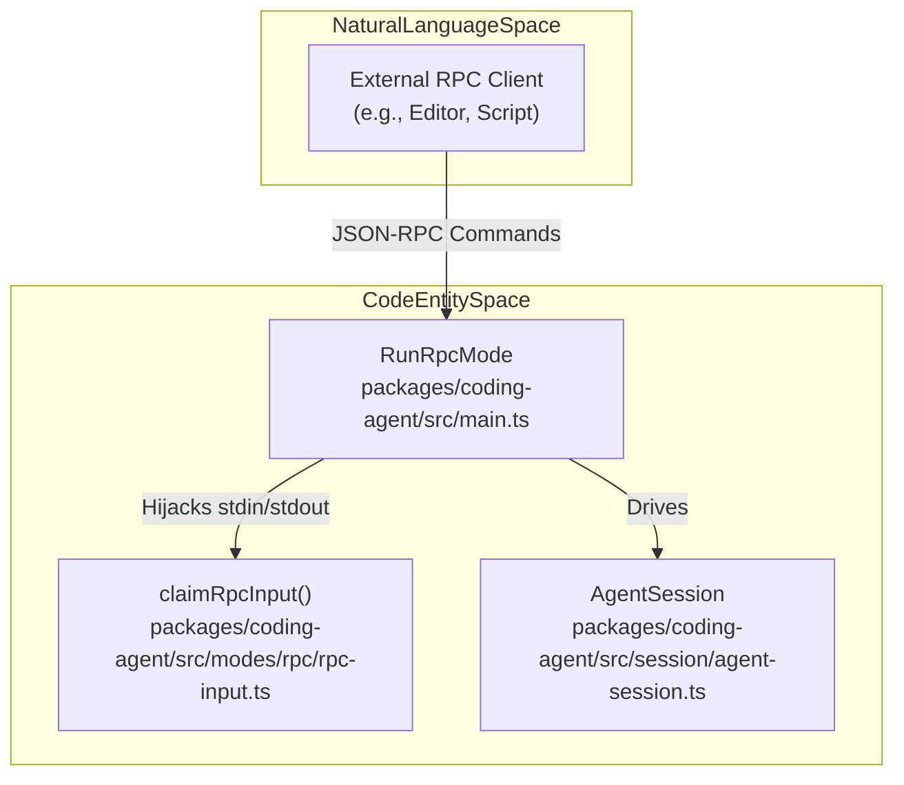
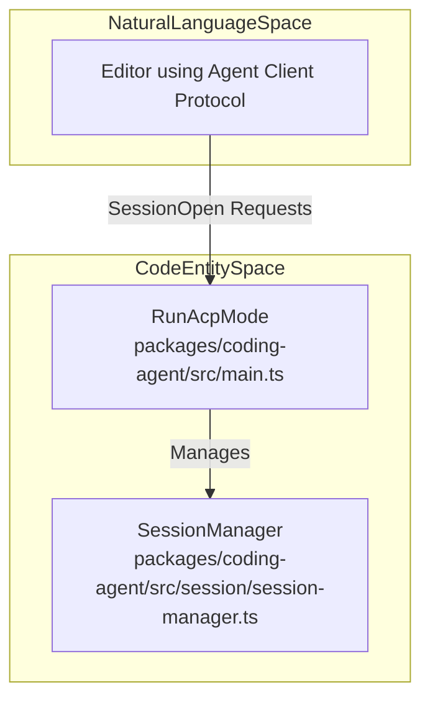

<!-- source: DeepWiki mcp.deepwiki.com · repo can1357/oh-my-pi · page 5 Operational Modes · fetched 2026-10-30 -->

# Operational Modes

Relevant source files

The following files were used as context for generating this wiki page:

- [packages/coding-agent/src/cli/args.ts](packages/coding-agent/src/cli/args.ts)
- [packages/coding-agent/src/cli/extension-flags.ts](packages/coding-agent/src/cli/extension-flags.ts)
- [packages/coding-agent/src/cli/flag-tables.ts](packages/coding-agent/src/cli/flag-tables.ts)
- [packages/coding-agent/src/commands/launch.ts](packages/coding-agent/src/commands/launch.ts)
- [packages/coding-agent/src/main.ts](packages/coding-agent/src/main.ts)
- [packages/coding-agent/src/modes/controllers/command-controller.ts](packages/coding-agent/src/modes/controllers/command-controller.ts)
- [packages/coding-agent/src/modes/controllers/event-controller.ts](packages/coding-agent/src/modes/controllers/event-controller.ts)
- [packages/coding-agent/src/modes/controllers/input-controller.ts](packages/coding-agent/src/modes/controllers/input-controller.ts)
- [packages/coding-agent/src/modes/controllers/selector-controller.ts](packages/coding-agent/src/modes/controllers/selector-controller.ts)
- [packages/coding-agent/src/modes/interactive-mode.ts](packages/coding-agent/src/modes/interactive-mode.ts)
- [packages/coding-agent/src/modes/types.ts](packages/coding-agent/src/modes/types.ts)
- [packages/coding-agent/src/modes/utils/ui-helpers.ts](packages/coding-agent/src/modes/utils/ui-helpers.ts)
- [packages/coding-agent/src/session/session-manager.ts](packages/coding-agent/src/session/session-manager.ts)
- [packages/coding-agent/src/slash-commands/builtin-registry.ts](packages/coding-agent/src/slash-commands/builtin-registry.ts)
- [packages/coding-agent/test/acp-mcp-isolation.test.ts](packages/coding-agent/test/acp-mcp-isolation.test.ts)
- [packages/coding-agent/test/acp-session-effects.test.ts](packages/coding-agent/test/acp-session-effects.test.ts)
- [packages/coding-agent/test/cli-explicit-extension-isolation.test.ts](packages/coding-agent/test/cli-explicit-extension-isolation.test.ts)
- [packages/coding-agent/test/cli-unknown-flag.test.ts](packages/coding-agent/test/cli-unknown-flag.test.ts)
- [packages/coding-agent/test/extension-flag-dispatch.test.ts](packages/coding-agent/test/extension-flag-dispatch.test.ts)
- [packages/coding-agent/test/extension-flag-initial-message.test.ts](packages/coding-agent/test/extension-flag-initial-message.test.ts)
- [packages/coding-agent/test/flag-tables.test.ts](packages/coding-agent/test/flag-tables.test.ts)
- [packages/coding-agent/test/initial-message.test.ts](packages/coding-agent/test/initial-message.test.ts)
- [packages/coding-agent/test/input-controller-escape.test.ts](packages/coding-agent/test/input-controller-escape.test.ts)
- [packages/coding-agent/test/input-controller-keybindings.test.ts](packages/coding-agent/test/input-controller-keybindings.test.ts)
- [packages/coding-agent/test/main-session-resolution-error.test.ts](packages/coding-agent/test/main-session-resolution-error.test.ts)
- [packages/coding-agent/test/session-manager/move-to.test.ts](packages/coding-agent/test/session-manager/move-to.test.ts)
- [packages/coding-agent/test/session-manager/title-source-persistence.test.ts](packages/coding-agent/test/session-manager/title-source-persistence.test.ts)

## Purpose and Scope

The `omp` coding agent supports multiple operational modes designed to handle various usage scenarios such as interactive terminal development, programmatic agent control, editor integrations, scripting automation, and collaborative live sessions. This page provides a high-level overview of these modes, how they relate to each other, and connects to the core agent session system.

Mode selection is primarily controlled via the `--mode` CLI flag or the `--print` flag, processed early in the CLI argument parsing layer `[packages/coding-agent/src/cli/args.ts:23-60]`. Each mode orchestrates its own runtime environment, but all share the underlying SDK, session management, and core agent logic managed in the main entry point and SDK `[packages/coding-agent/src/main.ts:10-140]`.

Detailed configuration and usage instructions reside in the child pages linked at the end of this document.

Sources: `[packages/coding-agent/src/cli/args.ts:23-60]`, `[packages/coding-agent/src/main.ts:10-140]`

---

## Mode Overview

The agent supports the following key operational modes, activated by CLI flags and designed for separate usage patterns:

| Mode           | Activation Flag                        | Typical Use Case                                                       | Implementation Entry Point                                                                              |
|----------------|-------------------------------------|----------------------------------------------------------------------|-------------------------------------------------------------------------------------------------------|
| **Interactive** | (default, no `--mode` or `--mode text/json` with TUI) | Terminal interactive development with a rich TUI                      | `InteractiveMode` class, main CLI orchestration `[packages/coding-agent/src/main.ts:60-140]`        |
| **RPC**         | `--mode rpc`                        | Programmatic JSON-RPC control for integration with editors or tools  | `RunRpcMode` function handling RPC transport and sessions `[packages/coding-agent/src/main.ts:70-71]` |
| **ACP**         | `--mode acp`                       | Agent Client Protocol mode for advanced editor integration (e.g. Zed)| `RunAcpMode` with session and permission mapping `[packages/coding-agent/src/main.ts:70-71]`          |
| **Print**       | `--mode text`, `--mode json`, or `--print` | Single-shot scriptable execution with text or JSON output            | `RunPrintMode` function for non-interactive scripted runs `[packages/coding-agent/src/main.ts:81-82]` |
| **Collab**      | `/collab` slash command            | Real-time live session sharing between `omp` instances and browsers  | Collaboration subsystem inside interactive mode `[packages/coding-agent/src/main.ts:60-140]`          |

### Diagram: Mode Dispatch Flow

Sources: `[packages/coding-agent/src/main.ts:10-140]`, `[packages/coding-agent/src/cli/args.ts:23-60]`

---

## Interactive Mode (TUI)

Interactive mode is the default and primary experience. It offers a Terminal User Interface (TUI) designed for live coding, conversation, and exploration. Users interact directly via the terminal with an AI-powered agent that understands commands, code, and tooling workflows.

### Key Features
- Multi-line input editor allowing complex prompt composition.
- Transcript rendering supports Markdown, embedded images, and inline tool outputs.
- Rich event handling via modular input, event, selector, and command controllers.
- Integrated slash commands for session management, collaboration, settings, and planning.

Internally, this mode is managed by the `InteractiveMode` class which orchestrates input and output rendering `[packages/coding-agent/src/modes/interactive-mode.ts:1-4]`. For implementation details and usage, see [Interactive Mode](#5.2).

Sources: `[packages/coding-agent/src/modes/interactive-mode.ts:1-4]`

---

## RPC Mode (Headless JSON RPC)

RPC mode offers a programmatic JSON RPC interface over standard input/output streams. It enables external clients such as editors or automation scripts to control the agent turn-by-turn in a structured manner.

### Protocol Interaction

### Characteristics
- Full streaming of intermediate, thought, and tool call events.
- Input framing tailored for RPC with event streaming support.
- Supports extension contexts for UI embedding.

See [RPC Mode](#5.5) for detailed protocol and client SDK documentation.

Sources: `[packages/coding-agent/src/main.ts:70-71]`, `[packages/coding-agent/src/modes/rpc/rpc-input.ts:65]`

---

## ACP Mode (Agent Client Protocol)

ACP mode integrates the coding agent with editors supporting the Agent Client Protocol, allowing enhanced interaction, lazy startup, fine-grained permissions, and seamless editor integration.

### System Model

ACP mode manages sessions via `SessionManager` and uses event mapping and permission bridging for safe editor embedding.

See [ACP Mode](#5.6) for full architecture and usage notes.

Sources: `[packages/coding-agent/src/main.ts:70-71]`, `[packages/coding-agent/src/session/session-manager.ts:118-118]`

---

## Print Mode (Single-Shot Execution)

Print mode is designed for one-off runs of prompts in scripting, automation, or CI/CD workflows where no interactive UI is needed. It processes inputs, executes a single session turn, and outputs textual or JSON results before exiting.

### Mode Behavior
- Supports `--mode text`, `--mode json`, or `--print` flags.
- Merges CLI positional messages, file contents, and stdin input into a single prompt.
- Outputs results in plain text or newline-delimited JSON for downstream consumption.

For detailed execution flow and output format options, see [Print Mode](#5.7).

Sources: `[packages/coding-agent/src/cli/args.ts:84-85]`, `[packages/coding-agent/src/main.ts:81-82]`

---

## Collab — Live Session Sharing

Collab mode is triggered via the `/collab` slash command in interactive mode. It enables real-time sharing and collaboration of live `omp` sessions between multiple terminal or browser clients.

This feature leverages a relay architecture and supports encrypted room links and guest UI rendering. The subsystem integrates into interactive mode's core orchestration.

See [Collab — Live Session Sharing](#5.8) for architecture and usage.

Sources: `[packages/coding-agent/src/modes/interactive-mode.ts:72-73]`, `[packages/coding-agent/src/slash-commands/builtin-registry.ts:4-4]`

---

# Links to Child Pages

For detailed documentation, see the following child pages:

- [Command-Line Options](#5.1) — Comprehensive CLI argument and flag reference.
- [Interactive Mode](#5.2) — Interactive TUI orchestration and UI controllers.
- [Slash Commands](#5.3) — Builtin and custom slash commands registry.
- [Keyboard Shortcuts](#5.4) — Keyboard binding customization and reference.
- [RPC Mode](#5.5) — JSON RPC protocol and client SDK documentation.
- [ACP Mode](#5.6) — Agent Client Protocol integration details.
- [Print Mode](#5.7) — Single-shot scripting mode and output formats.
- [Collab — Live Session Sharing](#5.8) — Real-time collaboration system overview.

---

This overview facilitates understanding which operational mode best suits your workflow, enabling efficient use of the `omp` coding agent across diverse development environments.

Sources: `[packages/coding-agent/src/cli/args.ts:23-60]`, `[packages/coding-agent/src/main.ts:10-140]`, `[packages/coding-agent/src/modes/rpc/rpc-input.ts:65]`, `[packages/coding-agent/src/session/session-manager.ts:118-118]`, `[packages/coding-agent/src/main.ts:81-82]`

---

